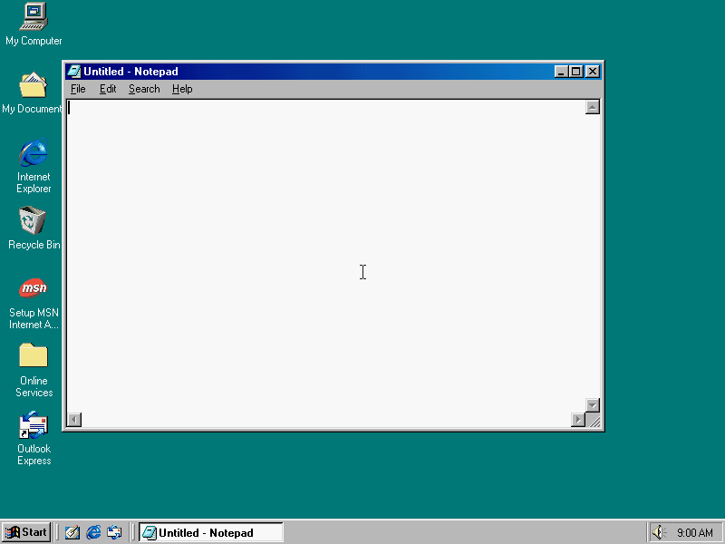
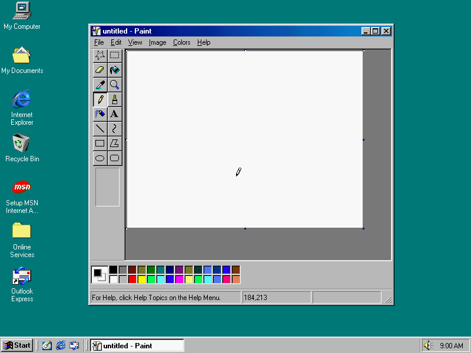

# 98artware

Script animations with a real Windows 98 desktop as the medium, in the style of
Manim. You write a Python scene, Windows draws it inside a VM, and the video is what
the guest's screen showed.




The project has two parts:

- **[Part 1: VM preparation](docs/setup/README.md).** `art98 setup` turns your own
  Windows 98 SE disc into a desktop snapshot with no input.
- **[Part 2: scenes](docs/scenes/README.md).** A Scene API, a bridge
  that can call any Win32 function in the guest, and a renderer.

[docs/README.md](docs/README.md) lists every page. [PLAN.md](docs/archive/PLAN.md), now
archived, has the original creative direction. [docs/status.md](docs/status.md) says where
the work stands and what is open.

```
Host: Python                                     Guest: Windows 98 SE in QEMU
  your Scene or script                             Explorer, Notepad, Paint...
  art98.anim, art98.Bridge -- COM1, framed text -> AGENT.EXE: Win32 call proxy
  art98.VM ---------------- QMP: asks for frames -> QEMU, which writes each frame
  ffmpeg <---------------------------------------- to a file the host reads
```


## Setup

```bash
sudo dnf install qemu-system-x86 qemu-img mtools 7zip ffmpeg make binutils mingw32-gcc
```

```bash
make -C windows_handlers
```

```bash
uv run art98 doctor
```

## Part 1: prepare the image

You need your own Windows 98 SE disc image and product key. Nothing here supplies
them. Running `art98 setup` accepts the Windows 98 licence agreement on your behalf: the
answer file asks to skip it, and OEM discs that show it anyway get "I accept"
selected by keystroke.

Pass the key through the environment, so it stays out of your shell history:

```bash
read -rs ART98_PRODUCT_KEY && export ART98_PRODUCT_KEY
```

```bash
uv run art98 setup --iso /path/to/win98se.iso
```

Add `--watch` to see the screen. Progress is saved after each step, so rerunning
resumes, and `--from STAGE` repeats a stage and everything after it.

| Stage | What happens |
|-------|--------------|
| `media` | Checks the agent can load on 98, unpacks `WIN98`, pulls the boot floppy from the disc and points it at Setup |
| `disk` | Makes a raw disk with a boot record and FAT32, copies in the setup files, answer file and agent |
| `install` | Runs Setup until the agent says hello, starting a new VM each time Setup reboots, then forces a reboot that ends QEMU. Answers the OEM first-boot wizard and the logon prompt by watching the screen. Screenshots go to `work/shots/` |
| `patch` | Edits `MSDOS.SYS` offline and converts the disk to qcow2 |
| `harden` | Over the bridge: applies registry settings, clears the Run keys except the agent and the tray, sets 800x600x16, reboots, checks the desktop is clean, saves snapshot `ready` |

The result is `work/golden.qcow2` and `work/image.json`.

**Keep `work/` private.** The finished image holds your product key in clear text,
so never publish `golden.qcow2` or a copy of it. `work/` is gitignored for that
reason. See [the key on the image](docs/setup/image.md#your-product-key-is-on-the-image).

## Part 2: animate it

A scene describes what happens, and `art98 render` turns it into a video:

**Parked.** Notepad, Paint, Minesweeper, Screensaver and Dialog still work, but
`from art98.anim import *` leaves them out until each program returns as its own action
class. Samples that use them import them from `art98.anim.apps`. The MVP's one window is
[`Picture`](docs/scenes/scene-api.md#picture).
The MVP's own scene is [artware_experiments/set_state/mvp.py](artware_experiments/set_state/mvp.py):

```bash
uv run art98 render artware_experiments/set_state/mvp.py -o mvp.mp4
```

A scene with a parked program:

```python
from art98.anim import *
from art98.anim.apps import Notepad


class Hello(Scene):
    def construct(self):
        pad = Notepad()
        self.add(pad)
        self.pause(0.5)
        self.play(TypeWithCursor(pad, "hello from 1998"))
        self.wait(1)
        self.play(pad.animate.shift(280 * RIGHT + 120 * DOWN), run_time=2)
        self.pause(1)
        self.play(Close(pad))
        self.pause(1)
```

```bash
uv run art98 render artware_experiments/hello.py Hello -o hello.mp4
```

`-o` also takes `.gif`. Each render runs on a private copy of the image, so renders
can't touch `golden.qcow2`, and several can run side by side.

Every frame waits for the guest to repaint before it is captured, so a video comes
out the same on a slow host as on a fast one. The exception is anything that moves
by itself, such as a screensaver. `live(seconds)` follows the host's clock and skips
the sync, so that stretch does depend on host speed. Its `stop_condition` ends it
early.

Start with the [tutorial](docs/scenes/tutorial.md). The
[gallery](docs/scenes/gallery.md) has one scene per feature, and
[artware_experiments/showcase.py](artware_experiments/showcase.py) draws in Paint with the mouse, clears a
Minesweeper board and runs 3D Pipes.

### The raw bridge

Below the scene layer, any exported Win32 function from any DLL is one call away:

```python
from art98 import Out, boot

with boot("work") as stage:
    guest = stage.bridge
    guest.spawn("notepad.exe")
    notepad = guest.find_window(class_name="Notepad")

    guest.user32.SetWindowPos(notepad.hwnd, 0, 100, 80, 400, 300, 0x14)
    guest.user32.SetCursorPos(200, 200)
    rect = guest.user32.GetWindowRect(notepad.hwnd, Out(16)).buffers[0]

    # Anything that blocks goes on its own guest thread.
    dialog = guest.acall("user32", "MessageBoxA", 0, "hello", "98", 0)

    stage.vm.screenshot("frame.png")
```

Every `boot()` restores the same snapshot, so nothing carries over between runs. In
a scene the same object is `self.guest`. See the [bridge](docs/scenes/bridge.md),
the [instruction set](docs/scenes/instruction-set.md) and the
[Win32 recipes](docs/scenes/win32-recipes.md).

A guest reboot ends the VM, because Windows freezes on its logo after a warm reset
in the same QEMU process. Start a new one with `boot()` afterwards. `ExitWindowsEx`
never replies, so call it with `acall`.

## Tests

```bash
uv run --group dev pytest
```

| Suite | Runs against |
|-------|--------------|
| `test_protocol`, `test_bridge`, `test_setup` | Python alone, with mtools for the disk tests |
| `test_anim`, `test_anim_docs` | The scene layer on a fake guest, and the documented API |
| `test_qemu` | Real QEMU with no Windows: boot chain, QMP, snapshots |
| `test_agent_wine` | The real `agent.exe` under Wine, with a pty as COM1 |

The QEMU and Wine suites skip themselves if those tools are missing. They can't
stand in for real Windows 98, so the findings from real runs are below.

## Measured on real Windows 98

From a Windows 98 SE OEM disc, on QEMU 10.2.2 with software emulation:

| What | Result |
|------|--------|
| Full `art98 setup`, blank disk to snapshot, no input | About 40 min |
| Snapshot restore to a working agent | About 1 s |
| `PING` round trip | About 5 ms |
| `SYNC` plus one frame capture | About 6.5 ms |
| `put_file` | 100 to 190 KB/s |
| `get_file` | About 325 KB/s |
| `artware_experiments/hello.py`, 211 frames | About 3 s |
| `artware_experiments/showcase.py`, 1858 frames, 62 s of video | About 42 s |
| 3D Pipes under TCG, launched with `/s` | About 37 new frames per second |
| Guest clock against host | 5004 ms over 5 s |
| Screenshots | Include the mouse pointer |
| Installed extras | Games, Character Map, 12 screensavers, sound schemes. Screensavers have long names, such as `3D Pipes.scr`, and 11 of the 12 are in `C:\WINDOWS\SYSTEM` |

The serial port is emulated and QEMU does not pace it to 115200 baud, so files move
well above the line rate. Setup quirks that `art98 setup` handles are in
[troubleshooting](docs/setup/troubleshooting.md).

## Deferred

Audio. art98 is video only for now, though the VM keeps its Sound Blaster.

## Not yet proven on Windows 98

- The Wine suite against the final agent. It needs a Wine prefix on this machine.
