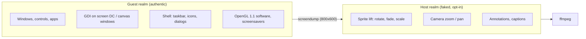
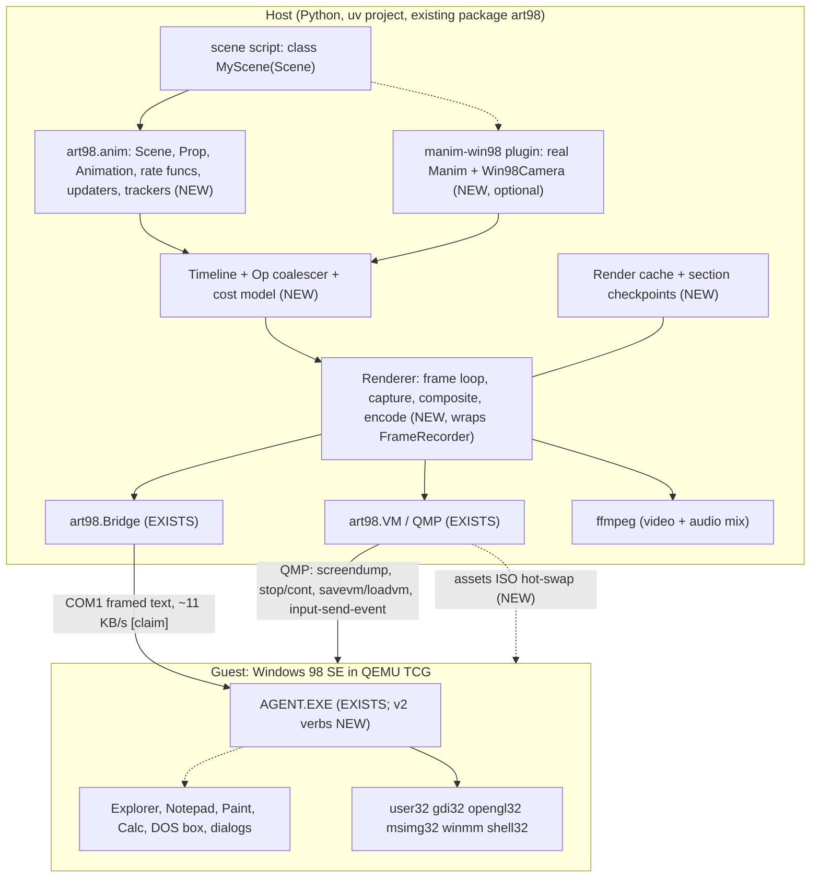
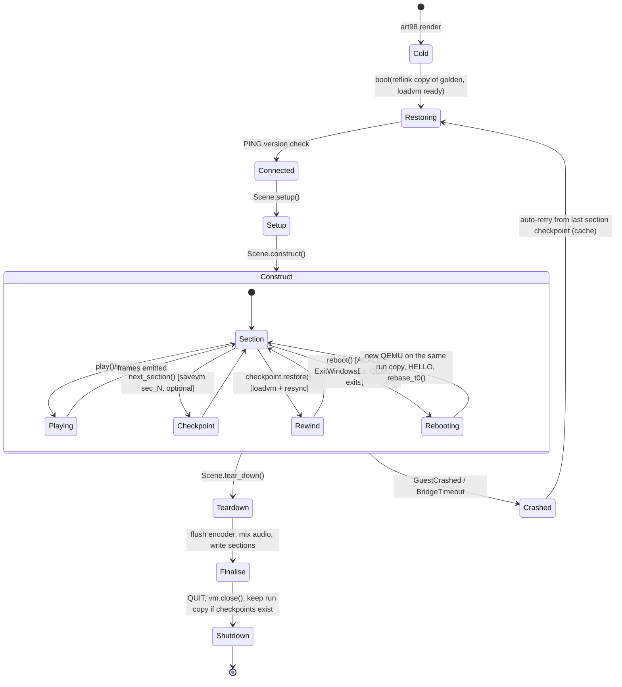
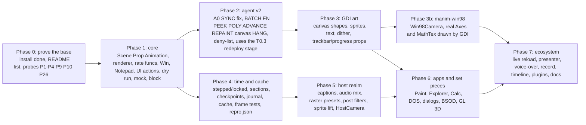

# art98 as "Manim for Windows 98": design plan

Status: design, revised 2026-11-06. A first slice of this library is built, in `src/art98/anim/`, and [its docs](actions/README.md) say what exists. The rest is still design. The final Windows 98 image is built with no manual steps and
`examples/hello.py` renders on it, so section 2.7 records what the real image has settled. Every other Windows 98 claim stays an assumption until its probe runs.


## Summary

**The idea.** Manim animates vector objects. art98 animates a real, running Windows 98 desktop inside
QEMU. A script on the host drives the guest over a serial link, one frame at a time, and each video
frame is a capture of what Windows actually drew. A window is the Mobject, `SetWindowPos` is the
`shift`, and a real caret typing into real Notepad is `TypeWithCursor`.

**The map at a glance.** Section 4 maps every Manim class and the methods scenes call; any other getter or internal is host-only. These rows are the core of it.
Grades: N native, A approximate, F faked on the host, X impossible, H host-only (section 0).

| Manim idea | Windows 98 action | Grade |
|------------|-------------------|-------|
| `Scene` | a VM run restored from the `ready` snapshot | N |
| `Mobject` | a host-side handle on a window, control, icon or canvas shape; the target sets the grade of what it does | H |
| `shift`, `MoveAlongPath` | `SetWindowPos` along a host-computed path, with a `RedrawWindow` per move to clear stale pixels | N |
| `TypeWithCursor` | `WM_CHAR` into Notepad, with the real caret | N |
| `Write` | the same typing on an Edit control, a glyph reveal on a canvas; Manim's `Write` is simulated hand-drawing | A |
| `ChangingDecimal` | Calculator digits pressed with `BM_CLICK`: one clear, then one click per digit | A |
| `Restore` | host interpolation back to the saved state. `vm=True` is a separate instant cut with `loadvm` that undoes anything, including app state | H |
| `Click`, `Drag`, `Scroll`, `Menu` (art98 additions) | real pointer and keyboard input on real controls | N |
| `Circle`, `Axes`, `Create` | GDI on a canvas window: hard-edged, integer pixels | A |
| `FadeIn`, `FadeOut` | 8x8 ordered dither (or palette fade at 8-bit, or host blend) | A/F |
| `Tex`, `MathTex` | host TeX to outlines, `PolyBezier` paths in the guest | A |
| `ThreeDScene` | OpenGL 1.1 software, display lists | A |
| Rotating a window | no honest equivalent: orbit, squash flip, or host sprite lift | X |

**Biggest decisions.**

| # | Decision | Why | Section |
|---|----------|-----|---------|
| D1 | Three ways in: native `art98.anim` for windows and apps, a `manim-win98` plugin for maths, and the raw bridge always reachable | Windows are not vectors, but `Axes`, `MathTex` and `Graph` should not be rewritten | 3.1, 6.8 |
| D2 | The Mobject is a handle, not geometry | Interpolate on the host, push property writes to the guest | 1 |
| D3 | `strict` means no host compositing of guest pixels; captions and audio are labelled exceptions | The user always knows what Win98 drew | 1 |
| D4 | Default clock is `stepped` from Phase 4 (`free` until then), with guest-time debt accounting | Carets blink and clocks tick at video speed, without guest time running away | 3.4 |
| D5 | Default draw back-end is an agent-owned canvas window; `screen` DC is for short overlays only | Persistent, z-ordered, cheap to erase | 4.3 |
| D6 | Each run gets a reflink copy of golden | Overlays and `-snapshot` fail on internal snapshots (verified) | 3.3 |
| D7 | Commands go over serial, bulk goes on an ISO, moving vector data gets a compact `POLY` verb | Serial is a command channel, not a video bus | 3.5, 8 |
| D8 | Agent v2 reaches `ready` through an `agent` prep stage | Otherwise every agent change is a 40-minute reinstall | 8.3 |
| D9 | Nothing about Win98 is trusted until a probe says so: 28 probes, the blocking ones first | The base now works (2.7), but most guest claims are still assumptions | 10.1 |
| D10 | Native scenes work in pixels, y down; Manim units exist only in `manim-win98`. A scene picks one base class, and `-qh` means a 2x upscale, not 1080p | Windows are pixel things, and silently rescaling would round every move. It does mean `shift(RIGHT)` moves one pixel natively | 6.1, 11.2 |
| D11 | A guest reboot ends the QEMU process, so a scene that restarts Windows carries on in a new process on the same run copy | Warm reboots freeze in the BIOS, and only a new process clears it (measured) | 3.3 |
| D12 | A window move is two calls: `SetWindowPos`, then a `RedrawWindow` that clears stale pixels | Moves leave stale pixels on the frame, and no `SWP_` flag stops it (measured) | 3.6, 6.2 |

**A scene looks like this** (6.3):

```python
class Hello(Scene):
    def construct(self):
        pad = Notepad(at=(120, 80))
        self.add(pad)
        self.play(TypeWithCursor(pad, "hello from 1998"), run_time=2)
        self.play(pad.animate.shift(280 * RIGHT + 120 * DOWN), run_time=2)
```

**What you need.** Your own Windows 98 SE disc image and product key, a Linux host with QEMU, ffmpeg and mtools, and for `manim-win98` a working Manim and TeX. Nothing Microsoft ships is bundled.

**Words used here.** `ready`: the saved VM snapshot of a clean desktop. Golden: the prepared disk image that holds `ready`. Agent: the small Win32 program in the guest that makes calls for the host. `strict`: a scene mode that forbids host compositing of guest pixels. Canvas: an agent-owned window that GDI draws into. `POLY`: a planned agent verb that sends point lists compactly.

**Reading on.** Sections 1 to 3 are the design, section 4 is the full mapping, section 5 is what cannot
map, sections 6 to 8 are the implementation, section 9 is features, section 10 the roadmap, and section 11
the decisions, including the seven the owner made.

## 0. How to read this

Evidence tags used throughout:

| Tag | Meaning |
|-----|---------|
| **[V:doc]** | Verified against the Manim Community docs fetched on 2026-11-06 (URL given) |
| **[V:src]** | Verified by reading a file in this repo (path given) |
| **[V:ext]** | Verified against a named outside source fetched on 2026-11-06: 3b1b/manim source, QEMU source, Microsoft documentation, or a plugin's own docs |
| **[V:vm]** | Measured on the real Windows 98 SE image in the VM (section 2.7) |
| **[A]** | Assumption about Windows 98 / QEMU behaviour. Unproven. Most carry a probe id (P1..P28, section 10.1) that settles it |
| **[reviewer-cited]** | A claim taken from the first review (`docs/MANIM_MAPPING_REVIEW.md`) and not checked again here |

Mapping grades:

| Grade | Meaning |
|-------|---------|
| **N** native | The guest OS does the same thing with its own machinery; pixels in the video are what Win98 drew. A different widget standing in for a Manim object (a trackbar for a `NumberLine`) is **A**, not N |
| **A** approximate | Guest-drawn, but a coarser or different thing than Manim does (no AA, snapped sizes, dither instead of alpha) |
| **F** faked | Done on the host after capture (compositing, sprite transforms). Pixels are Win98's, the motion or blend is not |
| **X** impossible | No honest equivalent. A substitute is named |
| **H** host-only | Pure host bookkeeping (scheduling, state, files, encoding). No claim about Windows 98 at all |
| **N~A, A/F** | Combined grade: first value in the common case, second in the edge case or on the other back-end |

Every table row states the grade, the stand-in, and the Win32 calls or messages. "Calls" means
the generic `CALL` verb of the existing bridge unless a new agent verb is named.

---

## 1. Premise: what this medium is for

Manim animates abstract objects that exist only as vector data, so anything can be
interpolated into anything. art98 animates **a running operating system**. The objects
are real Win32 windows with real behaviour: menus, a text caret, a scrollbar that
really scrolls, a dialog that really blocks. That changes the design in three ways.

1. **The Mobject is a handle, not geometry.** A `Prop` is a host-side proxy for a guest
   thing (an `HWND`, a file on the desktop, a region of the screen DC). Interpolation
   happens on the host, on virtual time, and the result is pushed as property writes.
   This is already the shape of the bridge ([V:src] `PLAN.md` status note: "All timing lives on the host").
2. **Two realms, and the user always knows which one they are in.**



   **`strict` is defined as: no host compositing of guest pixels.** Sprite lift, exposure
   blends, host camera zoom/rotate, host-drawn annotations and the host `Overlay` layer all
   raise. Two **labelled exceptions** are allowed and each can be switched off: `captions` (burned or soft
   subtitles) and `audio` (host-mixed SFX). `repro.json` records which exceptions a film used.

   The pointer needs no exception. It appears in `screendump` on the real image [V:vm], so a strict film can claim that every video pixel
   other than captions was drawn by Windows 98. QEMU's `cirrus_cursor_draw_line` composites it, and its comment says a changed cursor
   bitmap shows only after the next move [V:ext], so P3 still measures that lag. Outside strict, host operations are allowed and are listed in the output metadata.
3. **Failures are material.** Smear trails behind dragged windows, the dither of 16-bit
   colour, bitmap fonts that only exist at fixed sizes, `Fatal Exception 0E`. These are
   features, not defects. A good half of the "ready-made scenes" in section 9 are such.

**What the medium is bad at, said plainly:** smooth vector morphing, anti-aliasing,
alpha, rotation, resolution independence, 3D beyond what software OpenGL 1.1 gives,
LaTeX, and bulk pixel transfer into the guest (the link is a command channel, not a
video bus). Section 5 lists each with its substitute.

---

## 2. Verified inputs

### 2.1 What exists in the repo [V:src]

| Piece | Fact | File |
|-------|------|------|
| Transport | COM1, line frames `<payload> *<crc16>\n`, protocol version 1 | `src/art98/protocol.py`, `guest/agent.c` |
| Args | int, `"str"`, `#hex` in/out buffer, `&n` zeroed out buffer; max 16 args, 8 KB per buffer, 16 KB per line (hex doubles a buffer, so a `#` argument tops out just under 8 KB). The DLL and function names use 2 of the 16, so a function gets **14 dwords at most** (`CreateFontA` just fits). Return values are one dword, so nothing that returns a float works through `CALL` | `guest/agent.c` (`MAX_ARGS`, `MAX_BLOB`, `MAX_LINE`) |
| Verbs | `PING CALL ACALL WINDOWS PROCS SPAWN SYNC PUT GET QUIT`. `SYNC` already returns `GetTickCount` | `guest/agent.c` `handle_line`, `verb_sync` |
| `CALL` | Runs on the agent's UI thread; `LoadLibraryA` + `GetProcAddress` on every call; pushes args and restores ESP so cdecl works | `agent.c` `perform_call`, `invoke` |
| `ACALL` | Same, on a new thread; completion arrives as event `! DONE id value last_error buffers...` | `agent.c` `async_call_thread`, `bridge.py` `_handle_event` |
| `SYNC` | `RedrawWindow(UPDATENOW\|ALLCHILDREN)` plus `SendMessageTimeout(WM_NULL)` on each visible top-level window, then `GdiFlush`. Repaint guarantee on 9x is explicitly unproven | `agent.c` `verb_sync`, `README.md` |
| Crash | Unhandled exception filter reports `! CRASH` and respawns the agent | `agent.c` `on_crash` |
| Host API | `Bridge.call/acall/windows/find_window/spawn/sync/put_file/get_file/set_display_mode`, `bridge.user32.X(...)` sugar, `CallResult.buffers` | `bridge.py` |
| Frames | `FrameRecorder.frame(hold)` = `sync()` + QMP `screendump` (ppm) + write to an `ffmpeg image2pipe` libx264 process | `session.py` |
| VM | `qemu-system-i386`, TCG, `-no-reboot` (3.3), `pentium3`, 128 MB, cirrus, SB16 (`-audiodev wav` optional), `-rtc base=1998-06-25T09:00:00,clock=vm`, no NIC, `acpi=off`, optional `-icount shift=N,sleep=off,align=off`, `-loadvm ready` | `qemu.py` |
| Snapshot | `ready` is an internal qcow2 snapshot saved inside `golden.qcow2` while the VM is paused. `boot()` loads it directly from the golden file each time | `prep.py` `stage_harden`, `session.py` |
| Agent deployment | `agent.exe` is copied onto the disk **only** in `stage_disk` (`prep.py:474`); `stage_harden` never copies it and ends with `self.raw.unlink`. The agent running inside `ready` is whatever was built at `disk` time | `prep.py` |
| Hardened registry | no screen saver, `DragFullWindows=1`, `FontSmoothing=0`, `MenuShowDelay=0`, `SmoothScroll` off, `MinAnimate=0`, no wallpaper, "No Sounds" scheme, no Tips | `prep.py` `HARDEN_SETTINGS` |
| Desktop gate | `verify_desktop` rejects any visible titled window other than `Program Manager`, and requires a `Shell_TrayWnd` to exist | `prep.py` `verify_desktop` |
| PE gate | `check_agent` allows only listed imports and subsystem <= 4.10 | `src/art98/pecheck.py` |
| Throughput | "about 11 KB/s", `put_file` about 3 KB/s. Latency is measured (2.7), bulk transfer is not | `README.md` |
| Not proven | audio capture and playback in a scene, bulk serial, frame capture under load. The rest of the README's list is now measured (2.7) | 2.7 |
| Setup prompts | This OEM disc ignores the answer file's request to skip its first-boot wizard, so `prep` answers the wizard and the logon prompt by watching the screen. Licence acceptance is automated with the owner's approval. The blank logon password means the prompt does not return on later boots | `prep.py` `setup_wizard_showing`, `logon_prompt_showing` |

Observed on the live install (2026-11-06, not repo facts): the Win98 CD boot floppy contains `JO.SYS`, a
startup menu that defaults to the hard disk, and `patch_floppy` now removes it. Unattended Setup then ran with
no prompts **through the file copy** and stopped at the four-page OEM first-boot wizard (Name, EULA, Product
Key, Finish), with the key pre-filled from MSBATCH. `prep.py` now answers that wizard (`_answer_setup_wizard` [V:src]), and the install was still running when
this revision was written. The desktop has not been confirmed, so every statement here about the post-install desktop remains an assumption.

Three observations that shape the plan:

- `FrameRecorder.frame()` never pauses the VM, so guest time (caret blink, clock,
  tooltips, any guest-timed animation) still advances with host wall time. Frames are
  host-deterministic only for host-driven changes. Section 3.4 fixes this.
- The first real consequence of `FontSmoothing=0`: all text will be unsmoothed, which
  is right for the look but matters for the `Text` mapping.
- The install now uses `InstallType=1` with `OptionalComponents=1` and an `[OptionalComponents]` section built from `OPTIONAL_COMPONENTS` (`prep.py` [V:src]). Setup honoured it on this disc, even though the Resource Kit ties that key to
  `InstallType=3` [V:ext]. What it installed is in 2.7. Setup ignores names it does not know, so a component that prep requests can still be missing, as Desktop Themes is.

### 2.2 Manim Community surface (v0.22.1 is the current docs) [V:doc]

Sources: <https://docs.manim.community/en/stable/reference.html>,
<https://docs.manim.community/en/stable/reference_index/animations.html>,
<https://docs.manim.community/en/stable/reference_index/mobjects.html>,
<https://docs.manim.community/en/stable/reference_index/scenes.html>,
<https://docs.manim.community/en/stable/reference/manim.scene.scene.Scene.html>,
<https://docs.manim.community/en/stable/reference/manim.utils.rate_functions.html>,
<https://docs.manim.community/en/stable/guides/configuration.html>,
<https://docs.manim.community/en/stable/guides/deep_dive.html>.

- **Scenes:** `Scene`, `MovingCameraScene`, `ZoomedScene`, `ThreeDScene`, `SpecialThreeDScene`,
  `VectorScene`, `LinearTransformationScene`. Modules `manim.scene.{scene, section,
  scene_file_writer, three_d_scene, moving_camera_scene, zoomed_scene, vector_space_scene}`
  and a new `manim.manager` that runs `setup() / construct() / tear_down() / post_construct()`.
- **Scene methods:** `construct`, `setup`, `tear_down`, `play(*args, subcaption=None,
  subcaption_duration=None, subcaption_offset=0, **kwargs)`, `wait`, `pause`, `add`, `remove`,
  `clear`, `replace`, `bring_to_front`, `bring_to_back`, `add_foreground_mobject(s)`,
  `remove_foreground_mobject(s)`, `next_section`, `add_sound`, `add_subcaption`,
  `add_updater`, `remove_updater`, `get_top_level_mobjects`, `get_mobject_family_members`,
  `get_run_time`, `embed`, `interactive_embed`, `interact`, `set_key_function`, `update_to_time`, the `time`
  property, `on_key_press`, `on_key_release`, `on_mouse_drag`, `on_mouse_motion`, `on_mouse_press`, `on_mouse_scroll`,
  `mouse_drag_orbit_controls`, `mouse_scroll_orbit_controls`.
- **Signatures that matter:** `Scene(renderer=None, camera_class=Camera, always_update_mobjects=False, random_seed=None,
  skip_animations=False)`; `wait(duration=1.0, stop_condition=None, frozen_frame=None)`; `wait_until(stop_condition,
  max_time=60)`; `pause(duration=1.0)`, which is `wait` with `frozen_frame=True`; `add_sound(sound_file, time_offset=0,
  gain=None, **kwargs)`; `add_subcaption(content, duration=1, offset=0)`; `next_section(name='unnamed',
  section_type=DefaultSectionType.NORMAL, skip_animations=False)`.
- **Mobject and VMobject methods:** mapped by family in 4.2b.
- **Animation classes:**
  - animation: `Animation`, `Add`, `Wait`
  - creation: `Create`, `Uncreate`, `DrawBorderThenFill`, `Write`, `Unwrite`, `AddTextLetterByLetter`, `AddTextWordByWord`, `RemoveTextLetterByLetter`, `TypeWithCursor`, `UntypeWithCursor`, `ShowIncreasingSubsets`, `ShowSubmobjectsOneByOne`, `ShowPartial`, `SpiralIn`
  - fading: `FadeIn`, `FadeOut`
  - growing: `GrowFromCenter`, `GrowFromEdge`, `GrowFromPoint`, `GrowArrow`, `SpinInFromNothing`
  - transform: `Transform`, `ReplacementTransform`, `TransformFromCopy`, `ClockwiseTransform`, `CounterclockwiseTransform`, `MoveToTarget`, `ApplyMethod`, `ApplyFunction`, `ApplyMatrix`, `ApplyComplexFunction`, `ApplyPointwiseFunction`, `ApplyPointwiseFunctionToCenter`, `FadeToColor`, `FadeTransform`, `FadeTransformPieces`, `ScaleInPlace`, `ShrinkToCenter`, `Restore`, `Swap`, `CyclicReplace`, `TransformAnimations`
  - matching: `TransformMatchingShapes`, `TransformMatchingTex`
  - movement: `Homotopy`, `ComplexHomotopy`, `SmoothedVectorizedHomotopy`, `PhaseFlow`, `MoveAlongPath`
  - rotation: `Rotate`, `Rotating`
  - indication: `Indicate`, `Flash`, `FocusOn`, `Circumscribe`, `Blink`, `Wiggle`, `ApplyWave`, `ShowPassingFlash`, `ShowPassingFlashWithThinningStrokeWidth`
  - composition: `AnimationGroup`, `LaggedStart`, `LaggedStartMap`, `Succession`
  - changing: `TracedPath`, `AnimatedBoundary`; numbers: `ChangingDecimal`, `ChangeDecimalToValue`; specialized: `Broadcast`; speed: `ChangeSpeed`; updaters: `UpdateFromFunc`, `UpdateFromAlphaFunc`, `MaintainPositionRelativeTo`
- **Mobjects:** `Mobject`, `Group`, `VMobject`, `VGroup`, `VDict`, `VectorizedPoint`, `DashedVMobject`, `CurvesAsSubmobjects`;
  point clouds `PMobject`, `Point`, `PointCloudDot`; images `ImageMobject`, `ImageMobjectFromCamera`; `SVGMobject`, `Brace*`;
  frame `ScreenRectangle`, `FullScreenRectangle`; logo `ManimBanner`.
  - geometry: `Circle Dot AnnotationDot LabeledDot Arc ArcBetweenPoints CurvedArrow CurvedDoubleArrow Ellipse Annulus AnnularSector Sector TangentialArc CubicBezier ArcPolygon Line DashedLine TangentLine Arrow DoubleArrow Vector Elbow Angle RightAngle Polygon Polygram RegularPolygon RegularPolygram Rectangle Square RoundedRectangle Triangle Star ConvexHull Cutout SurroundingRectangle BackgroundRectangle Cross Underline Union Intersection Difference Exclusion Label LabeledLine LabeledArrow LabeledPolygram` and the arrow-tip family.
  - text: `Text MarkupText Paragraph Tex MathTex Title BulletedList Code DecimalNumber Integer Variable Typst MathTypst`
  - graphing: `Axes NumberPlane PolarPlane ComplexPlane ThreeDAxes CoordinateSystem NumberLine UnitInterval FunctionGraph ParametricFunction ImplicitFunction BarChart SampleSpace LinearBase LogBase`; `Graph DiGraph GenericGraph`
  - tables: `Table MathTable MobjectTable IntegerTable DecimalTable`; matrices `Matrix IntegerMatrix DecimalMatrix MobjectMatrix`
  - 3D: `Sphere Cube Cylinder Cone Torus Prism Surface Line3D Arrow3D Dot3D` and polyhedra `Tetrahedron Octahedron Icosahedron Dodecahedron Polyhedron ConvexHull3D`
  - other: `ValueTracker ComplexValueTracker`, `VectorField ArrowVectorField StreamLines`
- **Cameras:** `Camera`, `MovingCamera`, `MultiCamera`, `MappingCamera`, `ThreeDCamera`.
- **Rate functions (49):** `linear smooth smoothstep smootherstep smoothererstep rush_into rush_from slow_into double_smooth there_and_back there_and_back_with_pause running_start not_quite_there wiggle squish_rate_func lingering exponential_decay unit_interval zero` and `ease_{in,out,in_out}_{sine,quad,cubic,quart,quint,expo,circ,back,elastic,bounce}`.
- **CLI / config:** quality `-ql 854x480@15`, `-qm 1280x720@30`, `-qh 1920x1080@60`, `-qp 2560x1440@60`, `-qk 3840x2160@60`. The full `manim render` flag list is mapped in 4.13. Config precedence: library cfg < user cfg < folder `manim.cfg` or `--config_file` < CLI < programmatic `config`. Subcommands under `manim.cli`: `cfg`, `checkhealth`, `init`, `plugins`, `render`.
- **Utility modules:** `manim.utils.{bezier, color, commands, config_ops, debug, hashing, images, ipython_magic, iterables, paths, rate_functions, simple_functions, sounds, space_ops, testing, tex, tex_file_writing, tex_templates}`, `manim.typing`, `manim.data_structures`, `manim.constants`. Mapped in 4.14.
- **Pipeline:** `Scene.render` -> `Manager.render` ("Coordinate the render lifecycle for a single scene") -> `setup`, `construct`, `tear_down`, `post_construct`. `CairoRenderer.play` compiles the animations, hashes the call (`get_hash_from_play_call`, `is_already_cached`), saves a static image of everything that will not move, then steps the timeline frame by frame. Each frame is `update_frame` (restore background, `camera.capture_mobjects`), `get_frame` (a copy of `camera.pixel_array`) and `add_frame` (`file_writer.write_frame`). Partial movie files are sealed per animation and concatenated at the end. See 2.6 for why these hooks matter.

### 2.3 ManimGL: what to borrow [V:ext]

Source: the `manimlib` source of 3b1b/manim, fetched 2026-11-06. ManimGL has no `MovingCameraScene`, `ZoomedScene`
or `ThreeDScene`, because every scene has a movable camera frame.

| ManimGL | What it does | art98 adoption |
|---------|--------------|----------------|
| `ShowCreation`, `TexText` | names for `Create` and text-mode `Tex` | `ShowCreation = Create` alias in `art98.anim`; `TexText` follows `Tex` (5) |
| `self.frame` (`CameraFrame`, a Mobject; `set_euler_angles`, `increment_theta`) | the camera is an ordinary animatable object | `self.frame.animate...` is the primary camera API (4.7) |
| `self.embed()`, `-e/--embed` (`InteractiveSceneEmbed`) | an IPython shell against the live scene, with `play`, `wait`, `add`, `remove`, `clear`, `save_state`, `undo`, `redo` | `art98 live`: the shell holds a running VM (6.6) |
| `checkpoint_paste` | run clipboard code; its leading `#` comment is the key; a new key saves scene state, a known key restores it and drops later keys | the same rule over `savevm`/`loadvm`: the strongest idea to take, because a VM checkpoint restores app state too (6.6) |
| `reload` | re-run the script with the window kept, after a syntax check | `art98 live` reload |
| `-p/--presenter_mode` | pause on each `wait` until space or right arrow | present live on the running VM (feature 19) |
| `copy_frame_positioning`, `copy_cursor_position` (`InteractiveScene`, shift+d and shift+c) | copy current layout as code | `art98 block`: arrange windows by hand, get `at=` code (feature 4) |
| `--prerun` | run once first to measure the duration | `art98 dry` already gives this |
| `--subdivide`, `-i/--gif`, `-n/--start_at_animation_number`, `--autoreload`, `--clear-cache` | one file per animation, GIF, start late, reload modules, wipe cache | map to `--save_sections`, `--format gif`, `-n`, `art98 live`, `art98 cache clear` |
| GLSL shaders | per-pixel effects | no guest equivalent; the host post filters are the labelled substitute (feature 10) |

### 2.4 Manim plugin mechanism [V:doc]

Plugins register in `pyproject.toml` under `[project.entry-points."manim.plugins"]` as `"name" = "object_reference"`.
`manim plugins -l` lists them. A plugin is enabled in `manim.cfg` with `[CLI] plugins = module_name, other`, using the
module name, not the PyPI name. art98 mirrors this with the group `art98.plugins`, and `manim-win98` (6.8) is a
Manim plugin in the `manim.plugins` group.

### 2.5 Ecosystem [V:ext]

| Project | API that matters | art98 use |
|---------|------------------|-----------|
| manim-slides | `Slide(Scene)`, `ThreeDSlide`, `next_slide(loop=False, auto_next=False, playback_rate=1.0, reversed_playback_rate=1.0, notes='', skip_animations=False, ...)`, `canvas`, `add_to_canvas`, `wipe`, `zoom`, `start_skip_animations`, `stop_skip_animations`; `manim-slides convert` to HTML, `manim-slides present` | works on top of `manim-win98`; native scenes get the same `next_slide` surface (feature 19) |
| manim-voiceover | `VoiceoverScene`, `set_speech_service`, `with self.voiceover(text=...) as tracker`, `tracker.duration`, `get_remaining_duration()`, `time_until_bookmark()`, `wait_until_bookmark()`, `<bookmark mark='A'/>`, services such as `RecorderService`, `GTTSService`, `AzureService`, `OpenAIService`, `CoquiService` | works on top of `manim-win98`; a native `VoiceoverScene` mixes through the audio track (feature 20) |
| Plugin index | names seen: chanim, manim-ds, manim-dsa, manim-editor, manim-eng, manim-extras | these draw ordinary VMobjects, so they should render through `manim-win98` unchanged [A]; domain packs (feature 27) are the native answer |

### 2.6 Manim's render hooks [V:doc]

These are why the plugin is cheap. `Scene` takes `camera_class`, and `Camera` exposes `capture_mobjects(mobjects, **kwargs)`,
`capture_mobject`, `get_image`, `reset`, `set_pixel_array`, `get_mobjects_to_display`, `display_multiple_vectorized_mobjects`,
`display_multiple_image_mobjects`, `display_multiple_point_cloud_mobjects` and `set_frame_to_background`. `CairoRenderer`
calls these once per frame and only ever reads `camera.pixel_array`. So a subclass that draws through the bridge and then sets
`pixel_array` from a `screendump` leaves the rest of Manim alone: rate functions, `Axes`, `MathTex`, sections, caching and sound all
keep working.

### 2.7 Measured on the real image [V:vm]

Measured on Windows 98 SE in the VM on 2026-11-06, by the install session. These replace the assumptions they name.

| Measured | Result | What it changes |
|----------|--------|-----------------|
| Agent | Starts by itself; `PING` round trip about 5 ms; `GetVersion` 0xc0000a04 | Requests do not wait a 55 ms tick, so the read path is not the bottleneck (3.4) |
| Restore | `ready` to a working agent in about 1 s, in a new process | Starting a scene is cheap. Mid-run `loadvm` is still unmeasured (P21) |
| Capture | `SYNC` plus QMP ppm capture about 6.5 ms per frame at 800x600, on an idle desktop | Capture is not the bottleneck, as long as it holds under load (3.5, P4) |
| A move | `SetWindowPos` plus `SYNC` about 14 ms | Matches the estimate of about 7 ms per `CALL` (3.5) |
| `hello.py` | 210 output frames in under 3 s. Those are 79 captures and 131 held copies (`frame(hold=N)`), so at most about 38 ms per capture | Holds are nearly free, and distinct frames are the real cost (3.5) |
| Guest clock | `GetTickCount` advanced 5004 ms over 5 s of host time | A running guest keeps real time, which debt accounting needs (3.4). This is 5 s without a `stop`, not P11. The figure is not a multiple of 55 ms, a hint and no more that the tick is finer |
| Display | 800x600x16 confirmed with `GetDeviceCaps` | The 11.2 output default works. Other modes remain P18 |
| Pointer | The mouse pointer appears in `screendump` output | No cursor overlay and no `cursor` exception to `strict` (section 1). Shape lag remains P3 |
| Sound | `SB16 Wave Out [220]` detected: 1 `waveOut` and 1 `midiOut` device | The device exists. Nothing has been played or captured (P28), and the `midiOut` device may not be a synth (4.11) |
| Exports | `msimg32` exports `AlphaBlend`, `opengl32` exports `glBegin`, `SetWindowRgn` exists | Presence only: none has been called (P5, P6, P17) |
| `AngleArc` | Exported by `gdi32` | Proves only the stub, so it stays on the deny-list until called (8.5) |
| Warm reboot | Freezes: `IO.SYS` spins on the BIOS tick at 0040:046C with IRQ0 pending but never taken. QMP `system_reset` does not clear it; a new QEMU process does | `VMConfig` always passes `-no-reboot`, so a guest reboot ends the VM (3.3) |
| `ExitWindowsEx` | Never replies | Must go through `ACALL`, and never inside a `BATCH` (8.5) |
| Clean install | `art98 prep` went from a blank disk to a `ready` snapshot with no input, in about 40 minutes | The base is reproducible. A reinstall is now a wait, not a project (8.3) |
| Accessories | The final image has Minesweeper, Solitaire, Character Map, Paint, WordPad, Calculator, Sound Recorder, Media Player, and 77 sounds including the schemes | Those rows no longer depend on the install. On disk does not mean driven: P16 still has the class names |
| Screensavers | 11, with long names: 10 in `C:\WINDOWS\SYSTEM` and `Channel Screen Saver.SCR` in `C:\WINDOWS` | The draft's short names were wrong, and `ssmarque.scr` is not on the image (4.10). None has been launched |
| Absent | Desktop Themes did not install, though prep asks for it. The Banana animated cursor is missing. The animated cursors are `GLOBE.ANI`, `APPSTART.ANI` and `HOURGLAS.ANI` | Desktop Themes gets a stand-in (4.10). Other animated cursors need the assets ISO |
| Window moves | Leave up to 75 off-pattern pixels on the frame after 60 moves. `SWP_NOCOPYBITS` and `SWP_FRAMECHANGED` do not clear them. `RedrawWindow` with `INVALIDATE\|ERASE\|ALLCHILDREN\|UPDATENOW\|FRAME` does | A move is two calls, through `Bridge.move_window` (3.5, 3.6, 6.2) |

**Not measured yet:** audio capture and playback in a scene, bulk serial throughput, and frame capture under load.

---

## 3. Architecture

### 3.1 Layers



**Three ways in.** A scene file picks one base class. `art98.anim.Scene` works in pixels. `Win98Scene` works in Manim units and can also reach native props, named explicitly and still in pixels, through `self.stage`, and the raw bridge through `self.guest`. Both packages export `Scene` and `Create`, so a file never star-imports both.

| Layer | For | Depends on | Grade of output |
|-------|-----|------------|-----------------|
| `art98.anim` (native) | windows, apps, dialogs, icons, the desktop as a stage | nothing beyond art98 | N where the OS does it, A for canvas shapes |
| `manim-win98` (compat, the `art98[manim]` extra) | maths, graphs, `MathTex`, existing Manim scripts, manim-slides, manim-voiceover | real Manim (6.8) | A: Manim computes, GDI draws |
| `self.guest` (raw bridge) | any Win32 call the library does not wrap | exists today | whatever the call does |

New package layout (all NEW; existing modules untouched except where section 8 says):

```
src/art98/anim/
  __init__.py        # re-exports: from art98.anim import *
  scene.py           # Scene, Section, Timeline
  prop.py            # Prop, PropGroup, Attr, Op, State
  props_window.py    # Win, Dialog, Notepad, WordPad, Explorer, Calc, DosBox, Desktop, Taskbar, Tray, Icon, Cursor
  props_gdi.py       # Canvas, Shape family, Text, Trackbar, ProgressBar, ListView; simple Axes/Plot only
  props_gl.py        # Scene3D (OpenGL 1.1), Mesh
  animation.py       # Animation, AnimationGroup, LaggedStart, Succession, Wait
  anims_*.py         # creation, fading, growing, transform, movement, indication, rotation, numbers, ui
  renderer.py        # frame loop, wraps FrameRecorder, encoder
  rate.py            # the 49 rate functions + quantisation helpers
  updaters.py        # ValueTracker, always_redraw, add_updater
  color.py           # ManimColor-compatible, W98 palette, 565 snapping, COLORREF
  clock.py           # ClockMode, guest-time control
  camera.py          # Camera (guest-shift) + HostCamera (zoom)
  host/compose.py    # raster normaliser, sprite lift, exposure blend, captions, post filters
  audio.py           # SFX event log -> ffmpeg mix
  cache.py           # content hash, section store
  mock.py            # FakeGuest: pure-Python desktop for tests and instant preview
  journal.py         # handle journal and ReplayBridge for fast-forward (6.9)
src/art98/cli.py     # extended: render, dry, preview, probe, timeline, new, block, test, record, live
src/manim_win98/     # the compat plugin; imports manim, so only the extra installs it
  camera.py          # Win98Camera: flatten VMobjects, draw through the bridge, set pixel_array
  scene.py           # Win98Scene, boots the VM and passes camera_class
```

### 3.2 Frame loop

One "frame" is a transaction. Virtual scene time is `frame_index / fps`; wall time never
enters it.

```mermaid
sequenceDiagram
  autonumber
  participant S as Scene.play
  participant A as Animations/updaters
  participant P as Props (dirty attrs)
  participant C as Coalescer
  participant B as Bridge
  participant V as VM (QMP)
  participant E as ffmpeg
  S->>A: alpha = rate(k/n); interpolate(alpha); run updaters(dt)
  A->>P: set attrs (x, y, text, color...)
  P->>C: emit Ops for dirty attrs only
  C->>C: merge per target (one SetWindowPos), order by phase, dedupe
  alt frame has ops, or at least a whole tick is owed
    S->>V: cont (no-op in free mode)
    C->>B: BATCH (one round trip, v2) or N CALLs (v1)
    B-->>C: results (handles, errors)
    S->>B: advance(debt), only if debt >= tick
    S->>B: SYNC (reply carries the guest tick)
    S->>V: stop (no-op in free mode)
    S->>V: screendump (ppm, tmpfs)
    V-->>S: raw frame
  else no ops and less than a tick owed
    S->>S: reuse the last capture, the guest stays stopped
  end
  S->>S: normalise raster, compose host layers (captions, sprite lift)
  S->>E: write frame x hold
```

Rules the loop enforces:

- **Dirty-diff only.** An attribute not changed this frame costs zero bytes.
- **Quantise on the host.** Positions round to ints before diffing, so a rate function
  that moves 0.3 px sends nothing. This also makes cost predictable.
- **A stopped guest costs nothing.** In `frozen` mode, inside `wait(d, frozen_frame=True)` or `pause(d)`, and in `stepped`/`locked` on an op-free frame with under a tick owed,
  the guest is not resumed and the last capture repeats. In `free` mode every frame is captured, because anything can change.
- **Guest work between frames.** Prop creation, `self.guest`, `spawn`, `find_window` and `wait_until` polling all happen outside the loop, when the VM is stopped. A guarded
  bridge resumes the VM for any such request, stops it afterwards and calls `rebase_t0()` (3.4), so none of them sits out the 10 s `BridgeTimeout`.
- **The output raster is fixed.** `set_display_mode` and full-screen DOS change the `screendump` size mid-scene.
  A host normaliser scales by an integer factor with nearest-neighbour and letterboxes onto the output raster before
  encoding, so ffmpeg never autoscales (which would blur) and a mode switch never breaks the stream (P19).
- **Settle by double capture** as a fallback for P1: capture, run the guest for a short slice, stop, capture again, and require equality outside a mask over the caret
  (cost 2x or more, only for frames where ops were emitted). Two captures of a stopped VM always match, so the slice is the point, and without the mask a blinking caret would never match.
- **Fast-forward** has two forms, defined in 6.9: with no checkpoint, ops are applied and frames are not captured;
  with a checkpoint, no ops run at all, the handle journal feeds the host, and the VM resumes by `loadvm`.

### 3.3 Scene lifecycle



Between scenes the reset is `boot()`, which restores `ready`. Today it boots the golden file
itself, so a run can dirty it. **Per-run strategy: a private copy of golden.**

Verified on QEMU 10.2.2 (test image: 10 MB, not a full Win98 snapshot):

| Attempt | Result |
|---------|--------|
| `-snapshot -loadvm ready` | fails: `Snapshot 'ready' does not exist in one or more devices` |
| qcow2 backing-file overlay over golden, `-loadvm ready` | fails with the same error |
| second VM on the same image file | fails: `Failed to get "write" lock` |
| `cp --reflink=auto golden.qcow2 run.qcow2`, then `-loadvm ready` on `run.qcow2` | **works** |

So the design is: `boot()` makes `run-<id>.qcow2` as a reflink copy of golden, boots it with
`-loadvm ready`, and deletes it on close, **unless the run saved section checkpoints**: those live inside the copy,
so it moves to `cache/<scene>.qcow2`, and a later resume reflinks that file and boots with `-loadvm sec_N`.
Each checkpoint is named by a prefix hash: image, config and every op emitted up to that section, taken from a dry pass over the journal (6.9). A hash of the source would change on any
edit and invalidate every section, because `construct()` is one function.
Golden is never opened writable by a render. The overlay chain, `-snapshot`, and parallel VMs on one image are **out**.

After `loadvm ready` the agent is already running and has stopped sending `HELLO` (`request_proc` kills that timer
once it has seen a request [V:src]), so connecting uses `PING` alone. `HELLO` applies only after a real boot (8.3).

**Guest reboots end the VM.** A warm reboot freezes in `IO.SYS`, and `system_reset` does not clear it, so `VMConfig` always passes `-no-reboot` and the guest's reset ends the QEMU process [V:vm]. A scene that restarts Windows
therefore spans two processes:

1. `ACALL user32.ExitWindowsEx(EWX_REBOOT | EWX_FORCE, 0)`, keep capturing until `VM.wait_exit` returns. `Prep._reboot` already does this [V:src]. The last frame is whatever the guest showed before the reset.
2. Start a new QEMU on the **same run copy**, with no `-loadvm`, and keep the same `FrameRecorder`, because the video outlives the VM. QMP, serial and the bridge are all new.
3. Capture the boot, wait for `HELLO`, then `rebase_t0()`, since `GetTickCount` has restarted.
4. Every `HWND` is dead. Props are marked gone, and using one raises instead of calling the guest.

Two side effects. `-rtc base=` restarts with the process, so the desktop clock jumps back unless the new process gets a base moved forward by the guest time already spent, or the scene calls `SetLocalTime` after boot (3.4).
A reset the scene did not ask for, such as a triple fault, also ends QEMU, so the renderer treats an unexpected VM exit like `GuestCrashed`.

Cost: on a copy-on-write filesystem (btrfs, XFS with reflink) the copy is near-instant; on any other filesystem
`--reflink=auto` silently becomes a **full copy** of a qcow2 that contains a 128 MB RAM image plus the disk, which adds
seconds to every run and one image of disk space per concurrent VM. `/home` here is btrfs and `cp --reflink=always`
worked in `docs/` on 2026-11-06. `art98 doctor` should still report whether reflink works in the work directory.
Remaining probe (P9): repeat with a real post-install `ready` and time it.

### 3.4 Time model: the central design problem

Frame stepping on the host is not enough. Guest-side clocks keep running:
caret blink, tooltip delay, taskbar clock minute roll, `DrawAnimatedRects`, AVI animations in
shell dialogs, screensavers, `Sleep`-based app animations, menu delays. Four modes
([A], P2, P11, P21):

| Mode | Mechanism | Determinism | Cost | Use |
|------|-----------|-------------|------|-----|
| `free` (today) | VM runs continuously | Host-driven props yes; guest-timed behaviour no | cheapest | quick preview |
| `frozen` | `stop` after each capture, `cont` only while ops run; **no** `advance` | Guest time moves only during op execution; caret, clock, tooltips are effectively stopped | +2 QMP calls per frame | fastest deterministic render; static `wait`s cost nothing |
| `stepped` (**default** from Phase 4) | as `frozen`, plus debt-based `advance`, so guest time tracks video time | Guest animations (caret blink, clock, tooltips) look alive and repeat to within serial latency and the guest tick | +2 QMP calls on each frame that runs the guest; on an idle hold, about one run every 1.65 frames at 30 fps | normal renders |
| `locked` | `-icount shift=N,sleep=off` (already a `VMConfig.icount_shift` field) + `stepped` | Near-bit-exact only if serial input timing is also pinned; true bit-exactness would need QEMU record/replay | probably not cheap: `sleep=off` warps only while the vCPU sleeps, and Windows 9x may never `HLT` when idle (P11) | cached/reproducible renders |

**Guest-time debt.** A naive `advance(33)` each frame is wrong, because the guest clock also runs while ops execute,
so guest time would outpace the video. The host instead tracks what the guest clock should read:

```python
# NEW, in anim/clock.py
target = t0 + 1000 * frame_index / fps      # where guest time should be at this frame
debt = target - last_tick                   # last_tick: the last SYNC reply, SYNC returns GetTickCount [V:src]
if frame_has_ops or debt >= tick_ms:        # tick_ms is ~55 on 9x, so only whole ticks are worth advancing
    run_guest(ops, advance_ms=debt if debt >= tick_ms else 0)     # cont, ops, advance, SYNC, stop, capture
else:
    reuse_last_capture()                    # the guest stays stopped, so no guest time passes
```

Everything is cumulative, so rounding never accumulates. Four consequences:

- At 30 fps with a 55 ms tick, an idle hold runs the guest about every 1.65 frames.
- Every run of the guest has a floor: `cont`, a `SYNC` round trip, `stop`. If that floor reached a frame time, running the guest every frame would keep it permanently ahead. `SYNC` plus capture takes about 6.5 ms [V:vm], so it
  probably does not, but the floor still spends guest time, so an op-free frame with under a tick owed does not run the guest at all. P4 times `cont` and `stop`.
- In a heavy animation, ops can take longer than a frame, and guest time runs **ahead** of video. One moved window fits inside a 33 ms frame (about 15 ms of ops); five on v1 do not (about 75 ms). Nothing can pull it back, but
  the debt turns negative and the next quiet hold absorbs it by not advancing. Guest-timed effects inside a heavy stretch will
  look fast. `locked` is the answer if that matters.
- The tick is coarse. `SYNC` v2 can return `timeGetTime` through a cached `GetProcAddress` for a finer reading (P11).

**Discontinuities.** `rebase_t0()` resets `t0` so that debt is zero at the current frame. It runs after `pause()`, `wait(frozen_frame=True)`, a skipped section (6.9), `Checkpoint.restore()`, a guest reboot (3.3), and guest work
between frames (3.2). Without it the next frame would advance by the whole gap, or a spawn would leave a negative debt and a frozen caret until it drained.

`advance(ms)` runs the guest for `ms` of guest time: `cont`, wait for the sleep to finish, `stop`. Plain `CALL kernel32.Sleep` is
wrong, because `CALL` runs on the agent's UI thread and any window the agent owns would stop painting. Two correct routes: on
protocol v1, `ACALL kernel32.Sleep(ms)`, which runs on its own thread and reports `! DONE`; on v2, the `ADVANCE ms` verb (A4), which
uses `SetTimer` and replies from `WM_TIMER` while the message loop keeps pumping. Hypothesis for P11, and an unlikely one: under icount with
`sleep=off`, a guest sleep of 3000 ms returns in milliseconds of wall time. QEMU's `sleep=off` warps only while the vCPU is asleep [V:ext], and Windows 9x is widely reported to spin rather than `HLT` when idle,
which is why tools such as Rain and CPUIdle existed. CPUIdle's documentation says so for Windows 95; for 98 there are only forum reports. So P11 tests for `HLT` first. If the guest never halts, a sleep runs every idle
instruction and waits cost full wall time, unless a large `shift` or a `HLT` VxD changes that. `locked` still works in that case; it is just not cheap.

Timer granularity hazard [A; the Win9x ~55 ms tick is cited by the independent review, KB Q81592,
not fetched here]: `GetTickCount` and `Sleep` on Win9x may be quantised to about 55 ms (18.2 Hz). Then
`advance(33)` can overshoot to ~55 ms. Request latency is not affected: `PING` takes about 5 ms [V:vm], and the read loop blocks on an overlapped `ReadFile`, reaching its `Sleep(READ_POLL_MS=2)` (`agent.c:779`) only on an empty read. Mitigation to test: call `winmm.timeBeginPeriod(1)`
once so `Sleep` uses the 1 ms multimedia timer, and use `timeGetTime` for guest time. `timeBeginPeriod` does not change
`SetTimer`, so `ADVANCE` stays tick-bound and the debt rule above absorbs that. P4 and P11 measure `Sleep(1/2/33)`
and request latency.

Also untested: a snapshot saved **without** `-icount` (the existing `ready`) may or may not load
under `-icount shift=N,sleep=off` (timer and vmstate differences are plausible failures). Phase 4 depends
on it; it is part of P11 and P21.

Residual hazards: QMP has no "run for N virtual ns" command, so exactness is bounded by
the reply latency of the sleep. Reproducibility claims are therefore **visual**, not byte-exact, until
record/replay is evaluated (section 11).

Taskbar clock: set the guest time explicitly at the start of each section
(`kernel32.SetLocalTime`, broadcast `WM_TIMECHANGE`), and expose it as a prop (`Clock`). A reboot needs this too, because the RTC restarts from `-rtc base=` in the new process (3.3).

### 3.5 Performance budget over serial

Latency figures marked **measured** come from the real image (2.7). The byte rows are still estimates: no bulk transfer has been timed, so they use the nominal 11 KB/s of 115200 8N1 (`agent.c:836` [V:src]), which the README also labels a claim.
It may not be a ceiling, since QEMU's 16550 does not appear to pace at baud rate [V:ext, `hw/char/serial.c`], so only P4 settles it. v1 echoes every `#hex` buffer back in the reply (`agent.c:478` [V:src]), so an input array costs double; the in-only blob (A11) removes that on v2.

| Operation | Wire bytes (req+reply) | Est. time at 11 KB/s | Note |
|-----------|-----------------------|----------------------|------|
| `PING` round trip | small | **about 5 ms, measured** | the latency floor of any request |
| `SetWindowPos(hwnd,0,x,y,0,0,5)` via `CALL` (v1) | ~79 in total | ~7 ms + latency; **14 ms measured with a `SYNC`** | v1 sends `"user32" "SetWindowPos"` every call (~25 bytes of pure repetition) |
| `Bridge.move_window`: the same plus `RedrawWindow` (v1) | ~150 in total | **at least 15 ms** | the second call also waits for the repaint, so a busy window costs more |
| Same via interned fn + `BATCH` (v2) | ~43 per call, and a move is two calls (inner calls travel inside one string argument, so every `"` becomes `\"` and every newline `\x0a`, about +8 B per call, `protocol.py:49-58` [V:src]) | ~4 ms each, one latency per batch | section 8 |
| `Polygon` with 64 points via `CALL` (v1) | 64*8 B = 512 B -> 1 KB hex each way: ~2.1 KB | ~190 ms | the echo is half of it |
| Same with the in-only blob (v2, A11) | ~1.05 KB | ~95 ms | hex still doubles it |
| `Polyline` with 160 points via `CALL` (v1) | 160*8 B = 1280 B -> 2560 hex each way: ~5.2 KB | ~470 ms | over the 1.5 KB guard on its own |
| Same with the in-only blob (v2, A11) | ~2.6 KB | ~235 ms | still over the guard; this is why `POLY` exists |
| Same via `POLY` (A9): delta int8 points, base85 | ~160*2 B *1.25 = ~400 B + header | ~40 ms | a smooth curve's deltas fit in int8 at 800x600; falls back to int16 |
| Rigid shape moved with the sprite cache | one `BitBlt` from an offscreen copy, ~45 B | ~4 ms | 6.8; cost no longer depends on point count |
| Ellipse/Rectangle/LineTo | ~40 B | ~4 ms | prefer primitives over polygons |
| `SYNC` + `screendump` 800x600 ppm (1.44 MB, tmpfs) + read | local | **about 6.5 ms, measured** on an idle desktop | load is unmeasured (P4) |
| `libx264 -preset veryfast -crf 12` | local | unmeasured | runs in ffmpeg's own process, so it costs a frame only if the pipe backs up |
| `screen` back-end erase (3.6, 4.3): `REPAINT` (A10) per dirty rect | ~40 B | ~4 ms wire + the **guest CPU to repaint every app under the rect** (unmeasured, tens of ms under TCG for a busy Explorer) | see 4.3 |
| Full-screen pixel push | 960 KB hex x2 | ~175 s | **not possible**, never design for it |
| Asset on ISO | n/a | 0 s once attached | section 8.4 |

Per-frame estimates, from the measured latencies and the estimated byte rows, assuming the encoder keeps up. Only the first v1 row has a real render behind it.

| Distinct frame | v1 | v2 (`BATCH`, `POLY`) |
|----------------|----|----------------------|
| One window moved | about 22 ms, 40+ fps. `hello.py` averaged at most 38 ms per capture | not needed |
| Five windows moved | about 80 ms, 12 fps | about 50 ms, 20 fps |
| Five windows and a 64-point polygon | about 270 ms, **3-4 fps**, and a 10 s clip at 30 fps takes about 80 s | about 70 ms, 14 fps, and about 20 s |

The polygon is what costs on v1, so that row stays the case for agent v2. P4 replaces the byte rows.

Consequences: windows and primitives are cheap, polygons are costly until `POLY`, rigid motion is cheap with sprites, a hold costs one capture however long it lasts, pixels
are impossible.
`art98 dry` (section 9) prints calls/frame and estimated render time per animation so
a script author sees the cliff before rendering. Hard guard: warn when a frame exceeds, say, 1.5 KB of ops.

### 3.6 Determinism and repaint on Win9x [A]

| Issue | Why | Design response |
|-------|-----|-----------------|
| Painting is by the owning process; `SYNC` only asks politely | Win9x paints directly into the framebuffer from each app; no compositor, no back buffers (P1) | keep `SYNC`; add `settle by double capture`; per-app `ready()` predicates (e.g. Explorer list populated) |
| **Moves leave stale pixels on the frame** [V:vm] | Up to 75 off-pattern pixels after 60 moves. `SYNC` repaints only what is invalid and these pixels are not, so `SYNC` does not clear them, and double capture cannot see them because they are stable. `SWP_NOCOPYBITS` and `SWP_FRAMECHANGED` do not help | follow every move with `RedrawWindow(hwnd, 0, 0, INVALIDATE\|ERASE\|ALLCHILDREN\|UPDATENOW\|FRAME)`, as `Bridge.move_window` does. Budget two calls per move (3.5). `UPDATENOW` is not hang-safe, so a window flagged hung moves with plain `SetWindowPos`, and the `SWP_NOREDRAW` smear route skips the repaint on purpose. Other window ops are untested (P1 part c) |
| Hung app never repaints, **and v1 `SYNC` can deadlock on it** | `settle_window` calls `RedrawWindow(..., RDW_UPDATENOW\|RDW_ALLCHILDREN)` **before** the `SendMessageTimeoutA(SMTO_ABORTIFHUNG)` (`agent.c:596-601`), and `verb_sync` runs it for every visible top-level window on the UI thread (`agent.c:610-620`). `UPDATENOW` sends `WM_PAINT` synchronously with no timeout, so one visible non-pumping window blocks the agent and every later frame | **Fix `SYNC` first (agent task A0, section 8):** probe each window with `SendMessageTimeout(WM_NULL, SMTO_ABORTIFHUNG, 100 ms)` and call `RedrawWindow` only on windows that answered; skip windows of the agent's own process. `IsHungAppWindow` is NT-only, so the probe is the test. Any smear/hang effect must wait for A0 (P1 verifies) |
| 16-bit components and the Win16 lock serialise USER | 9x design | never `CALL` into a 16-bit-hosted window without a timeout; avoid DOS-box and old accessories on the hot path |
| Cross-process messages with pointers are not marshalled | Win9x private arenas (P7) | use `WM_GETTEXT/SETTEXT` (marshalled); for common-control messages with pointers use a shared-arena buffer or run the control inside the agent |
| Coordinates are 16-bit in GDI | 9x GDI | clamp to +-32767. Stricter for `Arc`, `Pie`, `Chord`, `RoundRect`: left+right and top+bottom must not exceed 32K [reviewer-cited, unverified here]. The linter enforces both |
| Caret, tooltips, clock, animations | guest timers | time model above. A living caret is a `stepped` feature, so it stays at its normal rate; a scene that wants it still sets `SetCaretBlinkTime` large under `frozen`. Hide or pin the clock |
| System metrics may clamp tiny window sizes | `SM_CXMINTRACK` applies to user drags; programmatic effect unknown (P17) | use `SetWindowRgn` to clip instead of shrinking |
| Pointer is in every frame [V:vm] | `screendump` captures it, and QEMU shows a changed bitmap only after the next move [V:ext] (P3) | park or hide the pointer when no scene uses it, and nudge it after a cursor-shape change |
| Resource exhaustion | USER and GDI heaps are 64 KB 16-bit heaps on 9x (P8) | `ResourceMeter` prop; refuse to create past a budget; estimates in section 7.2 |
| Colour quantisation | 565 at 16-bit | snap all colours on the host so the mock preview equals the render |

---

## 4. Mapping tables

Calls are `bridge.<dll>.<Func>` through `CALL`. All Win98-side claims are [A] unless a probe or section 2.7 says otherwise.

**A window move is two calls.** Wherever a row below moves a window with `SetWindowPos`, `DeferWindowPos` or a host path, read it as `SetWindowPos` plus the `RedrawWindow` of 3.6, one per moved window (6.2). The rule is measured for moves.
It is applied to resizes as well until P1 part c says otherwise. Z-order-only changes do not get it.

### 4.1 Scene and Scene methods

| Manim | Win98 stand-in | Calls / mechanism | Grade | Notes |
|-------|----------------|-------------------|-------|-------|
| `Scene` | one VM run restored from `ready` | `boot()` -> `loadvm ready` | N | the "canvas" is the desktop |
| `construct/setup/tear_down` | host hooks | host | H | `setup` may pre-place windows; `tear_down` may leave the guest in any state |
| `play(*anims, run_time, rate_func)` | frame loop (3.2) | batched property writes | H (the writes they emit are graded per row) | |
| `wait(duration=1.0, stop_condition=None, frozen_frame=None)` | hold frames; in `stepped` mode guest time advances so the caret blinks and the clock ticks | debt-based `advance` (3.4) | H | `frozen_frame=True` freezes guest time and reuses one capture; `stop_condition` is checked on each hold frame |
| `wait_until(stop_condition, max_time=60)` | hold until a predicate holds: the natural form of "until the dialog appears" | predicate polls `WINDOWS` | H | as in Manim, it gives up at `max_time`; art98 also logs a warning, so a scene cannot hang forever unnoticed |
| `pause(duration=1.0)` | `wait` with `frozen_frame=True`: one capture repeated by the encoder | none | H | |
| `time` property | virtual scene time, `frame_index / fps` | host | H | never wall time |
| `random_seed`, `--seed` | seeds the host RNG used by scenes and layouts | host | H | guest `rand()` is untouched; a scene that needs it sets it explicitly |
| `skip_animations`, `always_update_mobjects`, `update_to_time` | fast-forward flag (6.9), force per-frame updaters, jump updaters to a time | host | H | |
| `camera_class` | `Win98Camera` in the compat layer (6.8); a choice of `Camera` or `HostCamera` natively | host | H | |
| `add(prop)` | create/show guest object | `CreateWindowExA`/`ShowWindow`/`spawn`; file in `Desktop` | N | props keep a `visible` attr; `add` is "make visible at its state" |
| `remove(prop)` | hide or destroy | `ShowWindow(SW_HIDE)` / `DestroyWindow` / `PostMessage(WM_CLOSE)` / delete file | N | policy per Prop: `hide` (reversible) vs `destroy` |
| `clear()` | remove all registered props | as above | N | |
| `set_z_index` / `z_index` (animatable layering) | window z-order; for canvas shapes, draw order inside the canvas | `SetWindowPos(hwnd, hwndInsertAfter, ...)` | N~A | z-index animates only as discrete reorders at frame boundaries |
| `bring_to_front`, `bring_to_back` | z-order | `SetWindowPos(hwnd, HWND_TOP/HWND_BOTTOM, ..., SWP_NOMOVE\|SWP_NOSIZE\|SWP_NOACTIVATE)` | N | foreground vs topmost: use `HWND_TOPMOST` for `add_foreground_mobject` |
| `add_foreground_mobject(s)`, `remove_foreground_mobject(s)` | topmost window / screen-DC overlay drawn last; removing drops `HWND_TOPMOST` | `HWND_TOPMOST` | N~A | screen-DC layer is always on top |
| `replace(old,new)` | swap at same rect and z | `SetWindowPos` pair | N | |
| `next_section(name, section_type, skip_animations)` | checkpoint + chapter marker + optional separate file | `savevm sec_N` (opt), ffmpeg chapter metadata | H | the VM checkpoint is a superpower: see 6.6 |
| `add_sound` | host mix at virtual timestamp; optionally also guest `PlaySound` | `winmm.PlaySoundA(path, 0, SND_FILENAME\|SND_ASYNC)` | F (host-mixed audio track; the guest playback is only for on-screen effects) | see 4.11 |
| `add_subcaption`, `play(subcaption=, subcaption_duration=, subcaption_offset=)` | SRT/ASS track + optional in-world caption window | host; or a balloon-style `STATIC` window | H (soft track or burn-in) / N (in-world window) | choose overlay or in-world |
| `add_updater` | per-frame host callback | host | H | |
| `get_top_level_mobjects`, `get_mobject_family_members`, `get_run_time` | prop registry and timeline queries | host | H | |
| `interactive_embed`, `embed`, `interact` | `art98 live`: a visible VM plus an IPython shell, with `checkpoint_paste` over VM snapshots (2.3, 6.6) | QEMU display + IPython | A | free-running guest; no frame stepping |
| `on_key_press`, `on_key_release`, `on_mouse_drag`, `on_mouse_motion`, `on_mouse_press`, `on_mouse_scroll`, `set_key_function` | host-side keys in `art98 live` only; guest input is not observed | live-shell key bindings; observation needs the input hook (A12) | H (live) / X (render) | scripts inject input, they do not observe it |
| `mouse_drag_orbit_controls`, `mouse_scroll_orbit_controls` | orbit the GL camera from `art98 live` | host input to `self.frame` | H | GL tier only |
| `Manager` | `Scene.render` lifecycle: `setup`, `construct`, `tear_down`, `post_construct` | host | H | |
| `MovingCameraScene`, `ZoomedScene`, `ThreeDScene`, `SpecialThreeDScene` | see 4.7 and 4.9 | | A/F | |
| `VectorScene`, `LinearTransformationScene` | a `NumberPlane` on a canvas with basis vectors, `ApplyMatrix` on shapes; a good fit for `manim-win98` (6.8), which gets them unchanged | canvas redraw per frame via `POLY` | A | the moving grid is a byte cost; the plugin's static layer helps only for what stays still |

### 4.2 Mobject, VMobject, groups, positioning

A `Prop` keeps host state; `Attr`s are the animatable fields.

| Manim | art98 | Mechanism | Grade | Notes |
|-------|-------|-----------|-------|-------|
| `Mobject` | `Prop` | host object with attrs and a driver | H | |
| `VMobject` (Bezier points, stroke, fill) | `Shape` on a `Canvas` (polyline/Bezier/primitive) | `Polygon`, `PolyBezier`, `Ellipse`, `Arc`, `Pie`, `Rectangle`, `RoundRect`, `MoveToEx/LineTo`, `CreatePen/CreateSolidBrush/SelectObject` | A | no AA, 16-bit coords, integer pixels, solid colours at 565 |
| `Group`, `VGroup`, `VDict` | `PropGroup` | host list; ops flattened | H (the `DeferWindowPos` it emits is N) | one `DeferWindowPos` for a group of windows |
| `move_to`, `shift`, `to_edge`, `to_corner`, `next_to`, `align_to`, `arrange`, `arrange_in_grid` | host layout on pixel rect of screen (800x600, origin top-left) | host | H | provide `Screen` coordinate helpers (`UL, UR, DL, DR`, taskbar-aware work area from `SPI_GETWORKAREA`) |
| `scale`, `stretch`, `set_width/height` | window size (`SetWindowPos`), shape geometry, font height | | A | contents of real apps do not scale; shapes do; bitmap fonts snap |
| `rotate`, `flip` | shapes: rotate vertices; windows: X; bitmaps: pixel rotate on host | | A (shapes) / X (windows) / F (sprite lift) | documented unsupported on 9x: `SetWorldTransform`/`ModifyWorldTransform` (only `GM_COMPATIBLE` graphics mode), `PlgBlt`, `MaskBlt` [reviewer-cited KB 136989; deny-listed, 8.5] (P15) |
| `set_color`, `set_fill`, `set_stroke` | `COLORREF` (0x00BBGGRR), pens/brushes; window colours via system colours or `WM_CTLCOLOR*` (own controls only) | | A | real apps ignore your colour; use `SetSysColors` theme |
| `set_opacity` | dither dissolve, double exposure, or palette fade | 4.6 | A/F | no layered windows on 98 [A] (P12) |
| `copy`, `generate_target`, `save_state`, `become`, `animate` | host state snapshots and proxies | | H | `copy()` of a window = a second window of the same app (new process), documented as `clone(spawn=True)` |
| `VectorizedPoint` | a host-only anchor with no guest object | host | H | |
| `CurvesAsSubmobjects` | one host `Shape` per curve of a path | host split, then per-shape draw | A | byte cost grows with curve count |
| `ScreenRectangle`, `FullScreenRectangle` | a canvas-sized rectangle; `FullScreenRectangle` is the whole 800x600 stage | `Rectangle` on the Stage canvas | A | |
| `PMobject`, `Point`, `PointCloudDot` | `SetPixel`/1x1 `PatBlt` per point | | A | O(n) calls; cap at ~200 points per frame |
| `ImageMobject` | BMP loaded from the assets ISO, `LoadImageA` + `BitBlt/StretchBlt` | | A | host converts PNG/JPEG to BMP, quantises to 565 |
| `ImageMobjectFromCamera` | a live inset: guest `StretchBlt` from the screen DC, or a host crop | see `ZoomedScene` in 4.7 | A / F | |
| `SVGMobject` | host parses SVG to polylines/Beziers, draws as `Shape`s | | A | no gradients, no AA |
| `DashedVMobject`, `DashedLine` | `PS_DASH` pen at width 1; at width > 1 wide pens are solid-only on 9x [reviewer-cited], so draw a segment loop | | A | |
| `Brace`, `BraceBetweenPoints`, `ArcBrace`, `BraceLabel`, `BraceText`, `BackgroundRectangle`, `SurroundingRectangle`, `Underline`, `Cross` | shapes sized from `GetWindowRect`; arc braces as `Arc` segments | | A | |
| `StealthTip` and the other tip classes, `TipableVMobject`, `ArcPolygonFromArcs`, `MathTexPart` | polygons / host geometry / see 5 | | A | |
| `.animate` modifiers (`set_run_time`, `set_rate_func`, `set_default`), `override_animation`, `suspend_mobject_updating`, `Animation.introducer/remover/lag_ratio` | host animation builder; `introducer` = prop is created at `begin`, `remover` = destroyed at `finish` | | H | |

### 4.2b Mobject and VMobject methods, by family

These families cover the methods a scene calls. Any other public getter, setter or internal on the two reference pages is host maths, grade H, as the last row says. In `manim-win98` they are all simply Manim's own.
Natively, "H" means the same name exists on `Prop` and does host maths; "window" says what it means when the Prop is a real window.

| Family | Methods | On a canvas shape | On a window | Grade |
|--------|---------|-------------------|-------------|-------|
| Position | `move_to shift center set_x set_y set_z set_coord align_to next_to to_edge to_corner align_on_border shift_onto_screen is_off_screen` | host vertices | `SetWindowPos` plus `RedrawWindow`, rounded to pixels | N (window) / A (shape) |
| Matching | `match_x match_y match_z match_coord match_width match_height match_depth match_dim_size match_color match_points surround replace` | host | geometry only; colour does not apply to real apps | N~A |
| Layout of groups | `arrange arrange_in_grid arrange_submobjects space_out_submobjects sort sort_submobjects shuffle shuffle_submobjects repeat` | host | `DeferWindowPos` for one group move | H, N for the move |
| Size | `scale stretch stretch_about_point stretch_to_fit_width stretch_to_fit_height stretch_to_fit_depth scale_to_fit_width scale_to_fit_height scale_to_fit_depth rescale_to_fit put_start_and_end_on` | host vertices | window rect; contents reflow only as the app chooses | A |
| Orientation | `rotate rotate_about_origin flip pose_at_angle reverse_points` | vertex rotation | X; see 4.6 | A / X |
| Colour | `set_color set_color_by_gradient set_colors_by_radial_gradient set_submobject_colors_by_gradient fade fade_to invert to_original_color` | pens and brushes, 565 snapped, `fade` via dither | `SetSysColors` theme, or dither fade | A |
| Point functions | `apply_function apply_matrix apply_complex_function apply_function_to_position apply_function_to_submobject_positions apply_points_function_about_point apply_to_family` | host vertices | centre only | A |
| Queries | `get_center get_corner get_edge_center get_left get_right get_top get_bottom get_zenith get_nadir get_x get_y get_z get_coord get_start get_end get_midpoint get_boundary_point get_critical_point get_family get_num_points has_points` | host | `GetWindowRect` once, then host state | H |
| Interpolation | `interpolate align_data align_points align_submobjects become copy generate_target save_state restore` | host | state snapshot; `copy` is `clone(spawn=True)` (4.2) | H |
| Updaters | `add_updater remove_updater clear_updaters update get_updaters suspend_updating resume_updating match_updaters` | host | host | H |
| Output | `save_image get_image show` | host crop of the last capture | same | H |
| Z | `set_z_index get_z_index_reference_point` | canvas draw order | `SetWindowPos` z-order | N~A |
| Path building | `set_points set_points_as_corners set_points_smoothly add_line_to add_cubic_bezier_curve add_cubic_bezier_curve_to add_quadratic_bezier_curve_to add_smooth_curve_to add_points_as_corners add_subpath start_new_path close_path append_points append_vectorized_mobject` | host points, flattened to `PolyBezier`/`POLY`; subpaths through `BeginPath`, `EndPath`, `FillPath` with `SetPolyFillMode` | n/a | A |
| Path shaping | `make_smooth make_jagged change_anchor_mode insert_n_curves resize_points reverse_direction force_direction scale_handle_to_anchor_distances` | host | n/a | H |
| Partial paths | `pointwise_become_partial point_from_proportion proportion_from_point get_subcurve get_nth_curve_points get_arc_length get_anchors get_anchors_and_handles get_subpaths` | host; `Create` is built on these | n/a | H |
| Style | `set_style match_style get_style set_fill set_stroke set_opacity` | pens and brushes; `fill_opacity` becomes the nearest of 17 dither levels (4.6) | n/a | A |
| Gradients and textures | `set_sheen set_sheen_direction rotate_sheen_direction color_using_background_image match_background_image set_background_stroke` | `GradientFill` clipped to the path, or a pattern brush | n/a | A, banded at 16-bit |
| Caps | `set_cap_style` | `ExtCreatePen` end-cap styles, which on 9x apply only to geometric pens inside paths [A] | n/a | A |
| 3D shading | `set_shade_in_3d` | 4.9 | n/a | A |
| Adding and removing | `add remove add_to_back add_background_rectangle set` | host, then show or hide | child or canvas membership | H |
| Everything else | other getters and internals, such as `get_color is_closed` | host | host | H |

### 4.3 Geometry

| Manim | Stand-in | Calls | Grade |
|-------|----------|-------|-------|
| `Circle`, `Ellipse`, `Dot`, `AnnotationDot`, `LabeledDot` | `Ellipse` (+`TextOut`) | `gdi32.Ellipse` | A |
| `Arc`, `ArcBetweenPoints`, `TangentialArc`, `CurvedArrow`, `CurvedDoubleArrow` | `Arc` (needs the 32K sum rule), or host-flattened `Polyline`/`PolyBezier`; arrow tips as filled polygons. **Not** `ArcTo`/`AngleArc`/`PolyDraw`: NT-only or unsupported on 9x (8.5) | `gdi32.Arc`, `PolyBezier`, `Polyline` | A |
| `Annulus`, `Sector`, `AnnularSector` | `Pie`, `Chord`, region ring with `CombineRgn` | `gdi32.Pie`, `CombineRgn` | A |
| `Line`, `Arrow`, `DoubleArrow`, `Vector`, `Elbow`, `TangentLine` | `MoveToEx/LineTo` with pen width | | A (width > 1 is solid geometric only on 9x) |
| `Polygon`, `Polygram`, `RegularPolygon`, `RegularPolygram`, `Star`, `Triangle`, `Square`, `Rectangle`, `RoundedRectangle` | `Polygon`, `Rectangle`, `RoundRect` | | A |
| `Angle`, `RightAngle` | arc + lines | | A |
| `Union/Intersection/Difference/Exclusion`, `Cutout` | **GDI regions**: `CreatePolygonRgn/CreateEllipticRgn` + `CombineRgn(RGN_OR/AND/DIFF/XOR)`, then `FillRgn`; or `SetWindowRgn` on a shape window | | A: exact on the pixel grid, hard edges; a natural fit for hard-edged shapes |
| Arrow tips (`ArrowTriangleTip` etc.) | polygons | | A |
| `Label`, `LabeledLine`, `LabeledArrow`, `LabeledPolygram` | text on a small `Rectangle`, placed on the shape | `TextOutA`, `Rectangle`, the line or polygon calls above | A |
| `ConvexHull`, `ArcPolygon` | host geometry then polygon | | A |
| `CubicBezier` | `PolyBezier` | | A |

**Two draw back-ends** for shapes. **The default is `window`**, because the `screen` back-end's
erase step is expensive and interacts badly with hung windows (below).

| Back-end | Mechanism | Persistence | z-order | Agent change | Use |
|----------|-----------|-------------|---------|--------------|-----|
| `window` (**default**) | child/popup window of class `Art98Canvas` with a **static DC** and a **frame DC**. Each frame `BitBlt`s static to frame, draws what moves, then `InvalidateRect` + `UpdateWindow`, so a redraw never resends what did not change. `SetWindowRgn` for non-rectangular canvases | survives repaints | real window z-order, can sit behind apps | canvas class (A7) | plots, charts, panels, persistent art, anything behind windows |
| `screen` (overlay only) | `GetDC(0)` immediate drawing over whatever is on screen, with the explicit erase algorithm below | none: rebuilt every frame | on top of everything at capture time | `REPAINT` (A10) | short-lived annotations: lines between windows, spotlights, `Circumscribe`, `Flash` |

**`screen` back-end algorithm, per frame.** Pixels drawn on the screen DC stay until the
underlying window repaints, so erasing is not free:

1. `dirty = union(previous bounds, new bounds)` per overlay layer, coalesced to at most 4 rectangles.
2. For each dirty rectangle: `REPAINT` (A10), which probes each window under the rectangle and repaints only those that answer.
   This repaints **every responding application under the rectangle**, synchronously.
3. Run the fixed `SYNC` (A0) so those apps finish painting.
4. Draw the overlay shapes.
5. Capture.

Cost per frame: one `REPAINT` (~40 B, ~4 ms of wire) per dirty rect, plus the guest CPU to
repaint everything under it (unmeasured; assume tens of ms under TCG for a busy window), plus the draw
ops. Because the overlay is redrawn after every other window has settled, it is always above windows
**at capture time** and a window moved across it cannot erase it in the output. Restrictions: a hung
window under a dirty rect would block `UPDATENOW`, so `REPAINT` uses the same answered-probe as
`SYNC` and skips unresponsive windows (their stale pixels then stay, which is the smear effect again);
overlays are never interactive; large dirty areas (whole screen) are priced by `dry` as a full
repaint. P25 measures the cost.

**Canvas shapes.** A canvas window is an opaque panel by default. `SetWindowRgn` trims it to a shape but costs one region per
change, so moving shapes should stay on a panel. A full-screen, bottom-of-z-order **Stage** canvas gives a Manim-like empty page for
scenes with no desktop in shot, and real windows can still pass in front of it.

### 4.4 Text, math, code, numbers

| Manim | Stand-in | Mechanism | Grade | Notes |
|-------|----------|-----------|-------|-------|
| `Text`, `Paragraph`, `MarkupText` | A `STATIC` control, a `TextOut` on a canvas, or text in Notepad/WordPad | `CreateFontIndirectA`, `TextOutA`, `DrawTextA`; `WM_SETTEXT` | A | fonts are what 98 ships: MS Sans Serif (bitmap, fixed sizes), Arial, Times New Roman, Courier New, Fixedsys, Terminal, System, Symbol, Wingdings, Marlett (P13). `font_size` snaps for bitmap fonts; TrueType scales. No AA at `FontSmoothing=0` |
| `Title`, `BulletedList` | caption of a window; list of `STATIC` or WordPad bullets (`EM_SETPARAFORMAT`) | | N~A | |
| `Tex`, `MathTex`, `MathTypst`, `Typst` | host typesets to outlines, drawn in the guest with `PolyBezier` paths (section 5) | | X -> A | no TeX in the guest |
| `Code` | a **RichEdit control created inside the agent** (same-process, so `EM_SETCHARFORMAT`/`EM_STREAMIN` pointer messages work) in a WordPad-looking frame, monospace font, per-span colours; or plain Notepad (no colours) or DOS `EDIT.COM` | `LoadLibrary("riched32.dll")`, `CreateWindowExA("RichEdit")`, `EM_SETSEL`, `EM_SETCHARFORMAT` | A | real WordPad cannot be coloured cross-process on 9x (4.10), so colour comes from the agent-owned control |
| `DecimalNumber`, `Integer`, `Variable` | `Calc` display via button messages, a `STATIC`, a trackbar/progress bar, or canvas text | `BM_CLICK` on Calculator buttons; `WM_SETTEXT` | A | a different widget stands in. Driving the real Calculator is the signature effect, at a cost of one clear plus one click per digit for each value (P26) |
| `Table`, `IntegerTable`, `DecimalTable`, `MobjectTable`, `MathTable` | `SysListView32` in report mode with grid lines, created inside the agent so pointer messages are same-process | `CreateWindowExA("SysListView32")` after `comctl32.InitCommonControls`, `LVM_INSERTITEM`, `LVM_SETITEMTEXT` | N~A | grid lines need comctl32 4.70+ (IE3+) [A] (P16) |
| `Matrix`, `IntegerMatrix`, `DecimalMatrix`, `MobjectMatrix`, `get_det_text` | grid of `STATIC`/canvas text plus drawn brackets | | A | |
| `Variable` + tracker | label + number | | N | |

### 4.5 Coordinate systems, graphs, data

| Manim | Stand-in | Mechanism | Grade |
|-------|----------|-----------|-------|
| `Axes`, `NumberPlane`, `PolarPlane`, `ComplexPlane`, `CoordinateSystem` | host maps data -> pixels; lines/ticks/labels as screen-DC or canvas shapes | `LineTo`, `TextOut`; dashed pens | A |
| `NumberLine`, `UnitInterval` | GDI line + ticks, **or a native `msctls_trackbar32`** with `TBS_AUTOTICKS`, thumb = `ValueTracker` | `TBM_SETPOS/SETRANGE` | A (GDI) / A (trackbar: a real control standing in for the object) |
| `FunctionGraph`, `ParametricFunction`, `ImplicitFunction` | host samples (<= ~200 pts), draws `Polyline` | `gdi32.Polyline` (8 B/pt, hex doubles) | A |
| `BarChart`, `SampleSpace` | **vertical `msctls_progress32` controls** (`PBS_VERTICAL`, `PBM_SETPOS/SETBARCOLOR`) or rectangles | `PBM_SETPOS` | A (real controls as bars: on-theme, not Manim's drawing) |
| `Graph`, `DiGraph`, `GenericGraph` | windows or icons as nodes, edges drawn on the screen DC each frame | overlay `LineTo` per the `screen` algorithm (4.3), or shaped canvas windows | A |
| `VectorField`, `StreamLines`, `ArrowVectorField` | many short lines per frame, capped at ~150 segments | `POLY` multi-segment form, or `PolyPolyline` | A |
| `ThreeDAxes`, `Surface`, `Sphere`, `Cube`, `Cylinder`, `Cone`, `Torus`, `Prism`, polyhedra, `Line3D`, `Arrow3D`, `Dot3D` | OpenGL 1.1 software tier (4.9) | | X -> A |
| `Graph`/`DiGraph` `LayoutFunction` layouts (spring, circular, ...), `NxGraph` input | host layout, positions become window rects or canvas coordinates | host | H |
| `LinearBase`, `LogBase` | host axis scales, applied before pixels | host | H |
| `ValueTracker`, `ComplexValueTracker` | host float; optionally **bound to a real trackbar/scrollbar/progress control** | `TBM_SETPOS` / `SBM_SETPOS` / `PBM_SETPOS` | H (value) + A (widget display) |
| `ManimBanner` | not ported; replace with a Win98-flavoured logo or title card | | n/a |

### 4.6 Animations

#### Creation

| Manim | Stand-in | Mechanism | Grade |
|-------|----------|-----------|-------|
| `Create` (shape) | draw an increasing prefix of the polyline | partial `Polyline`/`Arc` each frame | A |
| `Create` (window) | **XOR outline first, then show**: classic drag rectangle with `R2_NOT` pen; then `ShowWindow` | `SetROP2(R2_NOT)`, `Rectangle`, or `DrawFocusRect` | N~A |
| `DrawBorderThenFill` | XOR outline -> fill; for windows the same as above | | A |
| `Uncreate`, `Unwrite` | reverse | | A |
| `AddTextLetterByLetter`, `TypeWithCursor` (Notepad/WordPad/Edit) | **real typing**: `WM_CHAR` per letter, caret visible | `SendMessageA(edit, WM_CHAR, ch, 1)` (as `examples/hello.py` [V:src]) | **N** (best mapping in the library) |
| `Write` (Edit control) | the same typing, as a convenience. Manim's `Write` subclasses `DrawBorderThenFill` and simulates hand-drawing, so typing is a stand-in | `WM_CHAR` | A |
| `Write` (canvas text) | reveal glyphs by clipping or per-char `TextOut` | | A |
| `AddTextWordByWord`, `RemoveTextLetterByLetter`, `UntypeWithCursor` | `WM_CHAR` words; `WM_CHAR VK_BACK`/`EM_SETSEL`+`EM_REPLACESEL` | | N |
| `ShowIncreasingSubsets`, `ShowSubmobjectsOneByOne` | show props one at a time (icons appear, list items inserted) | `ShowWindow`; create files in `Desktop` + `SHChangeNotify`; `LVM_INSERTITEM` | N |
| `ShowPartial` | abstract base in Manim: a partial path. Shapes: a prefix of the path; windows: a growing region | `SetWindowRgn` | A |
| `SpiralIn` | submobjects fly in along spirals as they fade in: windows or shapes on host paths, with a dither fade | `SetWindowPos`, stipple brush (4.6) | A |

#### Fading

| Manim | Stand-in | Mechanism | Grade |
|-------|----------|-----------|-------|
| `FadeIn`/`FadeOut` (any prop) | choose with `fade=`: **`dither`** (below), **`exposure`** (host double capture: frame with and without the object, linear blend), **`palette`** (8-bit mode only, `AnimatePalette`), **`cut`** | `PatBlt`, `CreatePatternBrush`; host | A / F / N (palette) / N |
| `FadeIn(shift=)`, `FadeOut(scale=)` | combine with move/size | | N |
| `FadeToColor` | interpolate COLORREF of shape or `SetSysColors` entry | `SetSysColors` | A |
| `FadeTransform`, `FadeTransformPieces` | dissolve A out + B in; `Pieces` does it per submobject | as `FadeIn`, `FadeOut` | A/F |

**`dither` fade, exactly.** It is destructive: it overwrites app pixels that only the app can redraw, and
it only looks right over a flat backdrop (the default teal desktop).
- Patterns: 8x8 monochrome bitmaps only (`CreatePatternBrush` rejects larger on 9x [reviewer-cited]); a Bayer
  ordering gives 17 density levels, created once and cached.
- Brush origin is not tracked on 9x: for every paint call `UnrealizeObject(brush)`, `SetBrushOrgEx(dc, wx, wy, NULL)`,
  `SelectObject`, so the pattern stays fixed relative to the window when it moves.
- **FadeOut** per frame, on `GetWindowDC(hwnd)`: pass 1 `PatBlt(PATAND)` with a brush whose 0 bits are the cleared pixels (they go black);
  pass 2 `PatBlt(PATPAINT)` with text colour = backdrop colour and background colour = black, which paints the
  backdrop colour only where pass 1 cleared. Then, at density 100 %, `ShowWindow(SW_HIDE)`. Cost: 2 `PatBlt` plus
  brush re-origin per frame, about 4 small calls.
- **FadeIn** (the reverse path): `ShowWindow`; each frame `RedrawWindow(hwnd, UPDATENOW)` so the window repaints
  fully, then cover it with the passes above at density `1 - alpha`. The cover is the backdrop colour, so this is wrong
  over anything but a flat backdrop; use `exposure` there.
- If the window is kept after a FadeOut it must be repainted (`RedrawWindow(UPDATENOW)`) before reuse.

`exposure` mode is the general way to get true alpha: hide/show the object per frame, capture
both, blend on the host. It doubles capture cost and requires the surroundings to be static
during the fade. Flag as `F`; `strict` scenes cannot use it (host compositing of guest pixels).

#### Growing and transform

| Manim | Stand-in | Mechanism | Grade |
|-------|----------|-----------|-------|
| `GrowFromCenter`, `GrowFromPoint`, `GrowFromEdge`, `GrowArrow` | window rect from a point to full size, or native `DrawAnimatedRects` (P14) | `SetWindowPos` growth with `SetWindowRgn` clip if min-track blocks (P17); `user32.DrawAnimatedRects(hwnd, IDANI_CAPTION, &from, &to)` | A / N |
| `SpinInFromNothing` | a grow with a spin. Shapes rotate their vertices; windows only grow, because rotation is X | vertex rotation; `SetWindowPos` | A / X |
| `Transform`, `ReplacementTransform`, `TransformFromCopy` (shapes) | resample both outlines to equal vertex counts, lerp, redraw | host + `Polygon` | A (jagged, vertex-count limited) |
| `Transform` (window -> window) | move/resize A to B's rect, swap visibility at the midpoint; or dither/exposure cross-fade | | A / F |
| `MoveToTarget`, `generate_target` | host target state, interpolate | | H |
| `ApplyMethod`, `ApplyFunction`, `ApplyPointwiseFunction`, `ApplyPointwiseFunctionToCenter`, `ApplyComplexFunction`, `ApplyMatrix` | apply to the prop's vertices, or to its centre only (the only form a window has) | host | A |
| `Restore`, `save_state` | animated transform back to the saved host state over `run_time` | host interpolation, then per target | H |
| `Restore(vm=True)` (art98 addition) | **VM-level checkpoint**: an instant cut, not an interpolation, that undoes anything, including app state | `savevm`/`loadvm` from the host | H (superpower, expensive) |
| `Swap`, `CyclicReplace` | exchange window rects | `DeferWindowPos` | N |
| `ScaleInPlace`, `ShrinkToCenter` | resize about centre | | A |
| `TransformAnimations` | interpolate between two animations of the same target: both run on the host and the result is written once per frame | host | H, then per target |
| `ClockwiseTransform`, `CounterclockwiseTransform`, `Transform(path_arc=)` | path via arc between centres (the `path_arc` angle is a host parameter) | | A |
| `TransformMatchingShapes`, `TransformMatchingTex`, `TransformMatchingAbstractBase` | Manim matches any submobjects, by a hash of their points or by TeX string. Natively, matched props move and text goes per glyph; in `manim-win98` it is Manim's own matching | per-glyph `TextOut`, positions from `GetTextExtentPoint32` | A |

#### Movement, rotation

| Manim | Stand-in | Grade |
|-------|----------|-------|
| `MoveAlongPath` | `Bridge.move_window` along a host path (also real mouse path with `mouse_event`) | **N** |
| `Homotopy`, `ComplexHomotopy`, `SmoothedVectorizedHomotopy`, `PhaseFlow` | per-vertex function on shapes; window centre only | A |
| `Rotate`, `Rotating` (shapes) | vertex rotation | A |
| `Rotate` (windows) | **X**. Substitutes: orbit a window around a centre; "card flip" by squashing width through `SetWindowRgn`; F: sprite lift | X -> A/F |

#### Indication

| Manim | Stand-in | Mechanism | Grade |
|-------|----------|-----------|-------|
| `Indicate` | shapes: scale pulse 1.2x plus a recolour, as Manim does; windows: a +-5% size pulse, or the caption flash | `user32.FlashWindow(hwnd, TRUE)`, called on the frames the host chooses, so it is not guest-timed | N~A |
| `Blink` | `ShowWindow` toggle | | N |
| `Flash` | radial lines from a point, growing | screen-DC lines | A |
| `FocusOn` / spotlight | a spotlight shrinking onto a point: a dithered screen outside a rectangle that closes on the target over `run_time`, four stippled `PatBlt`s per frame | `PatBlt(hdcScreen, ..., PATAND)` | A |
| `Circumscribe` | animated partial rectangle perimeter around a window rect | screen-DC `LineTo` | N~A |
| `Wiggle` | Manim's `Wiggle` is a rotation wiggle plus scale, so: for shapes the same (vertex rotation); for windows a small x/y shake, documented as a different effect | `SetWindowPos` | A |
| `ApplyWave` | a `Homotopy` that bends a travelling wave through the points. Shapes: per vertex, the same thing. A group of windows: sinusoidal offsets with lag, which is a different effect | host vertices; `SetWindowPos` | A |
| `ShowPassingFlash`, `ShowPassingFlashWithThinningStrokeWidth` | a lit segment travelling along a path; thinning steps the pen width from tail to head in 3-4 sub-segments | screen-DC `Polyline` per sub-segment | A |
| `Broadcast` | copies of any mobject expanding from a point and fading out. Rings are the simple case; fade by dither steps | the shape's own calls, such as `Ellipse` with null brush | A |
| `AnimatedBoundary` | Manim cycles colours along a copy of the outline. Shapes: the same, recoloured per frame. Windows: a colour-cycling frame, with XOR marching ants as a variant | `Polyline`; `DrawFocusRect` | A |
| `TracedPath` | Manim traces a point, with an optional `dissipating_time`: draw each new segment to the canvas static layer so it persists, and redraw a fading tail from host state; **or the authentic smear trail**: move a window over a hung target so exposed area is never repainted | **primary:** `SWP_NOREDRAW` moves on a window that still pumps messages, or `LockWindowUpdate` on the window **underneath** the mover (one window at a time, [A]), so nothing blocks; **secondary:** agent verb `HANG` (A6), usable only once `SYNC` is fixed (A0), otherwise `UPDATENOW` deadlocks the agent (3.6) | A / **N (smear)** |

#### Numbers, composition, speed, updaters

| Manim | Stand-in | Grade |
|-------|----------|-------|
| `ChangingDecimal`, `ChangeDecimalToValue` | Calculator display via digit button clicks (`BM_CLICK`), `STATIC` text, trackbar | A (the widget stands in for `DecimalNumber`) |
| `AnimationGroup`, `LaggedStart`, `LaggedStartMap`, `Succession`, `Wait`, `Add` | pure host scheduling | H |
| `ChangeSpeed` | time warp on the host clock | H |
| `UpdateFromFunc`, `UpdateFromAlphaFunc`, `MaintainPositionRelativeTo`, `always_redraw`, `always_shift`, `always_rotate`, `cycle_animation`, `turn_animation_into_updater` | host callbacks; ops diffed per frame | H |
| `Animation.rate_func` (all 49) | pure host functions; results quantised to integer pixels | H. Overshooting functions (`ease_*_back`, `elastic`, `bounce`) are fine; clamp to 16-bit coordinates |

### 4.7 Cameras

| Manim | Stand-in | Mechanism | Grade |
|-------|----------|-----------|-------|
| `Camera` | the 800x600 screen at the VM's pixel format | `screendump` | N |
| `MovingCamera`, `self.frame` (pan, zoom) | **guest**: apply an offset/scale to every registered `Prop` (windows move/resize, shapes scale; contents of real apps do not). **host**: crop and scale the captured frame (`HostCamera`) | host crop + nearest/lanczos scale | A (guest) / F (host) |
| `ZoomedScene` | inset: host crops a region and draws it larger with a frame; or guest `StretchBlt` from the screen DC into a canvas window | `gdi32.StretchBlt(hdcCanvas, ..., hdcScreen, ...)`; Windows 98's own Magnifier is an alternative | F / A |
| `MultiCamera`, `MappingCamera`, `SplitScreenCamera` | multiple host crops composited; fisheye-style mapping on host | | F |
| `ThreeDCamera`, `ThreeDScene` | 4.9 | | X -> A |
| Frame size / `frame_width` | fixed 800x600 (or 640x480, 1024x768 via `set_display_mode` [V:src]); resolution switching is an effect too, and the host normaliser keeps the output raster fixed (3.2) | `ChangeDisplaySettingsA` | A |

### 4.8 Colours and config

| Manim | Stand-in | Grade |
|-------|----------|-------|
| `ManimColor`, `manim_colors`, `BLUE` etc. | same API, converted to COLORREF; snapped to 565 at 16-bit, to the palette at 8-bit; exposes `W98` palette (`TEAL 008080`, `SILVER C0C0C0`, `NAVY 000080`, the 20 static system colours) | A |
| `config.background_color` | `SetSysColors(COLOR_BACKGROUND)` (desktop colour), no wallpaper | N |
| `config.background_opacity` | the desktop is opaque; below 1 only through the chroma key of `-t` | X -> F |
| `config.assets_dir` | where the ISO builder looks for assets (8.4) | H |
| System colour scheme / `Theme` | `user32.SetSysColors(n, indices, colorrefs)` over `COLOR_ACTIVECAPTION`, `COLOR_GRADIENTACTIVECAPTION`, `COLOR_BTNFACE`... then broadcast | N |
| `config.frame_rate` | output fps | H |
| `config.pixel_width/height` | native 800x600, then the host normaliser: integer upscale (nearest), or fit into 16:9 or vertical with letterbox | A |
| `-t` transparent | **X** (no alpha anywhere). Substitute: chroma-key desktop colour (e.g. `FF00FF`) + ffmpeg `colorkey` | X -> F |
| `--renderer opengl` | n/a | X |
| `manim.cfg` | `art98.cfg` with the same precedence rules | H |

### 4.9 3D (cameras, objects)

Win98 SE ships OpenGL 1.1 software: `opengl32.dll` is on the real image and exports `glBegin` [V:vm], while `glu32.dll` and creating a context remain [A] (P5). Because the bridge proxies
any export, GL is reachable without agent changes: pass floats as their IEEE bit patterns.

| Tier | Mechanism | Fidelity | Cost |
|------|-----------|----------|------|
| **GL** (recommended) | create a window, `ChoosePixelFormat/SetPixelFormat` (PIXELFORMATDESCRIPTOR in a buffer), `wglCreateContext/wglMakeCurrent`; compile geometry into display lists once (`glNewList`), then per frame send `glClear`, `glRotatef`, `glCallList`, `SwapBuffers` | flat/Gouraud, depth buffer, no AA, no textures beyond GL 1.1 | ~10-20 calls per frame, cheap |
| **GDI wire/poly** | host projects, painter's sort, `Polygon`/`Polyline` | wireframe or flat | O(polygons) bytes: expensive beyond ~30 polys |
| **Baked** | host-rendered sprite frames on the ISO, blitted | any look | assets only |
| **Native 3D scenery** | launch the `3D Flying Objects` and `3D Pipes` screensavers (quoted path, `/s`; 4.10) | authentic | uncontrollable parameters |

`ThreeDCamera` on the GL tier is a host-computed matrix sent with `glLoadMatrixf` from a 64-byte buffer. `gluLookAt` is out:
its 9 doubles need 18 dwords and `CALL` passes 14 at most (2.1). `glRotatef` passes each float as one dword, so it works directly.
`set_camera_orientation(phi, theta)` sets that matrix. `begin_ambient_camera_rotation` = per-frame angle increment (host). `Surface` = tessellate on the
host into a display list. Lighting: GL 1.1 lights, Gouraud only. Honest grade: A, and visibly low-poly.
`Tetrahedron`, `Octahedron`, `Icosahedron`, `Dodecahedron`, `Polyhedron`, `ConvexHull3D`: the host holds vertices and faces and compiles one
display list, so they cost a few calls per frame on the GL tier. `SpecialThreeDScene` is `ThreeDScene` with defaults, so it needs nothing extra.
The stock GL is OpenGL 1.1. Mesa9x exists as a software replacement for 9x and `pentium3` has the SSE it needs [V:ext], but it is research only.

### 4.10 Win98 facilities as first-class props (no Manim equivalent, or a loose one)

Paint, WordPad, Calculator, Character Map, Media Player, Sound Recorder, Minesweeper, Solitaire and the screensavers are on the final image [V:vm]. Magnifier, FreeCell, Internet Explorer and Welcome are unconfirmed (P26). `App` props check for the program at construction and fail with a clear message.

| Facility | Stand-in role | Mechanism | Grade |
|----------|---------------|-----------|-------|
| **Windows** (top-level) | the basic actor. Caveat: `SetForegroundWindow` is restricted on Win98 (foreground lock timeout), so a background agent may only flash the taskbar button; `WM_CHAR` typing and Start-menu keyboard scenes need the right window active, while the plan elsewhere uses `SWP_NOACTIVATE`. Handle with `ForegroundLockTimeout=0` in hardening v2 (8.3) and probe P23 | `SetWindowPos`, `ShowWindow`, `SetWindowTextA`, `SetWindowLongA(GWL_STYLE)`, `SetWindowRgn`, `FlashWindow`, `SetForegroundWindow`; `SendMessage(WM_SYSCOMMAND, SC_MOVE\|SC_SIZE...)` | N |
| **Child controls** | UI atoms: `BUTTON`, `EDIT`, `STATIC`, `LISTBOX`, `COMBOBOX`, `SCROLLBAR`, `msctls_*`, `SysListView32`, `SysTreeView32` (the natural stand-in for trees and nested data) | `CreateWindowExA` on the agent's thread (messages pumped by its loop) | N |
| **Message boxes** | speech bubbles, alerts, "characters" | `ACALL MessageBoxA` / `MessageBoxIndirectA` (MSGBOXPARAMS with custom icon from `shell32`), then `find_window(class="#32770")`, move, dismiss with `PostMessage(WM_COMMAND, IDOK)` or `WM_CLOSE` | N |
| **Notepad** | typewriter, subtitles, "confession" | class `Notepad`, child `Edit`; `WM_CHAR`, `EM_SETSEL`, `EM_REPLACESEL`, `EM_SETMODIFY(0)` to avoid the save prompt (as in `hello.py` [V:src]); 64 KB limit | N |
| **WordPad** | plain text typing and menu-driven formatting only | `WM_CHAR`, `WM_SETTEXT`, toolbar/menu commands. `EM_SETCHARFORMAT`, `EM_SETPARAFORMAT`, `EM_STREAMIN` carry pointers and are **not** thunked across processes on 9x, so per-span colouring of the real WordPad is dropped from scope; use the agent-owned RichEdit of `Code` (4.4) instead | A |
| **Paint** | `Create`/`Write` with a real pencil | `mouse_event` absolute move + button down along a host path with the pencil selected; shape tools via toolbox clicks | N (real strokes, rendered by Paint) |
| **Explorer** | "folders as rooms", list animation | `ShellExecuteA("explore")`; `LVM_SETITEMPOSITION` (no pointer, safe cross-process); `LVM_ARRANGE`; view mode via menu `WM_COMMAND` | N |
| **Desktop icons** | cast of small props | files/shortcuts in `C:\WINDOWS\Desktop` + `shell32.SHChangeNotify(SHCNE_CREATE...)`; position with `LVM_SETITEMPOSITION` on `SysListView32` under `Progman`; delete -> Recycle Bin with `SHFileOperationA(FO_DELETE, FOF_ALLOWUNDO)` | N |
| **Start menu** | navigation set piece | click the Start button (`BM_CLICK` on the `Button` child of `Shell_TrayWnd`) then real keyboard events (`keybd_event` or QMP `input-send-event`) through Programs; popup menus use mouse capture so synthetic `WM_*` are unreliable | N |
| **Taskbar** | stage floor | `SetWindowPos` on `Shell_TrayWnd`, `SHAppBarMessage(ABM_SETPOS...)`, `FlashWindow` on a window pulses its taskbar button | N |
| **System tray** | background characters, status | `shell32.Shell_NotifyIconA(NIM_ADD...)` owned by the agent's hidden window; icon from `CreateIcon`/`shell32` resources; tooltip text | N |
| **Clock** | prop | `SetLocalTime` + `WM_TIMECHANGE` | N |
| **MS-DOS Prompt** | "descent", ASCII, hacker aesthetics | `command.com` window; type with focus + keyboard events (WM_CHAR is not honoured by the console host [A]); `Alt+Enter` for full-screen; mode 13h demos; **note**: `color 0a` in `PLAN.md` §1.2 is a `cmd.exe` command and does not exist in `command.com`; use `ANSI.SYS` escape sequences, or the console's Properties | N |
| **Calculator** | live numbers | class `SciCalc`/`Calc`; `BM_CLICK` on buttons; read result with `WM_GETTEXT` of the display | N |
| **Character Map** | glyph showcase, Symbol/Wingdings | `charmap.exe`, grid selection | N |
| **Magnifier** (Accessibility Tools, which `OPTIONAL_COMPONENTS` does not request, so it may be absent: P26) | an in-guest `ZoomedScene` | `magnify.exe` | N |
| **Internet Explorer, Active Desktop** | a full layout engine in the guest: `MarkupText`, `Table`, `Title` and styled pages from HTML on the ISO, or the desktop itself as a page | `iexplore -k file.htm` for kiosk mode; Active Desktop through the shell (P27) | N, timing unknown under `stepped` |
| **Registered owner, file names, window titles** | identity as plot: the PC changes owner, a file renames itself, a title bar speaks | registry write under `RegisteredOwner`; `MoveFileA`; `SetWindowTextA` | N |
| **`BlockInput`** | "the machine refuses you", in a live or interactive scene | `user32.BlockInput(TRUE)`; `SystemParametersInfo(SPI_SCREENSAVERRUNNING)` also blocks Ctrl+Alt+Del on 9x [A]; whether synthetic input still works under it needs a test (P22). Scope: section 11 | N |
| **Media Player / CD Player / Sound Recorder** | video and audio actors | `mciSendStringA("open x.avi type avi alias a")`, `play`, or `mplayer2.exe /play /close file`; `winmm.PlaySoundA`; MIDI via `midiOutShortMsg` | N |
| **Screensavers** | time-skip, dissociation, 3D | launch the `.scr` directly with `/s`, quoting the path because the names have spaces, such as `"C:\WINDOWS\SYSTEM\3D Pipes.scr" /s`. In `C:\WINDOWS\SYSTEM`: `3D Maze`, `3D Pipes`, `3D Text`, `3D Flower Box`, `3D Flying Objects`, `Flying Windows`, `Flying Through Space`, `Mystify Your Mind`, `Curves and Colors`, `Blank Screen`, each with `.scr`; in `C:\WINDOWS`: `Channel Screen Saver.SCR` [V:vm]. The five 3D savers are the OpenGL ones [A]. None has been launched yet (P26). `SC_SCREENSAVE` is not used: it needs `SCRNSAVE.EXE` configured and the hardened registry sets `ScreenSaveActive=0` [V:src] | N |
| **Wallpaper** | environment | `SystemParametersInfoA(SPI_SETDESKWALLPAPER, 0, path, SPIF_UPDATEINIFILE\|SPIF_SENDCHANGE)`; BMP from the assets ISO | N |
| **System colours / metrics** | palette and proportions of the world | `SetSysColors`, `SystemParametersInfo(SPI_SETNONCLIENTMETRICS)` | N |
| **Display mode** | "reality degradation": 800x600x16 -> 640x480x8 | `ChangeDisplaySettingsA` (exists as `Bridge.set_display_mode` [V:src]) | N |
| **8-bit palette modes** | palette cycling, true fades | `AnimatePalette`, `SetSystemPaletteUse` | N (8-bit only; Win98 UI colours shift at 256 colours) |
| **Fatal Exception / "illegal operation"** | death, jump scare | the ring-3 case: let a helper process fault (bad-pointer `.exe` placed on the assets ISO) -> real "This program has performed an illegal operation" dialog. The agent has its own crash filter, so never fault the agent for effect | N |
| **BSOD (blue screen, 80x25 text)** | climax, death | the real thing needs a ring-0 fault. Options: (a) a known 9x bug such as `C:\CON\CON` (may be patched in SE, P20; if it resets the machine, the scene continues as a reboot, 3.3); (b) a **stand-in**: fullscreen topmost window drawn in Terminal or Fixedsys on `0000AA`; (c) real text mode through a full-screen DOS box | N (rare) / A (stand-in, drawn by Win98) |
| **Shutdown / "It's now safe to turn off your computer"** | closing credits | `ACALL ExitWindowsEx(EWX_SHUTDOWN)`, since the call never replies [V:vm]. The VM is started with `acpi=off` [V:src], but whether Win98 then stops at the real "safe to turn off" screen, or powers the VM off through SeaBIOS APM, is an assumption (P24). The agent dies; the host keeps capturing | N |
| **Restart** | a hard cut, a new day, the machine coming back | `ACALL ExitWindowsEx(EWX_REBOOT\|EWX_FORCE)`. QEMU exits at the reset, and the scene carries on in a new process (3.3). What Win98 would show between reset and BIOS is never captured, so this is a cut | N (a cut at the reset) |
| **Boot logo, Welcome screen, ScanDisk, Defrag** | openings, intermissions | cold boot with frames at fixed virtual times. Prep turns all of these off (`Logo=0`, `AutoScan=0`, emptied Run keys [V:src]), so a scene first edits `MSDOS.SYS` in its run copy (`SetFileAttributesA` to clear read-only, then rewrite), then reboots through a new process (3.3). A dirty shutdown (kill QEMU, then a new process) drives ScanDisk once `AutoScan` is back. The Welcome screen is simply `welcome.exe` spawned from a booted desktop. `defrag.exe` shows its block map | N (cold-boot scenes only; slow) |
| **Help (WinHelp), Find (flashlight AVI), Copy dialog (flying papers)** | period set pieces | `winhlp32`, `SHFileOperationA` progress dialogs | N (guest-timed, see 3.4) |
| **Control Panel, Device Manager, Display Properties** | period set pieces, "the machine looks at itself" | `control.exe desk.cpl`, `control.exe sysdm.cpl`; the UI actions of 4.10b inside them | N |
| **Common dialogs** | Open, Save As and Color pickers as story beats | `comdlg32.GetOpenFileNameA`, `ChooseColorA` through `ACALL`, or the app's own File menu | N |
| **Clipboard** | cut and paste as plot, text jumping between windows | `WM_CUT`, `WM_COPY`, `WM_PASTE` on Edit controls | N |
| **`TileWindows`, `CascadeWindows`** | a native `arrange_in_grid` | `user32.TileWindows(NULL, ...)`, `user32.CascadeWindows(NULL, ...)`, the same as the taskbar menu [A] | N |
| **Cursor shapes** | hourglass as suspense, a stuck pointer | `SetSystemCursor`, or a real busy app. The animated cursors in `C:\WINDOWS\CURSORS` are `GLOBE.ANI`, `APPSTART.ANI` and `HOURGLAS.ANI`, and the Banana is absent [V:vm]; a changed shape shows after the next move (3.6) | N |
| **Games** | Minesweeper and Solitaire as set pieces, and FreeCell if P26 finds it | `winmine.exe`, `sol.exe`, `freecell.exe` with real clicks | N |
| **Desktop Themes** | not on the image [V:vm]. A whole-desktop change of look is still possible by hand | `SetSysColors`, wallpaper, a sound scheme and cursors set one by one, instead of `themes.exe` | A |

`CreateRemoteThread` (PLAN.md §1.1) does not do what that table assumes on 9x; its classic 9x replacement is a shared arena, because
`MapViewOfFile` views sit in shared address space visible to every process, which is the pointer trick for the cross-process messages of 3.6 [A] (P7). Also, layered windows
(`WS_EX_LAYERED`, `SetLayeredWindowAttributes`) are NT-line only [A] (P12). Both are listed as
`X` in `API_CATALOG` (8.5) until a probe says otherwise.

### 4.10b UI actions: the pointer and keyboard as actors

These have no Manim name, and they are what a screencast is made of. Each is an animation with `run_time`, and each takes `human=True` for the seeded input feel (feature 8).
Mechanisms come from 7.3. P22 proves them.

| Action | What the viewer sees | Mechanism | Grade |
|--------|----------------------|-----------|-------|
| `Click(target)` | the pointer travels there, and the control presses and releases | `mouse_event` moves on a host path, then `LEFTDOWN`, `LEFTUP` on chosen frames. `BM_CLICK` when the pointer is out of shot | N |
| `DoubleClick`, `RightClick` | an icon opens; a real context menu appears | two clicks inside `GetDoubleClickTime`, which is guest time, so the clock must not jump between them; `RIGHTDOWN`, `RIGHTUP` | N |
| `Hover(target, hold)` | a tooltip or menu highlight | `mouse_event` move, then `advance()` past the tooltip delay (7.3) | N |
| `Drag(source, to)` | a title bar or icon pulled across the screen, repainting as it goes | move, `LEFTDOWN`, host path, `LEFTUP`; `DragFullWindows=1` is already set (2.1). The moves are USER's own, so `Bridge.move_window` is not in the path: repaint after `LEFTUP`, and per frame if P1 part c finds stale pixels | N |
| `Scroll(target, lines)` | a real scrollbar and real content moving | `WM_VSCROLL` or `WM_HSCROLL` with `SB_LINEDOWN`, `EM_LINESCROLL`; clicks on the arrows; a wheel via `MOUSEEVENTF_WHEEL` [A] | N |
| `Menu("File", "Save As...")` | a menu opens, highlights and closes | clicks or keys, because popup menus capture the mouse (4.10). Silent form: `WM_COMMAND` with the menu id | N |
| `Minimize`, `Maximize`, `RestoreWindow` | the window zooms to the taskbar and back | `WM_SYSCOMMAND` with `SC_MINIMIZE` and friends. Hardening sets `MinAnimate=0`, so a scene that wants the zoom turns it on with `SPI_SETANIMATION` [A] (P14); guest-timed | N |
| `Keys("alt+tab")`, `Keys("ctrl+s")` | the real switcher, a real shortcut | QMP `input-send-event` for chords; `keybd_event` otherwise | N |

### 4.11 Sound

| Manim | Stand-in | Mechanism | Grade |
|-------|----------|-----------|-------|
| `add_sound(sound_file, time_offset=0, gain=None)` | **host mix** at the virtual timestamp: deterministic, independent of guest speed | event log -> ffmpeg `adelay` + `amix` | F (audio is host-mixed) |
| Authentic guest audio | guest plays via SB16 into `-audiodev wav` ([V:src] `VMConfig.audio_wav`); the card is detected [V:vm], nothing has been played yet (P28) | `PlaySoundA`, `MessageBeep`, `mciSendString` | N, but the WAV timeline follows guest runtime, not frame time: only valid in `locked` mode (P11); inside `strict` this is the only audio that is not an "audio exception" |
| System sounds scheme | currently "No Sounds" [V:src]; scenes enable specific events by registry write or by calling `PlaySoundA` on `C:\WINDOWS\MEDIA\*.wav` | | N |
| MIDI | one `midiOut` device exists [V:vm], name not yet read. If it is the card's MIDI port rather than a synth, there may be nothing behind it in QEMU and guest MIDI is silent (P28); host alternative: render `.mid` with a soundfont | | N (guest, if P28 passes) / F (host) |
| Music bed, voice-over | host files mixed in | | F |

### 4.12 Sections, subtitles, partial files, caching

| Manim | Stand-in | Grade |
|-------|----------|-------|
| `next_section`, `--save_sections` | per-section mp4 + chapter markers; VM checkpoint at each boundary | H |
| partial movie files + hash cache (`--disable_caching`) | per-section encoded segments keyed by the section prefix hash (3.3); skip re-render when key matches; resume from nearest checkpoint | H, but only sound when the clock is `frozen`/`stepped`/`locked` |
| `manim init`, `checkhealth`, `cfg`, `plugins` | `art98 new`, `art98 doctor` (exists), `art98 cfg`, `art98 plugins` | H |
| Plugins | entry point group `art98.plugins`, same shape as `manim.plugins` (2.4) | H |

### 4.13 Command line and config

All of it is host work unless a row says otherwise. `art98 render` accepts the same flag names. The quality presets differ, because the guest stays 800x600: `-qh` means a 2x upscale at 30 fps, not 1080p60.

| `manim render` flag | art98 | Grade |
|---------------------|-------|-------|
| `-q{l,m,h,p,k}`, `-r/--resolution`, `--fps/--frame_rate` | output raster and fps only; the guest stays 800x600. `-ql` 800x600@15, `-qm` 800x600@30, `-qh` 1600x1200@30, `-qk` 3200x2400@30, all integer scales | H |
| `-s/--save_last_frame` | fast-forward (6.9), one capture | H |
| `-a/--write_all` | render every `Scene` in the file, each on its own run copy | H |
| `-n/--from_animation_number` | fast-forward to animation N, then capture; stops early given `n,m` | H |
| `-o/--output_file`, `-0/--zero_pad`, `--media_dir`, `--log_dir`, `--log_to_file`, `-v/--verbosity`, `--progress_bar` | same meaning; `media/` layout matches Manim's | H |
| `--format {png,png-sequence,gif,mp4,webm,mov}` | host ffmpeg | H |
| `--save_sections`, `--disable_caching` | 4.12 | H |
| `--video-codec`, `--pixel-format`, `--encoder-option`, `--max-inflight-encoders`, `--encoder-queue-size` | ffmpeg settings. The default master is `yuv444p`, because 4:2:0 smears 1-pixel coloured text; social presets upscale 2x with nearest **before** 4:2:0 | H |
| `-t/--transparent` | chroma key, see 4.8 | F |
| `--dry_run` | `art98 dry`, which also prices the scene | H |
| `--seed` | 4.1 | H |
| `-c/--config_file`, `--tex_template`, `--no_latex_cleanup` | `art98.cfg`; the TeX flags pass to the host typesetter | H |
| `-p/--preview`, `--preview_command`, `--show_in_file_browser` | open the output | H |
| `-l/--live-preview` | visible QEMU display while stepping | H |
| `--jupyter`, `manim.utils.ipython_magic` | `%%art98` cell magic that renders and embeds (feature 24) | H |
| `--enable_wireframe` | mock wireframe preview (6.7) | H |
| `--renderer`, `--use_projection_fill_shaders`, `--use_projection_stroke_shaders`, `--enable_gui`, `--gui_location`, `--fullscreen` | no meaning here: there is one renderer and no shaders. `--fullscreen` applies to `art98 live`; the rest are accepted and rejected with a clear message | X |
| `--notify_outdated_version`, `--silent` | accepted, no effect | H |

### 4.14 Utility modules

| Module | Native `art98.anim` | Grade |
|--------|---------------------|-------|
| `manim.utils.paths`: `straight_path`, `path_along_arc`, `path_along_circles`, `clockwise_path`, `counterclockwise_path`, `spiral_path` | same names; `path_func=` on `Transform` moves a window along the arc | H |
| `manim.utils.bezier` | flattening and resampling that feeds `PolyBezier` and `POLY` | H |
| `manim.utils.space_ops`, `simple_functions`, `iterables`, `config_ops`, `manim.constants`, `manim.typing`, `manim.data_structures` | small host helpers where scripts expect them; `UP`, `DOWN`, `PI`, `DEGREES` keep their names, with the unit note of 6.1 | H |
| `manim.utils.color` | 4.8 | A |
| `manim.utils.rate_functions` | all 49, ported and tested against Manim's formulas (T1.4) | H |
| `manim.utils.hashing` | section content hash (T4.2) | H |
| `manim.utils.images`, `sounds` | asset lookup, then ISO and audio track | H |
| `manim.utils.tex`, `tex_templates`, `tex_file_writing` | host typesetting, section 5 | H |
| `manim.utils.testing` (frame comparison, `_show_diff`) | `art98 test`, golden frames with a visual diff (feature 17) | H |
| `manim.utils.debug`, `commands` | `art98` logging and subprocess helpers | H |
| `manim.utils.ipython_magic` | 4.13 | H |

With `manim-win98` all of these are Manim's own, unchanged.

---

## 5. What cannot map, and the best period-faithful substitute

| Manim capability | Why it fails on Win98 | Substitute (grade) |
|------------------|----------------------|--------------------|
| LaTeX (`Tex`, `MathTex`) | no TeX; 98 has no math layout | (1) **host TeX or Typst to SVG to Beziers, drawn once as `PolyBezier` paths on the canvas static layer** (A): crisp, scalable at draw time and exact, and exactly what `manim-win98` gets for free (6.8). (2) `MathText98`: a small host layout engine using Symbol font, `TextOut` and `LineTo`, for machines with no TeX (A). (3) host-rendered 1-bit bitmaps on the ISO, blitted with the classic mask technique (`SRCAND` mask then `SRCPAINT`) (A). (4) ASCII math in Notepad or DOS, a style choice (N) |
| Smooth vector morphing | integer pixels, no AA, 16-bit coords, hex-bloated polygon transfer | resample to <= 32-64 vertices and redraw (A); or sprite-lift morph on the host (F) |
| Anti-aliased strokes | GDI has no AA | accept hard edges as the aesthetic; optional integer 2x upscale with nearest-neighbour; optional host SSAA overlay for annotations only (F) |
| Opacity / alpha compositing | no layered windows; GDI `AlphaBlend` is exported by `msimg32` [V:vm], not yet called (P6), and works only for bitmaps you own | dither dissolve (A), double-exposure (F), palette fade (N, 8-bit), `AlphaBlend` for canvas bitmaps (A) |
| Rotating windows / real apps | `SetWorldTransform`, `PlgBlt`, `MaskBlt` documented unsupported on 9x (8.5 deny-list) | orbit, squash-flip, sprite lift (F) |
| True 3D camera | no GPU, no DirectX acceleration under cirrus | OpenGL 1.1 software tier (A), GDI poly tier, baked sprites, native 3D screensavers |
| Resolution independence / 4K | fixed raster, cirrus, TCG speed | native 800x600 with integer upscale (blocky is the look); 1024x768 is the ceiling that stays sane |
| Transparent video (`-t`) | RGB framebuffer | chroma-key colour (F) |
| Real-time 60 fps playback | TCG + serial | offline render; preview is lower fps or free-running |
| Sub-pixel motion | integer screen coordinates | pixel-snapped motion; accept the stair-step, or ease so it hides |
| Smooth text scaling | bitmap fonts only exist at fixed sizes | TrueType (Arial/Times) for scalable text; `Text.scale` on a bitmap font jumps by design |
| Bulk pixel/video data into guest | 11 KB/s serial | assets ISO (8.4); video via Media Player from the ISO |
| Observing input (`on_key_press`, `on_mouse_*`) | the agent only receives, never sees user input | live-shell keys on the host, optional input hook A12 |
| `SVGMobject` gradients, filters | no vector engine | flatten to solid-colour polygons |
| `Typst`, `MathTypst` | no engine | same as LaTeX, with the host `typst` binary |
| Bit-exact reproducibility | guest timers + serial timing | visual reproducibility in `locked` mode; bit-exact only via QEMU record/replay (research) |

---

## 6. Library design

### 6.1 Core abstractions

| Manim | art98 | Responsibility |
|-------|-------|----------------|
| `Scene` | `Scene` | owns `Session`, clock, prop registry, timeline, sections |
| `Mobject` | `Prop` | state (`Attr`s), dirty set, `emit() -> list[Op]`, lifecycle (`create/show/hide/destroy`), resource accounting |
| `VMobject` | `Shape` (on a `Canvas`) | geometry + pen/brush; draw back-end `window` (default) or `screen` (overlay) |
| `Animation` | `Animation` | `begin()`, `interpolate(alpha)`, `finish()`, `run_time`, `rate_func`, `lag_ratio`, `introducer`/`remover` flags |
| `Camera` | `Camera` / `HostCamera` | world->screen transform for guest props; host crop/scale |
| `config` | `Config` | typed, layered (cfg file < env < CLI < code) |
| `file_writer` | `Renderer` + `Encoder` | capture, compose, encode, sections, audio |

**Units.** Native `art98.anim` works in screen pixels, origin top-left, y down, because that is what Win32 speaks. So `DOWN` adds to y and
`280 * RIGHT` moves 280 pixels, and a plain `shift(RIGHT)` moves one. Manim units (y up, frame height 8) exist only inside `manim-win98`, where `Win98Camera` does the conversion.
`art98 dry` warns about a native move under 2 pixels, the usual sign of Manim-unit habit. In a `Win98Scene`, `self.to_px(point)` converts so that a Manim graph can place a native window.

New code skeleton (every declaration below is NEW; none exists today):

```python
# src/art98/anim/prop.py
from dataclasses import dataclass, field
from typing import Any, Callable

@dataclass(frozen=True)
class Op:
    """One guest call, before coalescing."""
    dll: str
    fn: str
    args: tuple
    key: tuple | None = None   # same key in one frame => later op replaces earlier
    phase: int = 50            # 10 create, 30 style, 50 geometry, 70 z-order, 90 paint
    out: str | None = None     # name to store the result under (handle plumbing)

class Prop:
    realm = "guest"                       # "host" props are rejected under strict (section 1)
    def __init__(self, **attrs): ...
    def set(self, **attrs) -> "Prop": ...        # marks dirty, snaps to integers/565
    @property
    def animate(self) -> "_AnimateProxy": ...    # prop.animate.move_to(...) -> Animation
    def emit(self, scene: "Scene") -> list[Op]: ...  # only dirty attrs; clears dirty
    def teardown(self, scene: "Scene") -> list[Op]: ...
    cost: Callable[["Prop"], int]                  # estimated wire bytes for dry runs

# src/art98/anim/animation.py
class Animation:
    def __init__(self, target, *, run_time=1.0, rate_func=smooth, lag_ratio=0.0): ...
    def begin(self, scene) -> None: ...            # capture start state
    def interpolate(self, alpha: float) -> None: ...   # alpha already rate-mapped
    def finish(self, scene) -> None: ...           # apply alpha=1 exactly
    def clean_up(self, scene) -> None: ...

# src/art98/anim/scene.py
class Scene:
    fps: int = 30
    strict: "bool | Strict" = False             # Strict(captions=True, audio=True): the labelled exceptions
    clock: str = "stepped"                         # free | frozen | stepped | locked; "free" until T4.1 lands
    time: float                                    # virtual scene time, frame_index / fps
    def construct(self): ...
    def play(self, *animations, run_time=None, rate_func=None, subcaption=None): ...
    def wait(self, duration=1.0, stop_condition=None, frozen_frame=None): ...
    def wait_until(self, stop_condition, max_time=60): ...
    def pause(self, duration=1.0): ...             # wait(duration, frozen_frame=True)
    def add(self, *props): ...
    def remove(self, *props): ...
    def next_section(self, name="unnamed", section_type="default.normal", skip_animations=False, *, checkpoint=False): ...
    def checkpoint(self, name) -> "Checkpoint": ...  # savevm; .restore() = loadvm + resync
    def add_sound(self, sound_file, time_offset=0, gain=None): ...
    def add_subcaption(self, content, duration=1, offset=0): ...
    guest: "Bridge"                                # the raw escape hatch, EXISTS as art98.Bridge
```

The raw bridge stays available at `self.guest` so any Win32 call can be mixed into a scene; the
library never hides it. `Window`, `Bridge`, `boot`, `Session` from `art98/__init__.py` are unchanged.

### 6.2 Coalescing and ordering

The coalescer is where Win98 specifics live: for each frame it merges all position/size/z writes
to one hwnd into a single `SetWindowPos`, with flags computed from which fields are dirty. It batches multi-window moves into
`BeginDeferWindowPos/DeferWindowPos/EndDeferWindowPos` (HDWP threaded through `Op.out`), orders by `phase`, adds one `RedrawWindow` per moved window after the move (3.6), and appends `GdiFlush` and
the sync. With protocol v1 it falls back to one `CALL` per op, so `dry` counts a moved window as two. The coalescer emits the pair itself rather than calling `Bridge.move_window`, which passes only `SWP_NOSIZE|SWP_NOZORDER` [V:src] and so cannot carry `SWP_NOACTIVATE`.

Two defaults are deliberate. `SWP_NOREDRAW` is **not** used: suppressing the repaint is exactly the smear trick of 4.6, so it stays an
explicit effect, and it skips the `RedrawWindow` too. `SWP_NOACTIVATE` is a per-Prop policy, on by default and off for a Prop that receives keyboard input (P23).

### 6.3 Example: the existing hello scene, ported

```python
from art98.anim import *

class Hello(Scene):
    fps = 30
    def construct(self):
        pad = Notepad(at=(120, 80))          # spawns notepad.exe, finds window + Edit
        self.add(pad)
        self.play(TypeWithCursor(pad, "hello from 1998"), run_time=2)
        self.play(pad.animate.shift(280 * RIGHT + 120 * DOWN), run_time=2, rate_func=smooth)
        self.wait(1)          # the Notepad caret keeps blinking: in wall time under `free` (Phase 1), video time under `stepped`
        self.play(FadeOut(pad, fade="cut"))      # Phase 1; from Phase 3 use fade="dither" on the flat teal backdrop (4.6)
```

### 6.4 Example: a "graph", with real widgets

```python
from art98.anim import *
import math

class Wave(Scene):
    def construct(self):
        t = ValueTracker(0)
        slider = Trackbar(range=(0, 6.28), at=(40, 500), width=720).bind(t)     # real msctls_trackbar32
        plane = Axes(x=(0, 6.28), y=(-1.2, 1.2), at=(40, 40), size=(500, 440))   # default backend="window": an opaque plot panel
        curve = always_redraw(lambda: plane.plot(lambda x: math.sin(x + t.get_value()), samples=160, color=W98.NAVY))   # sent with POLY
        bars = BarChart([3, 5, 2, 7], at=(560, 40), size=(200, 440))            # vertical progress bars
        self.add(plane, curve, slider, bars)
        self.play(t.animate.set_value(6.28), run_time=4, rate_func=linear)
        self.play(bars.animate.change_bar_values([7, 2, 5, 3]), run_time=2)
```

### 6.5 Example: a short film beat (`strict`: no host compositing of guest pixels)

```python
class Confession(Scene):
    # forbids host compositing of guest pixels; the host audio mix is a labelled exception,
    # captions are off for this film
    strict = Strict(captions=False, audio=True)
    def construct(self):
        pad = Notepad(at=(200, 120))
        self.add(pad)
        self.play(TypeWithCursor(pad, "i need to tell you something"), run_time=3)
        self.wait(3)
        self.play(UntypeWithCursor(pad), run_time=1.5)
        self.play(TypeWithCursor(pad, "never mind"), run_time=1)
        self.play(Drag(pad.title_bar, to=RecycleBin().pos), run_time=1.5)     # real mouse drag
        self.play(Alert("A fatal exception 0E has occurred", icon="error"))   # MessageBox, dismissed on cue
        self.add_sound("chord.wav")                     # audio exception: host-mixed, starts at the current scene time
```

### 6.6 Checkpoints: what only this medium can do

`Scene.checkpoint()` saves a VM snapshot, `restore()` reloads it and re-syncs the link
(drain stale lines; the guest's pending output is part of the restored state). That gives
`Restore(vm=True)` (undo anything, including app-internal state), **time loops** (run a
sequence, `loadvm`, run it again with one difference), incremental render (restart from the
nearest section checkpoint), and "retake" for live editing. Costs: each snapshot embeds 128 MB
of RAM in the qcow2. Restoring `ready` in a new process takes about 1 s [V:vm]; a mid-run `loadvm` is unmeasured. Treat as section-boundary granularity, not per-frame (P21).

`art98 live` takes ManimGL's checkpoint-paste rule (2.3) and applies it to the VM. Run a pasted block whose first line is a comment, say
`# dialog appears`. A new comment saves a checkpoint first. A known comment restores that checkpoint and forgets later ones, then runs the
block again. Host state comes back through the handle journal (6.9). ManimGL restores Python objects; this restores a whole machine, including
what Notepad has typed.

### 6.7 Mock backend

`FakeGuest` implements the subset of `Bridge` that props use (`CALL` on a table of known
`user32/gdi32` functions, `WINDOWS`, `SYNC`) and draws rectangles with Pillow. It lets the
library, the coalescer, the dry-run cost model and the examples be tested without a VM, and gives an
instant "wireframe preview" for authoring. It is never used for final output.

### 6.8 `manim-win98`: real Manim, drawn by Windows 98

Reimplementing `Axes`, `Table`, `Matrix`, `Graph`, `MathTex`, `Brace` and the rest would cost months and be worse. Manim already computes all
of that. The plugin (2.4, 2.6) keeps Manim as the engine and replaces only the last step:

```python
# src/manim_win98/camera.py (NEW)
from manim import Camera, Scene, config
from manim.renderer.cairo_renderer import CairoRenderer

class Win98Renderer(CairoRenderer):
    """Tells the camera which pass it is in, and the video time it needs for debt."""
    def save_static_frame_data(self, scene, static_mobjects):
        self.camera.begin_static(content_hash(static_mobjects))    # a hit leaves the guest's static DC alone
        super().save_static_frame_data(scene, static_mobjects)
        self.camera.end_static()
    def update_frame(self, scene, *args, **kwargs):
        self.camera.video_time = self.time
        super().update_frame(scene, *args, **kwargs)

class Win98Camera(Camera):
    """Manim decides what goes where; GDI draws it; a screendump is the frame.
    The bridge lives outside the camera, because Manim hashes the camera's __dict__."""
    def reset(self):
        link().canvas.clear()               # the base method touches host pixels only
        return self
    def set_frame_to_background(self, background):
        link().canvas.blit_static()         # restores the static DC, not the host pixels
    def capture_mobjects(self, mobjects, **kwargs):
        shapes = flatten(self.get_mobjects_to_display(mobjects), self.to_pixels)   # Beziers, fill levels
        if self.in_static_pass:
            if not self.static_hit:
                link().canvas.draw_static(shapes)
            return
        link().canvas.draw(shapes)          # PolyBezier or POLY paths, 17-level dither for fill_opacity
        link().settle(self.video_time)      # SYNC, plus clock handling
        self.pixel_array = rgb_to_rgba(link().capture())     # screendump is RGB; Manim wants RGBA

class Win98Scene(Scene):
    def __init__(self, **kwargs):
        config.pixel_width, config.pixel_height = 800, 600
        super().__init__(renderer=Win98Renderer(camera_class=Win98Camera), **kwargs)
```

The script is a plain Manim scene, with one import changed:

```python
from manim import *
from manim_win98 import Win98Scene

class Parabola(Win98Scene):
    def construct(self):
        axes = Axes(x_range=[-3, 3], y_range=[0, 9])
        graph = axes.plot(lambda x: x ** 2, color=BLUE)
        self.play(Create(axes), Create(graph))
        self.play(Write(MathTex(r"y = x^2").to_corner(UR)))
```

**What it gets for free:** every geometry, graphing and text class, rate functions, `MathTex` through the user's TeX, sections, partial-movie
caching, sound, and manim-slides and manim-voiceover on top (2.5). Manim's cache is safe only while the guest holds nothing the scene did not draw: a segment hash cannot see guest state, so using `self.guest` or `self.stage`
turns caching off for that scene.
Mixing follows 3.1: `Win98Scene` exposes `self.guest` and native Props through `self.stage`, so a Manim graph can sit in a canvas window beside real Notepad.

**The rules it needs:** Manim clears `static_image` after every `play()`, so the static layer is keyed by a content hash of the static mobjects: `Text` and `MathTex` outlines reach the guest once, not once per play, because moving text is the byte cliff: 40 glyphs at ~12 curves each is
about 3.6 KB per frame even with `POLY`, or ~310 ms. Rigid motion therefore uses the **sprite cache**: draw once to an offscreen DC, then `BitBlt` it per frame (3.5). Only
real deformation pays for its points. `dry` warns when a frame exceeds the budget. A skipped `play()` still calls `render` once, so the camera draws nothing while `skip_animations` is set.

**Limits:** Cairo renderer only, not `--renderer opengl`. `ThreeDScene` is out at first. Output stays 800x600 with Manim's `frame_width` mapped to the
canvas. It tracks Manim's `Camera` methods, so it pins a tested Manim version. All of this is [A] until the Phase 3b spike renders the `Parabola` scene.

### 6.9 Fast-forward and the handle journal

Skipping is harder here than in Manim: a Prop's `HWND` comes from the guest, so a script that does not touch the guest has no handles.

| Situation | Guest ops | Captures | Host state comes from |
|-----------|-----------|----------|------------------------|
| `skip_animations=True`, `-n`, `-s` with no checkpoint | run through `Animation.fast_forward()`: by default `alpha=1`; animations with cumulative guest effects (Paint strokes, `Drag`, menu paths) replay every step | none | the guest, as normal |
| Section skipped with a usable checkpoint | none | none | the **handle journal**: recorded at the bridge, so it covers Props, raw `self.guest` calls and `wait_until` polls, and `ReplayBridge` feeds the replies back |
| Resume | `loadvm sec_N` on a reflink of `cache/<scene>.qcow2` | from there on | journal up to N, live after |

The journal is small and text: it also gives `art98 dry` real handles for a previous run, and doubles as a test fixture.

A guest reboot (3.3) cannot be fast-forwarded: without a checkpoint it runs for real, and the handles after it come from the new boot. Save a checkpoint after the boot, so that a later section can skip it.

---

## 7. Win98 and QEMU engineering notes

### 7.1 Cirrus and 16-bit [A]

- Pixel format RGB565 -> only 32 red, 64 green, 32 blue levels. Gradients band. Solid colours do not dither.
  `snap565()` on the host before sending keeps preview and render identical. `GradientFill`
  (`msimg32`) will show the banding, which is authentic.
- `Bridge.set_display_mode` already switches modes using what the driver reports [V:src]. Offer
  `depth=16` (default), `depth=32` (clean gradients, if the driver exposes it; P18) and `depth=8` (palette effects).
- Pointer: it is in `screendump` [V:vm] (3.6), so no host compositing is needed.
- VRAM and mode ceiling: stay at or below 1024x768x16.
- Driver may not implement gamma ramps; no screen-wide fade via `SetDeviceGammaRamp`.

### 7.2 GDI and USER resource limits [A], P8

- USER and GDI keep 64 KB local heaps in 16-bit code on 9x; "System Resources" is a real percentage.
  Windows, menus, DCs, pens, brushes, regions, bitmaps handles all draw on it. Thousands of
  windows will not fit; plan budgets as hypotheses: ~300 simultaneous windows, ~800 GDI objects, to be measured.
- Read free resources via the undocumented `rsrc32.dll` export (believed `_MyGetFreeSystemResources32@4`); P8 confirms the
  name and ordinal. Publish as `ResourceMeter` and assert in tests.
- Delete what you create (`DeleteObject`, `DeleteDC`, `ReleaseDC`). `Prop.teardown` owns this; leak tests count handles before/after a scene.
- Regions with thousands of rectangles are slow and big; avoid per-pixel dissolve regions. Use pattern `PatBlt`.
- Memory DC bitmaps for canvases should be DIB sections or device-dependent at screen depth. Only one DC may hold a bitmap
  at a time.

### 7.3 Input

- `SetCursorPos` moves the pointer but does not synthesise hover or drag semantics. For menus, drag, hover tooltips and
  Paint, use `mouse_event` with `MOUSEEVENTF_ABSOLUTE` (0..65535 range), or QMP `input-send-event` for keyboard chords
  (Alt+Tab, Win key).
- A real PS/2 mouse is relative in QEMU; absolute coordinates go through the guest API, not the device.
- Hover-driven UI (tooltips, Start-menu delay) depends on guest time: needs `advance()` between the move and the capture.

### 7.4 Bandwidth: what moves, what stays

Commands over serial; everything bulky lives on a host-generated ISO attached as the guest CD-ROM (8.4).
Protocol v2 also uses denser encodings for blobs (base85 vs hex: ~1.25x vs 2x), and `POLY` for moving points (A9).

---

## 8. Agent changes (protocol v2) and the pecheck allow-list

### 8.1 Agent verbs

All agent work lands in `guest/agent.c` and must stay a no-CRT, subsystem <= 4.10 binary that passes
`pecheck.check_agent`. These tasks all touch the same file, so they are sequential.
**None of it reaches a render until the new binary is inside `ready`; see 8.3.**

| ID | Change | Why | New imports (extend `ALLOWED_IMPORTS`) | Existing declarations touched |
|----|--------|-----|----------------------------------------|-------------------------------|
| A0 | **Make `SYNC` hang-safe (prerequisite for A6 and for any hung-app effect).** In `settle_window`, first `SendMessageTimeoutA(hwnd, WM_NULL, 0, 0, SMTO_ABORTIFHUNG, probe_ms, &r)`; call `RedrawWindow(..., RDW_UPDATENOW\|RDW_ALLCHILDREN)` only if it answered; skip only the `HANG` thread's windows, whose thread id the agent holds from `CreateThread`. Windows on the UI thread keep their `RedrawWindow`, because a posted `WM_REQUEST` outranks `WM_PAINT` and a trailing `SYNC` runs in the same handler, so Trackbars and ListViews would otherwise capture stale. Keep the trailing `WM_NULL` round trip | v1 `SYNC` blocks forever on a visible non-pumping window (3.6) | none (`SendMessageTimeoutA`, `RedrawWindow` already allowed) | `settle_window`, `settle_each`, `verb_sync` |
| A1 | `BATCH` verb: a string argument of newline-separated inner calls (`"user32" "SetWindowPos" 1 2 3 ...`), a flag for trailing `SYNC`/`GdiFlush`, `%n` references to earlier results in the same batch, one reply `OK n v0 e0 v1 e1 ...`, which has no buffer slot, so a call with an out buffer (`GetWindowRect`) stays outside a batch. Raise `MAX_LINE` use, keep `MAX_ARGS` per inner call | cuts round trips from N to 1 per frame | none | `handle_line`, new `verb_batch`; reuse `perform_call` internals (refactor into `do_call`) |
| A2 | **Interned functions:** `FN <index> "dll" "name"` caches the `FARPROC`; `CALLX <index> args...`. Also cache `LoadLibrary/GetProcAddress` results inside `perform_call` | removes ~25 B of dll/function text per call; removes per-call `LoadLibraryA` | none | `perform_call` |
| A3 | `PEEK addr len` / `POKE addr #blob`: read/write agent memory | persistent structs (POINT arrays, LOGFONT, DEVMODE, PFD) reused across frames without resending; DIB section bits | none | new verbs |
| A4 | `ADVANCE ms` verb: `SetTimer` on the request window, reply from `WM_TIMER`, branching on `wParam` because that handler is `HELLO_TIMER`'s today (`agent.c:802`), so the message loop keeps pumping. On v1, `ACALL kernel32.Sleep` is the stand-in (3.4); `Sleep` through `CALL` is wrong because it stops agent-owned windows painting | guest-time advance for the clock modes, without a thread per frame | none (`SetTimer`, `KillTimer` already imported) | `request_proc` |
| A5 | Protocol: `PROTOCOL_VERSION = 2`, capability list in the `PING` reply (`BATCH FN PEEK ADVANCE CANVAS HANG POLY REPAINT`); host keeps a v1 code path | negotiation only matters once a v2 binary actually runs in the guest (8.3); until then every guest is v1 | none | `PROTOCOL_VERSION` in `protocol.py` and `agent.c`; `Bridge.wait_ready` version check currently **rejects** any mismatch, change to "accept >= 1, negotiate" |
| A6 | `HANG x y w h` verb: a window on its own thread that never pumps messages. **Needs A0 first**, otherwise the next `SYNC` deadlocks the agent. Secondary to the `SWP_NOREDRAW` route (4.6) | authentic smear trails (the exposed area never repaints) | `CreateThread` (already) | new verb |
| A7 | `Art98Canvas` window class: `WM_PAINT` blits a frame DC stored in `GWL_USERDATA`; `WM_ERASEBKGND` returns 1; host creates static and frame DCs with `CALL`, draws, `BitBlt`s and invalidates | persistent shapes and sprites behind/among windows without flicker | USER32: `BeginPaint`, `EndPaint`, `GetClientRect`, `GetWindowLongA`; GDI32: `BitBlt` | `request_proc` stays; new `canvas_proc`; `entry` registers the class |
| A8 | Optional event push: `! WIN <hwnd> created/destroyed` via polling diff or a shell hook | scripts that wait for dialogs without a 100 ms poll loop | `RegisterShellHookWindow` is undocumented; start with a diff loop over `EnumWindows` (already imported) | `entry` |
| A9 | `POLY dc op x0 y0 "<base85>"`, in the RFC 1924 alphabet because Ascii85 contains `"` and `\`: decode delta-int8 points (a flag selects int16; a split list gives multi-segment) into a `POINT` buffer, then call `Polyline`, `Polygon` or `PolyBezier` through a cached `GetProcAddress` | moving vector data at ~2.5 B per point instead of 16 hex chars (3.5) | none (resolved at run time) | new `verb_poly`, shares the A2 cache |
| A10 | `REPAINT x y w h`: for each visible top-level window under the rectangle, run the A0 answered-probe, then `RedrawWindow` that window's part of the rectangle | the `screen` erase (4.3): one `RedrawWindow(NULL, ...)` cannot skip a hung window | none (`EnumWindows`, `GetWindowRect`, `RedrawWindow` already allowed) | new `verb_repaint`, shares A0's probe |
| A11 | In-only blob argument `=hex`: like `#hex`, but not echoed in the reply | v1 echoes every `#` buffer, doubling the cost of input arrays (3.5) | none | argument parser, reply builder |
| A12 | Optional input recording: a `WH_JOURNALRECORD` hook in the agent pushes `! INPUT` events [A] | `art98 record` and observing input in a live scene | `SetWindowsHookExA` family, unless resolved at run time | new verb, off by default |

### 8.2 `pecheck.py` change

NEW lines, shown as the delta:

```python
ALLOWED_IMPORTS["USER32.dll"] |= {"BeginPaint", "EndPaint", "GetClientRect", "GetWindowLongA"}
ALLOWED_IMPORTS["GDI32.dll"]  |= {"BitBlt"}
# KERNEL32 additions only if A3/A6 need them: none expected (HeapAlloc, CreateThread already allowed).
```

Important distinction: **anything the host calls through `CALL`/`BATCH` is resolved at run time
with `GetProcAddress` and does not appear in the agent's import table**, so the vast majority of this
plan (all of GDI drawing, controls, shell, GL, winmm) needs no allow-list change. The allow-list only
gates what `agent.c` itself links. Existence of each export on Win98 is a different question, answered by an
**export catalogue** (8.5), not by `pecheck`.

### 8.3 Getting the agent and hardening into `ready` (decision)

`prep.py` copies `agent.exe` only in `stage_disk` and `stage_harden` deletes the raw disk, so
rebuilding the agent means a full reinstall, about 40 minutes [V:vm], unless a stage is added. **Decision: add an explicit
`agent` stage** to `prep` (task T0.3), runnable as `art98 prep --from agent`:

1. back up `golden.qcow2` (`cp --reflink=auto`);
2. boot it with `-loadvm ready`; `put_file` the new binary under a versioned name (`C:\ART98\AGENT2.EXE`);
   the old `AGENT.EXE` stays because Win9x locks a running exe;
3. repoint the `Art98Agent` value under `HKLM\...\Run` (written by `[Art98.AddReg]` in MSBATCH [V:src]) at the new file, and
   apply **hardening v2** (below);
4. reboot with `Prep._reboot` (`ACALL ExitWindowsEx`, then `wait_exit`). `-no-reboot` ends the VM there, so start a new QEMU on the same image with no `-loadvm` (3.3), wait for the new agent's `HELLO`, verify its capability list;
5. `verify_desktop`, `vm.pause()`, `savevm ready` (QEMU replaces the existing snapshot of that name), screenshot.

Because redeploys are cheap this way, the agent no longer has to be frozen before the first `harden`. But
decide A0-A5, A7, A9 and A11 together so the first redeploy carries all of them.

**Hardening v2** (cheap now, costly after the snapshot) adds to `HARDEN_SETTINGS`:
`ForegroundLockTimeout=0` (so a background agent can activate windows, P23) and anything P13/P16/P26 shows is needed. That value is normally a DWORD and `apply_settings` writes only `REG_SZ` or `REG_BINARY` [V:src], so T0.3 adds `REG_DWORD`, or uses `SPI_SETFOREGROUNDLOCKTIMEOUT` in the guest. Caret blink is
**not** hardened, because `stepped` wants a living caret (3.6).
Also record the agent hash and protocol version in `image.json` so the render cache (T4.2) can key on it.

**Missing accessories.** `[OptionalComponents]` worked with `InstallType=1` [V:vm]. For anything still missing, such as Desktop Themes, there are two routes. Correct or add the name in `OPTIONAL_COMPONENTS` (`C:\SETUPLOG.TXT` holds the exact list) and reinstall, about 40 minutes with no input.
Or add it afterwards from the CD, through Setup's own component install, scripted inside the `agent` stage, which keeps the current image and is unproven.

### 8.4 Assets ISO

Per render, the host builds an ISO (or FAT image) from a manifest: BMP sprites, WAVs, fonts, helper
`.exe` files (crash dummy, `HANG` fallback), wallpaper BMPs, TrueType faces, HTML. Attach or replace with QMP `blockdev-change-medium`.
**Verified on QEMU 10.2.2:** a VM started without `-nodefaults` already has an
empty `ide1-cd0` drive, so the CD-ROM device exists in `ready` and the device set does not change;
what remains is to insert media at run time. **Still a probe (P10/P21):** after a media swap, and
after a `loadvm` that follows a swap, the guest's CD-ROM cache (CDFS/media-change state) can disagree with the
host's medium; also check that `NoDriveTypeAutoRun` (set by hardening [V:src]) does not hide the new disc, and that `savevm` still works with a
medium inserted. A raw, read-only ISO should be skipped by `savevm`, but a writable or qcow2 medium would break it.

**Stage and software packs.** The same ISO carries the scene's world: fonts installed with `gdi32.AddFontResourceA`, period wallpapers and bitmaps, third-party period
software the user is licensed to use, and pages for the IE tier. A pack is a directory with a manifest, and is what the plugin group calls an asset pack. Nothing from
Microsoft is ever redistributed: sounds, cursors and bitmaps are extracted locally at prep from the user's own disc.

### 8.5 Export catalogue and deny-list

An export table alone is not enough: Win9x exports **stubs** for many NT-only functions, and those stubs
return `ERROR_CALL_NOT_IMPLEMENTED` (120). `PLAN.md` itself says this about `CreateRemoteThread`. So the
catalogue has three parts:

1. **Export table.** At prep (or first boot), `GET` the system DLLs (user32, gdi32, kernel32, shell32, comctl32, opengl32, glu32,
   msimg32, winmm, rsrc32...), parse exports on the host (same PE reader style as `pecheck.read_imports` [V:src]), write
   `work/exports.json`. Catches typos and truly absent functions; gives completion for `guest.user32.<Tab>`.
2. **Deny-list** built from MSDN / `WIN32API.CSV` entries marked "Windows 95/98: Unsupported" (or restricted), shipped as
   `denylist.json` and checked before a call is sent. Seed entries (sources are those cited by the independent review, not fetched here;
   each is re-verified by probe P15/P12):

   | Function | Status on 9x | Source |
   |----------|--------------|--------|
   | `AngleArc` | NT-only; exported by the real `gdi32` [V:vm], which proves only the stub, so it stays here until called | KB Q125693 |
   | `PolyDraw` | unsupported | KB Q135059 |
   | `SetWorldTransform`, `ModifyWorldTransform`, `GM_ADVANCED` via `SetGraphicsMode` | fail; only `GM_COMPATIBLE` | KB 136989 |
   | `MaskBlt`, `PlgBlt` | unsupported | MSDN |
   | `ArcTo` | believed NT-only; unsupported until probed | none found |
   | `CreateRemoteThread`, `VirtualAllocEx`, `SetLayeredWindowAttributes` | NT line only [A] | MSDN, P12 |
   | `CreatePatternBrush`/`CreateDIBPatternBrush` with bitmaps larger than 8x8 | unsupported | MSDN |

3. **Runtime guard.** Every `CallResult` with `last_error == 120` raises `UnsupportedOnWin9x(name)`, so a stub that
   slipped past the lists still produces a clear authoring error instead of silent no-ops.

**Calls that never reply.** `ExitWindowsEx` never returns a reply [V:vm], so it goes through `ACALL`. A short `acall_only` list sits beside the deny-list: `CALL` or a `BATCH` entry naming one of these raises before anything is sent, because nothing after it in a batch would run and the bridge would wait out its timeout.

---

## 9. Features beyond parity, ranked

Value = how much users will feel it. Effort = relative engineering (S <= 2 days, M ~ 1 week, L ~ 2-3 weeks, XL > 1 month). Sorted by value, then by effort inside each value band.
Phase = where it lands in 10.2.

| # | Feature | Value | Effort | Phase | Notes |
|---|---------|-------|--------|-------|-------|
| 1 | **Dry run + cost model** (`art98 dry`): timeline, calls per frame, estimated render time, resource estimates, no VM | very high | S | 1 | uses the mock; the guard rail for the serial budget |
| 2 | **Fast preview**: mock wireframe; free-running real-time view; every-Nth-frame render; `-s` last frame | very high | M | 1, 4 |  |
| 3 | **`manim-win98` compat renderer** (6.8) | very high | L | 3b | existing Manim scripts, `Axes`, `MathTex`, slides and voice-over, drawn by Windows 98 |
| 4 | **Layout capture** (`art98 block`): arrange windows by hand in a live VM, press a key, get `at=` and `size=` code from a `WINDOWS` poll | high | S | 1 | ManimGL's `copy_frame_positioning` idea; authoring by hand beats guessing pixels |
| 5 | **Captions and subtitles** (burned, or SRT/ASS soft track) | high | S | 5 |  |
| 6 | **`art98 new` templates**: film beat, explainer, data story, each with a working scene and cfg | high | S | 7 | first five minutes of a new user |
| 7 | **Share presets**: 4:3 master to 16:9 or vertical with a period frame, GIF with a sane palette, `yuv444p` master | high | S | 5 | what people post |
| 8 | **Human input feel**: seeded typing rhythm, typos with corrections, curved mouse paths with overshoot | high | S | 1 | reproducible because seeded; plain host maths behind the UI actions of 4.10b |
| 9 | **SFX and music**: host mix at virtual timestamps, using Win98 sounds extracted locally at prep from the user's own disc | high | S-M | 5 | deterministic regardless of guest timing; never redistributed |
| 10 | **Post filters**: CRT, VHS and monitor bezel, on the host | high | S-M | 5 | labelled F, unavailable under `strict`; people will add these anyway, so do them well and honestly |
| 11 | **Reproducible renders, `stepped` clock**: pinned machine, per-run golden copy, hashed inputs, `repro.json` | high | M | 4 | prerequisite for caching; reproducibility is *visual* |
| 12 | **Zoom and pan onto the action** (`HostCamera`): frame the button that matters | high | M | 5 | the core screencast move; labelled F, unavailable under `strict` |
| 13 | **Ready-made scene library** (below) | high | M, ongoing | 6 | the discovery path for new users |
| 14 | **Live editing** (`art98 live`): save the file or paste a block, resume from the last unchanged VM checkpoint | high | M, after 15 | 7 | effective effort L+; ManimGL's best idea, stronger with VM snapshots (6.6) |
| 15 | **Section checkpoints + incremental render cache** | high | L | 4 | needs 11 and the agent stage; keyed by image, config and a per-section prefix hash of emitted ops (3.3) |
| 16 | **App drivers**: tested adapters for Notepad, WordPad, Calc, Paint, Explorer, DOS box with class names, menu IDs, readiness predicates | high | L | 6 | P16, P26 |
| 17 | **Golden-frame tests** (`art98 test`): compare frames with a visual diff | medium-high | S-M | 4 | Manim's frame-comparison idea; also guards the probes |
| 18 | **Automatic foley**: key clicks, mouse clicks and disk chatter generated from the op log | medium-high | S-M | 5 | builds on the SFX mix, so it is covered by the `audio` exception |
| 19 | **Presenter mode**: run the deck live on the VM (ManimGL `-p`), plus manim-slides `next_slide`, loop and reverse, and HTML export | medium-high | M | 7 | a live Win98 desktop as a talk prop is unique to this medium |
| 20 | **Voice-over timing**: narration drives `run_time`, with `<bookmark mark='A'/>` and `wait_until_bookmark` | medium-high | M | 7 | manim-voiceover works through 6.8; native scenes share the audio track |
| 21 | **Performance capture** (`art98 record`): a person drives a live VM and gets back an editable scene script | medium-high | M | 7 | polls `WINDOWS` and the cursor; keystrokes need a journal hook (A12) [A] |
| 22 | **Host compositor** (sprite lift, exposure fade, rotate) | medium-high | L | 5 | unavailable under `strict`; zoom is its own feature above |
| 23 | **Beat sync**: a music file's onsets drive props, for visualisers | medium | S | 7 | host analysis, ordinary animations |
| 24 | **Jupyter magic** (`%%art98`) | medium | S | 7 |  |
| 25 | **Timeline viewer**: HTML contact sheet: thumbnails per second, section markers, op counts, errors; click to open a checkpoint | medium | M | 7 |  |
| 26 | **Stage and font packs on the ISO** (8.4) | medium | M | 6 | `AddFontResourceA`, period wallpapers, the user's own software |
| 27 | **Domain packs**: data structures on `SysListView32` and `SysTreeView32`, file-system explainers in real Explorer, networking as dialogs | medium | M | 7 | teaches with real widgets, no plugin port needed |
| 28 | **Plugin model** (`art98.plugins`: props, animations, app drivers, asset packs, doctor checks) | medium | M | 7 | after the core API settles |
| 29 | **GL 3D tier** | medium | L | 6 |  |
| 30 | **Parallel render of independent sections** | medium | L | 7 | each VM needs its **own reflink/full copy** of golden (a shared image fails on QEMU's write lock, verified); N VMs on N cores since TCG is single-thread-per-VM |
| 31 | **`locked` clock** (`-icount`, snapshot compatibility, Sleep granularity) | medium, unproven | L-XL | 4 | depends on P11/P21, and waits stay costly if Windows 9x never halts (3.4); may be dropped |
| 32 | **Interactive export** (play the final scene live with a user controlling the mouse, as in PLAN's "Desktop Game") | niche-high | XL | later |  |
| 33 | **Record/replay for bit-exact** | niche | XL | later | research |
| 34 | **Audio from guest in `locked` mode** | low-medium | M | later | host mixing covers most needs |

Three enablers sit underneath the list. Nobody asks for them, but they decide what is affordable.

| # | Enabler | Value | Effort | Phase | Notes |
|---|---------|-------|--------|-------|-------|
| E1 | **Agent redeploy stage + hardening v2** (8.3): `art98 prep --from agent` | very high, keeps Phase 2 moving | S-M | 0, 2 | without it every agent change is a 40-minute reinstall |
| E2 | **Export catalogue + deny-list + linting** (9x-unsupported APIs, 16-bit and 32K-sum coordinate rules, resource budget) | medium-high | S | 2 | lands before GDI work |
| E3 | **`POLY` and the sprite cache** (3.5, 6.8) | medium-high | M | 2, 3 | not visible as a feature, but it decides what is affordable |

Ready-made scene ideas: typewriter confession; The Argument (two Notepads answering each other); Identity Crisis (the machine's registered owner, then every label, drifts); error-dialog
cascade (spawn and tile 40 message boxes, then the resource meter dips); window trail / smear; "hall of mirrors" (drag a window across a hung one); Fatal Exception sequence;
screen-saver time skip; palette-cycling title card; resolution degradation (800x600x16 -> 640x480x8); icons rearranging into a spiral; Recycle Bin eats a file; Calculator counting;
BarChart via progress bars; live Axes with a trackbar slider; file-copy "flying papers"; boot -> Welcome -> shutdown loop; time-loop (checkpoint restore with one change);
Paint drawing a circle with the real pencil; DOS "descent" with ANSI colour and mode 13h; credits ("safe to turn off").

---

## 10. Roadmap

### 10.1 Probes (28 probes; each gets a one-screen `art98 probe pN` script and a row in `docs/PROBES.md`. Results so far are in 2.7, and **Measured** marks what they settled. P1 parts a and c, P2-P4, P9, P10 and P26 run in Phase 0; the rest gate the tier that needs them)

| ID | Question | Settles |
|----|----------|---------|
| P1 | Part a: does `SYNC` guarantee repaint? Compare capture A against capture B after 200 ms of guest time. Part b, after T2.0: confirm v1 `SYNC` blocks on a visible non-pumping window, then that A0 fixes it and that agent-owned controls still paint. Run part a before any timed probe. **Measured:** moves leave stale pixels that `SYNC` does not clear, and the two captures would still match, so compare against an expected image. Part c: which other ops leave them: resize, z-order, `ShowWindow`, `DeferWindowPos` groups, `Drag`, canvas windows, and whether they build up or need a repaint every frame | frame-loop correctness, hang safety, which rows need the repaint |
| P2 | Does `screendump` work while the VM is `stop`ped, and is it current? | stepped mode |
| P3 | **Measured:** the pointer is in `screendump` at 800x600x16. **Remaining:** how long does a changed cursor shape lag? | cursor-shape scenes |
| P4 | **Measured:** `PING` 5 ms, `SetWindowPos` plus `SYNC` 14 ms, `SYNC` plus capture 6.5 ms on an idle desktop. **Remaining:** bulk serial throughput, both directions, and whether QEMU paces at baud at all; capture under load and encoder back-pressure; the `cont`, `SYNC`, `stop` round-trip floor; `Sleep(1/2/33)` granularity and `timeBeginPeriod(1)` effect | all cost model numbers, the debt floor (3.4) |
| P5 | **Measured:** `opengl32.dll` present, `glBegin` exported. **Remaining:** `glu32.dll` present; software context creatable; display list, `glLoadMatrixf` and `SwapBuffers` visible in screendump | 3D tier |
| P6 | **Measured:** `msimg32` exports `AlphaBlend`. **Remaining:** does a call work; `GradientFill` present; whether `TransparentBlt` leaks GDI resources on Win98 (from memory, unverified) | alpha for canvas bitmaps; the `SRCAND`/`SRCPAINT` mask is the default sprite path regardless |
| P7 | Which cross-process messages with pointers work on 9x (`LVM_GETITEMPOSITION`, `EM_GETSEL`, `TBM_*`)? | app drivers design |
| P8 | System resource limits: max windows, GDI objects; `rsrc32` export name | budgets |
| P9 | **Resolved on a 10 MB test image (QEMU 10.2.2):** `-snapshot`, overlay and shared-image all fail; reflink copy plus `-loadvm ready` works. **Measured:** real `ready` to a working agent in about 1 s, on the image itself. **Remaining:** repeat on a reflink copy and time the copy on the work filesystem | per-run golden copy (3.3) |
| P10 | CD-ROM present: **verified** (`ide1-cd0` by default). **Remaining:** media insertion at run time; Win98 sees the new disc with `NoDriveTypeAutoRun` set; guest CD state after a swap and after `loadvm`; `savevm` with a read-only raw ISO inserted | assets ISO |
| P11 | **Measured:** a running guest's `GetTickCount` advanced 5004 ms over 5 s. **Remaining:** guest-time debt: drift of `GetTickCount` and `timeGetTime` against video time over 60 s with and without ops. Does Win98 execute `HLT` when idle? `-icount ... sleep=off`: does a guest sleep of 3000 ms return fast; time jitter; **does the existing icount-less `ready` load under `-icount`?** | `stepped` and `locked` |
| P12 | `CreateRemoteThread`, `SetLayeredWindowAttributes` return not-implemented | exclusions |
| P13 | Installed fonts, `FontSmoothing` options available, bitmap font sizes | `Text` mapping |
| P14 | `DrawAnimatedRects`, window open/close animation, `SPI_SETANIMATION` to restore the minimise zoom despite `MinAnimate=0`, determinism | native grow effect, `Minimize` |
| P15 | Call each one, because an export proves only a stub: `SetWorldTransform`, `PlgBlt`, `MaskBlt`, `ArcTo`, `AngleArc` (exported, 2.7), `PolyDraw`, `GM_ADVANCED`, `SetStretchBltMode(HALFTONE)`, 8x8 pattern-brush limit and origin behaviour | deny-list, rotation, scaling, dither fade |
| P16 | Class-name table of every stock app (WINDOWS dump) and comctl32 version | app drivers |
| P17 | Can `SetWindowPos` go below min-track size; does `SetWindowRgn` (present, 2.7) work on top-level windows | grow effects |
| P18 | **Measured:** 800x600x16. **Remaining:** display modes cirrus reports at 8/16/24/32 bpp | `depth` option |
| P19 | DOS full-screen text and mode 13h captured by `screendump`; raster size changes reach the normaliser cleanly | DOS scenes, mode switches |
| P20 | `C:\CON\CON` and other ring-0 faults on this install | BSOD |
| P21 | `loadvm` mid-run: bridge resync, stale lines, id counter; icount-saved vs plain snapshots; guest CD state after load | checkpoints |
| P22 | `mouse_event` hover tooltips, menu tracking, drag with absolute coordinates; double-click timing under `stepped`; wheel messages; synthetic input under `BlockInput` | input fidelity |
| P23 | `SetForegroundWindow` from the agent with and without `ForegroundLockTimeout=0`; `WM_CHAR` typing into a background Notepad | foreground behaviour, hardening v2 |
| P24 | **Measured:** `EWX_REBOOT` ends QEMU under `-no-reboot`. **Remaining:** after `ExitWindowsEx(EWX_SHUTDOWN)` with `acpi=off`: real "safe to turn off" screen, or power-off? Part b: the 3.3 sequence inside one video, including the frames captured up to exit and the RTC carry-over | closing-credits scene, reboot scenes |
| P25 | Repaint cost of 1, 3 and 10 windows under a 200x200 `REPAINT` rect; behaviour with one hung window | `screen` overlay back-end |
| P26 | **Measured:** the apps, sounds and 11 screensavers listed in 2.7 are present; Desktop Themes is not. **Remaining:** read `C:\SETUPLOG.TXT`; check `magnify`, `iexplore`, `welcome`, `freecell`; launch a long-named `.scr` with `/s` from `SPAWN` | every row that names an app |
| P27 | IE kiosk and Active Desktop from a page on the ISO: does it load, does it paint under `stepped` capture, how long does it take | HTML layout tier |
| P28 | **Measured:** SB16 detected, 1 `waveOut`, 1 `midiOut`. **Remaining:** `PlaySoundA` and `MessageBeep` reach the `-audiodev wav` file; WAV timing against guest time; the `midiOut` device's name from `midiOutGetDevCapsA`, and whether `midiOutShortMsg` makes any sound | guest audio, MIDI |

### 10.2 Phases



| Phase | Milestone (done when) | Rough size | Main risk |
|-------|-----------------------|------------|-----------|
| 0 | A clean `ready` snapshot exists (done) and probes P1-P4, P9, P10, P26 are green or have documented workarounds | probes only | `SYNC` gaps beyond moves; bulk serial slower than 11 KB/s |
| 1 | `examples/hello.py` rewritten in the Manim style under the `free` clock and producing the same video; `art98 dry hello.py` prints a cost report; unit tests run on the mock | M | API shape churn; keep a small, versioned surface |
| 2 | `art98 prep --from agent` puts the v2 agent and hardening v2 into `ready`; the same scene runs with `BATCH` and shows measurably fewer bytes/frame; `SYNC` survives a visible non-pumping window; `test_agent_wine` and `check_agent` pass | M | agent bugs crash the UI thread; Wine cannot prove 9x behaviour; the redeploy stage replaces `ready` (keep the backup) |
| 3 | `Wave` example (6.4) renders on the `window` back-end; `Create/Write/FadeIn(dither)/Indicate/Circumscribe` on shapes and windows | L | per-frame byte budget; resource leaks; dither look is acceptable? |
| 3b | The `Parabola` scene (6.8) and Manim's `SquareToCircle` tutorial render unchanged from Manim code, with a real `MathTex`; a sample of the Example Gallery renders or fails with a clear message; a stock manim-slides deck runs through it | M-L | moving text byte cliff; tracking Manim internals; Manim's static-image flow against a guest canvas |
| 4 | Two renders of the same scene produce visually identical frames; editing the last section re-renders only that section; `repro.json` written | L | `locked` mode may be impractical; checkpoints are large |
| 5 | Captions on by default; SFX mixed; share presets and post filters work; `strict` raises on host compositing of guest pixels while allowing the two labelled exceptions; sprite-lift fade and `HostCamera` zoom available outside strict | L | users blur the line between authentic and composited output; label it in metadata |
| 6 | Library scenes in 9 render end to end: Paint pencil, Calc counting, error cascade, Fatal Exception, DOS descent, GL cube | XL | per-app quirks, 9x cross-process messages, fragile focus |
| 7 | `art98 live` reloads on save; presenter and voice-over work; HTML timeline; a third-party plugin works; docs site | L | scope creep |

**Film cut.** The shortest path to a finished film skips the agent rewrite: Phases 0 and 1, the UI actions in T1.7, the `stepped` clock from T4.1, and the SFX and `strict` parts of T5.1. `Confession` (6.5) needs nothing else, because
it only spawns, types, drags, shows a message box and adds a sound. v1 handles all of that: windows and typing cost little, and holds cost almost nothing (3.5). Done when it renders end to end. Phases 2, 3 and 3b are what explainers need.

### 10.3 Task list

Lane `implementer` = code that needs judgement; `utility` = mechanical.

| ID | Task | Files | Key constraints | Authority | Test | Lane |
|----|------|-------|-----------------|-----------|------|------|
| T0.1 | Probe harness: `art98 probe <id>` runner plus P1-P4, P9, P10, P26 scripts, writes `docs/PROBES.md` | NEW `src/art98/probes/*.py`, edit `src/art98/cli.py` | runs only against a real `ready`; never touches `work/` in tests | this doc 10.1 | `uv run --group dev pytest tests/test_probes.py` (mock only) | implementer |
| T0.2 | Per-run golden copy in `boot()` (`cp --reflink=auto`, delete on close unless checkpoints exist, doctor reports whether reflink works); `VM.insert_media(path)` over QMP for the existing `ide1-cd0` | `src/art98/session.py`, `src/art98/qemu.py`, `src/art98/cli.py` | golden never opened writable by a render; the CD drive already exists (verified), so no device-set change | 3.3, 8.4 | `pytest tests/test_qemu.py` | implementer |
| T0.3 | `agent` stage and hardening v2: `art98 prep --from agent` per 8.3; add `ForegroundLockTimeout` with `REG_DWORD` support or the `SPI` route; record agent hash in `image.json` | `src/art98/prep.py` (new stage in `STAGES`, new entries in `HARDEN_SETTINGS`) | backs up golden first; replaces the `ready` snapshot; versioned agent filename; boots with `image.json`'s machine, not `_machine()` | 8.3 | `pytest tests/test_prep.py` (mtools/mock) plus a real run | implementer |
| T1.1 | `art98.anim` core: `Scene`, `Prop`, `Op`, `Animation`, `AnimationGroup/LaggedStart/Succession`, 49 rate funcs, `ValueTracker`, updaters, colour module | NEW `src/art98/anim/{scene,prop,animation,rate,updaters,color}.py` | no import of QEMU in these modules; pure functions testable; ints and 565 snapping | section 6 | `pytest tests/test_anim_core.py` | implementer |
| T1.2 | Coalescer + `FakeGuest` + `art98 dry` | NEW `anim/coalesce.py`, `anim/mock.py`; edit `cli.py` | must produce the same op stream for mock and real; ops go out as v1 `CALL`s through `Bridge`, so `protocol.py` is untouched in Phase 1 | 3.2, 6.2 | `pytest tests/test_coalesce.py` | implementer |
| T1.6 | Renderer: frame loop over `FrameRecorder`, encoder, the guarded bridge of 3.2, `free` as the default clock until T4.1 | NEW `anim/renderer.py` | wraps, does not change, `FrameRecorder.frame` | 3.2 | mock test plus real run when `ready` exists | implementer |
| T1.3 | `Win`, `Notepad`, `Dialog` props and `TypeWithCursor`, `UntypeWithCursor`, `FadeOut(fade="cut")`, `Wiggle`, `MoveAlongPath` animations; port `examples/hello.py` | NEW `anim/props_window.py`, `anim/anims_*.py`; NEW `examples/hello_scene.py` | uses `Bridge.find_window`, `SendMessageA`, `SetWindowPos` plus `RedrawWindow` (6.2); leave `examples/hello.py` as is | 4.6, 4.10 | mock test plus real run when `ready` exists | implementer |
| T1.4 | Rate function table-driven tests against Manim's published formulas | `tests/test_rate.py` | the 49 names from 2.2 | [V:doc] rate_functions page | `pytest tests/test_rate.py` | utility |
| T1.5 | `art98 block`: poll `WINDOWS` in a live VM, print `at=`/`size=` code | edit `src/art98/cli.py` | read-only on the guest | 2.3 | mock test | utility |
| T1.7 | UI actions and input feel: `Click`, `DoubleClick`, `RightClick`, `Hover`, `Drag`, `Scroll`, `Menu`, `Minimize`, `Maximize`, `RestoreWindow`, `Keys`, `Alert`, `RecycleBin`, seeded typing and mouse paths | NEW `anim/anims_ui.py`; edit `anim/props_window.py` | seeded, so a render repeats; needs T1.3 | 4.10b, 7.3 | mock test plus P22, P23 | implementer |
| T2.0 | `SYNC` hang-safety fix (A0) with a Wine test that holds a non-pumping window open | `guest/agent.c`, `tests/test_agent_wine.py` | first agent task; no new imports | 3.6, 8.1 | `pytest tests/test_agent_wine.py` | implementer |
| T2.1 | Agent v2: `BATCH`, `%n` refs, `FN/CALLX`, call cache, `PEEK/POKE`, `ADVANCE`, `POLY`, `REPAINT`, in-only blob, capability list | `guest/agent.c`, `src/art98/protocol.py`, `src/art98/bridge.py` | **all agent tasks sequential**; keep no-CRT; version negotiation in `wait_ready` | 8 | `pytest tests/test_agent_wine.py tests/test_bridge.py` | implementer |
| T2.2 | Canvas class and `HANG` verb (after T2.0); extend `ALLOWED_IMPORTS` | `guest/agent.c`, `src/art98/pecheck.py` | after T2.1 (same file); import delta exactly as in section 8 | 8 | `pytest` suite plus `uv run art98 doctor` | implementer |
| T2.3 | Export catalogue builder, deny-list (`denylist.json`) and call linter with the error-120 runtime guard | NEW `src/art98/exports.py` | parse PE exports the way `pecheck` parses imports; lands before any GDI work | 8.5 | `pytest tests/test_exports.py` with a system DLL from Wine | utility |
| T3.1 | `Canvas`/`Shape` props with static and frame DCs, sprite cache, screen-DC back-end, a small `Axes`/`Plot`, `BarChart`, `Trackbar`/`ProgressBar` props, `Create/Uncreate/Write/FadeIn(dither)/FadeOut(dither)/Indicate/Circumscribe/FocusOn` | `anim/props_gdi.py`, `anim/anims_*.py` | needs T1.*, T2.1, T2.3; byte guard. Native `Axes` stays small: the full graphing surface comes from T3.3 | 4.3-4.6 | mock tests; real-run screenshots compared by eye | implementer |
| T3.2 | `manim-win98` spike: `Win98Camera`, `Win98Renderer`, `Win98Scene`, the `Parabola` scene | NEW `src/manim_win98/*`, `pyproject.toml` extra `art98[manim]` | Cairo path only; settle the static-image flow first | 2.6, 6.8 | one real render; a mock-canvas test | implementer |
| T3.3 | Compat layer proper: content-hashed static layer, sprite detection for rigid moves, `fill_opacity` to dither levels, pinned Manim version, caching off when `self.guest` is used, manim-slides and manim-voiceover smoke tests, `SquareToCircle` and Example Gallery as acceptance scenes | `src/manim_win98/*` | byte budget enforced through `dry`; no changes to Manim | 2.5, 6.8 | `pytest tests/test_manim_win98.py` | implementer |
| T4.1 | Clock modes (`stepped`, `locked`), debt with `rebase_t0()`, `advance()` (the `ACALL Sleep` route until A4), QMP stop/cont wrapper, `Checkpoint`; flip the default clock to `stepped` | NEW `anim/clock.py`; edit `src/art98/session.py`, `src/art98/qemu.py` | do not change `FrameRecorder.frame` behaviour for existing callers; add new recorder | 3.4, 6.6 | `pytest tests/test_qemu.py` (real QEMU without Windows) plus P2/P11/P21 | implementer |
| T4.2 | Render cache and sections: content hash, segment store, `repro.json` | NEW `anim/cache.py`; edit renderer | per-section prefix hash (3.3) over image.json digest, machine type, agent hash and emitted ops | 4.12 | `pytest tests/test_cache.py` | implementer |
| T4.3 | Bridge-level handle journal, `ReplayBridge`, `Animation.fast_forward()`, the skip rules of 6.9; `art98 test` golden frames | NEW `anim/journal.py`; edit renderer and `cli.py` | journal format is text and versioned; a stale journal forces a re-run, never a guess | 6.9 | `pytest tests/test_journal.py` | implementer |
| T5.1 | Host output: raster normaliser, captions, SFX mix, share presets, post filters, `strict` enforcement | NEW `anim/host/*.py`, `anim/audio.py` | host realm flagged in output metadata | 3.2, 4.7, 4.11 | `pytest tests/test_compose.py` with synthetic frames | implementer |
| T5.2 | Host compositor: sprite lift, exposure blend, `HostCamera` zoom and pan | NEW `anim/camera.py`, `anim/host/compose.py` | outside strict only; recorded in `host_ops` | 4.6, 4.7 | `pytest tests/test_compose.py` with synthetic frames | implementer |
| T6.x | App drivers, GL tier, DOS box, BSOD, set-piece scenes, `Scene.reboot()` per 3.3 | NEW `anim/apps/*`, `anim/props_gl.py`, `examples/scenes/*` | each depends on its probe result; the recorder must outlive the VM | 4.9, 4.10 | per-driver real-run checks | implementer |
| T7.x | Live editing, presenter, voice-over, record, beat sync, templates, Jupyter magic, timeline viewer, plugin loader, docs | NEW `anim/live.py`, `anim/plugins.py`, `docs/` | depends on T4.2, T4.3 | 9 | per feature | implementer |

Sequencing flags: T2.0, T2.1 and T2.2 share `guest/agent.c` (and T2.2 `pecheck.py`): strictly sequential in that order;
T0.3 must land before Phase 2 can
show anything in a render, and shares `prep.py` with nothing else. T0.2 and T4.1 both
edit `qemu.py`/`session.py` (T0.2 first). T1.1, T1.2, T1.6, T1.3 and T1.7 build on each other in that order.
T1.4, T1.5 and T2.3 are independent, but T2.3 must land before T3.1. T3.2 needs T3.1's canvas and A9. T4.3 needs T4.2.

### 10.4 Risks

| Risk | Likelihood | Impact | Mitigation |
|------|-----------|--------|------------|
| Agent v2 cannot reach `ready` without a reinstall | certain without T0.3 | 40 minutes per agent change, which stalls Phase 2 | `agent` stage (8.3), T0.3 |
| A visible non-pumping window deadlocks v1 `SYNC` | high | every later frame stalls | A0 before any hang effect or hung-app scene |
| `SYNC` does not guarantee a settled frame on 9x | certain for moves (2.7), unknown for the rest | flicker, half-painted frames, stale pixels | `RedrawWindow` after moves, P1 part c for other ops, double-capture fallback, per-app readiness predicates |
| A guest reboot ends the VM | certain | a scene or stage that assumes the VM survives stops dead | the 3.3 sequence; the recorder outlives the VM; 8.3 uses it too |
| Bulk serial slower than 11 KB/s on real Win98 (latency is fine, 2.7) | medium | polygon and array budgets shrink | measure P4 first, push work into `BATCH`/`FN`, primitives not polygons |
| `locked` mode impractical (icount cost, serial timing, a guest that never halts) | medium-high | no bit-exact claims, waits cost wall time | ship `stepped`, call reproducibility "visual" |
| Per-run golden copy is slow or large on a non-CoW filesystem | medium | seconds and one image of disk per run/VM | work dir on btrfs/XFS-reflink; doctor warns; reflink verified only on a 10 MB image (P9) |
| Win9x resource limits tighter than hoped | medium | scene designs rejected at runtime | `ResourceMeter`, budgets in `dry` |
| Cross-process pointer messages fail on 9x | high | app drivers limited to keyboard/mouse + marshalled messages | in-process controls, `WM_SETTEXT`-style messages, injected agent helpers |
| Win32 behaviours drift from MSDN memory (NT vs 9x); 9x exports unsupported stubs | high | wasted work, silent no-ops | export table + deny-list + error-120 guard + probes before each tier |
| Users unaware which pixels are authentic | medium | credibility | `strict` as defined in section 1, `host_ops` and exception list in `repro.json`, a badge in the timeline viewer |
| Serial hex bloat for sprites | certain | slow asset loading | ISO path for all assets; base85 in protocol v2 |
| A component the scenes want is not on the image | known for Desktop Themes, open for Magnifier and FreeCell | those rows fail | stand-in rows (4.10); P26; `OPTIONAL_COMPONENTS` route (8.3); `App` props fail clearly |
| Guest clock outruns video in heavy scenes | high | guest-timed effects look fast | debt accounting (3.4), quiet holds absorb it, `locked` if it matters |
| The `cont`, `SYNC`, `stop` floor reaches a frame time | medium | guest time leads video on busy stretches | op-free frames skip the guest (3.4); P4 measures it; `timeBeginPeriod(1)` |
| `manim-win98` hits the byte cliff on real scenes | medium | compat scenes slow to render | static layer, sprite cache, `POLY`, `dry` warnings; say plainly which scenes suit it |
| Manim internals move | medium | plugin breaks on upgrade | pin a tested version, stick to `Camera` methods, keep the adapter small |
| Agent crashes on a user-supplied bad call | certain by design | lost frames | existing `GuestCrashed` + respawn; library retries the frame from the last checkpoint |
| TCG speed makes long scenes slow | high | iteration pain | fast preview, cache, parallel VMs per section |
| Snapshot size growth (128 MB per checkpoint) | medium | disk | checkpoints only at section boundaries; prune after render |

---

## 11. Decisions

### 11.1 Taken by default (say if you disagree)

- **Names.** `from art98.anim import *`, keeping Manim names where the meaning matches (`Create`, `FadeIn`), with ManimGL aliases such as `ShowCreation`. Names carry over, units do not: see question 6.
- **Visual reproducibility is enough.** Same pixels to the eye, not byte-exact. QEMU record/replay stays a research item.
- **Text is unsmoothed.** `FontSmoothing=0` stays the default look. A scene can turn smoothing on at run time, but only if P13 finds it available.
- **A real-time mode already exists.** `clock="free"` is the authentic-timed mode, so no separate one is planned.
- **No Microsoft assets are ever bundled.** Sounds, cursors and bitmaps are extracted locally at prep from the user's own disc.
- **`strict` is off by default.** A scene opts in. Effects outside it are listed in the output metadata either way.

Settled since the first draft: where the CD-ROM comes from, how runs get an immutable golden, what `strict` means, how the agent gets into `ready`, the default draw
back-end, the work directory's filesystem (btrfs, reflink works), the cursor overlay (not needed, the pointer is in `screendump`), and every Manim detail the draft had marked as remembered.

### 11.2 Decided

The owner accepted all seven recommendations on 2026-11-06.

1. **Should graphing and maths come from real Manim, or be rewritten?** Decided: real Manim as the optional `art98[manim]` extra (6.8). `art98.anim` itself stays free of Manim for
   windows and apps. Rewriting `Axes`, `MathTex`, `Table` and `Graph` would take months and lose slides and voice-over.
2. **Should the install include the optional accessories?** Done: prep now writes `[OptionalComponents]`, and the clean run installed them (2.7). Desktop Themes did not install and has a stand-in (4.10). Magnifier and FreeCell wait on P26, and the fallback is the 8.3 route.
3. **What is the default output framing and depth?** Decided: a 4:3 800x600 master at 16-bit, integer upscaled, with 16:9 and vertical as share presets. 16-bit is the period look, and it bands,
   which is the point.
4. **Which comes first: films or explainers?** This sets the order of Phase 3b against Phase 6. Decided: films, through the film cut in 10.2. It needs Phases 0 and 1 plus slices of Phases 4 and 5, skips the agent rewrite, and shows what no other tool can.
   `manim-win98` stays the most valuable large feature and follows straight after.
5. **How far do the malware-adjacent ideas go as library features?** `BlockInput`, owner changes, deliberate crashes. Decided: in scope, because the VM is disposable and has no NIC, kept to the guest, and
   out of the default import so that a scene asks for them by name.
6. **Should native scenes stay in pixels?** Native `shift(RIGHT)` moves one pixel, y runs down, and `-qh` means a 2x upscale rather than 1080p60, so Manim habits will surprise. The alternative is Manim units everywhere, which rounds every window move and hides what Win32 does.
   Decided: pixels natively (D10), Manim units in `manim-win98`, and a `dry` warning on tiny native moves.
7. **Is this a personal tool or a public release?** That sets how much the docs site, plugin model and third-party packs matter, and whether `manim-win98` needs a public name. Decided: personal first, with those features left at the end of Phase 7.
