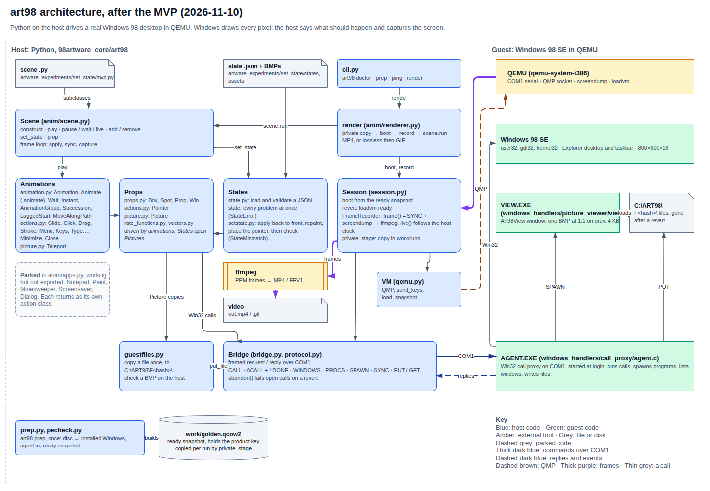
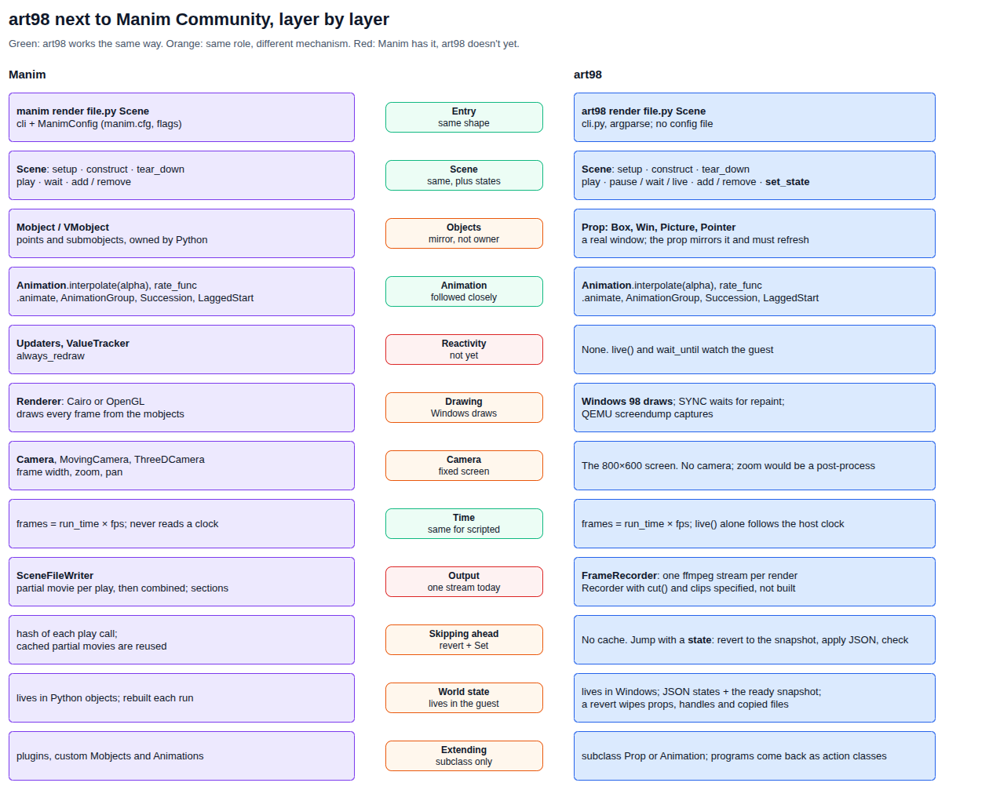

# Architecture, and how it compares with Manim

Drawn on 2026-11-10, after the MVP. Both pictures come from
[architecture.drawio](../diagrams/architecture.drawio), one page each.

## art98 today

A render goes top to bottom. `art98 render` loads the scene file, `render` takes a private copy of
the prepared disk and boots it, and `Scene.run` plays the scene. Animations change props, props
make Win32 calls through the bridge, and the agent runs them on the guest. Each frame is `SYNC`,
then a QMP `screendump`, then ffmpeg. A state file takes a shortcut: revert to `ready`, open the
state's picture windows, check the guest matches.

## Next to Manim

**What matches.** The script a user writes looks like Manim's: a `Scene` with `construct`,
`play`, `add` and `remove`, animations that `interpolate(alpha)` under a `rate_func`, `.animate`,
the group animations, and frames counted as `run_time × fps` instead of read from a clock.

**The one big difference: art98 doesn't own its world.** In Manim the mobjects are the truth and
the renderer draws them, so every frame follows from Python state. In art98 the truth is the
Windows desktop. A prop is a mirror of a window that Windows can move, resize, cover or close, so
props refresh before they act, and anything the script didn't do can drift. Most of what is
different follows from this:

| Manim | art98 | Because |
| --- | --- | --- |
| The renderer and camera draw each frame | Windows draws; art98 waits for the repaint and captures | Windows owns the pixels |
| Caching skips a `play` whose hash is unchanged | No cache. A state is the way to start partway | Re-running a play can't be skipped when its effect lives in the guest |
| World state is Python objects | World state is the guest, with JSON states and the `ready` snapshot as the fixed points | A revert throws away handles, props and copied files |
| Updaters run Python each frame | Not built. `live()` and `wait_until` watch the guest instead | |
| A camera moves over the scene | The screen is fixed at 800 × 600 | Zoom or pan would be a post-process on the capture |

**Where the layers differ.** Manim splits a render into `Scene` (what happens), a renderer and
camera (turning state into pixels), and `SceneFileWriter` (partial movies, sections, combining).
art98 has the same jobs in other places:

- The frame loop sits in `Scene.play`, which calls the recorder directly.
- `FrameRecorder` lives in `session.py` with the VM lifecycle, not in its own module.
- `render` in `anim/renderer.py` also owns booting and the private copy, which are backend jobs.
- `anim/` holds the scene, the renderer and the state code as well as animations. `state.py` sits
  at the top level, and `setstate.py` in `anim/`.
- `actions.py` mixes a prop (`Pointer`), pointer animations, keys and window commands.

The [Manim mapping plan](../archive/MANIM_MAPPING_PLAN.md), now archived, proposed a
`Win98Renderer`, updaters and partial movies. None of that is built. The
[recorder](state-and-action.md#recorder) spec covers clips, which are the nearest thing to
Manim's partial movies.
