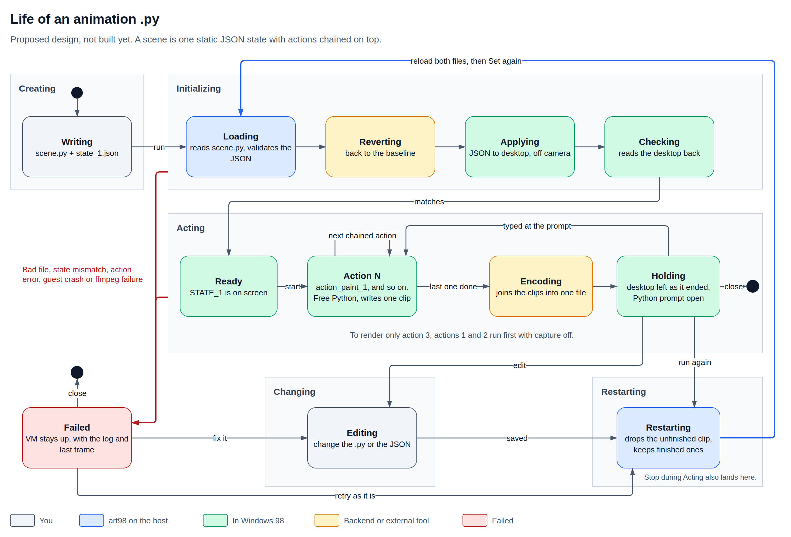

# State and action design

Status: the MVP is built (see "MVP results"). Everything after it is a proposal.

Today a scene runs from start to finish on the `ready` snapshot. art98 can't put Windows 98
into a chosen state, so reaching one point in a scene means playing everything before it, on
camera. This design adds static starting states and named sections, and leaves the script as free
as it is now. Where Manim already has the idea, this follows Manim.



## Goal

**Any scene starts from a hand-written static state, and its script can do anything from
there.**

1. Set gives the same starting desktop every time.
2. Part of a scene can be recorded again without recording the rest.
3. Scripts have no limits and produce no JSON.
4. Only the backend knows about QEMU.

Not in scope: capturing a section's result as a state, saving a snapshot per section, matching
memory byte for byte, audio, running on real hardware, and moving frame capture into the guest.

## Terms

| Term | Meaning |
| --- | --- |
| **Baseline** | The clean desktop we always revert to. Today that's `ready`. |
| **State** | A hand-written JSON file describing a static starting desktop. |
| **Set** | Revert to the baseline and apply a state, off camera. In code, `set_state()`. |
| **Section** | A named part of `construct()`, marked with `next_section`, as in Manim. |
| **Animation** | A building block a section plays, like `Glide` or `Stroke`. |
| **Action** | A class for one kind of thing on screen and the verbs that drive it, such as `Win` and `Teleport`. Programs come back as action classes. |
| **Clip** | The video file one section writes. |
| **Scene** | A state plus the sections that run on it, recorded. |
| **Backend** | Whatever provides revert and capture. Today that's QEMU. |

"Stage" keeps its meaning in the setup tool only (its steps were stages before). "Snapshot" only means the VM feature behind the baseline.

Manim users may read "state" as `save_state`, so the docs should say early that a state here is
a desktop. Until 2026-11-11 this design called a named part of a scene an action. That word now
means action classes, and the parts are sections, which is Manim's word for them. The pointer and
keyboard animations, once in `anim/actions.py`, are in `actions/pointer.py`, `actions/keyboard.py`
and `actions/window/`. Programs now live in `actions/programs/`, one file each (Notepad first).

## Decisions

| Decision | Why |
| --- | --- |
| A state is static and hand-written | Not every result of a scene can be described, and forcing it would limit what scenes can do |
| A state is stored as JSON | It can be written by hand, and it covers wallpaper, icons and tray, which props can't |
| A state can open a file | A finished drawing can start the next scene, without saving a scene's result |
| Sections are parts of `construct()` | Manim's `next_section` already does this, and a list of method names would be a second system |
| Sections can chain | Each one picks up where the last ended |
| Each section writes its own clip | Part of a scene can be recorded again, and clips are host files with no tie to the VM |
| A finished run holds the desktop | You can try more sections without a restart |
| A failed run holds the desktop too | The most useful evidence is the live desktop where it failed |
| Every restart takes the same path | A run never continues from a half-finished desktop |
| ~~Revert once after boot, so the first frame matches~~ | Replaced by one `SetCursorPos` nudge in `Pointer.attach`. It gives the same frame without a second boot step. See [first-frame](../../experiments/first-frame/README.md) |

An animation is a Python script, so it's arbitrary code. As with Manim, art98 doesn't decide how
many states or output files one script uses. Set is an ordinary call, and the rest is up to the
script.

## A state file

```json
{
  "version": 1,
  "desktop": {
    "colour": [128, 0, 0],
    "wallpaper": {"file": "assets/clouds.bmp", "sha256": "..."},
    "style": "tile",
    "icons": {"My Computer": [8, 8], "Recycle Bin": [8, 80]},
    "tray": ["volume"]
  },
  "windows": [
    {
      "id": "flower",
      "app": "picture",
      "title": "Flower",
      "at": [10, 10],
      "size": [640, 480],
      "show": "normal",
      "focus": true,
      "open": {"file": "assets/flower.bmp", "sha256": "..."}
    }
  ],
  "pointer": [400, 300]
}
```

- Anything a state leaves out stays as it is on the baseline.
- `windows` are listed back to front, so the last one is on top.
- `open` is optional. Without it, a window starts empty. For later programs it means their
  default state: blank Paint, an untitled Notepad, a new Minesweeper game.
- Files sit beside the state and are referenced by path and hash, never embedded in the JSON.
- One Python schema defines the fields, and a state is validated on load. Unknown fields fail.
- `app` maps to a prop class through a small registry. The MVP has one, `picture` (see Picture
  window). How to add a program: [Programs](programs.md).
- States are always written with fixed key order, so diffs stay clean and hashes are stable.

The schema starts small, with display, windows and pointer. Other fields join once they pass
their tests. `desktop` has `colour`, `wallpaper` and `style` since 2026-11-11 (below). `icons`,
`tray` and `focus` are rejected as "not supported yet" until they pass theirs. A window has
`at` and the outer `size` instead of a rect, the same way `Win(at=..., size=...)` takes them.

### Desktop colour and wallpaper

Built in the dialog-storm milestone. The schema is the one above, and each part is optional:

- `colour` is `[r, g, b]`, 0 to 255. The guest is 16-bit, so it shows the 5-6-5 rounding (128
  becomes 120, 255 becomes 248). Checks compare with that rounding, never the exact RGB.
- `wallpaper` is a BMP by `file` and `sha256`, 24-bit or 8-bit. `style` is `center` (the default),
  `tile` or `stretch`, and needs a wallpaper.
- A state with no wallpaper never touches the CD drive.

**The disc.** A wallpaper doesn't go through `put_file`, which would take 15 s or more for a 1.4 MB
file. `Session.attach_disc(files)` builds a small ISO 9660 level 1 disc on the host (`disc.py`,
names in 8.3 capitals) and the backend puts it in the guest's CD drive, `D:`, with the
`insert_disc` op. On the container, the disc travels on the serve channel as a header line and
raw bytes. The guest reads it, and the state sets the wallpaper with `SystemParametersInfo`.
There is no AutoPlay and no Explorer window. After the insert the scene polls every 50 ms and
gives up after 2 s; the first read succeeded at once in every run.

**Revert.** `loadvm` brings back the guest's empty tray but not QEMU's medium, so a revert has to
eject first: open the tray with force, remove the medium, close the tray. `Session.revert` does
that when it inserted a disc, and only then, so a scene without a disc never sends the op. The
QEMU id of the drive is read from `query-block` each time, because it was `device[5]` on one
host and `device[4]` in the plan.

**Checks.** Windows won't report the wallpaper path back (`SPI_GETDESKWALLPAPER` gives an empty
buffer), so the check reads one known pixel above the taskbar, with a tolerance of 12 per channel.
`bmp_pixel` decodes 24-bit and 8-bit BMPs only, and the check is skipped for any other depth.

**On a blank desktop.** A colour change makes Windows show the icons again, so the colour call
hides them again if they were hidden. Setting a wallpaper doesn't bring them or the taskbar
back, so it needs no such step. Numbers: [README-p2](../../experiments/dialog-storm/README-p2.md)
and [README-p3](../../experiments/dialog-storm/README-p3.md).

`icons` and `tray` are still later.

## A scene

```python
class Flower(Scene):
    state = "states/state_1.json"

    def construct(self):
        flower = self.prop("flower")

        self.next_section("slide")
        self.play(...)

        self.next_section("close")
        self.play(...)
```

```bash
uv run art98 render flower.py Flower --section close
```

`self.prop("flower")` returns the prop for that window `id`. `Win(hwnd=...)` can already take
hold of an existing window. Program props such as Paint also need adopting properly, which waits
for their own classes: see "After the MVP".

`state` is optional. Without one, a scene starts on the baseline, so scenes written today keep
working. Sections keep the animations and raw `self.guest` access scenes have now.

## How it runs

| State in the diagram | What it does |
| --- | --- |
| Loading | Imports `scene.py`, then validates the JSON and the file hashes |
| Reverting | Returns the desktop to the baseline (see Backend) |
| Applying | Copies the state's files to the guest, applies the JSON through the bridge, then repaints the state's windows back to front |
| Checking | Reads back what the state describes, and fails on a difference |
| Ready | `STATE_1` is on screen and no frames have been written |
| Section N | Runs one section and writes its clip, with its own ffmpeg. The diagram still says Action N |
| Encoding | Joins the clips into one file, and fails if ffmpeg did |
| Holding | Keeps the VM up and opens a Python prompt |
| Failed | Keeps the VM up at the failure, with the log and last frame |
| Restarting | Drops the unfinished clip, keeps finished ones, and returns to Loading |

Checking only covers what the state describes. Anything else on the desktop is ignored.

### Holding

Holding opens a Python prompt where `self` is the live scene. Anything typed there runs as a new
section with its own clip. This is the same idea as Manim's `interactive_embed`. A file can't do
this job, because the variables from `construct()` only exist in the running process.

Clips made this way are previews. They may differ from a clean run, so the final output should
come from a full run. Failed opens the same prompt, without the new clip.

### Recording part of a scene

With `--section part_3`, sections 1 and 2 run first with capture off, section 3 records, and the
result is joined with the clips already on disk.

- **Capture off is not free.** Manim can skip an animation in one step. Here, earlier sections must
  still make their real mouse moves and clicks, and `Hover`, other live animations and keypresses
  still take real time. Only the screenshots are saved. A later `fast_forward()` hook on
  animations could jump window moves to their end, but pointer actions would still replay.
- **Reuse is your call.** art98 can't tell whether an edit to `construct()` changed an earlier
  section. A full render ignores old clips, and only `--section` reuses them.
- **Later clips can go stale.** If section 3 ends differently, clip 4 starts with a visible jump.

## Recorder

Status: spec decided 2026-11-10, built 2026-11-11 in `core/art98/recorder.py`. See
[As built](#as-built) for what the build added to the spec. The API is in
[bridge.md](../scenes/bridge.md#recorder) and [scene-api.md](../scenes/scene-api.md#clips).

### Before

`FrameRecorder` in `session.py` wrote one file per render. `render()` opens it around
`scene.run()`, and a scene sees it as `self.video`. Frames are taken when the script asks, never
on a timer:

- `frame(hold=1)` waits for the guest to repaint (`SYNC`), takes a QMP `screendump`, and writes
  `hold` copies to ffmpeg. `play()` calls it once per step, and `pause()` once with a long hold.
- `live(seconds)` takes frames on the host clock without the repaint wait, for things that move
  by themselves.
- Video time is frames over fps, so a slow host makes the same video as a fast one.

It can't be changed during a run: one file, one fps, and `close()` doesn't check ffmpeg's exit code.

### Change

`Recorder` replaces `FrameRecorder`. A scene reaches it as `self.recorder`, and `self.video`
stays as another name for it. The only new control is cutting to a new clip.

| Member | What it does |
| --- | --- |
| `frame(hold=1)`, `live(seconds, stop_condition=None)` | As today |
| `cut(path=None)` | Closes the current clip, fails if its ffmpeg failed, and starts the next one. It returns the closed clip's path. Without `path`, clips are named `<stem>-01<suffix>`, `<stem>-02<suffix>` and so on |
| `path` | The clip being written now |
| `clips` | Finished clips, in order |
| `count`, `total` | Frames in this clip, and in all clips so far. `Scene.time` uses `total` |
| `close()` | Closes the last clip and fails if its ffmpeg failed |
| `join(output)` | Joins the clips into one file. Every clip uses the same codec settings, so this is a stream copy |

- A cut falls between two frames, so no frame is lost or repeated.
- A scene that never cuts writes one file, exactly as today, with no join.
- With cuts, `render()` keeps the clips beside the output and joins them into it.
- `set_state()` doesn't cut. A script that wants one clip per state calls `cut()` after it.
- `next_section` will call `cut()` with the section name, and `--section` builds on `clips`.

Checking ffmpeg's exit code touches one of the host bugs on hold (`FrameRecorder.close`). `cut()`
needs it to know a clip finished, so the recorder work would include that fix.

Not in this change: pausing capture, cropping or following a window, and real-time capture.

### Recorder decisions

Decided 2026-11-10: the owner took all four recommendations below. Sizes come from re-encoding `hello.mp4` and
`showcase.mp4`, the two demo videos in the repository: H.264 at CRF 12 is about 10 to 14 KB a
second, and lossless FFV1 about 1.5 to 2.2 MB a second, 150 times more.

**1. A GIF once a render is cut.** Today a GIF is made from one lossless recording (FFV1), because
H.264's 4:2:0 colour smears 1-pixel coloured text, and the MP4 is then encoded from that same
recording.

*Decided:* when a GIF is wanted, every clip is recorded lossless, the clips are joined by
stream copy into one lossless recording, and the GIF and MP4 are made from it, exactly as today.
The render still makes one GIF. A GIF per clip isn't made: each would get its own palette, so
colours would shift from one to the next. `--section` can add per-clip GIFs later, where a
shifted palette doesn't matter.

**2. Whether clips are kept after the join.**

*Decided:* keep them, since cutting is something a scene asks for and sections will build
on the clips. They're kept as H.264 MP4, named `<stem>-01.mp4` and so on beside the output, even
when the output is only a GIF. When the clips were recorded lossless, each is encoded to MP4 at
the end and the lossless one deleted, so a kept clip costs what the MP4 output costs. A scene that
never cuts leaves no clips, as today. `render(..., keep_clips=False)` deletes them after the join.

**3. Whether the `close()` exit-code bug is in scope.**

*Decided:* yes. `cut()` can't say a clip is finished without it, and the fix is small:
`close()` waits for ffmpeg and raises if it failed. One rule goes with it: when the scene itself
raised, `close()` still closes ffmpeg but doesn't replace the scene's error with its own.

**4. A state that changes the screen size.** Not in the original list. A state's `display` can
switch the guest to another size partway through a render. Frames reach ffmpeg as PPM images,
and ffmpeg scales every frame to the first frame's size by default, so today the stretch after the
change is probably resized without warning. That hasn't been tried. With clips, two clips of
different sizes can't be joined by stream copy.

*Decided:* the recorder checks the size of each frame. If the size changes inside a clip,
it raises and suggests `cut()` before the `set_state` that changes it. If clips of different
sizes are joined, the join fails with the sizes in the message. Scaling is left to the scene's
author, outside art98.

### As built

Built 2026-11-11 as specified, with these additions:

- `Scene.cut(path=None)` wraps `self.recorder.cut`, so a script writes `self.cut()`.
- Each clip's ffmpeg starts at the clip's first frame. A cut with nothing recorded since the last
  one closes nothing, makes no empty file, and returns `None`. So `set_state` then `cut()` at the
  very start of a scene is harmless. A `path` given to such a cut names the clip to come.
- The first clip is written at the output's name and renamed to `<stem>-01` by the first cut,
  so a scene that never cuts is unchanged. A clip the scene named still takes a number, so
  `cut()`, `cut("intro.mp4")`, `cut()` gives `-01`, `-02`, `intro.mp4`, `-04`.
- A lossless recorder writes every clip as `.mkv`, whatever suffix it was given, since FFV1
  doesn't go in MP4. In a GIF render the kept MP4 of a clip the scene named is that name with
  `.mp4`.
- ffmpeg's error output goes to a log per clip, and the `RecorderError` quotes it. When the
  scene raised, a recorder failure is added to the scene's error as a note.
- `render()` raises `RecorderError` if the scene recorded no frames. `keep_clips` is a Python
  argument only: `art98 render` has no flag for it.
- `Recorder` and `RecorderError` are exported from `art98`. The name `FrameRecorder` is gone.

Checked with a copy of `examples/mvp/mvp.py` that calls `self.cut()` right after
`set_state("states/gallery.json")`, rendered with `-o mvpcut.mp4 --gif mvpcut.gif` on both
backends: `mvpcut-01.mp4` has 152 frames, `mvpcut-02.mp4` 105, and the joined `mvpcut.mp4` 257,
the same count as the uncut scene. The GIF has 128 frames at 15 fps. Both backends wrote files of
the same sizes. `/proc/pressure/cpu` some avg10 was 0.00.

## Picture window

Status: built, 2026-11-10.

The MVP's only window. Windows 98 has no small image viewer, and Paint brings its own tools,
canvas and quirks, so art98 ships a tiny one.

- **Program.** `guest/picture_viewer/view.c` builds `VIEW.EXE` with the agent's toolchain, using only functions
  Windows 98 has. It came out at 4 KB.
- **Command line.** `VIEW.EXE <x> <y> <width> <height> "<title>" ["<image.bmp>"]`. Each window is
  its own process, and it opens where the state wants it, so nothing moves on screen first.
- **Window.** A normal window: title bar, minimise, maximise and close buttons, a sizing frame
  and a taskbar button. Its class is `Art98View`.
- **Contents.** A BMP drawn at 1:1, centred, with the rest of the client area grey. With no image,
  the window is plain grey. An image bigger than the window is cropped. Scaling and other formats
  are out for now.
- **Getting there.** A revert removes everything copied since `ready`, so `VIEW.EXE` and each
  image are copied again when they're missing. Each file goes in `C:\ART98\F<7 hex of its
  sha256>\`, so one `GetFileAttributesA` call tells whether the right file is there. Putting the
  viewer in the setup tool instead would change the image, so that needs a decision.
- **Prop.** `Picture(Win)`, with `title`, `image`, `at` and `size`. The image is checked on the
  host when the prop is made. Windows 98's `LoadImage` crashes inside 16-bit code on a BMP that's
  cut short, so the viewer can't catch it. The host check stops that before the guest is asked,
  and if the viewer crashes anyway, `Picture` sees Windows' crash dialog and fails at once instead
  of waiting 15 s.

On camera, a picture window does what any window does:

| Do | How |
| --- | --- |
| Move | `pic.animate.shift(...)`, as today |
| Teleport | `Teleport(pic, to=...)`, a new `Instant` that places the window in one frame. `run_time=0` on `.animate` already gives the same result |
| Close | `Close(pic)`, as today |
| Open | `self.add(Picture(...))`, as today |

## Backend

| Call | QEMU today |
| --- | --- |
| `start()` | Make a private copy of the image, then boot it with `-loadvm ready` |
| `revert()` | `loadvm ready` in the running VM |
| `capture()` | QMP `screendump` |
| `send_keys()` | QMP `send-key` |
| `connect()` | COM1 over a unix socket |

The first run calls `start()`. A restart calls `revert()`, which took 0.06 to 0.2 s in the test and
keeps the bridge connected, so it avoids a new QEMU process. `start()` is the fallback if the VM has died.
Python rebuilds its props after any revert, because every window handle changes.

Revert and capture stay outside Windows 98 for now. Revert can't be done reliably from inside.
Capture over serial would take about 3 s per frame, against 6.5 ms now. Mouse input is already in
the guest.

## Not proven yet

Each of these needs a test on the real image before the schema is final.

| Item | Risk |
| --- | --- |
| Icon positions | Another program owns them, and Windows 98 has refused some calls that reach into other programs' windows |
| Tray | Adding icons is likely. Removing another program's icon is unproven |
| Wallpaper | Built. The bitmap reaches the guest on a CD, not by `put_file`. See "Desktop colour and wallpaper" |
| Window order and focus | Taskbar order follows the order windows opened, so it may not match the JSON |
| Opening files in programs | After the MVP. Titles change, and Paint may not show the image at the expected zoom or size |
| Paint with an opened file | After the MVP. `canvas_size` assumes a blank canvas, so canvas positions and `resize_canvas` would be wrong. `ready()` must also run on an adopted window |
| Copying files | `put_file` ran at about 90 KB/s on a quiet host and about 12 KB/s on a busy one, so a 1.4 MB wallpaper could take 15 s or far longer on every Set. That was too slow, so a wallpaper goes on a read-only disc attached by the backend: about 1 s for 1.4 MB |
| Stray pixels | Explained. Moving a window off another one can leave desktop label pixels in the lower window's frame. A repaint at the end of Apply clears them. See "Test results" |
| Capture off | Some actions depend on real time, so a run with capture off may differ from a recorded one |
| Clock and randomness | A new Minesweeper board differs each run unless these are fixed |

## Test results

Run on 2026-11-07 on a private copy of the image, with throwaway scripts. The state was Notepad and
Paint placed by hand, Paint opening a 57 KB BMP, and the pointer placed last.

**Set works.** It repeats, and a revert leaves nothing behind.

| Check | Result |
| --- | --- |
| Same state, repeated | 13 of 13 screenshots identical across two runs, then 3 of 4 on a warm baseline |
| State A, state B, state A | Identical to the first A |
| Revert after windows, a file and a display change | Same desktop as the baseline, with windows and display mode gone |
| Revert with a call still open | The bridge keeps working. The open call never finishes and waits for its timeout |

**Speed depends mostly on how busy the host is.** The disk made no difference: btrfs, tmpfs and
`cache=unsafe` all took the same time. Figures are the median for a whole Set.

| Host CPU pressure | `ready` today | Warm baseline |
| --- | --- | --- |
| About 30% | 10.3 s | Not measured |
| About 2 to 6% | 3.1 s | 1.7 s |
| Under 1% | 2.0 s, from 2 runs | 1.6 s |
| Under 0.4%, 2026-11-08 | 1.6 s, and 1.8 s with the repaint | 1.25 s, with or without the repaint |

**A warm baseline beats the 2 s target.** A revert also throws away the guest's disk cache, so
every launch is cold. Launching Notepad and Paint once before saving the snapshot cut Paint from
0.83 s to 0.49 s on a quiet host. The windows are closed again before the save, and the resulting
state matched the one from `ready`, apart from the stray pixels below. This changes how the
baseline is made, so it's a decision, not a test result.

**Decided 2026-11-08: the MVP uses `ready` as it is.** A warm baseline is only added if Set misses
the 2 s target. If it is added, the first choice is a `warm` snapshot made at the start of each run
on the private copy, so setup, `ready` and today's scenes don't change. Two costs come with any warm
baseline. Running the apps once leaves traces: the window cascade moves on (Notepad then opens at
(116, 110) instead of (68, 66)), and closing Paint likely writes its settings and recent files to
the registry, which isn't checked. Saving the snapshot also takes time, which hasn't been measured.
Reading the program files once, without running them, might warm the disk cache without the
traces. That is untested.

**Differences found:**

- **Pointer and colours.** On a fresh boot, the first pointer move turns the pointer on and shifts
  the colours (white 255 becomes 248, teal 123 becomes 120). The memory is the same, so this looks
  like QEMU switching how it draws, though that cause is inferred. It already affects today's
  scenes, in the frames before the first pointer move. After a revert it's always in the second
  form, so Sets are consistent with each other. Reverting once right after boot would make every
  frame consistent. That revert was dropped. A `SetCursorPos` nudge in `Pointer.attach`
  (`actions/pointer.py`) now settles the first frame instead; see
  [first-frame](../../experiments/first-frame/README.md).
- **Stray pixels.** In one run, 1 Set in 4 differed by 8 pixels at Notepad's left edge, on the end
  of the "My Documents" label. Run 2's stall wasn't real: the watchdog fired during normal slow work
  and it didn't happen again. The pixels are explained below.

### Stray pixels, explained

Run on 2026-11-08 on a private copy, at under 0.4% CPU pressure, with `stray.py` and
`stray_order.py`.

The odd Set out was the clean one. A Windows 98 frame's outer column is light grey (216 in the
screenshot) and the next one is white (248), as Paint's frame shows. Usually, Notepad's outer column
at x = 60 is white in rows 118 to 123. Those are the text pixels of the "My Documents" label, drawn
into Notepad's 4-pixel sizing frame (x 60 to 63). The client edge at x = 64 is never touched.

| Run | Label pixels in Notepad's frame |
| --- | --- |
| 10 Sets from `ready` | 10 of 10 |
| 10 Sets from a warm baseline | 8 of 10 |
| Screenshot again 1 s later | No change, so this isn't a screenshot taken too early |
| Notepad placed, Paint not moved yet | 0 of 8 |
| Then Paint moved away | 8 of 8 |
| Paint placed first, then Notepad | 0 of 8 |
| Notepad repainted after both are placed | 0 of 8 |
| Both windows repainted back to front, from `ready` and from warm | 20 of 20 screenshots identical, and warm matches `ready` exactly |

Paint opens at (0, 0, 275, 400), on top of the desktop label and of Notepad's new left frame. When
Paint moves away, the desktop and Notepad both repaint the area it uncovered. The desktop draws its
label into Notepad's frame as well. Notepad's frame is usually painted first, so the label ends up
on top. On the warm baseline the order sometimes flips, which is why that run looked like 1 in 4.
Which part of Windows 98 lets the desktop paint there is inferred, not proven. `SYNC` doesn't fix
it, because it waits for pending repaints and doesn't ask for new ones.

This isn't specific to a Set. Any move of a window off another window can leave these pixels on
the lower window's frame. Today's scenes probably show them too. That hasn't been checked.

**Fix:** Apply ends by repainting every window the state placed, back to front, before the final
sync. Checking rects alone wouldn't catch the stray pixels, so done-when 1 compares screenshots.

**What this changes:**

- Revert must fail open calls straight away, not leave them waiting for a timeout.
- The documented `put_file`, `get_file` and app launch times are quiet-host figures. A Set figure
  should be quoted with the host load.
- Apply ends with a back-to-front repaint of its windows. With it, Sets match pixel for pixel.

## MVP

**A script can jump the desktop to a state it chose, as many times as it likes, and record from
there.** The baseline already exists, so the MVP is the path from Loading to Ready, plus a
restart. That path is the biggest unknown, and everything else builds on it.

### In

| Part | What it covers |
| --- | --- |
| Display | `"display": [800, 600, 16]`, using `set_display_mode`. A switch takes 65 to 150 ms with no reboot, but only modes the driver offers work |
| Windows | Picture windows only, each with `id`, `title`, `at`, `size`, `show` and an order |
| Images | `open` on a picture window, with a BMP copied to the guest first |
| On camera | Move, teleport, close and open a picture window. Only `Teleport` is new |
| Pointer | Placed last, because focus may need a click on a title bar |
| Revert | `loadvm ready` in the running VM, kept as one plain function |
| Set | `set_state(path)`, usable any number of times. Each call is a hard cut, and ends with a repaint of the state's windows |
| Check | Display, each window's title, show state, place, size and order, and the pointer |
| Scene | `state`, `set_state()` and `self.prop()` |

Moving, opening and closing windows on camera use the existing animations, starting from the
state. Teleporting adds one small `Instant`.

```python
class Mvp(Scene):
    state = "states/two_windows.json"

    def construct(self):
        flower = self.prop("flower")
        self.play(flower.animate.shift(200 * RIGHT), run_time=2)
        self.play(Teleport(flower, to=(40, 40)))
        self.play(Close(flower))
        self.add(Picture("Sky", image="assets/sky.bmp", at=(300, 200), size=(320, 240)))

        self.set_state("states/gallery.json")
        self.pause(1)
        self.play(self.prop("picture").animate.shift(100 * DOWN), run_time=2)
```

### Out, for now

Every program: Paint, Notepad, Minesweeper and any `command`. Their classes are parked in
`art98/anim/apps.py`, unexported (Notepad has since returned as `actions/programs/notepad.py`, and `Dialog` as `actions/programs/dialog.py`), until each returns as its own action class. Icons and tray. (The desktop colour and wallpaper came later: see "Desktop colour and wallpaper".)
Sections, clips and `--section`. Holding, Failed with a live VM, the Python prompt and Stop. The
backend interface, and the agent bug fixes.

### Done when

1. Setting the same state 10 times gives matching screenshots. Any difference gets explained.
2. Set takes under 2 s for a state with two windows and a small image. The real figure goes in
   the docs either way.
3. A bad file, a missing window or a wrong position stops with a clear error.
4. The sample scene renders, moving, teleporting, closing and opening a picture window, and
   jumping between two states.
5. Existing scenes and tests still pass.

### Order

All done, 2026-11-10.

1. Test revert and a hand-applied state in a throwaway script on a private copy. It passed, and
   the stray pixels are explained. See "Test results".
2. Make `put_file` check the written count.
3. Build `VIEW.EXE`, the `Picture` prop and `Teleport`, and test them by hand on a private copy.
4. Add the schema and loader.
5. Add revert, apply and check.
6. Add `state`, `set_state()` and `self.prop()` to `Scene`.
7. Add the sample scene and tests, then record the results.

### MVP results

Run on 2026-11-10 on private copies, with host CPU pressure (some, avg10) between 0.02 and 1.6%.

| Done when | Result |
| --- | --- |
| 1. Same state 10 times | 10 of 10 screenshots identical, for both sample states |
| 2. Set under 2 s | Two windows and a 57 KB image: median 1.45 s (1.18 to 1.61). One window and an image: median 0.97 s (0.75 to 1.27) |
| 3. Clear errors | A bad file lists every problem before the desktop is touched. A window Windows won't make (`"size": [40, 20]`) stops with `size [40, 20] wanted, the guest has [112, 27]`. A cut-short image fails on the host. Unit tests cover a missing window, the wrong order, title, show state, display and pointer |
| 4. Sample scene | `examples/mvp/mvp.py` renders in 7.7 s, moving, teleporting, closing and opening a picture window, then jumping to a second state |
| 5. Nothing broken | 199 tests pass (32 skip without QEMU set up), all 32 doc samples render, and so do `hello.py`, `showcase.py` and the gallery scenes |

What it's made of:

- `Session.revert()` fails every open call and async call at once (`Bridge.abandon`), then
  reverts and pings.
- `art98.state` loads and checks a state file. `art98.anim.setstate` applies it back to front and
  checks it. Maximizing happens as each window opens, because it activates the window, and
  minimized windows are left out of the order check, because Windows 98 sends them to the back.
- `Scene.set_state()` forgets the old props, so one used after a Set fails with "not on stage"
  instead of driving a stale handle. Adding it again opens a new window.

Found on the way:

- The revert winds the guest's clock back to the snapshot's time, so the taskbar clock can go back
  a minute at a Set.
- Copying the files again is a large part of a Set: about 60 KB per Set for the sample.

## After the MVP

1. **Sections and clips.** The recorder above, then `next_section`, one clip per section, capture
   off and `--section`.
2. **Programs.** Each program (Paint, Notepad, Minesweeper and others) becomes its own action
   class. Not designed yet.
3. **More of the desktop.** The colour and the wallpaper are built. Icons and tray remain, each after its test.
4. **Backend.** Move start, revert, capture and keys behind one interface.
5. **Run control.** Holding and Failed with the Python prompt, and Stop. `render()` closes the VM
   on exit today, so this needs restructuring.
6. **Docs.** Update Part 2 and port the showcase as the proof. (`anim/actions.py` is already
   split into `actions/`.)

The agent bug fixes are separate work. Nothing here depends on them.
