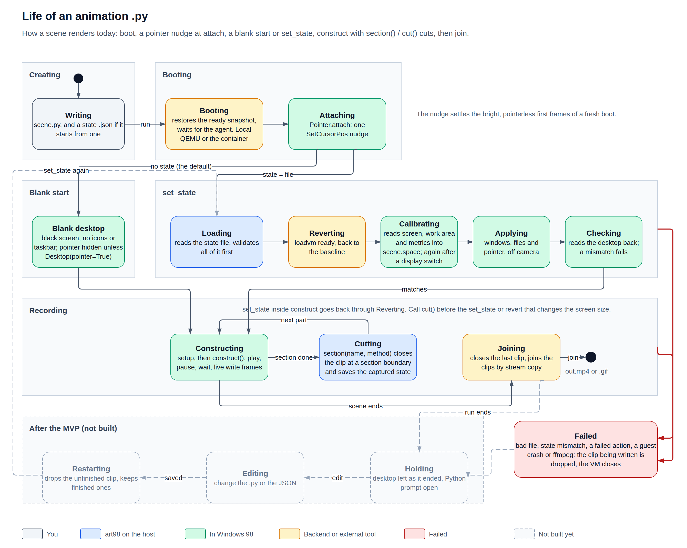

# State and action design

How states, Set and sections work. Built: states, Set and its check, desktop colour and wallpaper,
the recorder, `section` and [`--section`](#recording-part-of-a-scene). Proposed, not built:
[Holding](#holding). Why states are static and actions are free:
[decision 7](decisions.md#7-states-are-static-and-hand-written-actions-are-free-python). Terms are
in the [glossary](../glossary.md). A state here is a desktop, not Manim's `save_state`. Where Manim
already has the idea, this follows Manim.



## Goal

**Any scene starts from a static state, written by hand or captured from an earlier render, and
its script can do anything from there.**

1. Set gives the same starting desktop every time.
2. Part of a scene can be recorded again without recording the rest: a section starts from the
   state a full render captured at its boundary.
3. Scripts have no limits and write no JSON. The captured states are written by `get_state`.
4. Every visible window is a prop, so a capture can't miss one.
5. Only the VM layer knows about QEMU.

Not in scope: saving a VM snapshot per section, replaying earlier sections muted, matching
memory byte for byte, audio, running on real hardware, and moving frame capture into the guest.

## A state file

```json
{
  "version": 1,
  "display": [800, 600, 16],
  "desktop": {
    "fill_colour": [128, 0, 0],
    "wallpaper": {"file": "assets/clouds.bmp", "sha256": "..."},
    "style": "tile"
  },
  "windows": [
    {
      "id": "flower",
      "app": "picture",
      "title": "Flower",
      "at": [10, 10],
      "size": [640, 480],
      "show": "normal",
      "open": {"file": "assets/flower.bmp", "sha256": "..."}
    }
  ],
  "pointer": [400, 300]
}
```

- Anything a state leaves out stays as it is on the baseline.
- `windows` are in creation order: Windows 98 orders taskbar buttons by creation.
- `stack` is optional: the window `id`s back to front (z-order), the last on top and active.
  Without it, list order is the z-order too. A capture always writes it.
- `open` is optional. Without it, a window starts empty. For later programs it means their
  default state: blank Paint, an untitled Notepad, a new Minesweeper game.
- Files sit beside the state and are referenced by path and hash, never embedded in the JSON.
- One Python schema defines the fields, and a state is validated on load. Unknown fields fail.
- `app` maps to a prop class through `APPS` in `actions/apps.py`. See [Programs](programs.md).
- States are always written with fixed key order, so diffs stay clean and hashes are stable.
- `text` is a Notepad's contents, a file like `open`, set after the window opens. A capture needs
  it, because typing isn't in `open`. Other programs reject it.
- `selection` is a Notepad's `[start, end]` character offsets of the selected text or caret,
  restored after the text (default `[0, 0]`). Other programs reject it.
- A window `id` is ASCII letters, digits, `_` and `-`, because a capture uses it as a folder name.

The schema starts small, with display, windows and pointer. Other fields join once they pass
their tests. `show` is `normal`, `minimized` or `maximized`. `desktop` has `fill_colour`, `wallpaper` and `style` (below). Desktop `icons` and
`tray`, and a window's `focus`, are rejected as "not supported yet" (the last window is the active
one) until they pass theirs. A window has
`at` and the outer `size` instead of a rect, the same way `Win(at=..., size=...)` takes them.

### Desktop colour and wallpaper

The schema is the one above, and each part is optional:

- `fill_colour` is `[r, g, b]`, 0 to 255: the plain desktop colour behind the icons and around a
  centred wallpaper (Windows calls it "Desktop" in Display Properties, Appearance), not the
  taskbar or selection colour. An old `colour` key fails with a message naming `fill_colour`. The guest is 16-bit, so it shows the 5-6-5 rounding (128
  becomes 120, 255 becomes 248). Checks compare with that rounding, never the exact RGB.
- `wallpaper` is a BMP by `file` and `sha256`, 24-bit or 8-bit. `style` is `center` (the default),
  `tile` or `stretch`, and needs a wallpaper.
- A state with no wallpaper never touches the CD drive.

**The disc and the revert.** The wallpaper reaches the guest on a CD, not through `put_file`, which
would take 15 s or more for a 1.4 MB file. See [The CD drive](container.md#the-cd-drive) and
[decision 15](decisions.md#15-big-files-go-on-a-cd-not-down-the-serial-line). The state then sets
the wallpaper with `SystemParametersInfo`.

**Checks.** Windows won't report the wallpaper path back (`SPI_GETDESKWALLPAPER` gives an empty
buffer), so the check reads one known pixel above the taskbar, with a tolerance of 12 per channel.
`bmp_pixel` decodes 24-bit and 8-bit BMPs only, and the check is skipped for any other depth.

**On a blank desktop.** A colour change makes Windows show the icons again, so the colour call
hides them again if they were hidden. Setting a wallpaper doesn't bring them or the taskbar
back, so it needs no such step. Numbers: [README-p2](https://github.com/StanLukuvka/98artware/blob/dev/experiments/dialog-storm/README-p2.md)
and [README-p3](https://github.com/StanLukuvka/98artware/blob/dev/experiments/dialog-storm/README-p3.md).

`icons` and `tray` are still later.

## A scene

```python
class Flower(Scene):
    state = "states/state_1.json"

    def construct(self):
        self.section("slide", self.slide)
        self.section("close", self.close)

    def slide(self):
        flower = self.prop("flower")
        self.play(...)

    def close(self):
        flower = self.prop("flower")
        self.play(...)
```

```bash
uv run art98 render flower.py Flower --section close
```

`self.prop("flower")` returns the prop on stage with that `id`: one a state opened, or one added
with `self.add(prop, id="flower")`. A section finds its windows this way, because a solo run
doesn't run the sections before it. Adopting a window the scene did not start isn't built;
`Win(hwnd=...)` can take hold of one.

`state` is optional. Without one, a scene starts on the baseline, so scenes written today keep
working. Sections keep the animations and raw `self.guest` access scenes have now.

## How it runs

| State in the diagram | What it does |
| --- | --- |
| Loading | Imports `scene.py`, then validates the JSON and the file hashes |
| Reverting | Returns the desktop to the baseline (see [The VM service](container.md#the-vm-service)) |
| Applying | Copies the state's files to the guest, applies the JSON through the bridge, then repaints the state's windows back to front |
| Checking | Reads back what the state describes, and fails on a difference |
| Ready | `STATE_1` is on screen and no frames have been written |
| Section N (Action N in the diagram) | Runs one section and writes its clip, with its own ffmpeg. |
| Encoding | Joins the clips into one file, and fails if ffmpeg did |
| Holding | Keeps the VM up and opens a Python prompt |
| Failed | Keeps the VM up at the failure, with the log and last frame |
| Restarting | Drops the unfinished clip, keeps finished ones, and returns to Loading |

Checking only covers what the state describes. Anything else on the desktop is ignored.

Measured at the MVP (CPU pressure some avg10 0.02 to 1.6%): the same state 10 times gave 10 of 10
identical screenshots. A Set of two windows and a 57 KB image took median 1.45 s (1.18 to 1.61);
one window and an image, median 0.97 s (0.75 to 1.27). About 60 KB is copied per Set for the
sample. A revert winds the guest clock back to the snapshot's time, so the taskbar clock can step
back a minute at a Set. A window Windows won't make stops with, for example,
`size [40, 20] wanted, the guest has [112, 27]`. The plan and the full results are in
[build history](../archive/build-history.md#mvp-plan-and-results).

### Holding

Holding opens a Python prompt where `self` is the live scene. Anything typed there runs as a new
section with its own clip. This is the same idea as Manim's `interactive_embed`. A file can't do
this job, because the variables from `construct()` only exist in the running process.

Clips made this way are previews. They may differ from a clean run, so the final output should
come from a full run. Failed opens the same prompt, without the new clip.

Three rules for run control, not built yet:

- A finished run holds the desktop, so you can try more sections without a restart.
- A failed run holds the desktop too, because the live desktop where it failed is the best evidence.
- Every restart takes the same path, so a run never continues from a half-finished desktop.

### Recording part of a scene

A section starts from a state, not from a replay of the sections before it. `construct` calls
`self.section(name, method)` once per section, and each method is the code of one section.

**A full render** cuts the clip before each section after the first, then calls `get_state` and
saves the desktop as a capture. Nothing is reverted or set, so the render isn't disturbed. A
capture is `NN-name.state.json` with its files in `NN-name.files/` and a `NN-name.meta.json`,
in `<scene file stem>.<Scene>.sections/` beside the scene's file. The folder is written aside
and swapped in only when the render succeeds.

**`--section NAME`** skips `setup` and every section before NAME without calling them. At NAME
it checks the capture is fresh, sets the desktop to it (a Set, so the guest is checked against
it), starts `time` at the captured time, calls the method, and writes one clip. It never writes
captures.

- **`get_state` reads the props, not the desktop.** Each window prop writes its own entry, from
  the live window: the title as it is, and the normal rectangle whatever its `show`. So every
  window needs an `id`, and `Dialog`, `Paint` and `Minesweeper` can't be captured yet. A window
  that is not a prop is an error, not something missed (below).
- **Every window is tracked.** `check_tracking` runs after every `play`, `wait` and
  `wait_until`, and at the end of a run. A visible window that is not the desktop's or a prop's
  raises `UntrackedWindow`. A prop's window that went without `Close` raises `ImplicitClose`:
  windows end only through `Close`, so the scene always knows. A menu, tooltip or prompt a
  scene is dealing with is a claim, which the check lets be until it is gone.
- **A capture can go stale.** Its meta file has a hash of the source of `setup`, the scene's
  state file and each earlier section. A solo run whose hashes don't match refuses with the name
  of what changed. Editing the section being rendered is fine.
- **A solo run can differ from the full one.** The guest clock restarts at the Set, so things
  Windows times itself (a caret blink, the taskbar clock) can differ. A Notepad's horizontal
  scroll bar can too: the Edit keeps the widest line it ever had, and a capture can't restore it.
  A prop kept in `self.<attr>` by an earlier section doesn't exist in a solo run.
- **No code between sections.** It would run in a full render and be skipped in a solo one, so
  `section()` raises `UsageError` if frames were recorded or props added between two sections.

## Recorder

Built in `core/art98/output/recorder.py`. Why it works this way:
[decision 14](decisions.md#14-the-recorder-is-a-class-you-can-steer). The API:
[Clips](../scenes/scene-api.md#clips) and [bridge.md](../scenes/bridge.md#recorder). The spec, the
four decisions and the as-built notes are in
[build history](../archive/build-history.md#recorder-spec).

Sizes behind the GIF rule, from re-encoding `hello.mp4` and `showcase.mp4`: H.264 at CRF 12 is
about 10 to 14 KB a second, lossless FFV1 about 1.5 to 2.2 MB a second. One GIF is made from the
joined lossless clips. A GIF per clip would get its own palette, so colours would shift from clip
to clip.

Checked: a copy of `recipes/scenes/mvp/mvp.py` with `self.cut()` right after
`set_state("states/gallery.json")` gave `mvpcut-01.mp4` 152 frames, `-02` 105, and a joined 257,
the same as the uncut scene. The GIF had 128 frames at 15 fps. CPU pressure some avg10 0.00.

## Test results

A Set repeats pixel for pixel, and a revert leaves nothing behind. A Set ends by repainting its
windows back to front, because a window moved off another can leave desktop label pixels in the
lower window's frame. Speed depends mostly on host load: a whole Set took 1.6 s from `ready` at
under 0.4% CPU pressure and 10.3 s at about 30%. The probes, the warm-baseline trial, the decision
to use `ready` as it is, and the full tables are in
[revert-test](https://github.com/StanLukuvka/98artware/blob/dev/experiments/revert-test/README.md#test-results).

## Not proven yet

Each of these needs a test on the real image before the schema is final.

| Item | Risk |
| --- | --- |
| Icon positions | Another program owns them, and Windows 98 has refused some calls that reach into other programs' windows |
| Tray | Adding icons is likely. Removing another program's icon is unproven |
| Window order and focus | Taskbar order follows the order windows opened, so it may not match the JSON |
| Opening files in more programs | Built for `picture` and `notepad` only. Elsewhere titles change, and Paint may not show the image at the expected zoom or size |
| Paint with an opened file | Not built yet. `canvas_size` assumes a blank canvas, so canvas positions and `resize_canvas` would be wrong. `ready()` must also run on an adopted window |
| Clock and randomness | A new Minesweeper board differs each run unless these are fixed |
