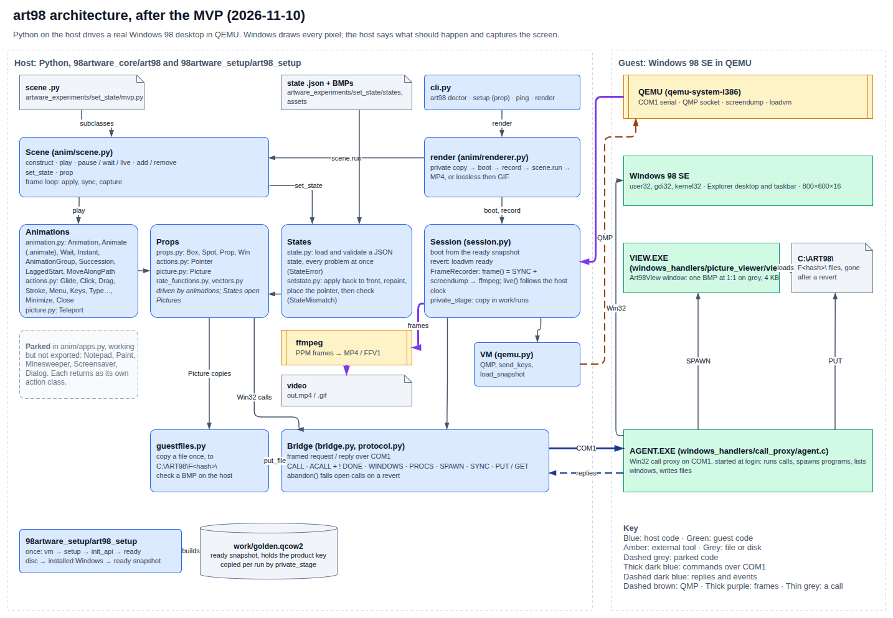
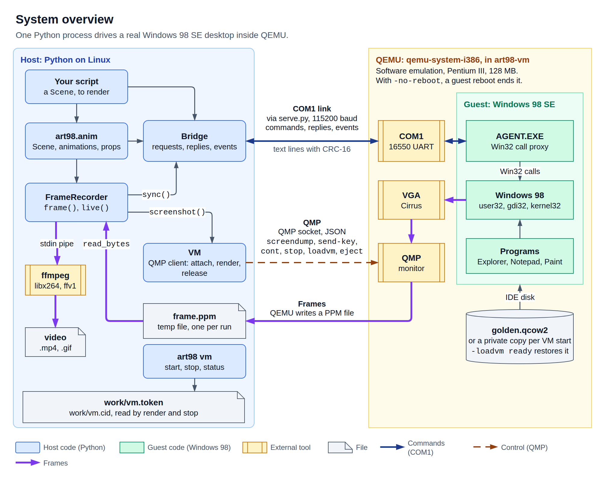
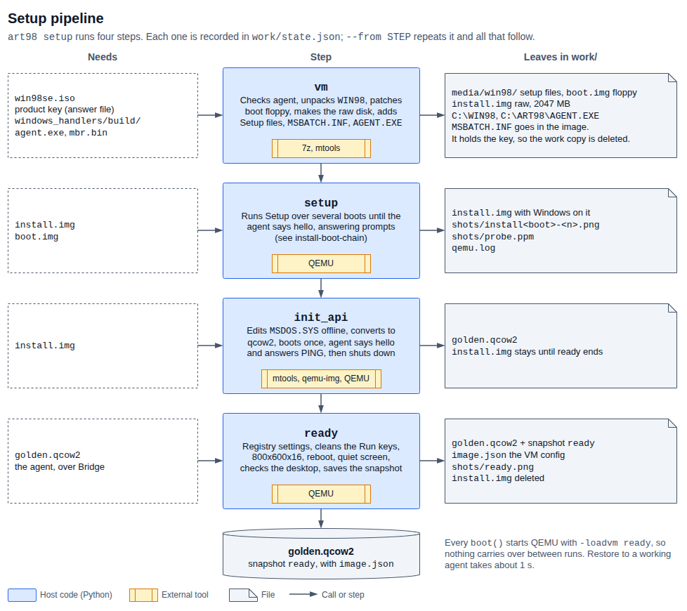
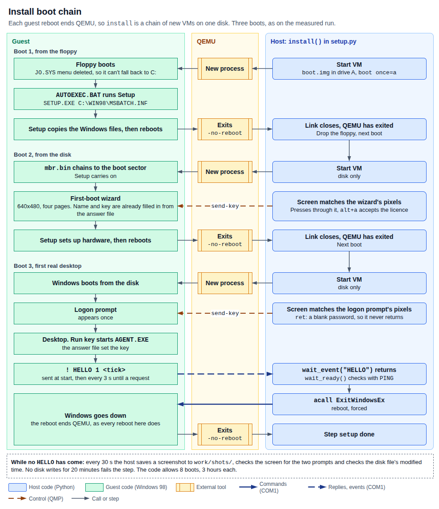
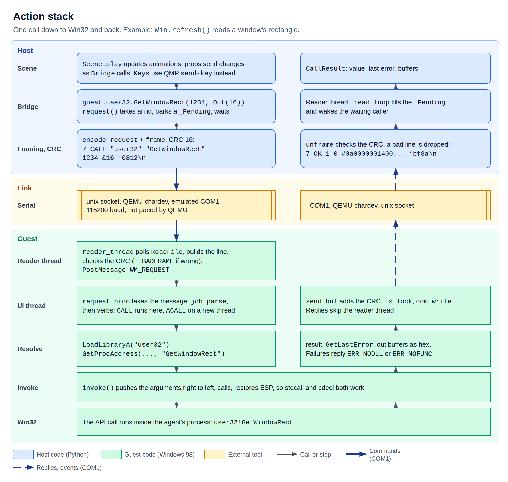
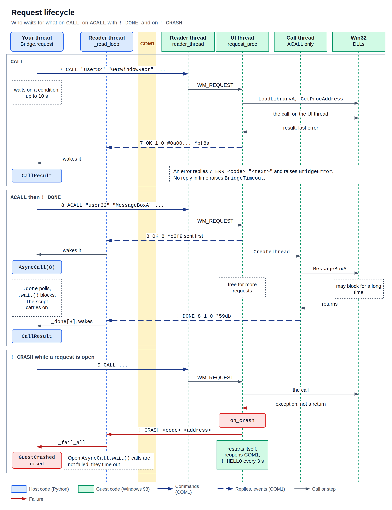
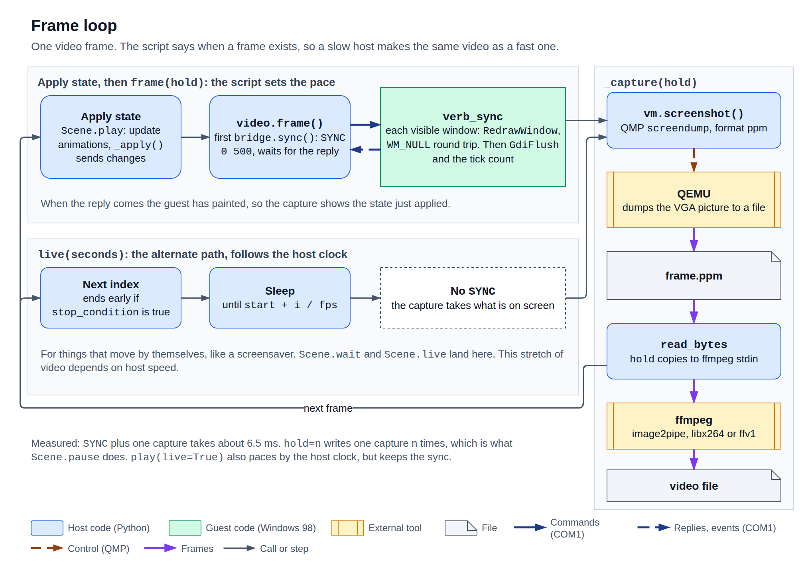

# Diagrams

Each diagram has an editable `.drawio` file and an exported `.png`. The PNGs have a
solid white background, so they read the same in GitHub's light and dark modes. Audio
is left out.

## Architecture

Every part of art98 after the MVP, host and guest, and which link carries what. A second page in
the same file puts it next to Manim. See [Architecture, and how it compares with
Manim](../design/architecture.md).



## System overview

Host and guest side by side, and which link carries commands and which carries frames.



## Setup pipeline

The four `art98 setup` steps (vm, setup, init_api, ready), what each needs and leaves in `work/`, ending at
`golden.qcow2` with the `ready` snapshot.



## Install boot chain

How the `setup` step gets through three boots, with each reboot ending QEMU and a
new VM starting, until the agent says `HELLO`.



## Action stack

Every layer one call passes through, from a scene down to a Win32 call and back.



## Request lifecycle

Who waits for what on `CALL`, on `ACALL` with `! DONE`, and on `! CRASH`.



## Frame loop

One video frame: apply state, `SYNC`, QMP `screendump`, PPM, ffmpeg. `live()` is the
alternate path that skips the sync and follows the host clock.



## Colour key

| Look | Means |
| --- | --- |
| Blue, rounded box | Host code (Python) |
| Green, square box | Guest code (Windows 98) |
| Amber box with side bars | External tool (QEMU, ffmpeg, mtools) |
| Grey page or cylinder | File or disk image |
| Dashed box | A note, or an input |
| Red box | A failure |
| Thick dark blue line | Commands over COM1 |
| Dashed dark blue line | Replies and events over COM1 |
| Dashed brown line | Control over QMP |
| Thick purple line | Frames |
| Thin grey line | A call or the next step |

## Re-exporting

Edit the `.drawio` file in draw.io, then export it over the PNG. Run this from
`docs/diagrams/`:

```bash
drawio -x -f png -e -b 16 -s 2 -o frame-loop.png frame-loop.drawio
```

To export all six:

```bash
for f in *.drawio; do drawio -x -f png -e -b 16 -s 2 -o "${f%.drawio}.png" "$f"; done
```

`-e` embeds the diagram in the PNG, so the PNG opens as an editable diagram too. `-s 2`
keeps the text sharp at GitHub's page width. Keep each diagram about 1000 px wide with
text at 13 px or larger, or it gets too small to read on that page.
