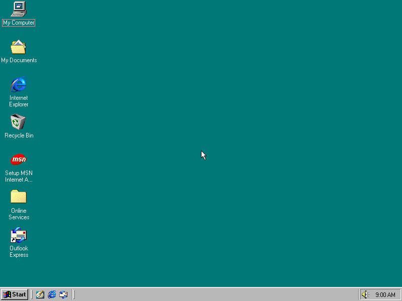
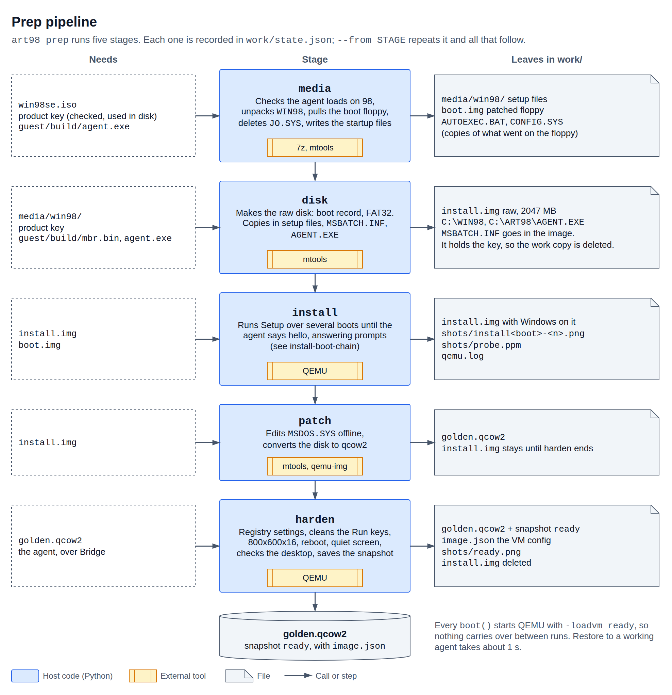
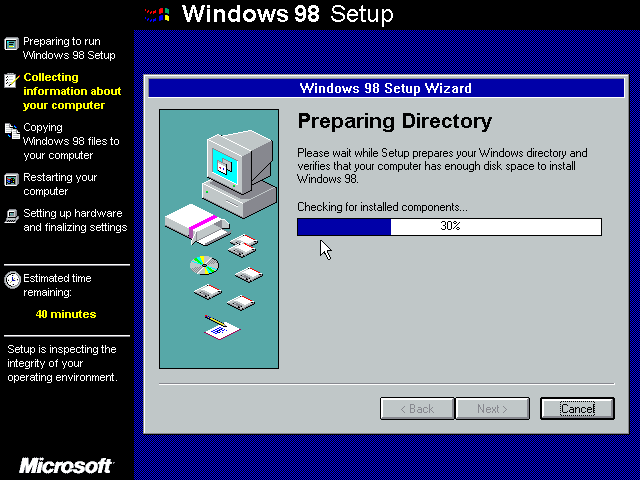

# Part 1: preparing the VM

`art98 prep` turns your Windows 98 SE disc image into a desktop that restores to
the same state every time. It runs Setup with no input, cleans up the result, and
saves a QEMU snapshot called `ready`. Everything else in art98 starts from that
snapshot.

This part covers the preparation scripts. To drive the finished desktop, see
[Part 2](../actions/README.md).


## What it produces

| File | What it is |
|------|------------|
| `work/golden.qcow2` | The installed disk, with the snapshot `ready` inside it. About 415 MB on disk, 2 GB virtual |
| `work/image.json` | The `VMConfig` that created the snapshot. `boot()` reads it, and the snapshot only loads on the same hardware |
| `work/state.json` | The stages that have finished |
| `work/shots/ready.png` | What the desktop looked like when the snapshot was saved |



The desktop is Windows 98 SE at 800x600 in 16-bit colour, with screensavers,
system sounds and power saving off, and `C:\ART98\AGENT.EXE` already running.
[image.md](image.md) lists what is on it.

## What you need

- **A Windows 98 SE disc image and product key of your own.** The disc must boot
  from an emulated floppy and hold a `WIN98` folder. The tool was run on one OEM
  disc only, see [what a different disc needs](troubleshooting.md#a-different-disc).
- **Linux with these tools.** `art98 doctor` checks them.

  | Tool | Fedora package | Used for |
  |------|----------------|----------|
  | `qemu-system-i386` | `qemu-system-x86` | Running the VM |
  | `qemu-img` | `qemu-img` | Converting the disk to qcow2 |
  | `mcopy` and the rest of mtools | `mtools` | Editing the FAT floppy and disk from the host |
  | `7z` | `7zip` | Unpacking the disc |
  | `ffmpeg` | `ffmpeg` | Not used by `prep`. Scenes need it to encode video |
  | `make`, `as` | `make`, `binutils` | Building `mbr.bin` |
  | `i686-w64-mingw32-gcc` | `mingw32-gcc` | Building `agent.exe` |

- **Python 3.11 or newer and [uv](https://docs.astral.sh/uv/).** art98 has no
  runtime Python dependencies.
- **About 3 GB of free disk space during the build**, and 40 minutes. The raw
  install disk is 2 GB, and it exists next to the qcow2 until `harden` deletes it.

KVM is not used. See [why TCG](image.md#hardware).

## Licence

Nothing from Microsoft is in this repository. You supply the disc and the key.

**Running `prep` accepts the Windows 98 licence agreement on your behalf.** The
answer file sets `ShowEula=0`, and on OEM discs that show the agreement anyway,
prep selects "I accept the Agreement" by keystroke. Only run it with a disc and
key you are licensed to use.

The finished image holds your key in clear text, see
[the key on the image](image.md#your-product-key-is-on-the-image). Do not share
`golden.qcow2`.

## Quick path

Install the tools:

```bash
sudo dnf install qemu-system-x86 qemu-img mtools 7zip ffmpeg make binutils mingw32-gcc
```

Build the two files that go on the Windows disk, `guest/build/agent.exe` and
`guest/build/mbr.bin`:

```bash
make -C guest
```

Check the host:

```bash
uv run art98 doctor
```

Give prep your key without leaving it in your shell history:

```bash
read -rs ART98_PRODUCT_KEY && export ART98_PRODUCT_KEY
```

Build the image. This takes about 40 minutes and needs no input:

```bash
uv run art98 prep --iso /path/to/win98se.iso
```

Check that it works:

```bash
uv run art98 ping
```

`ping` restores the snapshot and prints what is running in the guest:

```
guest tick count: 54390
0xff0f5f99 C:\WINDOWS\SYSTEM\KERNEL32.DLL
0xffff8b21 C:\WINDOWS\SYSTEM\MSGSRV32.EXE
0xffff8319 C:\WINDOWS\SYSTEM\SPOOL32.EXE
0xffff91cd C:\WINDOWS\SYSTEM\MPREXE.EXE
0xfffff38d C:\WINDOWS\SYSTEM\mmtask.tsk
0xffffdc1d C:\WINDOWS\EXPLORER.EXE
0xfffe4865 C:\ART98\AGENT.EXE
0xfffe4025 C:\WINDOWS\SYSTEM\SYSTRAY.EXE
```

If a stage fails, fix the cause and see
[recovering from a failed stage](troubleshooting.md#recovering-from-a-failed-stage).

## What happens

Prep runs five stages in order and records each one in `work/state.json`.



| Stage | Time on the two full runs logged | Result |
|-------|---------------------------------|--------|
| `media` | 1 s | Setup files unpacked, boot floppy patched |
| `disk` | 0 to 9 s | Raw disk with Setup, the answer file and the agent on it |
| `install` | 2083 s and 2268 s | Windows installed |
| `patch` | 1 to 2 s | `MSDOS.SYS` edited, disk converted to qcow2 |
| `harden` | 78 s and 106 s | Settings applied, snapshot saved |

This is Setup running, from file copy to the first desktop, with one frame every
few minutes:



## The rest of this part

| Page | Covers |
|------|--------|
| [stages.md](stages.md) | Each stage: inputs, outputs, what happens inside, how it fails, what `--from` redoes |
| [cli.md](cli.md) | `art98 doctor`, `prep` and `ping`, every flag, environment variables, the work directory |
| [image.md](image.md) | What is on the finished image, every setting and why, the snapshot, the VM hardware |
| [troubleshooting.md](troubleshooting.md) | Setup quirks, the stall rule, recovery, other discs |

Audio is deferred. art98 is video only for now, though the VM keeps its Sound
Blaster.
