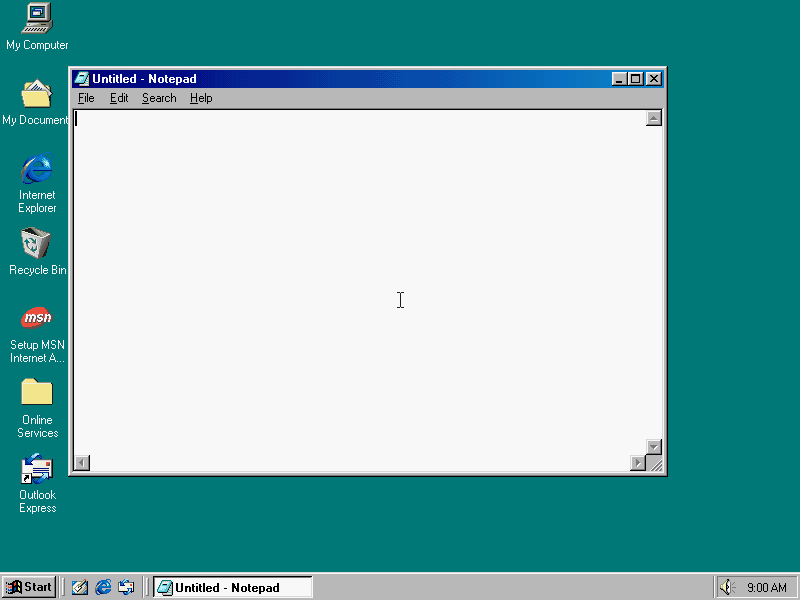
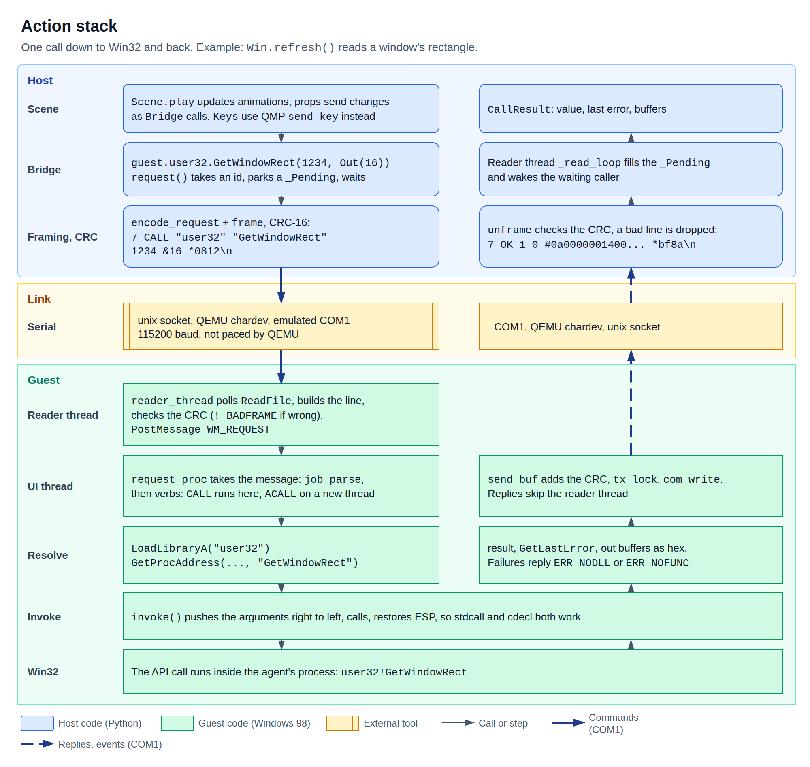

# Part 2: scenes

[Part 1](../setup/) builds the prepared Windows 98 image. Part 2 runs it. A Python script on the
host drives the real desktop inside QEMU and records the screen.

Python draws nothing. Each window, letter and brush stroke is made by Windows, and the video is
what the guest's screen showed. That is the whole idea of art98, and it decides what the API can
and cannot do.


**Parked.** Notepad, Paint, Minesweeper, Screensaver and Dialog still work, but
`from art98.anim import *` leaves them out until each program returns as its own action
class. Samples that use them import them from `art98.anim.apps`. The MVP's one window is [`Picture`](scene-api.md#picture).

## A first scene

```python
from art98.anim import *
from art98.anim.apps import Notepad


class Hello(Scene):
    def construct(self):
        pad = Notepad()
        self.add(pad)
        self.pause(0.5)
        self.play(TypeWithCursor(pad, "hello from 1998"))
        self.wait(1)
        self.play(pad.animate.shift(280 * RIGHT + 120 * DOWN), run_time=2)
        self.pause(1)
        self.play(Close(pad))
        self.pause(1)
```

```bash
uv run art98 render examples/hello.py Hello -o hello.mp4
```



## Pages

| Page | What it covers |
| --- | --- |
| [Tutorial](tutorial.md) | Your first scenes, step by step. Start here. |
| [Scene API](scene-api.md) | `Scene`, props, app props, rendering. |
| [Animations](animations.md) | Everything you pass to `play`, and how to write your own. |
| [Gallery](gallery.md) | One short scene per feature, with its GIF and source. |
| [Bridge](bridge.md) | The raw Win32 proxy behind `self.guest`. |
| [Instruction set](instruction-set.md) | The serial protocol the agent speaks. |
| [Win32 recipes](win32-recipes.md) | Win32 calls that are known to work from the agent. |
| [App catalog](app-catalog.md) | What is on the image, and how each program behaves. |

## The layers

A scene talks to `art98.anim`. That layer turns each frame into Win32 calls through the bridge.
The agent makes those calls inside Windows and sends the results back over COM1. Real key
presses and screen captures go to QEMU over QMP instead.



You can drop down a layer at any point. `self.guest` is the raw bridge, so any Win32 call can sit
between two animations:

```python
from art98.anim import *
from art98.anim.apps import Notepad


class Lower(Scene):
    def construct(self):
        pad = Notepad(at=(200, 120))
        self.add(pad)
        self.guest.user32.SetWindowTextA(pad.hwnd, "Renamed by a raw Win32 call")
        self.pause(1)
```

## Time

Scenes run under the `free` clock, the only one so far. The guest runs all the time.

- What the script drives lands on exact frames. A window at 30% of its move is captured at 30%.
- What the guest times for itself follows the host clock. That covers caret blinks, tooltips,
  the taskbar clock and screensavers.

So a `play` is repeatable to the frame, but the guest's own animations depend on how fast the
host renders. `self.wait` and `self.live` record at host speed for that reason, and `self.pause`
holds a single capture. See [`Scene`](scene-api.md#time).

A scene never touches the prepared image. `art98 render` boots a private copy, and deletes it
afterwards.

## How it differs from Manim

| Thing | Manim | art98 |
| --- | --- | --- |
| Units | Scene units, y up | Screen pixels, y down |
| `UP` | `(0, 1)` | `(0, -1)` |
| Objects | Geometry you draw | Real windows that exist in the guest |
| `add` | Shows the object | Starts the program, which can take a moment |
| Frame | Rendered by Manim | Captured from the guest's screen |
| `wait` | Holds a still image | Records the guest in real time. `pause` holds a still |

The names otherwise match where the meaning matches: `play`, `run_time`, `rate_func`, `smooth`,
`.animate`, `shift`, `move_to`, `next_to`, `to_edge`, `to_corner`, `AnimationGroup`, `Succession`,
`LaggedStart`, `MoveAlongPath`.

## Not built yet

These are planned and left out because the current agent cannot do them honestly, or because
nothing needs them yet.

- `frozen`, `stepped` and `locked` clocks. A scene with any other `clock` raises
  `NotImplementedError`.
- `FadeIn` and `FadeOut`. Windows 98 has no window opacity, so a real fade needs a dither in the
  agent. `Close` is the honest exit for now.
- Batched calls. Each frame sends its Win32 calls one by one, except that a move and a resize of
  one window become a single `SetWindowPos`.
- `add_updater`, sections, `Write`, `Scroll` and shape drawing on Paint's canvas.

Audio is left out on purpose. art98 is video only for now.
