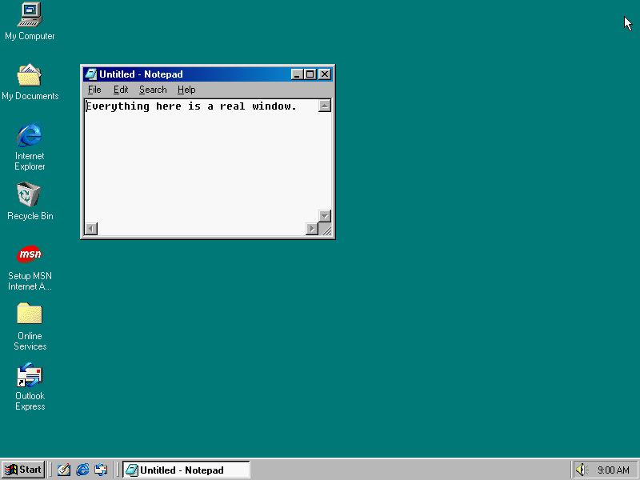
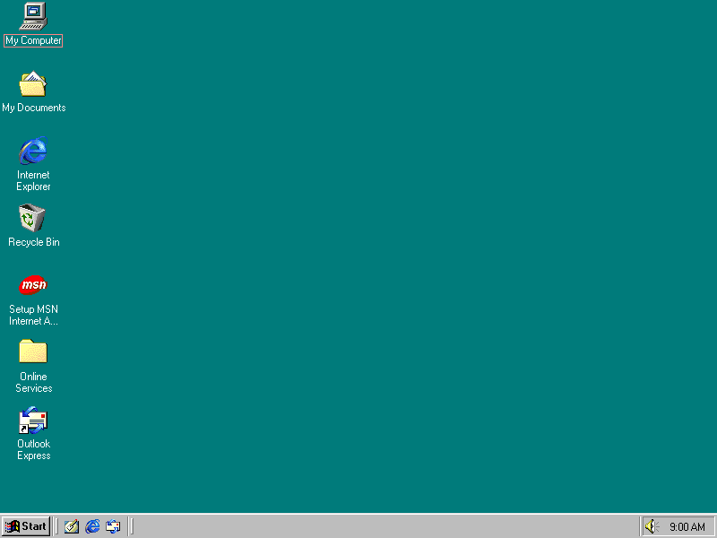
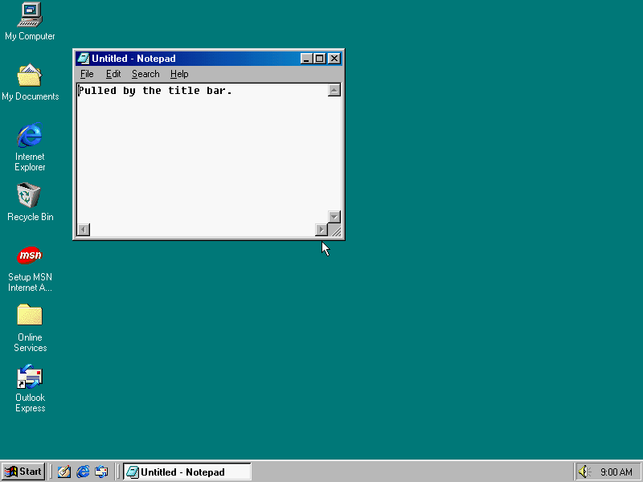
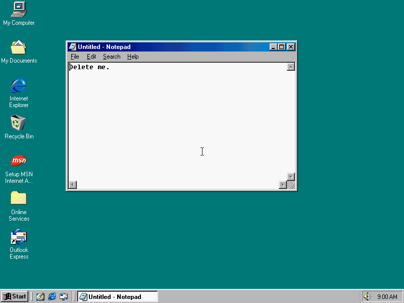

# Animations

An animation is one change over time. You pass it to [`Scene.play`](scene-api.md#playing).

Every animation takes `run_time` and `rate_func` as keywords. A value given to `play` overrides
both.

Most samples here use Notepad as the window to act on.

## How one runs

`play` calls `begin(scene)` once. Then it calls `update(progress)` on each frame, with `progress`
reaching exactly 1 on the last. Then it calls `finish(scene)`. An animation finishes on its own
last frame, before that frame is captured.

`begin` runs when the animation starts, not when you create it. So `Click(pad.title_bar)` aims at
where the title bar is by then.

## Rate functions

A rate function maps progress to eased progress. The formulas are Manim's.

| Name | Shape |
| --- | --- |
| `smooth` | Eases in and out. The default, except for text and keys. |
| `linear` | Constant speed. |
| `smoothstep` | A gentler ease in and out. |
| `rush_into` | Starts slowly, ends fast. |
| `rush_from` | Starts fast, ends slowly. |
| `there_and_back` | Goes there and returns, so the prop ends where it began. |

```python
from art98.anim import *


class Rates(Scene):
    def construct(self):
        pad = Notepad(at=(100, 100), size=(300, 200))
        self.add(pad)
        self.play(pad.animate.shift(320 * RIGHT), run_time=1, rate_func=rush_from)
        self.play(pad.animate.shift(200 * DOWN), run_time=1.5, rate_func=there_and_back)
        self.pause(0.5)
```

## Moving props

### prop.animate

`prop.animate.<layout call>` gives an `Animate`. Any [`Box`](scene-api.md#box) layout method
works, and calls chain. Default run time 1 s.

The end state is worked out when it begins, on a copy of the prop. Only the fields that change
are driven, so two `.animate` calls on one window can share a `play`.

For a window, each frame is a real move or resize ([`Win`](scene-api.md#win)): the app gets
`WM_SIZE` and lays itself out again.

Call the result to set its timing, which is handy inside a group:
`pad.animate.shift(100 * DOWN)(run_time=2)`.

```python
from art98.anim import *


class Chained(Scene):
    def construct(self):
        pad = Notepad(at=(100, 80), size=(300, 200))
        self.add(pad)
        self.play(pad.animate.shift(200 * RIGHT).resize(400, 300), run_time=1.5)
        self.play(pad.animate.to_edge(DOWN, buff=10))
        self.pause(0.5)
```



Source: [window_motion.py](../../recipes/scenes/gallery/window_motion.py).

### Teleport

`Teleport(target, to=None, *, aligned_edge=ORIGIN, size=None)` puts a window somewhere else in
one frame, with nothing in between. `to` and `aligned_edge` work as in `move_to`, so by default
the window's centre lands on `to`. `size` changes its outer size as well. It needs `to`, `size`
or both.

```python
from art98.anim import *


class Jump(Scene):
    def construct(self):
        pic = Picture("Jump", at=(100, 100), size=(320, 240))
        self.add(pic)
        self.pause(0.5)
        self.play(Teleport(pic, (40, 40), aligned_edge=UL, size=(240, 180)))
        self.pause(0.5)
```

### MoveAlongPath

`MoveAlongPath(target, path, *, run_time=1.0, rate_func=smooth)`

Carries a prop's centre along a path. The path is a list of points, walked at even speed, or a
function from 0..1 to a point.

```python
import math

from art98.anim import *


class Orbit(Scene):
    def construct(self):
        pad = Notepad(size=(240, 160))
        self.add(pad)

        def circle(t):
            return (
                400 + 200 * math.cos(2 * math.pi * t),
                280 + 120 * math.sin(2 * math.pi * t),
            )

        self.play(MoveAlongPath(pad, circle), run_time=3, rate_func=linear)
        self.pause(0.5)
```

## Combining

### Wait

`Wait(run_time=1.0)` does nothing for a while. It is for use inside a `Succession`.

### AnimationGroup

`AnimationGroup(*animations, lag_ratio=0.0, run_time=None, rate_func=None)`

Runs animations together, or staggered. With `lag_ratio` 0 they all start at once. With 1 each
starts as the one before it ends. A child begins when its turn comes, so a `Click` starts from
wherever the pointer is by then.

The default run time is what the children need. The group's `rate_func` shapes the group's time
and defaults to `linear`.

Children that overlap can't drive the same thing. That raises `ValueError`.

### Succession

`Succession(*animations)` is a group with `lag_ratio=1`: one after another, as one animation.

```python
from art98.anim import *


class InOrder(Scene):
    pointer_visible = True

    def construct(self):
        pad = Notepad(at=(120, 100), size=(420, 260))
        self.add(pad)
        self.play(
            Succession(
                Glide((300, 400)),
                Wait(0.3),
                Click(pad.client(40, 40)),
                TypeWithCursor(pad, "one after another"),
            )
        )
        self.pause(0.5)
```

### LaggedStart

`LaggedStart(*animations, lag_ratio=0.05)` starts each animation a fraction of the way through
the one before.

```python
from art98.anim import *


class Staggered(Scene):
    def construct(self):
        pads = [Notepad(at=(30 + 180 * i, 40), size=(170, 120)) for i in range(4)]
        self.add(*pads)
        self.play(
            LaggedStart(*(pad.animate.shift(300 * DOWN) for pad in pads), lag_ratio=0.3)
        )
        self.pause(0.5)
```

## The pointer

These are real input ([Pointer](scene-api.md#pointer)), so Windows decides what each press
means. A target is a point, a [`Spot`](scene-api.md#spot) or a prop. Only one pointer animation
can run in a `play`; a second raises `ValueError`.



Source: [pointer_clicks.py](../../recipes/scenes/gallery/pointer_clicks.py).

### Glide

`Glide(target, *, run_time=0.5, rate_func=smooth)`

Moves the pointer with no buttons held.

### Hover

`Hover(target, *, hold=1.0, travel_time=0.5)`

Moves to a target and stays for `hold` seconds. Tooltips are timed by the guest, so these frames
follow the host clock to give the tooltip real time to appear. The run time is the travel plus
the hold.

```python
from art98.anim import *


class Tooltip(Scene):
    desktop = "stock"  # it uses the desktop icons or the taskbar

    def construct(self):
        self.play(Hover((768, 587), hold=1.5))
        self.pause(0.5)
```

### Click

`Click(target, *, button=None, run_time=0.65, rate_func=smooth)`

Travels to the target, presses, and releases. The press is at 74% of the run time and the release
at 84%, so the button shows pressed for a few frames. `button` is `"left"`, `"right"` or
`"middle"`. Default `"left"`.

### RightClick

`RightClick(target, *, run_time=0.65, rate_func=smooth)`

`Click` with the right button. A context menu opens on the release.

### DoubleClick

`DoubleClick(target, *, run_time=0.75, rate_func=smooth)`

Two clicks, a few frames apart. Windows times a double click by its own clock (500 ms), so both
fall in the same short stretch of the run time. The real gap also includes the time to capture
those frames, so keep the run time short.

```python
from art98.anim import *


class OpenMyComputer(Scene):
    desktop = "stock"  # it uses the desktop icons or the taskbar

    def construct(self):
        self.play(DoubleClick((38, 22)))
        self.wait(1)
        self.play(RightClick((640, 300)))
        self.wait(0.5)
        self.play(Keys("esc"))
        self.pause(0.5)
```

### Drag

`Drag(source, to=None, *, by=None, button="left", run_time=1.2, rate_func=smooth)`

Travels to `source`, presses, carries the pointer, and lets go. Give `to` for a target or `by` for
an offset, not both. Windows moves whatever was grabbed, so a title bar drags its window and a
frame corner resizes it. Afterwards every prop reads its real position back.



Source: [drag_window.py](../../recipes/scenes/gallery/drag_window.py).

```python
from art98.anim import *


class DragAndResize(Scene):
    pointer_visible = True

    def construct(self):
        pad = Notepad(at=(90, 60), size=(340, 240))
        self.add(pad)
        self.play(Drag(pad.title_bar, by=(280, 150)))
        self.play(Drag(pad.corner(DR), by=(-60, 100)))
        self.pause(0.5)
```

### Stroke

`Stroke(path, *, button="left", steps_per_frame=4, run_time=2.0, rate_func=smooth)`

Holds a button down along a path, as a pen does. The path is a list of points or a function from
0..1 to a point. The pointer first travels to the start for 0.4 s, and `rate_func` shapes only
the drawing.

Each frame moves the pointer `steps_per_frame` times and waits for the guest after each move.
Windows keeps only the latest pointer position, so without the wait an app sees a few corners
instead of a curve. More steps give a smoother line and a slower render.

```python
from art98.anim import *


class Line(Scene):
    pointer_visible = True

    def construct(self):
        paint = Paint(at=(120, 40), size=(520, 480))
        self.add(paint)
        self.play(Click(paint.tool("pencil")))
        self.play(
            Stroke(
                [paint.canvas(40, 60), paint.canvas(360, 60), paint.canvas(200, 240)]
            )
        )
        self.pause(0.5)
```

### Menu

`Menu(window, *labels, step=0.45)`

Opens a window's menu with real clicks, and picks an item. It is a `Succession` of one `Click` per
label, `step` seconds each. Labels are matched in the live menu, ignoring case and `&` marks.

Windows only knows where a menu item is once its menu is open, so each click is aimed when its
turn comes. An unknown label raises `LookupError` listing what is there.



Source: [menus_keys.py](../../recipes/scenes/gallery/menus_keys.py).

```python
from art98.anim import *


class WordWrap(Scene):
    pointer_visible = True

    def construct(self):
        pad = Notepad(at=(120, 90), size=(300, 220))
        self.add(pad)
        pad.set_text("A line long enough to reach past the right edge of this window.")
        self.pause(0.5)
        self.play(Menu(pad, "Edit", "Word Wrap"))
        self.pause(1)
```

## Text and keys

There are two routes for text.

| | `TypeWithCursor` | `Keys`, `TypeKeys` |
| --- | --- | --- |
| Reaches | One known control | Whatever has the focus |
| Route | `WM_CHAR` through the bridge | QMP `send-key` to the guest's keyboard |
| Focus | Not needed | Needed |
| Works in | Notepad and Edit controls | Dialogs, games, the MS-DOS Prompt |
| Characters | cp1252 | US keyboard, printable ASCII, `\n`, `\t` |

Use `TypeWithCursor` when you can. Real keys take host time for each press.

### TypeWithCursor

`TypeWithCursor(target, text, *, run_time=None, rate_func=linear)`

Types into a Notepad or Edit control, one `WM_CHAR` per letter, so the real caret moves. The
default run time gives ten letters a second. `\n` starts a new line.

### UntypeWithCursor

`UntypeWithCursor(target, count, *, run_time=None, rate_func=linear)`

Deletes `count` letters from the caret, with Backspace.

```python
from art98.anim import *


class Retype(Scene):
    def construct(self):
        pad = Notepad(at=(120, 90), size=(480, 300))
        self.add(pad)
        self.play(TypeWithCursor(pad, "Today the computer wrote back."))
        self.play(UntypeWithCursor(pad, 11, run_time=0.8))
        self.play(TypeWithCursor(pad, "typed by itself."))
        self.pause(0.5)
```

### Keys

`Keys(*combos, run_time=None, rate_func=linear)`

Presses keys or chords, evenly over the run time. Each argument is one press, such as `"alt+tab"`,
`"shift+home"`, `"enter"` or `"f5"`. This is Windows 98: Notepad has no Ctrl+A, for one. The default gives 0.25 s a key. Names are QEMU's, plus `enter`,
`escape`, `space`, `del`, `win`, `pageup` and `pagedown`.

### TypeKeys

`TypeKeys(text, *, run_time=None, rate_func=linear)`

Types on the real keyboard, at 0.15 s a key by default. It raises `ValueError` for a character
the US layout can't type.

```python
from art98.anim import *


class RealKeys(Scene):
    def construct(self):
        pad = Notepad(at=(120, 90), size=(480, 300))
        self.add(pad)
        self.play(TypeKeys("Real keys: (1 + 2) = 3!"))
        self.play(Keys("shift+home", "del"))
        self.pause(0.5)
```

## Window state

These post `WM_SYSCOMMAND`, so Windows does what its own title bar buttons do. Each takes one
frame.

### Minimize, Maximize, RestoreWindow

`Minimize(window)` sends it to the taskbar. `Maximize(window)` fills the desktop.
`RestoreWindow(window)` brings it back.

```python
from art98.anim import *


class States(Scene):
    def construct(self):
        pad = Notepad(at=(160, 110), size=(360, 240))
        self.add(pad)
        self.pause(0.5)
        self.play(Maximize(pad))
        self.pause(0.5)
        self.play(RestoreWindow(pad))
        self.pause(0.5)
        self.play(Minimize(pad))
        self.pause(0.5)
        self.play(RestoreWindow(pad))
        self.pause(0.5)
```

### Close

`Close(window)` closes the window and takes it off stage. For Notepad that skips the save prompt.

## Writing your own

Subclass `Animation`.

`Animation(target=None, *, run_time=None, rate_func=None)`

| Member | Meaning |
| --- | --- |
| `run_time` | Class default 1.0 s. |
| `rate_func` | Class default `smooth`. |
| `begin(scene)` | Once, at the start. Adds a `target` prop if it isn't on stage, and sets `self.scene`. |
| `interpolate(alpha)` | Each frame, with `alpha` after the rate function. Override this. |
| `update(progress)` | Each frame, before the rate function. It calls `interpolate`. Override this instead for timed stages. |
| `finish(scene)` | Once, at the end. |
| `claims` | Names only one animation may drive, such as `("pointer",)`. |
| `live` | `True` makes `play` follow the host clock. |

For something Windows does at once, subclass `Instant` and write `act()`. It runs once.

```python
from art98.anim import *

SW_HIDE, SW_SHOW = 0, 5


class Hide(Instant):
    def act(self):
        self.target.guest.user32.ShowWindow(self.target.hwnd, SW_HIDE)


class Blink(Animation):
    def interpolate(self, alpha):
        command = SW_HIDE if int(alpha * 6) % 2 else SW_SHOW
        self.target.guest.user32.ShowWindow(self.target.hwnd, command)


class Blinking(Scene):
    def construct(self):
        pad = Notepad(at=(200, 120), size=(320, 200))
        self.add(pad)
        self.play(Blink(pad, run_time=2, rate_func=linear))
        self.play(Hide(pad))
        self.pause(0.5)
```
