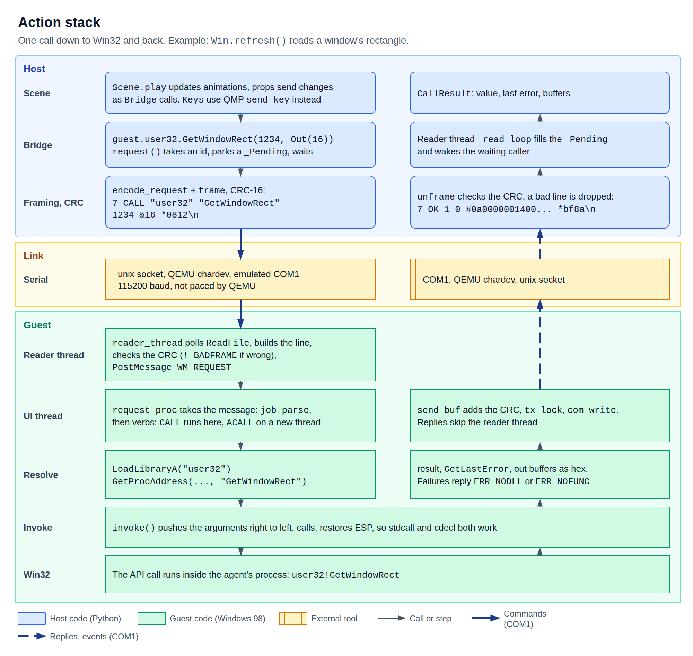
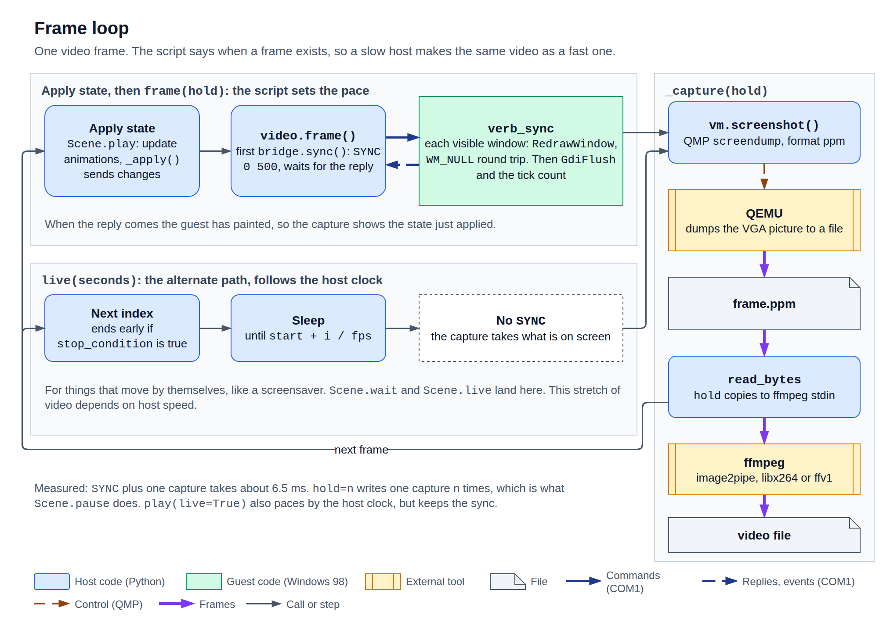

# Bridge

The bridge is the host's side of the link to the guest. It lets Python call any Win32 function
inside Windows 98. Scenes reach it as `self.guest`. This page is the full reference, from `boot`
down to `VM` and QMP. Audio is deferred, so only picture is covered.

The scene layer sits on top of this and has its own page, the [Scene API](scene-api.md). The wire
format is in the [Instruction set](instruction-set.md). Tested calls are in
[Win32 recipes](win32-recipes.md).



```python
from art98 import boot

with boot() as session:
    guest = session.bridge
    guest.spawn("notepad.exe")
    pad = guest.find_window(class_name="Notepad")
    guest.move_window(pad.hwnd, 100, 80)
    guest.sync()
    session.vm.screenshot("notepad.png")
```

The top-level names are `boot`, `Session`, `Bridge`, `CallResult`, `Window`, `Out`, `VM`, `VMConfig`,
`BridgeError`, `BridgeTimeout` and `GuestCrashed`. `FrameRecorder` and `private_stage` are in
`art98.session`. `QemuError` and `QMP` are in `art98.qemu`.

## Sessions

### boot

`boot(work="work", display="none", ready_timeout=30.0) -> Session`

Restores the `ready` snapshot of the prepared image, connects to the agent and waits for it to
answer. It takes about 0.1 s.

| Parameter | Meaning |
| --- | --- |
| `work` | Folder with `image.json`. The QEMU log goes to `<work>/qemu.log`. |
| `display` | QEMU's `-display` value. `"none"` runs headless. |
| `ready_timeout` | Seconds to wait for the agent. |

Raises `FileNotFoundError` when `image.json` is missing, which means setup has not run. If the agent
never answers, the VM is closed and the `BridgeTimeout` is raised.

Each boot starts from the same moment, so nothing from an earlier run survives. But two VMs can't
share one disk, and a run writes to it. Use `private_stage` for anything other than a single run.

### private_stage

`art98.session.private_stage(work="work")`

A context manager that gives a throwaway copy-on-write copy of the image in `work/runs/`, and
deletes it afterwards. Pass the path it gives to `boot`. Several can run at once.

```python
from art98 import boot
from art98.session import private_stage

with private_stage("work") as stage, boot(stage) as session:
    print(session.bridge.ping())
```

### Session

`class Session(vm, bridge)`

One running stage. `with` closes it on exit.

| Member | Meaning |
| --- | --- |
| `vm` | The [`VM`](#vm). |
| `bridge` | The [`Bridge`](#bridge-1). |
| `record(path, fps=30, lossless=False)` | Opens a [`FrameRecorder`](#framerecorder). |
| `close()` | Closes the bridge, then the VM. |

### FrameRecorder

`class FrameRecorder(session, path, fps=30, lossless=False)`

Encodes frames to a video. Frames are taken when the script asks, so a slow host makes the same
video as a fast one. Use it as a context manager, because the video is only complete after `close`.



By default ffmpeg writes H.264 with `-preset veryfast -crf 12 -pix_fmt yuv420p`. With
`lossless=True` it writes FFV1 in `bgr0`, which needs a container such as `.mkv`. `ffmpeg` must be on
`PATH`.

| Member | Meaning |
| --- | --- |
| `frame(hold=1)` | Runs `sync`, captures one frame and writes it `hold` times. |
| `live(seconds, stop_condition=None)` | Captures `round(seconds * fps)` frames on the host's clock, with no `sync`. |
| `count` | Frames written so far. |
| `close()` | Finishes the video. |

`frame` is for what the script drives. `hold` is cheap: 30 held copies take 45 ms, against about
340 ms for 30 separate frames.

`live` is for things that move on their own, such as a screensaver. That part of the video depends
on how fast the host runs. If it is given, `stop_condition` is checked before each frame and returns
true to stop early. If a capture takes longer than a frame, `live` does not skip frames, so it runs
long.

```python
with session.record("demo.mp4", fps=30) as video:
    video.frame(hold=30)
    guest.spawn(r'"C:\WINDOWS\SYSTEM\3D Pipes.scr" /s')
    video.live(3.0)
```

Calling `frame` after `close` raises `QemuError`, because the capture folder has gone.

## Bridge

`class Bridge(sock, timeout=10.0)`

Requests to the agent. `sock` is a connected socket. Most code gets a `Bridge` from `boot`.
`timeout` is the default in seconds for every request, and can be changed at any time through
`bridge.timeout`.

It is safe to use from several threads: 8 threads made 1600 calls in 0.58 s with no errors. A reader
thread takes replies off the socket, and a lock guards writes.

`with` closes it on exit. Closing does not touch the guest.

### Connecting

| Method | Meaning |
| --- | --- |
| `Bridge.connect(path, timeout=10.0)` | Class method. Connects to a Unix socket, normally `vm.serial_path`. |
| `wait_ready(timeout=60.0)` | Sends `PING` until the agent answers. Raises `BridgeTimeout` if it never does, and `BridgeError` if the protocol version differs. Tries are at most 2 s apart. |
| `ping(timeout=None)` | Returns the guest's tick count in ms. |
| `close()` | Closes the socket and joins the reader. |

### Calling Win32

| Method | Meaning |
| --- | --- |
| `call(dll, function, *args, timeout=None)` | Calls a function on the agent's UI thread. Returns a [`CallResult`](#callresult). |
| `acall(dll, function, *args)` | Calls on a new thread. Returns an [`AsyncCall`](#asynccall). |
| `dll(name)` | A proxy for any DLL. `bridge.dll("comctl32").InitCommonControls()`. |
| `kernel32`, `user32`, `gdi32`, `shell32`, `advapi32`, `winmm` | Ready-made proxies. |
| `request(verb, *args, timeout=None)` | Sends one raw request. Returns `(values, rows)`. |

A proxy attribute is the function name, and `timeout` is the one keyword it takes.

```python
guest.user32.SetCursorPos(400, 300)
guest.call("user32", "SetCursorPos", 400, 300)                 # the same call
guest.user32.SendMessageA(hwnd, 0x0C, 0, "new text", timeout=2)
```

Names are the exported ones, so an ANSI function ends in `A`. Windows 98 has few wide functions.

### Arguments

| Python | Sent as | The function gets |
| --- | --- | --- |
| `int` | `123` | The value masked to 32 bits, so `-1` becomes `0xFFFFFFFF`. |
| `bool` | `1` or `0` | The number. |
| `None` | `0` | A null pointer. |
| `str` | `"text"` | A pointer to cp1252 text. Characters outside cp1252 become `?`. |
| `bytes`, `bytearray`, `memoryview` | `#hex` | A pointer to a copy. It comes back in `buffers`. |
| `Out(size)` | `&size` | A pointer to zeroed bytes. They come back in `buffers`. |

Anything else, such as a `float`, raises `TypeError`. At most 14 arguments fit a call.

### Windows

| Method | Meaning |
| --- | --- |
| `windows(parent=0)` | Lists windows as [`Window`](#window) objects. With 0, all top-level windows. With a handle, all descendants. Hidden ones are included, and the agent's own window is not. |
| `find_window(title=None, class_name=None, parent=0, timeout=10.0)` | Waits for a visible window, checking every 0.1 s. `title` is a case-insensitive substring. `class_name` is case-insensitive and exact. Raises `BridgeTimeout` if none appears. |
| `move_window(hwnd, x, y)` | Moves a window with `SetWindowPos`, keeping its size and stacking order, then repaints it. A plain move leaves stale pixels on the frame on Windows 98. |
| `sync(hwnd=0, timeout_ms=500)` | Waits for one window, or all visible ones, to repaint. Returns the tick count. |
| `set_display_mode(width, height, depth, persist=True)` | Switches display mode. `persist=True` also writes it to the registry. Raises `BridgeError` if the driver has no such mode. See [Display modes](win32-recipes.md#display-modes). |

### Processes and files

| Method | Meaning |
| --- | --- |
| `spawn(command, cwd=None)` | Starts a program. Returns its process id. It returns before any window exists. |
| `processes()` | Lists `(pid, path)` tuples. |
| `put_file(path, data)` | Writes a guest file in 4 KB chunks. Replaces any existing file. |
| `get_file(path)` | Reads a guest file in 4 KB chunks. |

A failed `spawn`, `put_file` or `get_file` raises `BridgeError`. `put_file` does not check how many
bytes were written.

### Events

| Method | Meaning |
| --- | --- |
| `wait_event(name, timeout=None)` | Takes the oldest unread event called `name`, and returns its values. Waits for one if needed. Raises `BridgeTimeout`. |
| `clear_events()` | Forgets all unread events. |

The bridge keeps the last 256 `HELLO`, `CRASH` and `BADFRAME` events. `DONE` goes to the
`AsyncCall` instead, so `wait_event("DONE")` never finds it. See [Events](instruction-set.md#events).

```python
guest.clear_events()
call = guest.acall("kernel32", "RaiseException", 0xE0001234, 0, 0, 0)
code, address = guest.wait_event("CRASH", timeout=3)
guest.wait_event("HELLO", timeout=3)
```

To send `QUIT`, use `request("QUIT")`. There is no method for it.

## CallResult

`class CallResult(value, last_error, buffers)`

| Member | Meaning |
| --- | --- |
| `value` | The return value as an unsigned 32-bit number. |
| `signed` | The same value as a signed number. |
| `last_error` | `GetLastError()` right after the call. |
| `buffers` | Each `bytes` or `Out` argument after the call, in order. |

`bool(result)` is true for a non-zero value. `int(result)` gives the value, and a result works
anywhere Python wants an index.

A Win32 failure is not an exception. Check the value.

```python
result = guest.kernel32.DeleteFileA(r"C:\NOPE.TXT")
assert (result.value, result.last_error) == (0, 2)

left, top, right, bottom = struct.unpack("<4i", guest.user32.GetWindowRect(hwnd, Out(16)).buffers[0])
```

## Out

`class Out(size)`

Reserves `size` zeroed bytes on the guest for one call. Up to about 8180 bytes fit in a reply. See
[Limits](instruction-set.md#limits).

The pointer lasts for one call. For memory that stays valid, see
[Guest memory](win32-recipes.md#guest-memory).

## Window

`class Window(hwnd, pid, visible, rect, class_name, title)`

A snapshot of one window. Fields do not update, so fetch it again after a change.

| Field | Meaning |
| --- | --- |
| `hwnd` | The window handle. |
| `pid` | The owning process id. For a stub such as `WRITE.EXE` this differs from what `spawn` returned. |
| `visible` | `IsWindowVisible`. A minimised window counts as visible. |
| `rect` | `(left, top, right, bottom)` in screen pixels. |
| `class_name` | The window class. |
| `title` | The window text, up to 255 characters. |

`rect` holds edges, not a size. The width is `right - left`. Child windows also use screen
coordinates. Values are signed, and a window can lie off screen.

| State | Example `rect` |
| --- | --- |
| Normal | `(68, 66, 668, 477)` |
| Maximised | `(-4, -4, 804, 576)` |
| Minimised | `(3000, 3000, 3160, 3024)` |
| Taskbar | `(-2, 572, 802, 602)` |
| After `SetWindowPos(100, 80, 400, 300)` | `(100, 80, 500, 380)` |

`Window.from_row(row)` builds one from a raw `WINDOWS` row.

## AsyncCall

Returned by `acall`.

| Member | Meaning |
| --- | --- |
| `id` | The request id. |
| `done` | True once the result has arrived and has not been read yet. |
| `wait(timeout=None)` | Waits for the result and returns a [`CallResult`](#callresult). |

The result is handed over once. After `wait` returns, `done` is false, and a second `wait` times out.

`wait` raises `BridgeTimeout` in two more cases, and each looks like a slow call. So set a short
timeout, and read `CRASH` events if a crash matters.

- The function name or DLL was wrong. The agent's error is dropped.
- The agent crashed in the call.

If the link closes, `wait` raises `BridgeError`.

## Exceptions

| Exception | Raised when |
| --- | --- |
| `BridgeError` | The guest refused a request, such as `FILE: C:\NOPE.TXT`, or the link closed. |
| `BridgeTimeout` | No reply came in time. A subclass of `BridgeError`. |
| `GuestCrashed` | The agent crashed while a request was open. A subclass of `BridgeError`. The text has the code and address. |
| `QemuError` | QEMU failed to start or a QMP command failed. From `art98.qemu`. |
| `FrameError` | A frame failed its checks. From `art98.protocol`. The bridge drops such a frame, and the open request times out. |

After `BridgeTimeout` the request may still be running in the guest, and its reply is dropped when
it arrives. A `Sleep(1500)` with a 0.3 s timeout keeps the agent busy for the full 1.5 s, and later
requests queue behind it.

After `GuestCrashed` the agent is back in about 0.3 s. Windows and other programs carry on. Call
`wait_ready`, because requests sent in that gap are lost.

After the VM exits, every call raises `BridgeError("link to the guest closed")`.

## Threading

The agent has one UI thread that pumps messages. Every `CALL`, and every verb but `ACALL`, runs on
it, one at a time. While a `CALL` runs, nothing else does.

| Measured | Result |
| --- | --- |
| `PING` during `call("kernel32", "Sleep", 2000)` | Waits 1.9 s. |
| `PING` during `acall("kernel32", "Sleep", 2000)` | Answers in 8 ms. |

Use `acall` for:

- Long waits, such as `Sleep` or `WaitForSingleObject`.
- Calls that reboot or end Windows, such as `ExitWindowsEx`.
- Anything that shows a modal dialog in the agent, such as `MessageBoxA` and the common dialogs.

A `MessageBoxA` through `call` does not block other requests, because its modal loop pumps the
agent's messages too. `PING` answered in 4 ms with a box on screen. But the `CALL` itself stays open
until the box closes, so it hits the 10 s timeout.

`SendMessageA` is different. It waits inside the call, and the UI thread pumps no posted messages
while it does. So the agent is fully blocked until the target returns.

| Case | Effect | Do this |
| --- | --- | --- |
| Message opens a modal dialog in the target, such as `WM_COMMAND` for Help > About | Agent blocked until the dialog closes | Use `PostMessageA`. |
| Target is hung | Agent blocked | Use `PostMessageA`, or `SendMessageTimeoutA`. |
| Private struct pointer sent to another process | Agent can stay hung | Use [shared memory](win32-recipes.md#pass-a-struct-to-another-process). |

`vm.send_keys` still works with the agent blocked, because it goes through QEMU. A real Enter can
close the dialog and free the agent.

`PostMessageA` returns at once, so follow it with `sync(hwnd)` to wait for the effect.

A window created through `call` belongs to the UI thread. The agent pumps it, so it works. A window
created through `acall` dies with its thread.

`Bridge` is thread-safe. `QMP` and so `VM` are not, so keep captures and keys on one host thread, or
guard them with a lock.

## VM

`class VM(config, log=None)`

Runs QEMU. `log` is a file for its output. `boot` builds this for you.

| Member | Meaning |
| --- | --- |
| `config` | The [`VMConfig`](#vmconfig). |
| `serial_path`, `qmp_path` | The Unix sockets, under `$XDG_RUNTIME_DIR` when it is set. |
| `qmp` | The [`QMP`](#qmp) client, once started. |
| `running` | True while QEMU runs. |
| `start()` | Starts QEMU and returns the `VM`. Raises `QemuError` if it exits. It fails if another QEMU holds the disk. |
| `screenshot(path, format="png")` | Writes the screen to a file and returns the path. `format` can be `"png"` or `"ppm"`. |
| `send_keys(*qcodes, hold_ms=80)` | Presses keys together, as hardware. |
| `pause()`, `resume()` | Freeze and thaw the guest. |
| `save_snapshot(name)`, `load_snapshot(name)` | Save or restore all guest state. |
| `wait_exit(timeout)` | Waits for QEMU to exit. Returns true if it did. |
| `quit(timeout=15.0)` | Asks QEMU to quit. |
| `close()` | Stops QEMU if it is running, and removes the sockets. |

`with` calls `start` on entry and `close` on exit.

### Screenshots

A capture includes the pointer and follows the display mode. PPM takes 1.4 ms and PNG 5 ms. It
works while paused.

### Keys

`qcodes` are QEMU key names: `a`, `1`, `ret`, `spc`, `tab`, `esc`, `shift`, `ctrl`, `alt`, `meta_l`,
`delete`, `home`, `end`, `f1`, `dot`, `comma`, `slash`, `minus`, `equal`, `semicolon`, `apostrophe`,
`bracket_left`, `bracket_right`, `backslash`, `grave_accent`. A bad name raises `QemuError`.

`send_keys` returns in under 1 ms and QEMU plays the keys out afterwards. They go to the foreground
window.

| `hold_ms` | One key | Shifted key |
| --- | --- | --- |
| 80, the default | 152 ms | 308 ms |
| 40 | 76 ms | |
| 10 | 20 ms | |
| 1 | 2.5 ms | |

All of those arrived correctly when paced. Queueing 300 keys at once dropped 125 of them. See
[Type a string with real keys](win32-recipes.md#type-a-string-with-real-keys).

### Pause

While paused, every request times out. `screenshot` still works. The guest clock stops.

### Snapshots

The prepared image holds the `ready` snapshot. Save takes about 1.8 s and load 0.03 to 0.1 s. The
bridge stays connected through both, and the first `PING` after a load takes 42 ms.

Snapshot names live in the qcow2 file. Delete one with `vm.qmp.human_silent("delvm NAME")`. Never
change `ready`.

`load_snapshot` with a name that does not exist raises `QemuError`, and leaves the VM stopped. Its
status is `restore-vm`, and the next good load stays stopped too. Call `vm.resume()` after it.

### Ending

`wait_exit` is for when the guest ends the VM, such as a reboot under `-no-reboot`. A reboot exits
within a second. A shutdown does not exit, so call `close`.

## QMP

`class QMP` in `art98.qemu`, as `vm.qmp`

The QEMU control socket. It has no lock, so use it from one thread.

| Method | Meaning |
| --- | --- |
| `execute(command, **arguments)` | Runs a QMP command and returns its result. Raises `QemuError`. |
| `human(command)` | Runs a monitor command. Returns its text, errors included. |
| `human_silent(command)` | The same, and raises `QemuError` if the text says it failed. |
| `close()` | Closes the socket. |

```python
vm.qmp.execute("query-status")              # {'status': 'running', 'running': True}
vm.qmp.execute("query-version")["qemu"]     # {'major': 10, 'minor': 2, 'micro': 2}
print(vm.qmp.human("info snapshots"))
```

Relative mouse events work through `input-send-event`, and Windows doubles them like
`mouse_event`. Prefer `SetCursorPos`.

## VMConfig

`class VMConfig`

The QEMU settings, kept in `image.json`. `to_json()` and `from_json(data)` convert it.
`argv(qmp, serial)` builds the command line.

| Field | Default | Meaning |
| --- | --- | --- |
| `disk` | required | Path to the disk image. |
| `disk_format` | `"qcow2"` | Disk format. |
| `machine` | `"pc"` | Machine type. The image pins `pc-i440fx-10.2`, because a snapshot only loads on the same machine. |
| `accel` | `"tcg"` | Accelerator. |
| `cpu` | `"pentium3"` | CPU model. |
| `memory_mb` | 128 | Guest memory. |
| `vga` | `"cirrus"` | Video card. |
| `sound` | True | Keeps the Sound Blaster in the machine. Audio capture is deferred. |
| `rtc_base` | `"1998-06-25T09:00:00"` | Guest clock at power on. The clock runs from there on guest time. |
| `icount_shift` | None | Sets QEMU's `-icount` for deterministic time. |
| `floppy` | None | Floppy image. |
| `boot_once` | None | Boot device for the first boot. |
| `loadvm` | None | Snapshot to start from. `boot` sets `"ready"`. None is a cold boot, which reaches `HELLO` in 11.5 s. |
| `audio_wav` | None | Audio output file. Audio is deferred. |
| `display` | `"none"` | QEMU's `-display` value. |
| `extra_args` | `[]` | More QEMU arguments. |

A machine's hardware must match its snapshot, or the load fails. Don't change these on a config
that loads `ready`, apart from `display`.

## Timings

These are 200 samples each on the host, with the guest at the idle desktop. QEMU runs under TCG on
one host, so treat them as a guide.

| Operation | Median | 95% | Max |
| --- | --- | --- | --- |
| `ping` | 5.0 ms | 5.3 ms | 5.5 ms |
| `call`, `GetSystemMetrics` | 5.0 ms | | |
| `call`, `SetCursorPos` | 5.0 ms | | |
| `sync`, all windows | 5.0 ms | 5.2 ms | 6.4 ms |
| `sync`, one window | 5.0 ms | | |
| `windows`, 20 rows | 3.9 ms | 7.4 ms | 9.7 ms |
| `processes` | 5.0 ms | | |
| `screenshot`, PPM | 1.4 ms | 1.6 ms | 4.8 ms |
| `screenshot`, PNG | 5.1 ms | 6.6 ms | 8.8 ms |
| `sync` and PPM capture | 5.0 ms | | |
| `FrameRecorder.frame` | 11 ms | | |

| Other | Time |
| --- | --- |
| `boot`, to first reply | 0.1 s |
| Cold boot to `HELLO` | 11.5 s |
| `put_file` | 100 to 190 KB/s |
| `get_file` | 325 KB/s |
| Spawn to visible window | See the [App catalog](app-catalog.md) |
| `set_display_mode` | 65 to 150 ms |
| Save snapshot | 1.8 s |
| Load snapshot | 0.03 to 0.1 s |
| Agent back after a crash | 0.27 to 0.31 s |
| Reboot to QEMU exit | 0.7 s |

A round trip takes about 5 ms whatever the work, so 100 `SetPixel` calls take 0.5 s. To save round
trips, batch work into one call, such as `Polyline` with hundreds of points.
