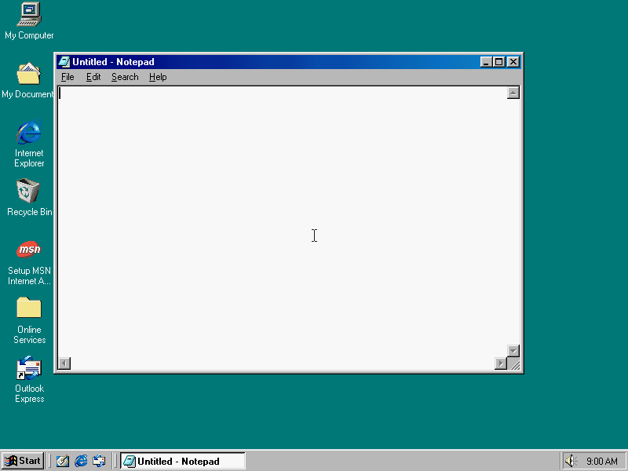
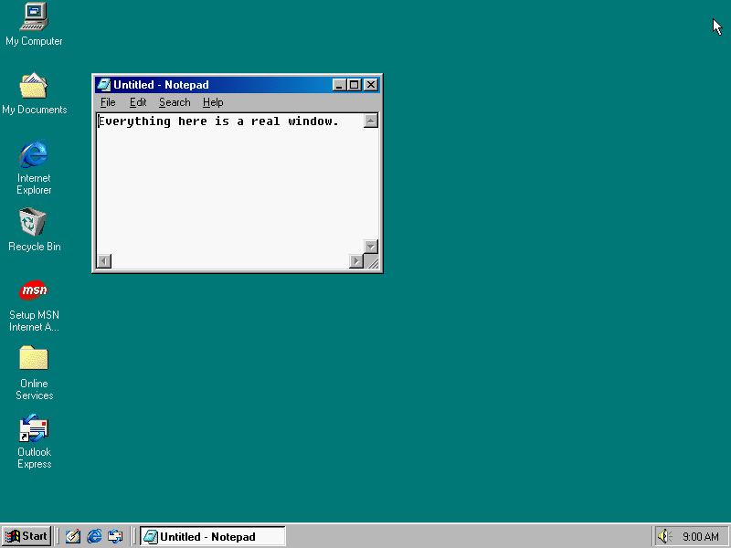
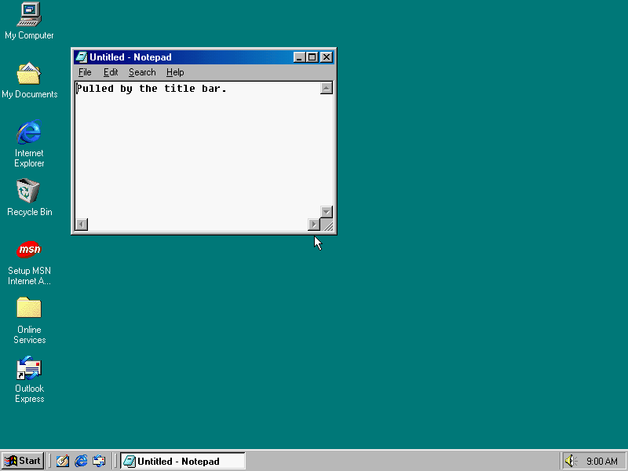
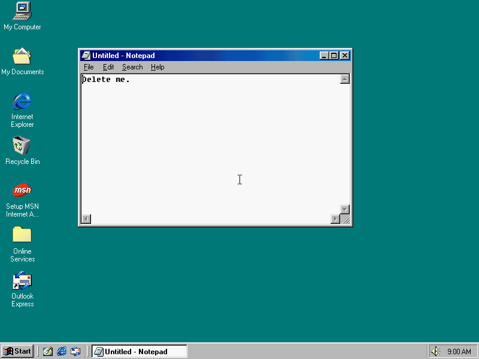

# Gallery

Each GIF is a real scene on the real image, cut down to keep the file small. To render them all:

```bash
uv run python artware_experiments/gallery/render_all.py
```

**Parked.** Notepad, Paint, Minesweeper, Screensaver and Dialog still work, but
`from art98.anim import *` leaves them out until each program returns as its own action
class. Samples that use them import them from `art98.anim.apps`. The MVP's one window is [`Picture`](scene-api.md#picture).
Every scene here but `pointer_clicks` uses one.

Give scene names to render only those, such as `render_all.py typing`. A GIF's frame rate and colours are set in that file.

## Hello

Notepad opens, types a line, moves across the desktop and closes.



Source: [hello.py](../../artware_experiments/hello.py)

```py
"""The Windows 98 equivalent of a triangle on screen.

Notepad opens, types a line, drifts across the desktop and closes.

    uv run art98 render artware_experiments/hello.py Hello -o hello.mp4
"""

from art98.anim import *
from art98.anim.apps import Notepad  # parked, see apps.py


class Hello(Scene):
    def construct(self):
        pad = Notepad()
        self.add(pad)
        self.pause(0.5)
        self.play(TypeWithCursor(pad, "hello from 1998"))
        self.wait(1)
        self.play(pad.animate.shift(280 * RIGHT + 120 * DOWN), run_time=2)
        self.pause(1)
        self.play(Close(pad))
        self.pause(1)
```

## Pointer and clicks

A double click on the desktop icon opens My Computer. A right click opens the desktop's context menu, and Esc closes it. Windows decides what each click means.


Source: [pointer_clicks.py](../../artware_experiments/gallery/pointer_clicks.py)

```py
"""Pointer and clicks: a double click opens My Computer, a right click a menu."""

from art98.anim import *


class PointerClicks(Scene):
    def construct(self):
        self.pause(0.4)
        self.play(Glide((200, 120)))
        self.play(DoubleClick((38, 22), run_time=0.9))
        self.wait(0.9)
        self.play(RightClick((640, 300)))
        self.wait(0.8)
        self.play(Keys("esc"))
        self.pause(0.5)
```

## Typing

Each letter is a `WM_CHAR` sent to Notepad's Edit control, so the real caret moves. Backspace works the same way.


Source: [typing.py](../../artware_experiments/gallery/typing.py)

```py
"""Typing: letters reach a real Edit control, and the caret moves with them."""

from art98.anim import *
from art98.anim.apps import Notepad  # parked, see apps.py


class Typing(Scene):
    def construct(self):
        pad = Notepad(at=(120, 90), size=(480, 300))
        self.add(pad)
        self.pointer.place((700, 500))
        self.pause(0.4)
        self.play(TypeWithCursor(pad, "Dear diary,\n\nToday the computer wrote back.", run_time=3))
        self.wait(0.8)
        self.play(UntypeWithCursor(pad, 11, run_time=0.8))
        self.play(TypeWithCursor(pad, "typed by itself.", run_time=1.6))
        self.wait(1)
```

## Window motion

A move, a resize, both at once, and a path. Each frame is one `SetWindowPos`.



Source: [window_motion.py](../../artware_experiments/gallery/window_motion.py)

```py
"""Window motion: a move, a resize, and both at once, as one SetWindowPos a frame."""

from art98.anim import *
from art98.anim.apps import Notepad  # parked, see apps.py


class WindowMotion(Scene):
    def construct(self):
        pad = Notepad(at=(100, 80), size=(320, 220))
        self.add(pad)
        self.pointer.place((780, 20))
        pad.set_text("Everything here is a real window.")
        self.pause(0.4)
        self.play(pad.animate.shift(320 * RIGHT + 60 * DOWN), run_time=1.2)
        self.play(pad.animate.resize(200, 140), run_time=0.8)
        self.play(pad.animate.to_corner(UL, buff=90), pad.animate.resize(420, 300), run_time=1.2)
        self.play(MoveAlongPath(pad, [(400, 200), (480, 340), (300, 340), (400, 200)]), run_time=2)
        self.pause(0.6)
```

## Dragging

The pointer holds the title bar, then the frame corner, and Windows does the moving. The script only moves the pointer.



Source: [drag_window.py](../../artware_experiments/gallery/drag_window.py)

```py
"""Dragging: Windows moves the window itself, because the pointer holds its title bar."""

from art98.anim import *
from art98.anim.apps import Notepad  # parked, see apps.py


class DragWindow(Scene):
    def construct(self):
        pad = Notepad(at=(90, 60), size=(340, 240))
        self.add(pad)
        pad.set_text("Pulled by the title bar.")
        self.pause(0.3)
        self.play(Drag(pad.title_bar, by=(280, 150), run_time=1.6))
        self.pause(0.3)
        self.play(Drag(pad.corner(DR), by=(-60, 100), run_time=1.4))
        self.pause(0.8)
```

## Menus and keys

`Menu` finds items in the live menu and clicks them. `Keys` and `TypeKeys` press real keys, which go to whatever has the focus.



Source: [menus_keys.py](../../artware_experiments/gallery/menus_keys.py)

```py
"""Menus and keys: real menu clicks select and stamp, real key presses delete and type."""

from art98.anim import *
from art98.anim.apps import Notepad  # parked, see apps.py


class MenusKeys(Scene):
    def construct(self):
        pad = Notepad(at=(130, 80), size=(460, 300))
        self.add(pad)
        pad.set_text("Delete me.")
        self.pause(0.3)
        self.play(Menu(pad, "Edit", "Select All"))
        self.pause(0.4)
        self.play(Keys("delete"))
        self.play(Menu(pad, "Edit", "Time/Date"))
        self.pause(0.4)
        self.play(TypeKeys("  Hello & 'goodbye'!", run_time=2))
        self.pause(0.8)
```

## Tooltip and dialog

The tray clock's tooltip comes up on the guest's own timer, so `Hover` runs on the host clock. The box is a real `MessageBoxA` and it moves like any window.


Source: [hover_dialog.py](../../artware_experiments/gallery/hover_dialog.py)

```py
"""A tooltip, which the guest times itself, and a real message box."""

from art98.anim import *
from art98.anim.apps import Dialog  # parked, see apps.py


class HoverDialog(Scene):
    def construct(self):
        self.pause(0.3)
        self.play(Hover((768, 587), hold=1.5))
        self.play(Glide((500, 150)))
        box = Dialog("Are you still there?", "art98", icon="question", buttons="yesno")
        self.add(box)
        self.pause(0.8)
        self.play(box.animate.shift(90 * LEFT + 100 * UP), run_time=0.8)
        self.pause(0.3)
        self.play(Click(box.button("Yes")))
        self.pause(0.7)
```

## Paint

Paint is moved and resized first. The tools, swatches and canvas are then found from the live window. The brush stroke is real input, and the fills are Paint's own.


Source: [paint_drawing.py](../../artware_experiments/gallery/paint_drawing.py)

```py
"""Paint: real strokes and real fills, with buttons found from the live window.

Paint is moved and resized first, so nothing here can rest on one layout.
"""

import math

from art98.anim import *
from art98.anim.apps import Paint  # parked, see apps.py

WIDTH, HEIGHT = 400, 310
RADIUS = 110


class PaintDrawing(Scene):
    def construct(self):
        paint = Paint(at=(150, 40), size=(520, 480))
        self.add(paint)
        self.pause(0.3)
        self.play(paint.animate.shift(90 * LEFT + 30 * DOWN), paint.animate.resize(500, 460),
                  run_time=0.7)
        self.play(paint.resize_canvas(WIDTH, HEIGHT, run_time=1))

        def flower(t):
            angle = 2 * math.pi * t
            radius = RADIUS * (1 + 0.3 * math.cos(6 * angle))
            return paint.canvas(WIDTH / 2 + radius * math.cos(angle),
                                HEIGHT / 2 + radius * math.sin(angle)).point()

        self.play(Click(paint.tool("brush")))
        self.play(Click(paint.color("navy"), run_time=0.5))
        self.play(Stroke(flower, run_time=2.6))
        self.play(Click(paint.tool("fill"), run_time=0.5))
        self.play(Click(paint.color("yellow"), run_time=0.5))
        self.play(Click(paint.canvas(20, 20), run_time=0.5))
        self.play(Click(paint.color("red"), run_time=0.5))
        self.play(Click(paint.canvas(WIDTH / 2, HEIGHT / 2), run_time=0.5))
        self.pause(1)
```

## Minesweeper

`find_mines` reads the board through the XYZZY cheat, between two frames. `clear` then wins with real clicks, and `sign_scoreboard` answers the best time prompt.


Source: [minesweeper_win.py](../../artware_experiments/gallery/minesweeper_win.py)

```py
"""Minesweeper: the board is read through the XYZZY cheat, then played by hand."""

from art98.anim import *
from art98.anim.apps import Minesweeper  # parked, see apps.py


class MinesweeperWin(Scene):
    def construct(self):
        board = Minesweeper(at=(300, 120))
        self.add(board)
        board.find_mines()
        self.pause(0.4)
        board.clear()
        board.sign_scoreboard()
```

## Screensaver

A screensaver is started with `/s` and recorded on the host clock. A pointer nudge ends it, as it would for a person.


Source: [screensaver.py](../../artware_experiments/gallery/screensaver.py)

```py
"""A screensaver, launched directly and recorded live, then dismissed."""

from art98.anim import *
from art98.anim.apps import Screensaver  # parked, see apps.py


class ScreensaverRun(Scene):
    def construct(self):
        self.pause(0.4)
        saver = Screensaver("Mystify Your Mind")
        self.add(saver)
        self.live(5)
        saver.stop()
        self.pause(0.6)
```
