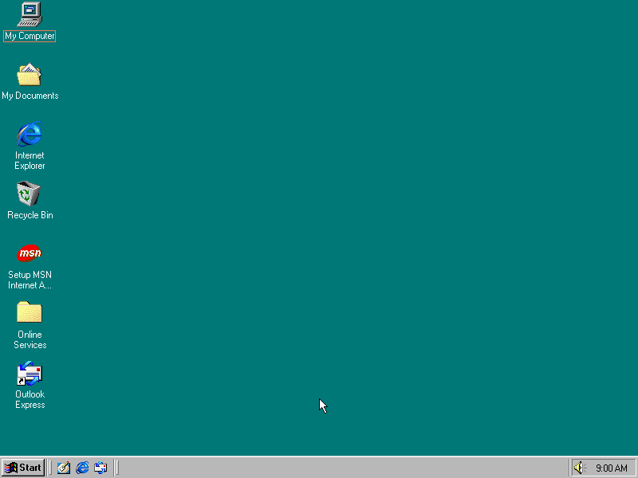
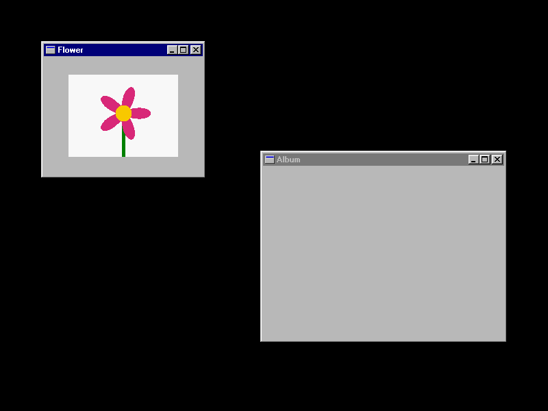
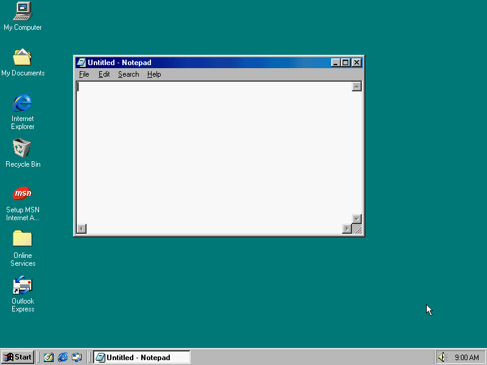
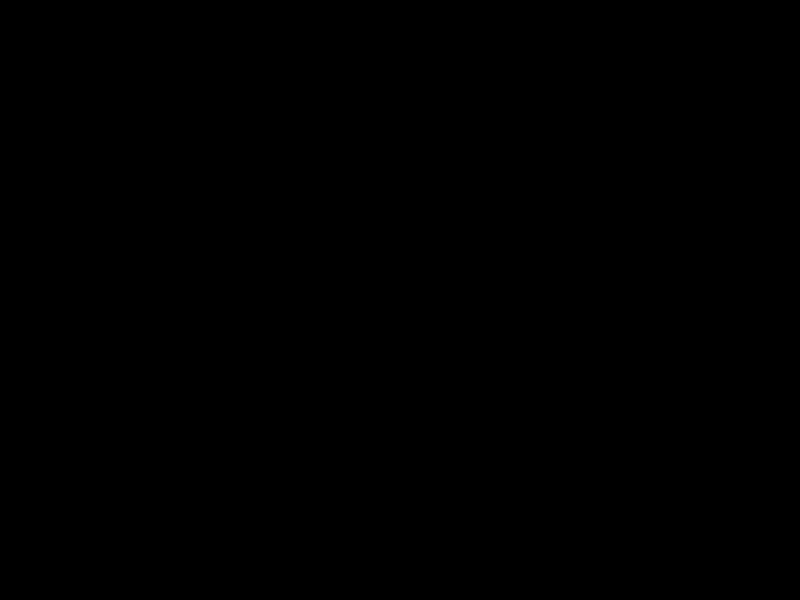
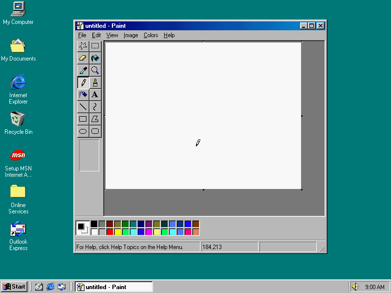
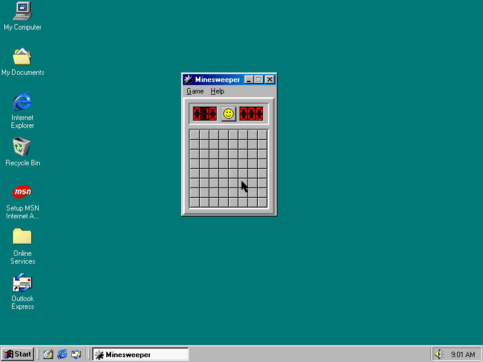

# Gallery

Each GIF is a real scene on the real image, cut down to keep the file small. To render them all:

```bash
uv run python tools/render_all.py
```

Every program in these samples (Notepad, Paint, Minesweeper, Screensaver, Dialog) is an action
class in `core/art98/actions/programs/`, and `from art98.anim import *` gives them all.

Give scene names to render only those, such as `render_all.py typing`. A GIF's frame rate and colours are set in that file.

## The README clip

Notepad types a line. Paint's canvas is pulled smaller by its corner handle, the window shrinks,
and a heart is drawn with the brush and filled. Minesweeper opens its biggest area with one click.
The pointer drags Notepad by its title bar, and a Yes/No message box is answered.



Source: [hero.py](../../examples/readme/hero.py)

```py
"""The README's opening clip: Notepad, Paint, Minesweeper and a message box in one take.

uv run art98 render examples/readme/hero.py -o hero.mp4 --gif hero.gif
"""

import math

from art98.anim import *

CANVAS = (300, 250)


class Hero(Scene):
    desktop = "stock"  # the taskbar and icons say "Windows 98" at a glance

    def construct(self):
        self.pointer.place((400, 500))
        self.pause(0.5)

        pad = Notepad(at=(20, 20), size=(240, 150))
        self.add(pad)
        self.play(TypeWithCursor(pad, "Hello from 1998.", run_time=1.3))

        # Paint opens big enough to show its whole canvas, so the corner handle is in reach.
        paint = Paint(at=(270, 10), size=(520, 480))
        self.add(paint)
        self.play(paint.resize_canvas(*CANVAS, run_time=0.8))
        self.play(paint.animate.set_rect(330, 10, 450, 400), run_time=0.6)

        def heart(t):
            a = 2 * math.pi * t
            x = 16 * math.sin(a) ** 3
            y = 13 * math.cos(a) - 5 * math.cos(2 * a) - 2 * math.cos(3 * a)
            y -= math.cos(4 * a)
            return paint.canvas(
                CANVAS[0] / 2 + 6.5 * x, CANVAS[1] / 2 - 10 - 6.5 * y
            ).point()

        self.play(Click(paint.tool("brush"), run_time=0.45))
        self.play(Click(paint.color("navy"), run_time=0.4))
        self.play(Stroke(heart, run_time=1.8))
        self.play(Click(paint.tool("fill"), run_time=0.45))
        self.play(Click(paint.color("red"), run_time=0.4))
        self.play(Click(paint.canvas(CANVAS[0] / 2, CANVAS[1] / 2), run_time=0.4))

        board = Minesweeper(at=(40, 220))
        self.add(board)
        mines = board.find_mines()  # between two frames, so it is never seen
        columns, rows = board.board_size
        safe = [(c, r) for c in range(columns) for r in range(rows)]
        best = max(
            (cell for cell in safe if cell not in mines),
            key=lambda cell: len(board.opened_by(cell)),
        )
        self.play(Click(board.cell(*best), run_time=0.6))
        self.pause(0.3)

        self.play(Drag(pad.title_bar, by=(200, 385), run_time=1.2))

        box = Dialog(
            "Keep this drawing?",
            "art98",
            icon="question",
            buttons="yesno",
            at=(540, 430),
        )
        self.add(box)
        self.pause(0.7)
        self.play(Click(box.button("Yes"), run_time=0.6))
        self.pause(1.2)
```

## The MVP: states and picture windows

Two picture windows are set from a state file, off camera. The Flower window glides right,
teleports to the corner and closes, and a Sky window opens. Then a second state replaces the
desktop, and its window moves down. This one was rendered through the container.



Source: [mvp.py](../../examples/mvp/mvp.py), with its
[states](../../examples/mvp/states/two_windows.json) beside it

```py
"""The MVP sample: picture windows, set from state files and moved on camera.

art98 render examples/mvp/mvp.py
"""

from pathlib import Path

from art98.anim import *

HERE = Path(__file__).parent


class Mvp(Scene):
    state = "states/two_windows.json"

    def construct(self):
        flower = self.prop("flower")
        self.pause(0.5)
        self.play(flower.animate.shift(200 * RIGHT), run_time=2)
        self.pause(0.5)
        self.play(Teleport(flower, to=(40, 40), aligned_edge=UL))
        self.pause(0.5)
        self.play(Close(flower))
        self.pause(0.5)
        self.add(
            Picture(
                "Sky", image=HERE / "assets" / "sky.bmp", at=(100, 260), size=(240, 200)
            )
        )
        self.pause(1)

        self.set_state("states/gallery.json")
        self.pause(1)
        self.play(self.prop("picture").animate.shift(100 * DOWN), run_time=2)
        self.pause(0.5)
```

## Hello

Notepad opens, types a line, moves across the desktop and closes.


Source: [hello.py](../../examples/hello.py)

```py
"""The Windows 98 equivalent of a triangle on screen.

Notepad opens, types a line, drifts across the desktop and closes.

    uv run art98 render examples/hello.py Hello -o hello.mp4
"""

from art98.anim import *


class Hello(Scene):
    desktop = "stock"  # made before the blank start, and it shows the pointer

    def construct(self):
        pad = Notepad()
        self.add(pad)
        self.pause(0.5)
        self.play(TypeWithCursor(pad, "hello from 1998"))
        self.wait(1)
        self.play(pad.animate.shift(280 * RIGHT + 120 * DOWN), run_time=2)
        self.pause(1)
        self.play(Close(pad))
        self.pause(1)
```

## Pointer and clicks

A double click on the desktop icon opens My Computer. A right click opens the desktop's context menu, and Esc closes it. Windows decides what each click means.


Source: [pointer_clicks.py](../../examples/gallery/pointer_clicks.py)

```py
"""Pointer and clicks: a double click opens My Computer, a right click a menu."""

from art98.anim import *


class PointerClicks(Scene):
    desktop = "stock"  # made before the blank start, and it shows the pointer

    def construct(self):
        self.pause(0.4)
        self.play(Glide((200, 120)))
        self.play(DoubleClick((38, 22), run_time=0.9))
        self.wait(0.9)
        self.play(RightClick((640, 300)))
        self.wait(0.8)
        self.play(Keys("esc"))
        self.pause(0.5)
```

## Typing

Each letter is a `WM_CHAR` sent to Notepad's Edit control, so the real caret moves. Backspace works the same way.



Source: [typing.py](../../examples/gallery/typing.py)

```py
"""Typing: letters reach a real Edit control, and the caret moves with them."""

from art98.anim import *


class Typing(Scene):
    desktop = "stock"  # made before the blank start, and it shows the pointer

    def construct(self):
        pad = Notepad(at=(120, 90), size=(480, 300))
        self.add(pad)
        self.pointer.place((700, 500))
        self.pause(0.4)
        self.play(
            TypeWithCursor(
                pad, "Dear diary,\n\nToday the computer wrote back.", run_time=3
            )
        )
        self.wait(0.8)
        self.play(UntypeWithCursor(pad, 11, run_time=0.8))
        self.play(TypeWithCursor(pad, "typed by itself.", run_time=1.6))
        self.wait(1)
```

## Window motion

A move, a resize, both at once, and a path. Each frame is one `SetWindowPos`.


Source: [window_motion.py](../../examples/gallery/window_motion.py)

```py
"""Window motion: a move, a resize, and both at once, as one SetWindowPos a frame."""

from art98.anim import *


class WindowMotion(Scene):
    desktop = "stock"  # made before the blank start, and it shows the pointer

    def construct(self):
        pad = Notepad(at=(100, 80), size=(320, 220))
        self.add(pad)
        self.pointer.place((780, 20))
        pad.set_text("Everything here is a real window.")
        self.pause(0.4)
        self.play(pad.animate.shift(320 * RIGHT + 60 * DOWN), run_time=1.2)
        self.play(pad.animate.resize(200, 140), run_time=0.8)
        self.play(
            pad.animate.to_corner(UL, buff=90),
            pad.animate.resize(420, 300),
            run_time=1.2,
        )
        self.play(
            MoveAlongPath(pad, [(400, 200), (480, 340), (300, 340), (400, 200)]),
            run_time=2,
        )
        self.pause(0.6)
```

## Dragging

The pointer holds the title bar, then the frame corner, and Windows does the moving. The script only moves the pointer.


Source: [drag_window.py](../../examples/gallery/drag_window.py)

```py
"""Dragging: Windows moves the window itself, because the pointer holds its title bar."""

from art98.anim import *


class DragWindow(Scene):
    desktop = "stock"  # made before the blank start, and it shows the pointer

    def construct(self):
        pad = Notepad(at=(90, 60), size=(340, 240))
        self.add(pad)
        pad.set_text("Pulled by the title bar.")
        self.pause(0.3)
        self.play(Drag(pad.title_bar, by=(280, 150), run_time=1.6))
        self.pause(0.3)
        self.play(Drag(pad.corner(DR), by=(-60, 100), run_time=1.4))
        self.pause(0.8)
```

## Menus and keys

`Menu` finds items in the live menu and clicks them. `Keys` and `TypeKeys` press real keys, which go to whatever has the focus.


Source: [menus_keys.py](../../examples/gallery/menus_keys.py)

```py
"""Menus and keys: real menu clicks select and stamp, real key presses delete and type."""

from art98.anim import *


class MenusKeys(Scene):
    desktop = "stock"  # made before the blank start, and it shows the pointer

    def construct(self):
        pad = Notepad(at=(130, 80), size=(460, 300))
        self.add(pad)
        pad.set_text("Delete me.")
        self.pause(0.3)
        self.play(Menu(pad, "Edit", "Select All"))
        self.pause(0.4)
        self.play(Keys("delete"))
        self.play(Menu(pad, "Edit", "Time/Date"))
        self.pause(0.4)
        self.play(TypeKeys("  Hello & 'goodbye'!", run_time=2))
        self.pause(0.8)
```

## Tooltip and dialog

The tray clock's tooltip comes up on the guest's own timer, so `Hover` runs on the host clock. The box is a real `MessageBoxA` and it moves like any window.


Source: [hover_dialog.py](../../examples/gallery/hover_dialog.py)

```py
"""A tooltip, which the guest times itself, and a real message box."""

from art98.anim import *


class HoverDialog(Scene):
    desktop = "stock"  # made before the blank start, and it shows the pointer

    def construct(self):
        self.pause(0.3)
        self.play(Hover((768, 587), hold=1.5))
        self.play(Glide((500, 150)))
        box = Dialog("Are you still there?", "art98", icon="question", buttons="yesno")
        self.add(box)
        self.pause(0.8)
        self.play(box.animate.shift(90 * LEFT + 100 * UP), run_time=0.8)
        self.pause(0.3)
        self.play(Click(box.button("Yes")))
        self.pause(0.7)
```

## Dialog storm

A cascade of eight `???` boxes on a teal desktop, a jittered pair of greyed boxes with a custom
icon, a box that types its own text, then the colour changes to dark red. A state then adds a
tiled wallpaper, and one more box. The wallpaper comes from a CD in the guest's drive D:. The
frames are the same on host QEMU, Podman and Docker (measured before the VM service, when a render could still run QEMU on the host). The file also holds a second scene,
`DialogStormStock`, for the stock desktop.



Source: [dialog_storm.py](../../examples/dialog_storm/dialog_storm.py), with its
[state](../../examples/dialog_storm/states/wall.json) beside it

```py
"""A dialog storm: a cascade of message boxes, a jittered pair, typing text, a new
desktop colour and a wallpaper (docs/design/inspiration.md, B3 to B7).

    art98 render examples/dialog_storm/dialog_storm.py DialogStorm
    art98 render examples/dialog_storm/dialog_storm.py DialogStormStock
"""

import random

from art98.anim import *

FRAME = 1 / 24
BOX = (300, 130)  # outer size, a bit more than the stock box


class DialogStorm(Scene):
    fps = 24
    desktop = "blank"

    def construct(self):
        self.pause(0.5)
        self.play(Backdrop("teal"))
        self.pause(0.5)

        # Cascade candidate: this loop by hand is the case for a library helper.
        x0, y0 = 60, 330
        for i in range(8):
            self.add(
                Dialog(
                    "???",
                    "???",
                    icon="warning",
                    at=(x0 + 24 * i, y0 - 18 * i),
                    size=BOX,
                )
            )
            self.pause(2 * FRAME)
        self.pause(0.5)
        self.next_section("pair")

        rng = random.Random(98)
        for _ in range(2):
            jitter = (rng.randint(-4, 4), rng.randint(-4, 4))
            self.add(
                Dialog(
                    "???",
                    "???",
                    icon="computer",
                    disabled=True,
                    size=BOX,
                    at=(400 + jitter[0], 380 + jitter[1]),
                )
            )
            self.pause(2 * FRAME)
        self.pause(0.5)

        self.next_section("typing")
        typed = Dialog("", "???", at=(120, 60), size=BOX)
        self.add(typed)
        self.pause(FRAME)
        for n in range(1, 8):
            typed.set_message("ABCDEFG"[:n])
            self.pause(FRAME)
        self.pause(0.5)

        self.next_section("colour")
        self.play(Backdrop("dark_red"))
        self.pause(0.5)
        self.cut()
        self.set_state("states/wall.json")
        self.add(Dialog("???", "???", icon="warning", at=(260, 200), size=BOX))
        self.pause(1)


class DialogStormStock(Scene):
    """The same boxes on the stock desktop: taskbar and icons, on a dark red colour."""

    fps = 24
    desktop = "stock"

    def construct(self):
        self.pause(0.5)
        self.play(Backdrop("dark_red"))
        for i in range(4):
            self.add(
                Dialog(
                    "???",
                    "???",
                    icon="warning",
                    at=(200 + 24 * i, 250 - 18 * i),
                    size=BOX,
                )
            )
            self.pause(2 * FRAME)
        self.pause(1)
```

## Paint

Paint is moved and resized first. The tools, swatches and canvas are then found from the live window. The brush stroke is real input, and the fills are Paint's own.



Source: [paint_drawing.py](../../examples/gallery/paint_drawing.py)

```py
"""Paint: real strokes and real fills, with buttons found from the live window.

Paint is moved and resized first, so nothing here can rest on one layout.
"""

import math

from art98.anim import *

WIDTH, HEIGHT = 400, 310
RADIUS = 110


class PaintDrawing(Scene):
    desktop = "stock"  # made before the blank start, and it shows the pointer

    def construct(self):
        paint = Paint(at=(150, 40), size=(520, 480))
        self.add(paint)
        self.pause(0.3)
        self.play(
            paint.animate.shift(90 * LEFT + 30 * DOWN),
            paint.animate.resize(500, 460),
            run_time=0.7,
        )
        self.play(paint.resize_canvas(WIDTH, HEIGHT, run_time=1))

        def flower(t):
            angle = 2 * math.pi * t
            radius = RADIUS * (1 + 0.3 * math.cos(6 * angle))
            return paint.canvas(
                WIDTH / 2 + radius * math.cos(angle),
                HEIGHT / 2 + radius * math.sin(angle),
            ).point()

        self.play(Click(paint.tool("brush")))
        self.play(Click(paint.color("navy"), run_time=0.5))
        self.play(Stroke(flower, run_time=2.6))
        self.play(Click(paint.tool("fill"), run_time=0.5))
        self.play(Click(paint.color("yellow"), run_time=0.5))
        self.play(Click(paint.canvas(20, 20), run_time=0.5))
        self.play(Click(paint.color("red"), run_time=0.5))
        self.play(Click(paint.canvas(WIDTH / 2, HEIGHT / 2), run_time=0.5))
        self.pause(1)
```

## Minesweeper

`find_mines` reads the board through the XYZZY cheat, between two frames. `clear` then wins with real clicks, and `sign_scoreboard` answers the best time prompt.



Source: [minesweeper_win.py](../../examples/gallery/minesweeper_win.py)

```py
"""Minesweeper: the board is read through the XYZZY cheat, then played by hand."""

from art98.anim import *


class MinesweeperWin(Scene):
    desktop = "stock"  # made before the blank start, and it shows the pointer

    def construct(self):
        board = Minesweeper(at=(300, 120))
        self.add(board)
        board.find_mines()
        self.pause(0.4)
        board.clear()
        board.sign_scoreboard()
```

## Screensaver

A screensaver is started with `/s` and recorded on the host clock. A pointer nudge ends it, as it would for a person.


Source: [screensaver.py](../../examples/gallery/screensaver.py)

```py
"""A screensaver, launched directly and recorded live, then dismissed."""

from art98.anim import *


class ScreensaverRun(Scene):
    desktop = "stock"  # made before the blank start, and it shows the pointer

    def construct(self):
        self.pause(0.4)
        saver = Screensaver("Mystify Your Mind")
        self.add(saver)
        self.live(5)
        saver.stop()
        self.pause(0.6)
```
