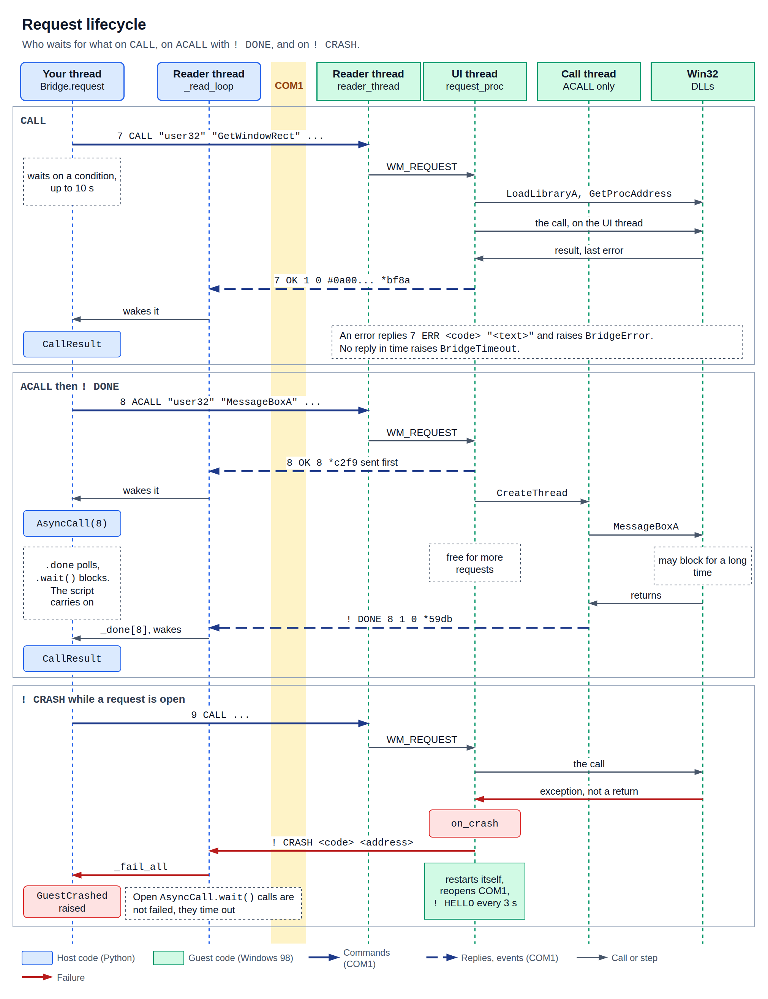

# Instruction set

The agent is a small Win32 program, `C:\ART98\AGENT.EXE`. It starts with Windows and answers text
requests on COM1. This page is the reference for that protocol, version 1. Most scripts never see
it, because [`Bridge`](bridge.md) speaks it for them.

Every example here is a real capture from Windows 98. The bytes are exact, including the
checksums. `>` is host to guest and `<` is guest to host.



## Transport

COM1 runs at 115200 baud, 8N1, with no flow control. On the host the port is a Unix socket that
`VM` creates, with a path such as `/run/user/1000/art98-XXXX/serial`.

QEMU does not pace the socket to the baud rate. Real throughput is well above 11 KB/s. See
[Timings](bridge.md#timings).

Text is cp1252 in both directions.

## Frames

One frame is one line, in both directions.

```text
<payload> *<crc16>\n
```

- `payload` is the message.
- A space and a `*` come next.
- `crc16` is four hex digits of the CRC of the payload. The space and `*` are not included.
- The line ends in `\n`. A `\r` becomes part of the line and fails the CRC.

The CRC is CRC-16/CCITT-FALSE: polynomial `0x1021`, initial value `0xFFFF`, no reflection, no final
XOR. Its check value for `123456789` is `0x29B1`.

```python
def crc16(data: bytes) -> int:
    crc = 0xFFFF
    for byte in data:
        crc ^= byte << 8
        for _ in range(8):
            crc = (crc << 1 ^ 0x1021 if crc & 0x8000 else crc << 1) & 0xFFFF
    return crc
```

The agent sends lower-case hex and accepts either case.

## Messages

| Direction | Shape | Meaning |
| --- | --- | --- |
| Request | `<id> <VERB> <args...>` | Host asks. |
| Row | `<id> + <values...>` | One item of a list. Zero or more come before the final reply. |
| Success | `<id> OK <values...>` | Final reply. |
| Error | `<id> ERR <code> "<text>"` | Final reply. |
| Event | `! <NAME> <values...>` | Guest speaks unprompted. |

`id` is a number the host chooses, and the reply echoes it. `Bridge` counts up from 1. The id is
what pairs replies with requests, so requests may overlap.

The verb is case-sensitive and upper case. Fields are separated by one or more spaces.

## Arguments

| Form | Example | Type | What the guest function receives |
| --- | --- | --- | --- |
| Decimal | `123` | DWORD | The number. |
| Hex | `0x7b` | DWORD | The number. The `0x` must be lower case. |
| String | `"text"` | String | A pointer to the unescaped bytes. |
| In/out buffer | `#68690000` | Buffer | A pointer to the decoded bytes. |
| Out buffer | `&32` | Buffer | A pointer to 32 zeroed bytes. |

Buffers of both kinds come back in the reply, in argument order. That is how structs such as `RECT`
reach the host. Strings do not come back. All these pointers last for one call.

A number has no sign. `-1` is malformed, so send `4294967295`. A number too big for 32 bits wraps
silently: `4294967296` becomes 0.

A string may hold these escapes: `\n`, `\r`, `\t` and `\xHH`. Any other backslash stands for the
next character, so `\\` is a backslash, `\"` is a quote and `\q` is `q`. A `\x00` ends the C string
early, so `lstrlenA("a\x00b")` is 1.

A blob's hex may be either case. It comes back lower case. An empty blob `#` and `&0` are valid.

### Reply values

Values use the same forms: decimal DWORDs, quoted strings and `#hex` blobs. A DWORD is always
unsigned, so a negative screen coordinate arrives as `4294967294`.

## Verbs

### PING

Checks the link and reads the guest's clock.

```text
<id> PING
<id> OK <tick> <version>
```

| Value | Meaning |
| --- | --- |
| `tick` | `GetTickCount()`, milliseconds since Windows started. |
| `version` | The protocol version, 1. |

Extra arguments are ignored. `PING` waits its turn on the agent's UI thread, so it also shows
whether that thread is free.

```text
> 2 PING *428f
< 2 OK 54391 1 *939c
```

### CALL

Calls any exported function on the agent's UI thread and waits for it.

```text
<id> CALL "<dll>" "<function>" <args...>
<id> OK <value> <last_error> <buffers...>
```

| Argument | Meaning |
| --- | --- |
| `dll` | A name for `LoadLibraryA`. |
| `function` | A name for `GetProcAddress`. The name is case-sensitive, and ANSI names end in `A`. |
| `args` | Up to 14 arguments, pushed right to left. |

| Value | Meaning |
| --- | --- |
| `value` | `EAX` after the call. Junk for a `void` function. |
| `last_error` | `GetLastError()` right after the call. The agent clears it first. |
| `buffers` | Every `#` and `&` argument after the call, in order. |

The agent restores the stack pointer after each call. So `stdcall`, `cdecl` and a wrong argument
count are all safe.

Errors: `BADARG` when the names are missing, `NODLL`, `NOFUNC`. If the function faults, the reply
is replaced by [`CRASH`](#crash).

A number:

```text
> 3 CALL "user32" "GetSystemMetrics" 0 *3431
< 3 OK 800 0 *0172
```

An out buffer. The eight bytes are the pointer's position, x = 400 and y = 300:

```text
> 4 CALL "user32" "GetCursorPos" &8 *6cc7
< 4 OK 33 0 #900100002c010000 *d579
```

An in/out buffer and a string:

```text
> 5 CALL "kernel32" "lstrcpyA" #000000000000 "hi" *73ea
< 5 OK 5308700 0 #686900000000 *3dc5
```

A failing call still gets `OK`. The failure is in `value` and `last_error`. Here 2 means file not
found:

```text
> 6 CALL "kernel32" "DeleteFileA" "C:\\NOPE.TXT" *b6cf
< 6 OK 0 2 *2947
```

A bad name:

```text
> 25 CALL "nope" "x" *9ffe
< 25 ERR NODLL "nope" *bcfb
> 26 CALL "user32" "Nope" *597a
< 26 ERR NOFUNC "Nope" *2982
```

### ACALL

Calls a function on a new thread, so the agent stays free.

```text
<id> ACALL "<dll>" "<function>" <args...>
<id> OK <id>
! DONE <id> <value> <last_error> <buffers...>
```

The `OK` only means the job was accepted. The result arrives later as a [`DONE`](#done) event. Its
fields match `CALL`.

```text
> 22 ACALL "kernel32" "Sleep" 100 *65fa
< 22 OK 22 *0310
< ! DONE 22 258 0 *306f
```

`Sleep` returns nothing, so 258 is whatever was left in `EAX`. The `DONE` came 105 ms after the
`OK`.

```text
> 23 ACALL "user32" "GetCursorPos" &8 *504f
< 23 OK 23 *ab50
< ! DONE 23 33 0 #900100002c010000 *2a37
```

Errors from the parser come back in place of the `OK`. Name errors come after it, so a request can
get `OK` and then `ERR` with the same id:

```text
> 45 ACALL "nope" "x" *ae6a
< 45 OK 45 *40de
< 45 ERR NODLL "nope" *58fb
```

`BADARG` for missing names behaves the same way. `Bridge` drops that late `ERR`. See
[Known gaps](#known-gaps).

### WINDOWS

Lists windows.

```text
<id> WINDOWS <parent>
<id> + <hwnd> <pid> <visible> <left> <top> <right> <bottom> "<class>" "<title>"
<id> OK <count>
```

With `parent` 0 this is `EnumWindows`, every top-level window, hidden ones too. With a window
handle it is `EnumChildWindows`, which includes all descendants. The agent's own hidden window is
left out.

The rectangle is `GetWindowRect`: right and bottom edges in screen coordinates, not a size. Negative
values arrive as large unsigned numbers. A title longer than 255 characters or a class longer than
127 is cut.

A missing or non-numeric `parent` counts as 0. A handle that does not exist gives `OK 0`.

```text
> 7 WINDOWS 0 *cdd4
< 7 + 272 4294958109 0 0 0 0 0 "tooltips_class32" "" *3e87
< 7 + 200 4294958109 1 4294967294 572 802 602 "Shell_TrayWnd" "" *cb73
  ... 17 more rows ...
< 7 + 260 4294958109 1 0 0 800 600 "Progman" "Program Manager" *2cb4
< 7 OK 20 *537f
```

```text
> 8 WINDOWS 260 *dda3
< 8 + 264 4294958109 1 0 0 800 572 "SHELLDLL_DefView" "" *c6ad
< 8 + 268 4294958109 1 0 0 800 572 "SysListView32" "" *5ec9
< 8 + 276 4294958109 0 0 0 0 0 "SysHeader32" "" *6139
< 8 OK 3 *7392
```

### PROCS

Lists processes through Toolhelp.

```text
<id> PROCS
<id> + <pid> "<path>"
<id> OK <count>
```

Error: `SYS` if `CreateToolhelp32Snapshot` fails. That never happened in testing.

```text
> 9 PROCS *3873
< 9 + 4279197593 "C:\\WINDOWS\\SYSTEM\\KERNEL32.DLL" *2efc
  ... 7 more rows ...
< 9 OK 8 *8759
```

### SPAWN

Starts a program with `CreateProcessA`. No shell is involved.

```text
<id> SPAWN "<command line>" ["<directory>"]
<id> OK <pid> <tid>
```

`OK` comes as soon as the process exists, before it opens a window. A second argument that is not a
string is ignored.

Errors: `BADARG` without a string, `SPAWN` if `CreateProcessA` fails. The text is the command line.

```text
> 10 SPAWN "notepad.exe" *cea7
< 10 OK 4294965701 4294895761 *bec9
> 13 SPAWN "notepad.exe" "C:\\WINDOWS\\SYSTEM" *cc72
< 13 OK 4294901497 4294900741 *fe1d
> 14 SPAWN "C:\\NOPE.EXE" *a583
< 14 ERR SPAWN "C:\\NOPE.EXE" *fcce
```

### SYNC

Waits for repainting, then reports the clock. A capture taken after the reply shows what the host
just asked for.

```text
<id> SYNC [<hwnd>] [<timeout_ms>]
<id> OK <tick>
```

| Argument | Default | Meaning |
| --- | --- | --- |
| `hwnd` | 0 | The window to settle. 0 means every visible top-level window. |
| `timeout_ms` | 500 | The most to wait for each window. |

For each window the agent calls `RedrawWindow` with `RDW_UPDATENOW | RDW_ALLCHILDREN`, then sends
`WM_NULL` with `SendMessageTimeoutA` and `SMTO_ABORTIFHUNG`, which proves the window's thread has
emptied its queue. Last comes `GdiFlush`.

A hung window costs at most `timeout_ms`, and a handle that does not exist returns at once. Neither
is an error. So `OK` does not prove the window repainted.

```text
> 15 SYNC 312 500 *8c1d
< 15 OK 54693 *b056
> 16 SYNC 0 500 *492b
< 16 OK 54718 *0e6b
```

### PUT

Writes bytes to a file.

```text
<id> PUT "<path>" <offset> #<data>
<id> OK <written>
```

Offset 0 creates the file or empties it. Any other offset needs an existing file. Writing past the
end extends the file, and the gap holds whatever was on the disk.

Errors: `BADARG` for a bad shape, `FILE` when the file cannot be opened. That covers a missing
folder, a program that is running, and a non-zero offset on a missing file.

```text
> 17 PUT "C:\\A.TXT" 0 #68656c6c6f *1768
< 17 OK 5 *c865
> 18 PUT "C:\\A.TXT" 5 #20776f726c64 *4a1f
< 18 OK 6 *3d05
```

### GET

Reads bytes from a file.

```text
<id> GET "<path>" [<offset>] [<length>]
<id> OK <file size> #<data>
```

`offset` defaults to 0 and `length` to 8192. Past the end of the file the data is empty, and the
size is still reported.

Do not use the default length on a file over 8 KB. The reply no longer fits one frame. See
[Limits](#limits).

Errors: `BADARG` for a bad shape or a length over 8192, `FILE` if the file cannot be opened.

```text
> 19 GET "C:\\A.TXT" 0 4096 *eca4
< 19 OK 11 #68656c6c6f20776f726c64 *61c3
> 20 GET "C:\\A.TXT" 6 3 *7960
< 20 OK 11 #776f72 *c71f
> 21 GET "C:\\NOPE.TXT" 0 10 *b92e
< 21 ERR FILE "C:\\NOPE.TXT" *d99d
```

### QUIT

Ends the agent. The reply comes first.

```text
<id> QUIT
<id> OK 0
```

Nothing restarts the agent afterwards. See
[Start the agent again](win32-recipes.md#start-the-agent-again).

```text
> 11 QUIT *692e
< 11 OK 0 *1521
```

## Events

Events start with `!` and have no id.

### HELLO

```text
! HELLO <version> <tick>
```

The agent sends this when it starts, then every 3 s until it receives its first valid frame.

`Bridge.wait_ready` does not use it. It sends `PING` instead. Setup uses `HELLO` to see the installed agent come
up.

```text
< ! HELLO 1 9621 *d850
```

That one came 11.5 s after a cold boot started.

### CRASH

```text
! CRASH <code> <address>
```

An unhandled exception reached the agent's filter. It sends this, closes COM1, starts a new copy of
itself and exits. Windows and other programs carry on. The new agent says `HELLO` about 0.25 s
after the crash (0.27 to 0.31 s until it answers a request, see [Timings](bridge.md#timings)). Any open request gets no reply. Requests sent during the gap are lost, and the new agent can
see a partial frame, which gives a `BADFRAME`.

Here a call jumps to unmapped memory:

```text
> 33 CALL "user32" "CallWindowProcA" 1879048192 0 0 0 0 *2253
< ! CRASH 3221225477 3220527302 *1759
< ! HELLO 1 57574 *be0b
```

`3221225477` is `0xC0000005`, an access violation. And here a call raises its own exception, with
the `HELLO` timer running because the new agent has not heard from the host yet:

```text
> 27 CALL "kernel32" "RaiseException" 3758101044 0 0 0 *c827
< ! CRASH 3758101044 4200970 *9bea
< ! HELLO 1 55159 *386c
< ! HELLO 1 58179 *6788
```

### DONE

```text
! DONE <id> <value> <last_error> <buffers...>
```

The result of an [`ACALL`](#acall). `id` is the request's id.

A thread that crashes reports `CRASH` and never sends `DONE`.

### BADFRAME

```text
! BADFRAME
```

A line arrived with a wrong or missing checksum. The event has no id, because a bad frame can't
be trusted to hold one. An empty line and a line ending in `\r\n` also count.

```text
> 5 PING *0000
< ! BADFRAME *6d15
```

## Error codes

| Code | Text | Sent when |
| --- | --- | --- |
| `BADARG` | `malformed argument` | An argument could not be parsed. |
| `BADARG` | `too many arguments` | More than 16 arguments. |
| `BADARG` | `CALL needs dll and function names` | `CALL` or `ACALL` lacks its two strings. |
| `BADARG` | `SPAWN needs a command line` | First argument is not a string. |
| `BADARG` | `PUT needs path, offset and data` | Wrong shape. |
| `BADARG` | `GET needs path, offset and a sane length` | Wrong shape, or length over 8192. |
| `NODLL` | The DLL name | `LoadLibraryA` failed. |
| `NOFUNC` | The function name | `GetProcAddress` failed. |
| `BADVERB` | The verb | Unknown verb, including an empty one. |
| `SPAWN` | The command line | `CreateProcessA` failed. |
| `FILE` | The path | `CreateFileA` failed. |
| `SYS` | `CreateToolhelp32Snapshot failed` | `PROCS` could not list processes. |

Real samples:

```text
> 24 NOPE *02bd
< 24 ERR BADVERB "NOPE" *27b7
> 507 CALL "user32" "GetSystemMetrics" -1 *3ce1
< 507 ERR BADARG "malformed argument" *00a0
> 523 CALL *f1de
< 523 ERR BADARG "CALL needs dll and function names" *444e
```

## Limits

| Name | Value | Applies to |
| --- | --- | --- |
| `MAX_LINE` | 16384 | Bytes in one line, in the reader's buffer and in the COM1 queues. |
| `MAX_ARGS` | 16 | Arguments in one request. `CALL` uses two for names, leaving 14. |
| `MAX_BLOB` | 8192 | Bytes in one `#` or `&` buffer, and in a `GET` length. |
| `PROTOCOL_VERSION` | 1 | Reported by `PING` and `HELLO`. |
| `HELLO_INTERVAL_MS` | 3000 | Gap between `HELLO` events. |
| `READ_POLL_MS` | 2 | Reader sleep when no bytes have arrived. |

Hex doubles the size of data on the wire, so `MAX_LINE` is reached before `MAX_BLOB`. In practice:

| Direction | Largest that works |
| --- | --- |
| Request line | 16384 bytes, not counting `\n`. |
| `#` buffer in a `CALL` | About 8170 bytes. The rest of the line takes room too. |
| Reply line | 16383 bytes, plus the `\n`. |
| `Out` or `GET` data in a reply | About 8180 bytes. Two or more buffers share this. |

`Bridge` transfers files in 4096-byte chunks, so `put_file` and `get_file` never reach these limits.

### When a limit is exceeded

| What happens | Agent does | Host sees |
| --- | --- | --- |
| 17 or more arguments | `ERR BADARG "too many arguments"` | `BridgeError`. |
| `&` over 8192 | `ERR BADARG "malformed argument"` | `BridgeError`. |
| `GET` length over 8192 | `ERR BADARG` | `BridgeError`. |
| Request line over 16384 bytes | Drops it silently. No reply, no `BADFRAME`. | `BridgeTimeout`. The next request is usually lost too. |
| Reply line over 16384 bytes | Cuts it at 16384 bytes. The rest is lost. | `BridgeTimeout`. The cut line fails the CRC. |
| Reply after a cut line | Sends it, but it joins onto the cut line. | The next request also times out. The one after works. |
| Burst of over 16384 bytes of requests at once | Keeps what fits in the queue, drops the rest silently. | Timeouts for the lost ones. |

A real burst of 2000 `PING`s in one 32000-byte write got exactly 1024 replies, and no `BADFRAME`.

The `Out(8181)` case, 16384 bytes on the wire, worked, and `Out(8182)` was lost. The exact edge moves
with the number of digits in the id and return value.

## Parser details

These were all tried on the real agent.

| Input | Result |
| --- | --- |
| Empty payload, or just an id | `<id> ERR BADVERB ""`, with id 0 if none was given. |
| Verb with no id | `0 OK ...`. |
| Hex id, `0x1f8 PING` | Accepted. The reply has id 504. |
| `0X10`, a bare word | `BADARG malformed argument`. |
| An unterminated string, a bad `\x`, a trailing backslash | `BADARG malformed argument`. |
| Text straight after a closing quote, `"abc"x` | `BADARG malformed argument`. |
| Odd or non-hex digits in a `#` blob, `&x` | `BADARG malformed argument`. |

## Threads

The agent has one UI thread with a message pump, and one reader thread on COM1. The reader checks
each frame's CRC and posts it to the UI thread. Each `ACALL` adds a thread of its own.

So requests run one at a time, in order, except `ACALL`. A slow `CALL` holds up every later request.
Writes to COM1 are locked, so replies from different threads never mix.

See [threading](bridge.md#threading) for what this means in practice.

## Known gaps

- `MAX_BLOB` can't be reached in a request or a reply, because hex takes twice the space. An 8193-byte `#` buffer can't fit in a line at all, so only `&` can get that error.
- If `CreateThread` fails in an `ACALL`, the `OK` has gone out and no `DONE` follows.
- `PUT` does not report a short write as an error. Compare `written` if it matters.
