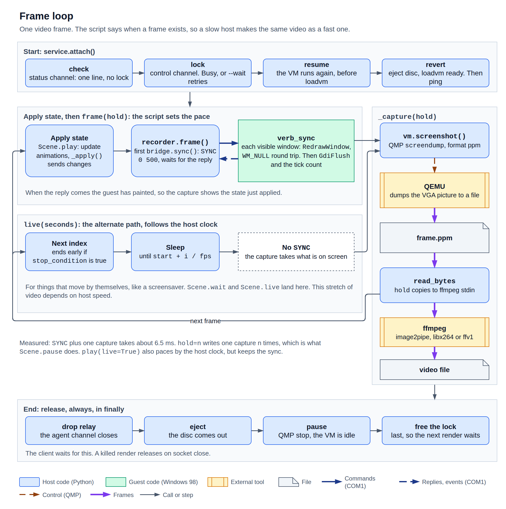
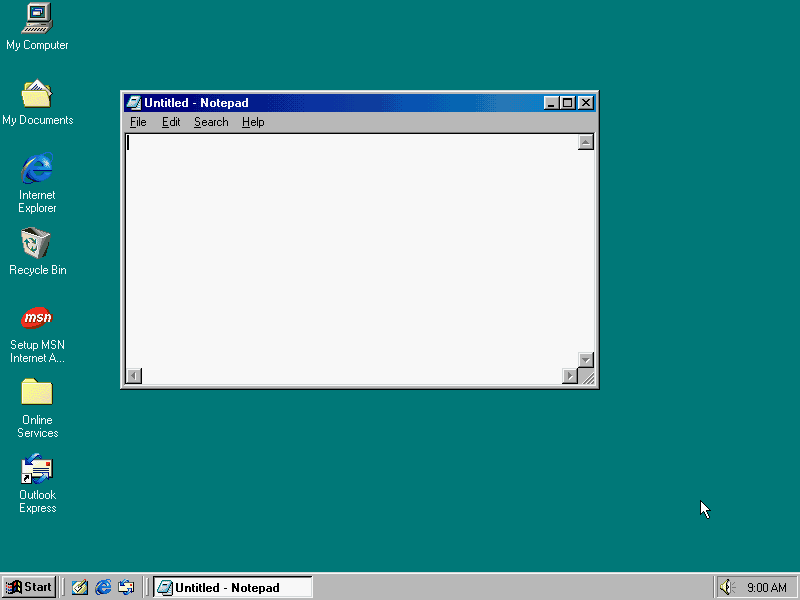
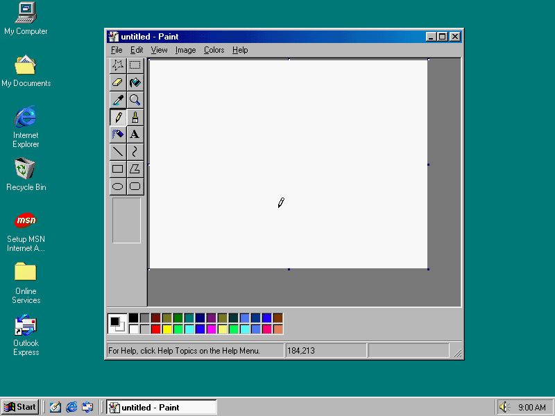
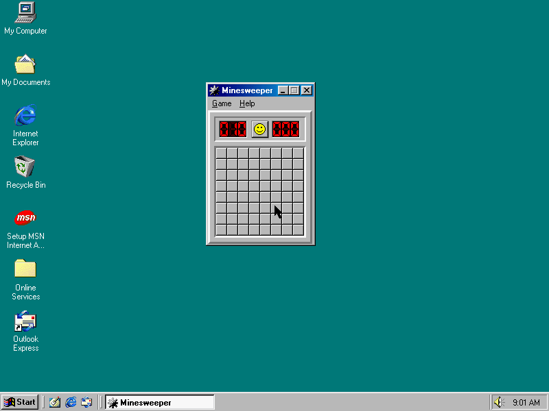
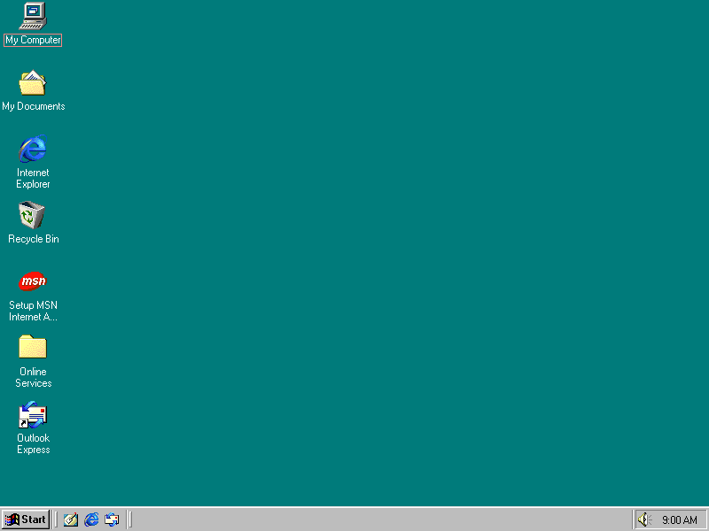

# Scene API

Everything here comes from `from art98.anim import *`. For what you pass to `play`, see
[Animations](animations.md).

Positions are screen pixels, with `(0, 0)` at the top left and y running down. The screen is
800 x 600 unless the desktop is set to another [display mode](../setup/image.md#display). The
[work area](#desktop-space) is the whole screen on the default blank desktop, unless the taskbar
is on, and above the taskbar on the stock one.

## Scene

`class Scene`

Subclass it and write `construct`. One scene is one recording.

| Attribute | Meaning |
| --- | --- |
| `output_fps` | Frames per second of the finished video: set it to match your edit timeline (24, 30, 60). It is not a capture or run rate. Default 30. |
| `desktop` | A [`Desktop`](#desktop-options), and nothing else: a string is refused. `Desktop()`, the default, is the blank preset: a black screen with no icons, taskbar, pointer or Start menu, and the work area the whole screen. `Desktop("stock")` is the Windows 98 desktop as the `ready` snapshot has it, pointer included. `Desktop(pointer=True)` is blank with the pointer drawn, and `Desktop("stock", clock=False)` writes single parts over a preset. It is resolved once when `run` starts and set again after every revert; changing it during a run is an error. See [Desktop options](#desktop-options) and [Blank start](../design/blank-start.md). |
| `state` | A [state file](#states) to set the desktop to before `setup`. Default `None`, the plain desktop. |
| `guest` | The raw [`Bridge`](bridge.md). |
| `vm` | The QEMU `VM`, for real key presses and captures. |
| `pointer` | The [`Pointer`](#pointer). |
| `props` | The props on stage. |
| `work_area` | `(left, top, right, bottom)` of the work area: the whole screen when the taskbar is off, above it when it is on. Read from `space`. |
| `screen` | The same area as a `Box`, to measure against. |
| `space` | The [desktop space](#desktop-space): screen, work area, taskbar and metrics, as read from the guest. |
| `strict_placement` | `False` by default. `True` makes a clamped size or a lost window raise `PlacementError` instead of warning. |
| `recorder` | The [`Recorder`](bridge.md#recorder) the frames go to. |
| `sections` | `(name, time)` for each [`section`](#clips) so far. |
| `time` | Video time in seconds: frames written over `output_fps`, across every [clip](#clips). It never reads a clock. |

| Hook | Runs |
| --- | --- |
| `setup()` | Before `construct`. |
| `construct()` | The scene. |
| `tear_down()` | After `construct`. |

`Scene.render(output=None, *, session, **options)` plays the scene on a session from
`art98.attach()` and renders from Python. The options are those of [`render`](#rendering).

A scene that has the retired `pointer_visible` attribute is refused with a `UsageError` that says
to write `desktop = Desktop(pointer=True)`. The check runs when the class is defined (the class
itself, or a mixin it inherits from) and at the start of `run` (an instance, or a class attribute
added after the definition). It does not see one set during `construct`.

### Desktop options

`desktop` takes a `Desktop`. A preset is a starting point; a `Desktop` names a preset and then
writes single parts over it.

`Desktop(preset="blank", *, icons=None, pointer=None, taskbar=None, buttons=None,
quick_launch=None, tray=None, clock=None)`

Each option is `True`, `False` or left out, and left out means the preset's value. The options
are keyword-only, so `Desktop("stock", False)` is a `TypeError`, and so is a misspelled option such
as `Desktop(clok=False)`. A preset name on its own is not accepted: `desktop = "stock"` is
refused, with a message that says to write `Desktop("stock")`.

| Preset | Parts that show |
| --- | --- |
| `"blank"` | None, and the pointer is hidden unless `pointer=True`. It also makes the colour black, turns off the interface effects and disables the desktop's right-click menu, as in [Blank start](../design/blank-start.md). The default. |
| `"stock"` | All of them. It changes nothing in the guest. |

A part is one piece of the shell. Some sit under another: the taskbar holds the window buttons,
Quick Launch and the tray, and the tray holds the clock.

| Option | Level | Sits under | Hidden by |
| --- | --- | --- | --- |
| `icons` | 0 | nothing | nothing |
| `pointer` | 0 | nothing | nothing |
| `taskbar` | 0 | nothing | nothing |
| `buttons` | 1 | `taskbar` | `taskbar` |
| `quick_launch` | 1 | `taskbar` | `taskbar` |
| `tray` | 1 | `taskbar` | `taskbar` |
| `clock` | 2 | `tray` | `tray`, `taskbar` |

A part that is off hides the ones under it, so `clock` shows only when `tray` and `taskbar` are
both on. Writing an option under an off part has no effect, and art98 warns about it (below). The
work area is the whole screen when `taskbar` is off, and the stock work area otherwise: hiding
the buttons, Quick Launch, tray or clock leaves the taskbar its size, so the work area does not
change.

The clock hidden on the stock desktop:

```python
from art98.anim import *


class NoClock(Scene):
    """The stock desktop with the clock hidden."""

    desktop = Desktop("stock", clock=False)

    def construct(self):
        self.add(Notepad("Untitled - Notepad", at=(80, 60)))
        self.wait(1)
```

A taskbar on the black desktop, with no window buttons:

```python
from art98.anim import *


class BlankWithTaskbar(Scene):
    """Black desktop, no icons, but a taskbar with no window buttons."""

    desktop = Desktop("blank", taskbar=True, buttons=False)

    def construct(self):
        self.add(Notepad("Untitled - Notepad", at=(80, 60)))
        self.wait(1)
```

The stock desktop with no taskbar and no pointer:

```python
from art98.anim import *


class StockNoTaskbarNoPointer(Scene):
    """The stock desktop with no taskbar and no pointer."""

    desktop = Desktop("stock", taskbar=False, pointer=False)

    def construct(self):
        self.wait(1)
```

The pointer comes only from the `Desktop`: the blank preset hides it and the stock preset draws
it, and `pointer=True` or `pointer=False` overrides that. It can't change partway through a scene.
It still moves and clicks when hidden, and Paint's tools still draw their own pointer over the
canvas. The 0.2.0 `pointer_visible` attribute is gone; see [Scene](#scene).

The desktop is resolved once, when `run` starts, before any guest call, and every revert in that
run uses the result. Setting `self.desktop` to something else during the run raises `UsageError`
("X.desktop changed during the run"), so set it before `run`. A second `run` of the same scene
object resolves again.

#### Warnings

An option written under an off part gets one warning, which names the highest part that is off,
because that is the one to change. It also says where the off value came from, the `Desktop` or
the preset. For `Desktop("stock", tray=False, clock=True)` in a scene called `Example`:

```text
Example.desktop: clock=True has no effect, because tray is off (tray=False). Remove clock=True, or write tray=True.
```

With a blank preset it ends `because taskbar is off (the "blank" preset)`, as for `buttons=False`
on `Desktop("blank", buttons=False)`. The option is dead whether it says `True` or `False`, so
writing it the same as its effective value still warns. A preset on its own does not warn, nor
does an override that takes effect, such as `Desktop("blank", taskbar=True, buttons=False)`.

An override warning comes from the class whose body sets `desktop`; a subclass that inherits it
does not warn again.

For a `desktop` set in the class body, it shows at the `class` line. For one set on an instance, it
shows at `run`.

#### What a colour change and a revert do

The parts are applied after every revert, so `set_state` starts from them too. They are applied
again after a state file's `display` changes the mode, because `apply_state` runs `prepare_desktop`
again. A [`Backdrop`](#backdrop) hides the icons again when they were hidden, and the tray too when
it was.
The window buttons, Quick Launch and the clock stay hidden through a colour change on their own.
A wallpaper does not bring any part back. With the pointer off it is hidden on each apply, so twice
when a state changes the display mode. That is harmless.

#### Errors

A `desktop` that is not a `Desktop` (a preset name such as `"stock"` included), an unknown preset,
or an option that is not `True` or `False` raises `UsageError` when the class is defined, or at
`run` for one set on an instance. After a revert, art98 reads back
what is off, except the pointer, which is not read back, and `DesktopError` lists whatever did
not take.

#### What was checked

On the real image, at 800x600, each taskbar part (buttons, rebar, clock, tray) was hidden and read
back with `IsWindowVisible`, after a colour change and after a revert. The buttons, rebar and tray
stayed hidden when a new window opened (the clock wasn't tried), and the clock stayed hidden after
65 seconds. A second probe covered Quick Launch alone, settling the
tray with `WM_SIZE`, and the wallpaper broadcast, which leaves the buttons, clock and tray hidden.
A third probe covered a display change. A raw `set_display_mode(..., persist=False)` leaves the
hidden parts hidden and does not move the taskbar. A state file's `display` uses `persist=True`,
which moves the taskbar to the new bottom edge and shows the tray again; art98 hides it again when
it applies the parts a second time. At 640x480 and 1024x768 the parts hide and read back the same. 1280x1024 at 16 bit is not offered by the driver. Icons hidden on stock survive a
colour change, and `hide_pointer` works on stock, checked by screenshot.

The VM tests check each part hidden, the tray after a `Backdrop`, the parts after `set_state`, and
the parts and the taskbar's place after a state's `display` at 640x480 and 1024x768.

Not yet measured: a window opened after `buttons` is off at other resolutions.

### Stage

`add(*props, id=None)` brings props on stage. For a window this starts the program, finds its
window, and places it. `id` names one prop, for `prop(id)` and for [`get_state`](#states); it
can't be given with several props. An id is ASCII letters, digits, `_` and `-` only, because a
capture uses it as a folder name, and a bad one raises `UsageError`. `prop(id)` returns the prop
on stage with that id, whether `add(id=)` or a state gave it, or raises `NotFound` listing the
ids it has. `remove(*props)` takes them off, which for a window does what [`Close`](animations.md#close)
does. `refresh_props()` reads positions back, for when something other than the script moved a
window.

#### Tracking

Every visible top-level window must be the desktop's or a prop's, and a prop's window ends only
through [`Close`](animations.md#close). That way the scene always knows what is on screen, and a
[captured state](#states) can't miss a window.

`check_tracking()` raises when that doesn't hold. It reads the window list once. `play`, `wait`
and `wait_until` run it when they return, `get_state` runs it first, and `run` runs it at the
end. `pause` doesn't, since it doesn't touch the guest. Windows that were on screen when the
desktop was set up (the baseline) don't count.

- A window nothing added raises `UntrackedWindow`, naming each with its title, class and handle.
  Add it as a prop (`self.add(Win(hwnd=...))`), or close it.
- A prop's window that went without `Close` (the X button, a menu's Exit, Alt+F4, a click on a
  dialog's button) raises `ImplicitClose`, naming the prop. Use `Close(window)`, or
  `Close(window, via=...)` to show the click.
- A control from `control()` isn't a prop and isn't checked. A hidden window still exists, and a
  minimized one is still a window.

`claim(owner, matches, *, hint="")` is for windows a program or action is handling that the scene
has no prop for: a menu, a tooltip, a prompt. `matches(row)` takes one row of `guest.windows()`
and says whether it is covered. The checks let a claimed window be until `release()`. Use it as a
`with` block, which releases at its end, or keep the handle and call `release()` later. Windows
that are still up at release raise `UntrackedWindow` naming `owner`. A claim still open at the
end of a run is dropped, and its windows are then errors, with `hint` said.

`RightClick` and `Hover` claim the menu and tooltip they bring up themselves, and
`Minesweeper.clear` claims the best-time prompt until `sign_scoreboard`. You need `claim` for what
you open yourself, such as the window a desktop icon opens before you have a prop for it.

### Desktop space

`scene.space` is the desktop as the guest has it. It holds the screen size, the work area, the
taskbar (the strip of screen outside the work area, worked out from those two) and the system
metrics that window sizes need. It is read once per `prepare_desktop`, which runs after every
revert and again when a state switches the display mode. Props read it through the scene, so
`center()`, `to_corner()` and `title_bar` all use the same numbers.

A scene that changes the desktop with a raw guest call, such as `SPI_SETWORKAREA`,
`art98.guest.win32.set_display_mode` or a moved taskbar, must call `scene.calibrate()` afterwards. art98 doesn't
notice those changes by itself.

#### Placement check

Each size is checked before it is sent to the guest.

- A resizable top-level window asked for a size outside Windows' track limits is clamped to the
  limit. A `PlacementWarning` is raised once per prop and reason, naming the requested and the
  sent size.
- With `strict_placement = True`, the same case raises `PlacementError`, and nothing is sent.
- A window entirely off the screen warns. A window partly off the screen is fine: sliding one in
  from the edge is a normal animation.
- Fixed-frame windows, such as dialogs, are not clamped to the track limits.
- Maximized windows are not checked.

#### Read-back

Read-back happens once at the end of each animation, not per frame. If Windows put a window
somewhere other than the rect it was asked for, for example because an app sets its own minimum
size, a `PlacementWarning` names both rects. The prop then takes the rect Windows gave.

#### Display modes

Changing the display mode keeps each window's pixel rect. Windows already on stage are not moved
to suit the new screen. The next move of one warns if its rect is then entirely off the screen.
The modes the Cirrus driver offers are listed under [Display](../setup/image.md#display).
1280x720 and 1920x1080 are not offered, so they are not supported. They would need another
display adapter in the image.

A state's `display` writes the mode to the registry, as the Display control panel does, so the
taskbar moves to the new bottom edge and `scene.space` gets the work area above it. The next
revert brings back 800x600 and the old registry value. A raw
`set_display_mode(..., persist=False)` changes only the screen: Explorer leaves the taskbar where
the old mode had it, so at 1024x768 it floats mid-screen and at 640x480 it is off the bottom.

### States

A state file describes the desktop: the display mode, its colour and wallpaper, the windows,
and where the pointer is.
`set_state(path)` makes the desktop look like it, within one frame, as many times as a scene
likes. It reverts the guest to the snapshot it booted from, opens the state's windows, and then
checks that the guest matches. Props from before are gone, and adding one again opens a new
window. `prop(id)` is the prop for a window the last state opened.

`get_state(path)` goes the other way: it writes the desktop as a state file and returns it as
`load_state` reads it. It reads the props, not the desktop, and runs
[`check_tracking`](#tracking) first, so an untracked window or an implicit close fails before
anything is written. Each window prop gives one entry, from the live window: its title as it is
now, and its normal position and size whatever `show` says. The files it needs (a picture, a
Notepad's text, the wallpaper) are copied to `<path stem>.files/` beside the file, so the capture
doesn't depend on where your assets are. It is built aside and moved in only once it loads, so a
failed capture leaves the earlier one alone. Every window prop needs an id
(`self.add(prop, id="note")`), and only the programs a state can open can be captured: `Paint`,
`Minesweeper`, `Dialog` and `Screensaver` raise `UsageError`, "can't be captured yet". A capture
is refused while a claimed window (a menu, a tooltip, a prompt) is up. The wallpaper can't be
read from the guest, so a capture holds the last one a state of this scene applied. One set by a
raw guest call is missed. [Sections](#sections) call `get_state` for you.

A relative path is looked for beside the scene's file first, then in the current folder. If it
is in neither, `MissingFile` names both places. A file path inside a state is relative to the
state file.

```json
{
  "version": 1,
  "display": [800, 600, 16],
  "windows": [
    {"id": "album", "app": "picture", "title": "Album", "at": [380, 220], "size": [360, 280]},
    {"id": "flower", "app": "picture", "title": "Flower", "at": [60, 60], "size": [240, 200],
     "open": {"file": "../assets/flower.bmp", "sha256": "<sha256 of the file>"}}
  ],
  "pointer": [400, 500]
}
```

Fill in `sha256` with the output of `sha256sum` on the file, for example `sha256sum recipes/scenes/mvp/assets/flower.bmp`.

| Field | Meaning |
| --- | --- |
| `version` | `1`. The only field that must be there. |
| `display` | `[width, height, depth]`, a mode the guest's driver offers. Depth is 8, 16, 24 or 32. |
| `desktop` | `fill_colour` as `[r, g, b]` (the plain desktop colour behind the icons and around a centred wallpaper, not the taskbar or selection colour), and `wallpaper` as a BMP (`file` and `sha256`) with a `style` of `"center"` (the default), `"tile"` or `"stretch"`. Each part is optional, and `style` needs a `wallpaper`. The old name `colour` for `fill_colour` is refused. |
| `windows` | In creation order: Windows 98 orders taskbar buttons by creation. |
| `stack` | Optional: the window `id`s back to front (z-order), the last on top and active. Without it, list order is the z-order too; a capture always writes it. |
| `id` | The name for `prop(id)`. Each one is used once. ASCII letters, digits, `_` and `-` only. |
| `app` | `"picture"`, a [`Picture`](#picture), or `"notepad"`, a [`Notepad`](#notepad). |
| `title` | Default `"Picture"` for a picture. A Notepad takes the Windows 98 title for its file. No double quotes. |
| `at`, `size` | The top left corner, and the outer size. |
| `show` | `"normal"` (the default), `"minimized"` or `"maximized"`. |
| `open` | A BMP to show (or a text file for Notepad): its `file`, and its `sha256` so a changed file is caught. |
| `text` | Notepad only: a text file, as `open`, whose contents are put in the Edit control once the window is up. A capture uses it for what was typed. |
| `selection` | Notepad only: `[start, end]`, the character offsets of the selected text or caret, restored after the text. Default `[0, 0]`. |
| `pointer` | `[x, y]`, placed last. |

Every mistake in the file is listed at once, as a `StateError`, before the desktop is touched. If
the guest doesn't match the state afterwards, `StateMismatch` (a `GuestError`, so a `RuntimeError`, not a `StateError` or `ValueError`) lists each difference. For example,
Windows won't make a window smaller than 112 x 27, so `"size": [40, 20]` stops with
`size [40, 20] wanted, the guest has [112, 27]`.

#### Catching art98's errors

Every error art98 raises on purpose (`StateError`, `PlacementError`, `RecorderError`, `BridgeError`
and the rest) inherits `art98.Art98Error`, so `except art98.Art98Error` catches them all. Each
also keeps its built-in base, so `except ValueError`, `RuntimeError` and `FileNotFoundError` still
work. The `art98` command prints any of them as one `error:` line.

- A mistake in what your scene passes to art98, such as an empty `play()` or an unknown icon
  name, raises `art98.UsageError` (a `ValueError`). A name that isn't there raises
  `art98.NotFound` (a `UsageError` and a `KeyError`). `StateError` and `PlacementError` are
  `UsageError`s too.
- The guest doing something other than expected raises `GuestError` (a `RuntimeError`).
  `StateMismatch` and `DesktopError` are `GuestError`s. `BridgeError` and `RecorderError` are
  `Art98Error`s and `RuntimeError`s.
- `UntrackedWindow` (a window on screen that no prop owns) and `ImplicitClose` (a prop's window
  went without `Close`) are `GuestError`s. See [Tracking](#tracking).
- `SectionNotFound` is a `UsageError`: `--section` named a section the scene doesn't have (it
  lists the ones it has), or the scene did something before its first `section()` in a solo run.
- A missing file raises `MissingFile` (a `FileNotFoundError`).

A plain exception from your own code, or a plain one from art98, keeps its traceback.

The wallpaper reaches the guest on a CD in drive D:, not through `put_file`, so a 1.4 MB BMP
costs under a second (see [Desktop colour and wallpaper](#desktop-colour-and-wallpaper)).
Icons and the tray are not in a state yet. `Dialog` is not an `app` either: add it in `construct`.

A Set with two windows and a 57 KB image took 1.2 to 1.6 s on a quiet host, mostly reverting and
copying the files again. The revert also winds the guest's clock back to the snapshot's time.

```python
from art98.anim import *


class TwoStates(Scene):
    state = "recipes/scenes/mvp/states/two_windows.json"

    def construct(self):
        flower = self.prop("flower")
        self.play(flower.animate.shift(200 * RIGHT), run_time=2)
        self.set_state("recipes/scenes/mvp/states/gallery.json")
        self.pause(1)
        self.play(self.prop("picture").animate.shift(100 * DOWN), run_time=2)
```

These paths are from the repository's root. The whole sample is
[recipes/scenes/mvp](../../recipes/scenes/mvp/mvp.py), with its states beside it.

### Playing

`play(*animations, run_time=None, rate_func=None, live=False)`

| Parameter | Meaning |
| --- | --- |
| `animations` | One or more. They run together, and shorter ones finish early and hold. |
| `run_time` | Seconds, overriding each animation's own for this `play` only. |
| `rate_func` | Overrides each animation's own for this `play` only. |
| `live` | Follow the host clock, so timers in the guest run at video speed. |

Each frame goes like this: work out every animation's state, apply it to the guest, wait for the
guest to finish painting, capture.



Two animations can't drive the same thing at once. Two pointer actions in one `play`, or two
`Keys`, raise `UsageError`. Two `.animate` calls on one window are fine.

```python
from art98.anim import *


class Together(Scene):
    def construct(self):
        pad = Notepad(at=(60, 60), size=(360, 220))
        self.add(pad)
        self.play(
            TypeWithCursor(pad, "moving and typing"),
            pad.animate.shift(300 * RIGHT + 200 * DOWN),
            run_time=2,
        )
        self.pause(0.5)
```

### Time

| Method | What the guest does | Frames |
| --- | --- | --- |
| `pause(duration=1.0)` | Keeps running, unseen | One capture, repeated |
| `wait(duration=1.0, stop_condition=None)` | Keeps running, seen | Captured at host speed, with no repaint wait |
| `wait_until(stop_condition, max_time=60.0)` | Keeps running, seen | Until the condition is true |

Use `pause` for a beat, and `wait` to let a caret blink or for something that moves by itself,
such as a screensaver.

`stop_condition` is a function, tried before each capture. `wait_until` warns if it gives up.

A window the scene starts itself needs a [claim](#tracking) until it becomes a prop with `self.add(Win(hwnd=...))`.

```python
from art98.anim import *


class WaitForCalculator(Scene):
    def construct(self):
        def is_calc(w):
            return w.class_name == "SciCalc"

        with self.claim("calc.exe", is_calc):
            self.guest.spawn("calc.exe")
            self.wait_until(lambda: any(is_calc(w) for w in self.guest.windows()))
            self.add(Win(hwnd=self.guest.find_window(class_name="SciCalc").hwnd))
        self.pause(0.5)
```

### Clips

`cut(path=None)` ends the current clip and starts a new one. The cut falls between two frames, so
no frame is lost or repeated, and `time` carries on across it. It returns the path of the clip it
closed.

- A scene that never cuts writes one file, the output.
- After a cut, `render` keeps each clip beside the output as H.264 MP4, named `<stem>-01.mp4`,
  `<stem>-02.mp4` and so on, and joins them into the output. That holds when the output is a GIF
  too: the render still makes one GIF, from the joined clips. `render(..., keep_clips=False)`
  deletes the clips after the join. `art98 render` always keeps them.
- `path` names the next clip instead. Numbered clips count it too: if the first cut is
  `self.cut("intro.mp4")`, the clips are `<stem>-01.mp4`, `intro.mp4`, then `<stem>-03.mp4`.
- A cut with nothing recorded since the last one makes no empty clip. It returns `None`, and a
  `path` given then names the clip to come.
- `section(name, method)` plays `method` as a named section. See [Sections](#sections).
- `set_state` doesn't cut. For one clip per state, call `cut()` after it.
- The screen size can't change inside a clip. If a frame has another size from the one before,
  the recorder raises `RecorderError`. Call `cut()` before the `set_state` that switches the
  display. Clips of different sizes are kept, but can't be joined: the join fails and names each
  clip's size, so render to MP4 clips with `keep_clips=True` and scale them yourself.

#### Temp files and old clips

- Every clip and the output are written as `.part` files, such as `out-01.part.mp4`, and renamed
  only once the whole render has worked, the output last. A render that fails at any step
  deletes the `.part` files it made, and only those. An earlier render's output and clips stay
  as they were.
- If ffmpeg fails, `RecorderError` carries ffmpeg's own message.
- A render never deletes clips from an earlier one. `<stem>-NN.mp4` files beside the output that
  this render did not write are named in a warning on stderr. Delete them yourself.

```python
from art98.anim import *


class TwoClips(Scene):
    def construct(self):
        self.pause(0.5)
        self.cut()
        self.pause(0.5)
```

`art98 render scene.py -o out.mp4` writes `out-01.mp4` and `out-02.mp4`, 15 frames each, and
`out.mp4` with all 30.

### Sections

`section(name, method)` is called from `construct`, once per section, each with a method that
holds that section's code. `name` is a label: ASCII letters, digits, `_` and `-`, and each is used
once. It cuts before every section after the first, adds `(name, time)` to `sections`, then calls
`method()`. There is no other code between the calls: `section()` raises `UsageError` if frames
were recorded or props added since the last section ended.

A full render also captures the desktop at each of those boundaries, with [`get_state`](#states),
into `<scene file stem>.<Scene>.sections/` beside the scene's file: `NN-name.state.json`, its
`NN-name.files/` and a `NN-name.meta.json`. A render that fails leaves the earlier captures alone.
A scene with sections has to live in a file.

`art98 render FILE --section NAME` then plays that one section alone, from its capture, into one
clip, `<Scene>-<name>.mp4` unless `-o` says otherwise. It skips `setup` and every section before
`NAME` without calling them, sets the desktop to the capture, and starts `time` at the captured
time. The first section runs as a full render does. It never writes captures: render the whole
scene once first, or it raises `MissingFile`. An unknown name raises `SectionNotFound`.

#### What makes a capture stale

Before it touches the guest, `--section` checks that nothing the capture was built from has
changed since the full render. If something has, it raises a `UsageError` that names the first
change, and tells you to render the whole scene again. These make a capture stale:

- the scene's `state` file, and every file it points at (a picture, a Notepad text, the wallpaper)
- a file passed to `set_state`, and every file that one points at
- the file of a `Picture(image=)` or a `Notepad(open=)` prop that the scene adds
- the capture's own `NN-name.state.json`, if someone edited it
- the code of `setup()`
- the source of the section methods before this one

A file counts as changed when its bytes change, and as moved or deleted when art98 can't read it
where it was. A file stays on the list for every later capture, even after its prop is gone, so a
capture can be called stale for a file that no longer matters. That costs one more full render.

These are not tracked, so changing them leaves a capture fresh:

- files the scene reads with its own `open()`
- helper code the sections call, including `recipes/helpers` modules
- class attributes such as `desktop` and `strict_placement`

There is no way to declare extra files or code to track. If you change one of these, render the
whole scene again yourself.

A capture made by an older art98 did not record its files. `--section` refuses it with a
`UsageError`, and the fix is the same: render the whole scene again.

What a later section needs from before is in the capture, so it finds a window by id:

```python
from art98.anim import *


class Notes(Scene):
    def construct(self):
        self.section("write", self.write)
        self.section("tidy", self.tidy)

    def write(self):
        pad = Notepad(at=(60, 60), size=(360, 220))
        self.add(pad, id="pad")
        self.play(TypeWithCursor(pad, "first draft"))

    def tidy(self):
        pad = self.prop("pad")
        self.play(pad.animate.shift(200 * RIGHT))
        self.play(Close(pad))
```

Every window made in `setup` or a section needs an id, and only windows a state can open (see
[States](#states)) can be captured. A capture also stores a hash of the source of `setup`, the
scene's `state` file and each earlier section method. If one has changed since, a solo run
refuses with its name: "render the whole scene again". Editing the section being rendered is
fine.

Known limits:

- A prop kept in `self.<attr>` by an earlier section is missing in a solo run, because that code
  didn't run. Find it with `prop(id)`.
- A capture is refused while a claimed window (a menu, a tooltip, a prompt) is up, so finish or
  dismiss it before the section ends.
- A solo section that starts after typing into Notepad can differ from the full run in the Edit's
  horizontal scroll bar. The control keeps the widest line it ever had, which a capture can't
  restore.
- Things the guest times for itself (a caret blink) can differ, because the Set winds the guest's
  clock back.
- A `--section` solo run starts from a fresh revert, so the taskbar clock can show a different
  minute from the full run at that point.

## Box

`Box(x=0, y=0, width=0, height=0)`

A rectangle with Manim's layout methods. These change numbers on the host only. A prop's numbers
reach the guest on the next frame, or at once with `apply()`.

| Method | Effect |
| --- | --- |
| `shift(*vectors)` | Move by each vector. |
| `move_to(target, aligned_edge=ORIGIN)` | Put the centre on the target. `aligned_edge=UL` puts the top left corner there instead. |
| `center()` | Centre in the work area. |
| `to_edge(edge=LEFT, buff=0)` | Against an edge of the desktop. |
| `to_corner(corner=DL, buff=0)` | Into a corner of the desktop. |
| `next_to(other, direction=RIGHT, buff=8)` | Beside another box, centred on it along the other axis. |
| `resize(width, height)` | New size. The top left corner stays. |
| `set_rect(x, y, width, height)` | Position and size. |
| `scale(factor)` | Grow or shrink about the centre. An app keeps its font size. |

| Read | Gives |
| --- | --- |
| `rect` | `(left, top, right, bottom)`, the order of a Win32 `RECT`. |
| `size` | `(width, height)`. |
| `get_center()` | Centre as a `Vec`. |
| `get_corner(direction)` | A corner or edge midpoint. |

A target is a point, a [`Spot`](#spot), or a prop, which means its centre.

All of these can be animated through `.animate`.

```python
from art98.anim import *


class Layout(Scene):
    def construct(self):
        left = Notepad(size=(260, 180))
        right = Notepad(size=(260, 180))
        self.add(left, right)
        left.to_corner(UL, buff=90)
        right.next_to(left, RIGHT, buff=16)
        self.pause(0.5)
        self.play(right.animate.move_to(self.screen.get_center()))
        self.play(left.animate.scale(1.3))
        self.pause(0.5)
```

## Vectors

`Vec(x, y)` is a named tuple with `+`, `-`, `*`, `/` and negation, and `rounded()`.

| Constant | Value |
| --- | --- |
| `ORIGIN` | `(0, 0)` |
| `UP`, `DOWN` | `(0, -1)`, `(0, 1)` |
| `LEFT`, `RIGHT` | `(-1, 0)`, `(1, 0)` |
| `UL`, `UR`, `DL`, `DR` | The four corners. |

`lerp(a, b, alpha)` is the point `alpha` of the way from `a` to `b`.

## Prop

`Prop` is a `Box` that exists in the guest. Add it to a scene to bring it to life.

| Member | Meaning |
| --- | --- |
| `animate` | Starts an [`Animate`](animations.md#propanimate). |
| `guest` | The bridge. Raises `UsageError` until the prop is on stage. |
| `apply()` | Send changed values to the guest now. |
| `refresh()` | Read the real position back. |
| `remove()` | Leave the stage. |
| `forget()` | Leave the stage without touching the guest. A revert does this to every prop. |

To add a kind of prop, subclass `Win` for a window, or `Prop` for anything else, and override
`apply`.

A program a [state](#states) can open is a `Win` subclass listed in `APPS`
(`core/art98/actions/apps.py`), which holds `picture` and `notepad`. It sets `open_keyword` (the
constructor keyword that takes the state's `open` file), `check_file(data, source)` and
`default_title(file)`, and inherits `from_state(window)`.

## Spot

`Spot(locate)`

A place on screen, worked out when needed. `locate` returns `(x, y)`. Controls move with their
windows, so the props give you Spots, and an animation reads them as it begins.

```python
from art98.anim import *


class Spots(Scene):
    desktop = Desktop(pointer=True)

    def construct(self):
        pad = Notepad(at=(100, 100), size=(300, 200))
        self.add(pad)
        close = pad.corner(UR, inset=14)
        self.play(pad.animate.shift(200 * RIGHT))
        self.play(Glide(close))
        self.pause(0.5)
```

## Win

`Win(title=None, *, class_name=None, hwnd=None, command=None, at=None, size=None)`

A real window. Give `command` to start a program, or `title`, `class_name` or `hwnd` to take hold
of a window that exists.

| Parameter | Meaning |
| --- | --- |
| `title` | Part of the title, ignoring case. |
| `class_name` | The exact window class. |
| `hwnd` | A window handle you already have. |
| `command` | A command line. The window must belong to the program it starts. |
| `at` | Top left corner, applied when added. |
| `size` | Outer size, applied when added. Checked as in [Placement check](#placement-check). |

Each frame, a changed position becomes one `SetWindowPos`, followed by a `RedrawWindow`. Without
the redraw Windows 98 leaves stale pixels on the frame.

| Member | Meaning |
| --- | --- |
| `title_bar` | `Spot` in the middle of the title bar. Drag from here. Its offset comes from `space`, not a guest read. |
| `corner(direction=DR, inset=2)` | `Spot` on a corner or edge of the frame. Resize from here. |
| `client(x, y)` | `Spot` at client coordinates. |
| `client_size()` | Client area as `(width, height)`. |
| `children(class_name=None, title=None)` | Descendant windows, from `EnumChildWindows`. |
| `control(class_name=None, title=None)` | The first match, as a `Win`. |
| `text` | The window's text. |
| `set_text(text)` | Set it with `WM_SETTEXT`. |
| `edit_hwnd` | Where typing goes. |
| `activate()` | Make it the foreground window. |
| `bring_to_front()` | Raise it without activating. |
| `maximize()`, `minimize()`, `restore()` | Post `WM_SYSCOMMAND`, as its title bar buttons do, and read the new place back. [`Maximize`, `Minimize` and `RestoreWindow`](animations.md#window-state) call these. |
| `show` | `"normal"`, `"minimized"` or `"maximized"`, as last read. |
| `min_size()` | The least outer size the window takes, or `None`. A `size` below it raises `UsageError`. Only `Dialog` gives one. |
| `close()` | Post `WM_CLOSE`, which is what its X button does. A scene ends a window with [`Close`](animations.md#close) instead, which waits for it to go and takes the prop off stage. A window ended by calling `close()` yourself raises `ImplicitClose`. |

`activate` clicks the title bar between two frames, because `SetForegroundWindow` returns 0 when
the agent calls it. It then puts the pointer back. It raises `GuestError` if another window
covers the title bar.

Calculator's buttons draw their own faces and have no window text, so this finds them by control
id. Where a control has text, `control("Button", "Yes")` is shorter.

```python
from art98.anim import *


SEVEN, TIMES, SIX, EQUALS = 131, 91, 130, 112  # Calculator's control ids


class Calculator(Scene):
    desktop = Desktop(pointer=True)

    def construct(self):
        calc = Win(command="calc.exe", class_name="SciCalc", at=(240, 120))
        self.add(calc)
        for number in (SEVEN, TIMES, SIX, EQUALS):
            button = self.guest.user32.GetDlgItem(calc.hwnd, number).value
            self.play(Click(Win(hwnd=button), run_time=0.5))
        self.pause(1)
```

## Pointer

The mouse pointer. Every scene has one, as `self.pointer`.

| Member | Meaning |
| --- | --- |
| `place(point)` | Jump there now, with no frames in between. |
| `press(button="left")` | Press a button. |
| `release(button="left")` | Release it. |
| `get_center()` | Where it is, as of the last move. |
| `refresh()` | Read the real position with `GetCursorPos`. |

Moves use `SetCursorPos` and buttons use `mouse_event`. Both are real input, so Windows routes
them. Double clicks, title-bar drags, context menus and the Start menu all work. The buttons are
`"left"`, `"right"` and `"middle"`.

Use the animations in most scenes. `place` is useful to park the pointer out of shot:

```python
from art98.anim import *


class OutOfShot(Scene):
    desktop = Desktop(pointer=True)

    def construct(self):
        pad = Notepad(at=(120, 90), size=(400, 240))
        self.add(pad)
        self.pointer.place((700, 500))
        self.play(TypeWithCursor(pad, "The pointer is out of the way."))
        self.pause(0.5)
```

## Picture

`Picture(title="Picture", *, image=None, at=None, size=None)`

A plain window that shows one BMP at 1:1, centred on grey. Windows 98 has no small image viewer,
so this is art98's own program, `VIEW.EXE`, built by `make` in `guest/` and copied to the guest
when it's needed. `image` is a BMP on the host, or `None` for an empty window. The window opens at
`at` (default `(100, 100)`) with the outer `size` (default `(320, 240)`), with no move on screen
first.

The image is checked when the prop is made, so a file that isn't a BMP, or one cut short, raises
`UsageError` straight away. Windows 98 crashes on a cut-short BMP instead of failing.
`image_size` is the picture's `(width, height)`, or `None` for a window with no image.

Move one with `.animate`, jump it with [`Teleport`](animations.md#teleport), close it with
`Close`, and open another with `add`.

```python
from art98.anim import *


class OnePicture(Scene):
    def construct(self):
        pic = Picture("Empty", at=(100, 100), size=(320, 240))
        self.add(pic)
        self.play(pic.animate.shift(200 * RIGHT), run_time=1)
        self.play(Teleport(pic, (40, 40), aligned_edge=UL))
        self.play(Close(pic))
```

## Notepad

`Notepad(title=None, *, open=None, at=None, size=None)`

Starts `notepad.exe`. `open` is a text file on the host, or `None` for an empty "Untitled" window.
It is copied to the guest and opened by Notepad. `title` is the title bar text it waits for. When
it's left out, Notepad's own rule gives it: a trailing `.txt` is dropped, so `note.txt` gives
"note - Notepad", and no file gives "Untitled - Notepad". `edit_hwnd`, `text` and `set_text` work on
its Edit control. `close` marks the text as saved first, so no save prompt appears.

In a state, it is `"app": "notepad"`:

```json
{"id": "note", "app": "notepad", "at": [320, 180], "size": [320, 200],
 "open": {"file": "../assets/note.txt", "sha256": "<sha256 of the file>"}}
```

The file must be plain text. `title` is optional there too. A Notepad state can also have a
`text` file, which is put in the Edit control after the window opens. It is how a captured state
keeps what was typed:

```json
{"id": "note", "app": "notepad", "at": [320, 180], "size": [320, 200],
 "text": {"file": "../assets/draft.txt", "sha256": "<sha256 of the file>"}}
```



Source: [typing.py](../../recipes/scenes/gallery/typing.py).

## Paint

`Paint(*, at=None, size=None)`

Starts `MSPAINT.EXE`. Buttons and the canvas are read from the live window. The tool buttons are
`ToolChild` windows, found by control id. The palette is the `AfxWnd42` child called `Colors`. So
every target stays right after the window moves or resizes.

| Member | Meaning |
| --- | --- |
| `tool(name)` | `Spot` on a toolbox button. |
| `color(name)` | `Spot` on a palette swatch. Left click sets ink, right click sets paper. |
| `canvas(x, y)` | `Spot` on a canvas pixel. |
| `canvas_size` | `(width, height)` of the canvas. |
| `canvas_handle` | `Spot` on the canvas's bottom right grab handle. |
| `resize_canvas(width, height, **kwargs)` | A `Drag` that pulls that handle. |

`TOOLS` lists the names: `free_select`, `select`, `eraser`, `fill`, `pick_color`, `magnifier`,
`pencil`, `brush`, `airbrush`, `text`, `line`, `curve`, `rectangle`, `polygon`, `ellipse`,
`rounded_rectangle`.

`PALETTE` lists the colours. The top row is `black`, `gray`, `maroon`, `olive`, `green`, `teal`,
`navy`, `purple`, `khaki`, `dark_teal`, `azure`, `steel`, `indigo`, `brown`. The bottom row is
`white`, `silver`, `red`, `yellow`, `lime`, `cyan`, `blue`, `magenta`, `cream`, `mint`, `sky`,
`periwinkle`, `rose`, `orange`.

Paint doesn't report its canvas size. `canvas_size` finds the edge with `GetPixel`, and that needs
a blank canvas, so read it before you draw or use `resize_canvas` first. A canvas bigger than the
window raises `GuestError`: make the window bigger.

Keep the canvas smaller than the grey area around it. A larger canvas gets scroll bars, and
`canvas(x, y)` doesn't follow the scroll position. Closing a changed Paint brings up its save
prompt, which isn't handled.



Source: [paint_drawing.py](../../recipes/scenes/gallery/paint_drawing.py).

## Minesweeper

`Minesweeper(*, at=None, size=None)`

Starts `WINMINE.EXE`. The cell positions come from the client area.

| Member | Meaning |
| --- | --- |
| `board_size` | `(columns, rows)`. |
| `cell(column, row)` | `Spot` on a cell. |
| `find_mines()` | Read the board. Returns the set of mine cells (a `frozenset`). |
| `mines` | The result of `find_mines`, or `None` before it has run. |
| `neighbours(cell)` | The cells around a cell. |
| `opened_by(cell)` | The cells a click on this cell opens, by flood fill. |
| `clear()` | Win the game, with real clicks. Plays its own animations. |
| `sign_scoreboard(name="art98")` | Answer the best time prompt that follows a first win. |

`find_mines` uses Minesweeper's own XYZZY cheat. It types the cheat, then moves the pointer over
every cell with Progman hidden and reads pixel (0, 0). This happens between two frames, so it
takes no video time. No window may cover the top left corner of the screen.

Read the mines once per game. Typing the cheat again turns it off, so a second `find_mines` finds
none. Windows 98 moves a mine away from a first click that lands on one, so a set read before the
first click is out by at most one mine. `clear()` never clicks a mine first, so it is not affected.



Source: [minesweeper_win.py](../../recipes/scenes/gallery/minesweeper_win.py).

## Screensaver

`Screensaver(name="3D Pipes")`

Starts `<name>.scr /s`. Follow it with `self.wait(seconds)`, because a screensaver runs by itself.
End it with `self.play(Close(saver))`. That calls `stop(timeout=5.0)`, which nudges the pointer,
the way a real one is dismissed, waits for it to exit, then puts the pointer back where it was.
It raises `BridgeTimeout` if the screensaver is still running after the timeout. A scene doesn't
call `stop` itself: a screensaver that ends without `Close` raises `ImplicitClose`. It fills the screen, so `at`, `size` and the other layout calls
do nothing to it.

`NAMES` lists what works: 3D Flower Box, 3D Flying Objects, 3D Maze, 3D Pipes, 3D Text, Blank
Screen, Curves and Colors, Flying Through Space, Flying Windows, Mystify Your Mind, Scrolling
Marquee.

Channel Screen Saver is on the image but left out, because moving the pointer doesn't dismiss it.


Source: [screensaver.py](../../recipes/scenes/gallery/screensaver.py).

## Backdrop

`Backdrop(colour)` sets the desktop colour in one frame. `colour` is an `(r, g, b)` tuple of ints
from 0 to 255, or one of `teal`, `red`, `dark_red`, `white`, `black`. Anything else raises
`UsageError` when you build it. It claims nothing, so it can run beside other animations.

The screen is 16-bit, so Windows rounds the colour to the nearest 5-6-5 value: 128 becomes 120
and 255 becomes 248. `dark_red` is the flat colour (120, 0, 0), with no dither. On the stock
desktop the icon labels stay clear on the new colour and the taskbar doesn't change. On a blank
desktop the icons stay hidden: Windows shows them again after a colour change, and `Backdrop`
hides them again.

```python
from art98.anim import *


class Colours(Scene):
    desktop = Desktop()

    def construct(self):
        self.pause(0.3)
        self.play(Backdrop("teal"))
        self.pause(0.3)
        self.play(Backdrop((40, 0, 90)))
        self.pause(0.3)
```

### Desktop colour and wallpaper

A state's `desktop` part sets the same colour, and a wallpaper. The BMP is built into a small
ISO 9660 disc on the host and put in the guest's CD drive, `D:`, over the control channel. The
guest reads it from there and sets it with `SystemParametersInfo`. The BMP must be 24-bit or
8-bit. The three styles are `center`, `tile` and `stretch`. Setting a wallpaper does not bring
the icons or the taskbar back on a blank desktop.

Timings, on a quiet host: the disc goes in in 1 to 8 ms, the guest sees it after about 40 to
110 ms (the scene waits for it, up to 2 s, and then fails with a clear error), and setting a
1.4 MB wallpaper takes 0.3 to 0.8 s.

A revert ejects the disc first, so the next state starts with an empty drive. It does so only
when the session put a disc in.

## Dialog

`Dialog(text, title="art98", *, icon=None, buttons="ok", at=None, size=None, disabled=False)`

A real `MessageBoxA`. It blocks whoever calls it, so the agent runs it on its own guest thread
with `ACALL`, and the scene carries on. Each box finds its own window, so several boxes with the
same title are fine, such as a storm of `???`.

| Parameter | Values |
| --- | --- |
| `icon` | `None`, a stock key, a custom key, or a `(dll, index)` pair. See below. |
| `buttons` | `"ok"`, `"okcancel"`, `"abortretryignore"`, `"yesnocancel"`, `"yesno"`, `"retrycancel"` |
| `at` | The top left corner. Default: where Windows puts it. |
| `size` | The outer `(width, height)`. Must not be smaller than the stock box, or `UsageError`. |
| `disabled` | `True` greys every button. |

The stock icon keys are `"error"`, `"question"`, `"warning"` and `"info"`. An unknown key
raises `UsageError`. The custom keys are icons from the guest's own files, each seen in a real
box:

| Key | File | Index |
| --- | --- | --- |
| `"computer"` | `C:\WINDOWS\SYSTEM\shell32.dll` | 15 |
| `"printer"` | `C:\WINDOWS\SYSTEM\shell32.dll` | 16 |
| `"mouse"` | `C:\WINDOWS\SYSTEM\main.cpl` | 0 |
| `"telephone"` | `C:\WINDOWS\SYSTEM\modem.cpl` | 0 |
| `"cd"` | `C:\WINDOWS\SYSTEM\shell32.dll` | 11 |
| `"globe"` | `C:\WINDOWS\SYSTEM\shell32.dll` | 13 |
| `"flag"` | `C:\WINDOWS\SYSTEM\user.exe` | 0 |

`icon=(r"C:\WINDOWS\SYSTEM\shell32.dll", 15)` names any other icon the same way. A file or index
with no icon raises `UsageError`. The icon is drawn 32 x 32 in the box's icon slot.

`size` resizes the box from its top left corner, then lays the buttons out again (75 x 23, in a
row, centred at the bottom) and widens the text. With `at`, the box grows right and down from
`at`.

`set_message(text)` changes the text at once, with no residue. Newlines make lines of about 15
pixels each. It raises `UsageError` if the new text would reach the buttons: give the Dialog a
bigger `size`. `button(label)` gives a button as a `Win`. `answer` is the lower-case name of the
button pressed, and it waits for the box to close.

The text and the title must fit Windows 1252. Other characters raise `UsageError` rather than
showing as `?`.

A Yes/No or Abort/Retry/Ignore box has no Cancel button, and it ignores the close that its title
bar sends. So `close()` doesn't shut it. `remove()` presses its No or Abort button, and then
destroys the custom icon. It raises `GuestError` if the box is still open after 5 seconds.



Source: [hover_dialog.py](../../recipes/scenes/gallery/hover_dialog.py).

```python
from art98.anim import *


class Question(Scene):
    desktop = Desktop(pointer=True)

    def construct(self):
        box = Dialog("Keep this?", icon="question", buttons="yesno", at=(280, 200))
        self.add(box)
        self.pause(0.5)
        self.play(Close(box, via=box.button("No")))
        pad = Notepad(at=(200, 120), size=(320, 160))
        self.add(pad)
        self.play(TypeWithCursor(pad, f"You pressed {box.answer}."))
        self.pause(1)
```

A cascade, a jittered pair, typed text and a colour change are in the
[dialog storm](gallery.md#dialog-storm). Not built yet: a helper that adds a cascade, `Dialog` as
a state `app`, and icons in a state.

## Rendering

### Command line

```text
art98 render FILE [SCENE] [-o OUTPUT] [--section NAME] [--gif GIF] [--work DIR]
             [--gif-fps N] [--gif-colors N] [--gif-scale X] [--gif-dither NAME] [--wait S]
```

| Option | Default | Meaning |
| --- | --- | --- |
| `FILE` | | The Python file. |
| `SCENE` | | The scene class. Needed if the file has several. |
| `-o`, `--output` | `<Scene>.mp4` | `.mp4`, or `.gif` for a GIF alone. |
| `--section` | | Play only this [section](#sections), from the capture an earlier full render made. The output defaults to `<Scene>-<name>.mp4`. |
| `--gif` | | Write a GIF as well as the video. |
| `--work` | `[vm] work` | The work folder. See [configuration](../setup/config.md). |
| `--gif-fps` | 15 | GIF frame rate. |
| `--gif-colors` | 128 | Palette size. |
| `--gif-scale` | 1.0 | Size factor, with nearest-neighbour scaling. |
| `--gif-dither` | `none` | A dither of ffmpeg's `paletteuse`. |
| `--wait` | 0 | If the VM is busy, retry for up to this many seconds, then fail. See [the CLI](../setup/cli.md#art98-render). |

### Python

`render(scene, output=None, *, session, gif=None, gif_options=None, keep_clips=True, section=None)`.
`output` must end in `.mp4` or `.gif`, and `gif` in `.gif`; anything else raises `UsageError` before
anything is recorded. `gif_options` is a `GifOptions(fps=15, colors=128, scale=1.0, dither="none")`
(`from art98.anim import GifOptions`); `None` means its defaults. It replaces the old `gif_fps`,
`gif_colors`, `gif_scale` and `gif_dither` arguments, which are gone.

`scene` is a class or an instance. `session` is required: take one with `art98.attach()`. Render
never boots or closes it. Returns the path written. `keep_clips` is for scenes that [cut](#clips). A scene that records no frames raises
`RecorderError`. `section="name"` plays only that [section](#sections) into one clip.

A render does not copy the image. It plays on the VM that `art98 vm start` runs, from its copy
under `work/runs/vm-*`. One render runs at a time. See [`ready` snapshot](../glossary.md).

`art98.output.gif.write_gif(source, output, options=GifOptions())` converts a video to a
GIF with `palettegen` and `paletteuse`.

A video goes through 4:2:0 H.264, which smears 1-pixel coloured text. A GIF comes from a lossless
FFV1 recording instead, so its pixels stay sharp. With cuts, every clip is recorded lossless,
the clips are joined into one lossless recording, and the GIF and MP4 are made from it. Each kept
clip is then encoded to MP4 and its lossless file deleted.
