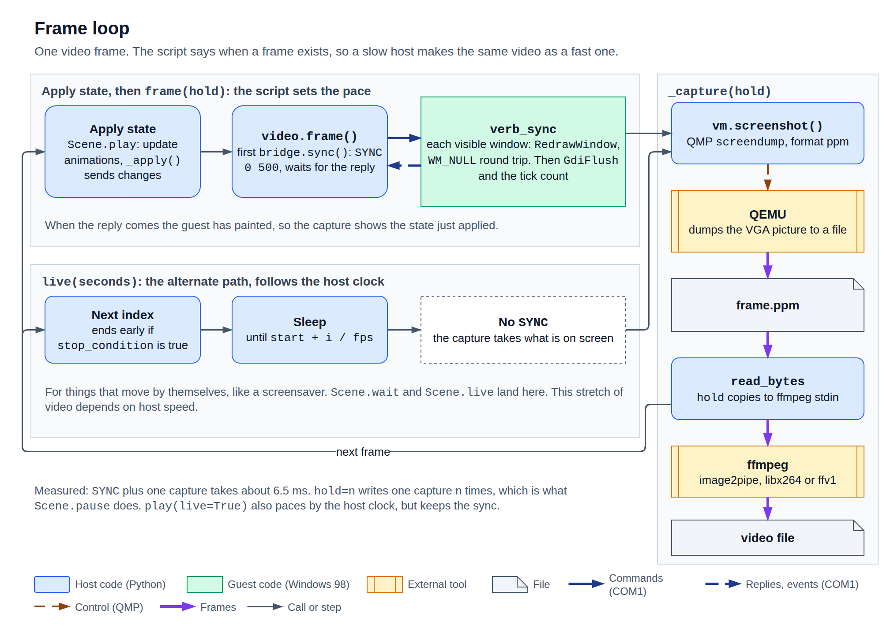
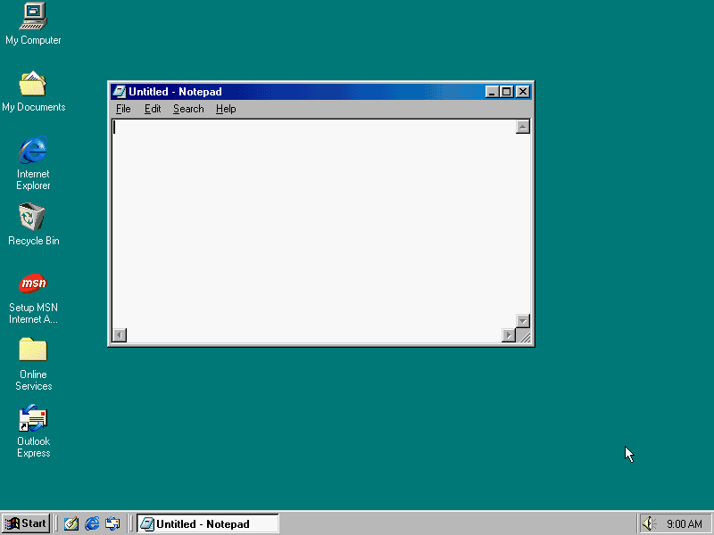
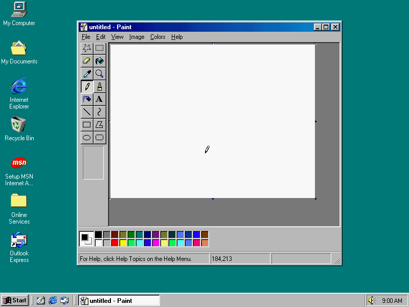
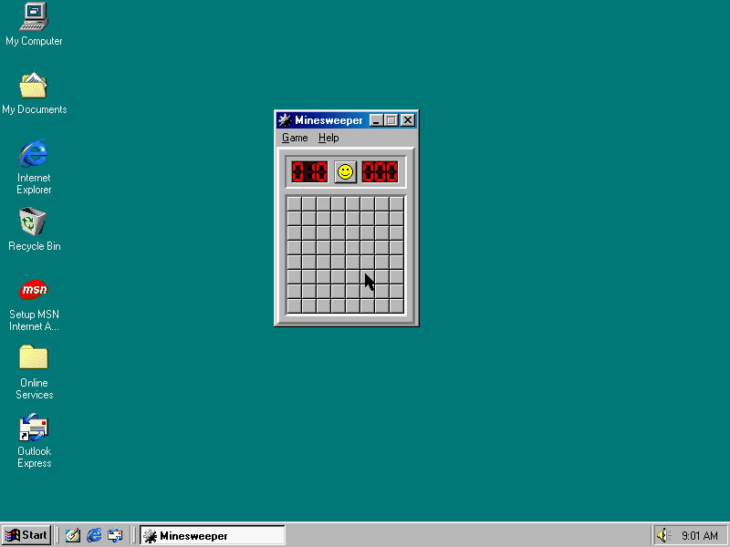
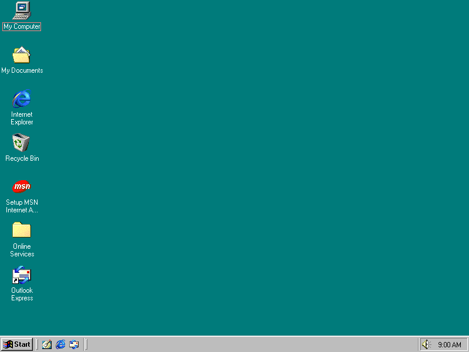

# Scene API

**Parked.** Paint, Minesweeper, Screensaver and Dialog still work, but
`from art98.anim import *` leaves them out until each program returns as its own action
class. Samples that use them import them from `art98.anim.apps`. [`Picture`](#picture) and
[`Notepad`](#notepad) are not parked.

Everything here comes from `from art98.anim import *`. For what you pass to `play`, see
[Animations](animations.md).

Positions are screen pixels, with `(0, 0)` at the top left and y running down. The screen is
800 x 600. A scene starts on a black screen with no icons, taskbar or pointer, so the whole
screen is the work area. On the stock desktop the taskbar takes the bottom 28 pixels.

## Scene

`class Scene`

Subclass it and write `construct`. One scene is one recording.

| Attribute | Meaning |
| --- | --- |
| `fps` | Frames per second of the video. Default 30. |
| `clock` | `"free"`, the only one so far. Anything else raises `NotImplementedError`. |
| `desktop` | `"blank"`, the default: a black screen with no icons, taskbar or Start menu, and the work area the whole screen. `"stock"`: the Windows 98 desktop as the `ready` snapshot has it. Either is set again after every revert. See [Blank start](../design/blank-start.md). |
| `pointer_visible` | On a blank desktop, whether the pointer is drawn. Default `False`. It still moves and clicks either way. It can't change partway through a scene. The stock desktop always draws it. |
| `state` | A [state file](#states) to set the desktop to before `setup`. Default `None`, the plain desktop. |
| `guest` | The raw [`Bridge`](bridge.md). |
| `vm` | The QEMU `VM`, for real key presses and captures. |
| `pointer` | The [`Pointer`](#pointer). |
| `props` | The props on stage. |
| `work_area` | `(left, top, right, bottom)` of the work area: the whole screen when blank, above the taskbar when stock. |
| `screen` | The same area as a `Box`, to measure against. |
| `recorder` | The [`Recorder`](bridge.md#recorder) the frames go to. `video` is another name for it. |
| `time` | Video time in seconds: frames written over `fps`, across every [clip](#clips). It never reads a clock. |

| Hook | Runs |
| --- | --- |
| `setup()` | Before `construct`. |
| `construct()` | The scene. |
| `tear_down()` | After `construct`. |

`Scene.render(output=None, **options)` boots a VM and renders from Python. The options are those
of [`render`](#rendering).

### Stage

`add(*props)` brings props on stage. For a window this starts the program, finds its window, and
places it. `remove(*props)` takes them off, which closes a window. `refresh_props()` reads
positions back, for when something other than the script moved a window.

### States

A state file describes the desktop: the display mode, the windows, and where the pointer is.
`set_state(path)` makes the desktop look like it, within one frame, as many times as a scene
likes. It reverts the guest to the snapshot it booted from, opens the state's windows, and then
checks that the guest matches. Props from before are gone, and adding one again opens a new
window. `prop(id)` is the prop for a window the last state opened.

A relative path is looked for beside the scene's file first, then in the current folder. A file
path inside a state is relative to the state file.

```json
{
  "version": 1,
  "display": [800, 600, 16],
  "windows": [
    {"id": "album", "app": "picture", "title": "Album", "at": [380, 220], "size": [360, 280]},
    {"id": "flower", "app": "picture", "title": "Flower", "at": [60, 60], "size": [240, 200],
     "open": {"file": "../assets/flower.bmp", "sha256": "<sha256 of the file>"}}
  ],
  "pointer": [400, 500]
}
```

Fill in `sha256` with the output of `sha256sum` on the file, for example `sha256sum examples/mvp/assets/flower.bmp`.

| Field | Meaning |
| --- | --- |
| `version` | `1`. The only field that must be there. |
| `display` | `[width, height, depth]`, a mode the guest's driver offers. Depth is 8, 16, 24 or 32. |
| `windows` | Listed back to front, so the last one is on top. |
| `id` | The name for `prop(id)`. Each one is used once. |
| `app` | `"picture"`, a [`Picture`](#picture), or `"notepad"`, a [`Notepad`](#notepad). |
| `title` | Default `"Picture"` for a picture. A Notepad takes the Windows 98 title for its file. No double quotes. |
| `at`, `size` | The top left corner, and the outer size. |
| `show` | `"normal"` (the default), `"minimized"` or `"maximized"`. |
| `open` | A BMP to show (or a text file for Notepad): its `file`, and its `sha256` (compute it with `sha256sum`) so a changed file is caught. |
| `pointer` | `[x, y]`, placed last. |

Every mistake in the file is listed at once, as a `StateError`, before the desktop is touched. If
the guest doesn't match the state afterwards, `StateMismatch` lists each difference. For example,
Windows won't make a window smaller than 112 x 27, so `"size": [40, 20]` stops with
`size [40, 20] wanted, the guest has [112, 27]`.

A Set with two windows and a 57 KB image took 1.2 to 1.6 s on a quiet host, mostly reverting and
copying the files again. The revert also winds the guest's clock back to the snapshot's time.

```python
from art98.anim import *


class TwoStates(Scene):
    state = "examples/mvp/states/two_windows.json"

    def construct(self):
        flower = self.prop("flower")
        self.play(flower.animate.shift(200 * RIGHT), run_time=2)
        self.set_state("examples/mvp/states/gallery.json")
        self.pause(1)
        self.play(self.prop("picture").animate.shift(100 * DOWN), run_time=2)
```

These paths are from the repository's root. The whole sample is
[examples/mvp](../../examples/mvp/mvp.py), with its states beside it.

### Playing

`play(*animations, run_time=None, rate_func=None, live=False)`

| Parameter | Meaning |
| --- | --- |
| `animations` | One or more. They run together, and shorter ones finish early and hold. |
| `run_time` | Seconds, overriding each animation's own. |
| `rate_func` | Overrides each animation's own. |
| `live` | Follow the host clock, so timers in the guest run at video speed. |

Each frame goes like this: work out every animation's state, apply it to the guest, wait for the
guest to finish painting, capture.



Two animations can't drive the same thing at once. Two pointer actions in one `play`, or two
`Keys`, raise `ValueError`. Two `.animate` calls on one window are fine.

```python
from art98.anim import *
from art98.anim.apps import Notepad


class Together(Scene):
    def construct(self):
        pad = Notepad(at=(60, 60), size=(360, 220))
        self.add(pad)
        self.play(TypeWithCursor(pad, "moving and typing"),
                  pad.animate.shift(300 * RIGHT + 200 * DOWN), run_time=2)
        self.pause(0.5)
```

### Time

| Method | What the guest does | Frames |
| --- | --- | --- |
| `pause(duration=1.0)` | Keeps running, unseen | One capture, repeated |
| `wait(duration=1.0, stop_condition=None, frozen_frame=False)` | Keeps running, seen | Captured at host speed |
| `live(seconds, stop_condition=None)` | Keeps running, seen | Captured at host speed, with no repaint wait |
| `wait_until(stop_condition, max_time=60.0)` | Keeps running, seen | Until the condition is true |

Use `pause` for a beat, `wait` to let a caret blink, and `live` for something that moves by
itself. `wait(frozen_frame=True)` is `pause`. `wait` and `live` are the same call today. `live`
wraps `Recorder.live`.

`stop_condition` is a function, tried before each capture. `wait_until` warns if it gives up.

```python
from art98.anim import *


class WaitForCalculator(Scene):
    def construct(self):
        self.guest.spawn("calc.exe")
        self.wait_until(lambda: any(w.class_name == "SciCalc" for w in self.guest.windows()))
        self.pause(0.5)
```

### Clips

`cut(path=None)` ends the current clip and starts a new one. The cut falls between two frames, so
no frame is lost or repeated, and `time` carries on across it. It returns the path of the clip it
closed.

- A scene that never cuts writes one file, the output, as before.
- After a cut, `render` keeps each clip beside the output as H.264 MP4, named `<stem>-01.mp4`,
  `<stem>-02.mp4` and so on, and joins them into the output. That holds when the output is a GIF
  too: the render still makes one GIF, from the joined clips. `render(..., keep_clips=False)`
  deletes the clips after the join. `art98 render` always keeps them.
- `path` names the next clip instead. Numbered clips count it too: if the first cut is
  `self.cut("intro.mp4")`, the clips are `<stem>-01.mp4`, `intro.mp4`, then `<stem>-03.mp4`.
- A cut with nothing recorded since the last one makes no empty clip. It returns `None`, and a
  `path` given then names the clip to come.
- `next_section(name)` is `cut()` with a label. It adds `(name, time)` to `sections`, a list of
  the sections so far, and returns what `cut()` returns. The name is only a label: clips stay
  numbered. An empty name raises `ValueError`.
- `set_state` doesn't cut. For one clip per state, call `cut()` after it.
- The screen size can't change inside a clip. If a frame has another size from the one before,
  the recorder raises `RecorderError`. Call `cut()` before the `set_state` that switches the
  display. Clips of different sizes are kept, but can't be joined: the join fails and names each
  clip's size, so render to MP4 clips with `keep_clips=True` and scale them yourself.

#### Temp files and old clips

- Every clip and every output is written to a temporary `.part` file beside it, such as
  `out-01.part.mp4`, and all of them are renamed to their final names only once the whole render
  has worked, the output last. A render that fails at any step, whether the scene raises, the
  join fails or an encode fails, leaves nothing under a real name that it made, and the output
  and clips of an earlier render are left exactly as they were.
- If ffmpeg fails, `RecorderError` carries ffmpeg's own message.
- A render that fails deletes the `.part` files it made, and only those.
- A render never deletes clips from an earlier one. If `<stem>-NN.mp4` files are left beside the
  output that this render did not write, say because the earlier scene cut more often, `render`
  prints a warning on stderr that names them. Delete them yourself.
- `keep_clips` is a Python argument of `render` only. `art98 render` has no flag for it and keeps
  the clips.

```python
from art98.anim import *


class TwoClips(Scene):
    def construct(self):
        self.pause(0.5)
        self.cut()
        self.pause(0.5)
```

`art98 render scene.py -o out.mp4` writes `out-01.mp4` and `out-02.mp4`, 15 frames each, and
`out.mp4` with all 30.

## Box

`Box(x=0, y=0, width=0, height=0)`

A rectangle with Manim's layout methods. These change numbers on the host only. A prop's numbers
reach the guest on the next frame, or at once with `apply()`.

| Method | Effect |
| --- | --- |
| `shift(*vectors)` | Move by each vector. |
| `move_to(target, aligned_edge=ORIGIN)` | Put the centre on the target. `aligned_edge=UL` puts the top left corner there instead. |
| `center()` | Centre in the work area. |
| `to_edge(edge=LEFT, buff=0)` | Against an edge of the desktop. |
| `to_corner(corner=DL, buff=0)` | Into a corner of the desktop. |
| `next_to(other, direction=RIGHT, buff=8)` | Beside another box, centred on it along the other axis. |
| `resize(width, height)` | New size. The top left corner stays. |
| `set_rect(x, y, width, height)` | Position and size. |
| `scale(factor)` | Grow or shrink about the centre. An app keeps its font size. |

| Read | Gives |
| --- | --- |
| `rect` | `(left, top, right, bottom)`, the order of a Win32 `RECT`. |
| `size` | `(width, height)`. |
| `get_center()` | Centre as a `Vec`. |
| `get_corner(direction)` | A corner or edge midpoint. |

A target is a point, a [`Spot`](#spot), or a prop, which means its centre.

All of these can be animated through `.animate`.

```python
from art98.anim import *
from art98.anim.apps import Notepad


class Layout(Scene):
    def construct(self):
        left = Notepad(size=(260, 180))
        right = Notepad(size=(260, 180))
        self.add(left, right)
        left.to_corner(UL, buff=90)
        right.next_to(left, RIGHT, buff=16)
        self.pause(0.5)
        self.play(right.animate.move_to(self.screen.get_center()))
        self.play(left.animate.scale(1.3))
        self.pause(0.5)
```

## Vectors

`Vec(x, y)` is a named tuple with `+`, `-`, `*`, `/` and negation, and `rounded()`.

| Constant | Value |
| --- | --- |
| `ORIGIN` | `(0, 0)` |
| `UP`, `DOWN` | `(0, -1)`, `(0, 1)` |
| `LEFT`, `RIGHT` | `(-1, 0)`, `(1, 0)` |
| `UL`, `UR`, `DL`, `DR` | The four corners. |

`lerp(a, b, alpha)` is the point `alpha` of the way from `a` to `b`.

## Prop

`Prop` is a `Box` that exists in the guest. Add it to a scene to bring it to life.

| Member | Meaning |
| --- | --- |
| `animate` | Starts an [`Animate`](animations.md#propanimate). |
| `guest` | The bridge. Raises `RuntimeError` until the prop is on stage. |
| `apply()` | Send changed values to the guest now. |
| `refresh()` | Read the real position back. |
| `remove()` | Leave the stage. |

To add a kind of prop, subclass `Win` for a window, or `Prop` for anything else, and override
`apply`.

## Spot

`Spot(locate)`

A place on screen, worked out when needed. `locate` returns `(x, y)`. Controls move with their
windows, so the props give you Spots, and an animation reads them as it begins.

```python
from art98.anim import *
from art98.anim.apps import Notepad


class Spots(Scene):
    pointer_visible = True

    def construct(self):
        pad = Notepad(at=(100, 100), size=(300, 200))
        self.add(pad)
        close = pad.corner(UR, inset=14)
        self.play(pad.animate.shift(200 * RIGHT))
        self.play(Glide(close))
        self.pause(0.5)
```

## Win

`Win(title=None, *, class_name=None, hwnd=None, command=None, at=None, size=None)`

A real window. Give `command` to start a program, or `title`, `class_name` or `hwnd` to take hold
of a window that exists.

| Parameter | Meaning |
| --- | --- |
| `title` | Part of the title, ignoring case. |
| `class_name` | The exact window class. |
| `hwnd` | A window handle you already have. |
| `command` | A command line. The window must belong to the program it starts. |
| `at` | Top left corner, applied when added. |
| `size` | Outer size, applied when added. |

Each frame, a changed position becomes one `SetWindowPos`, followed by a `RedrawWindow`. Without
the redraw Windows 98 leaves stale pixels on the frame.

| Member | Meaning |
| --- | --- |
| `title_bar` | `Spot` in the middle of the title bar. Drag from here. |
| `corner(direction=DR, inset=2)` | `Spot` on a corner or edge of the frame. Resize from here. |
| `client(x, y)` | `Spot` at client coordinates. |
| `client_size()` | Client area as `(width, height)`. |
| `children(class_name=None, title=None)` | Descendant windows, from `EnumChildWindows`. |
| `control(class_name=None, title=None)` | The first match, as a `Win`. |
| `text` | The window's text. |
| `set_text(text)` | Set it with `WM_SETTEXT`. |
| `edit_hwnd` | Where typing goes. |
| `activate()` | Make it the foreground window. |
| `bring_to_front()` | Raise it without activating. |
| `close()` | Post `WM_CLOSE`, which is what its X button does. |

`activate` clicks the title bar between two frames, because `SetForegroundWindow` returns 0 when
the agent calls it. It then puts the pointer back. It raises `RuntimeError` if another window
covers the title bar.

Calculator's buttons draw their own faces and have no window text, so this finds them by control
id. Where a control has text, `control("Button", "Yes")` is shorter.

```python
from art98.anim import *


SEVEN, TIMES, SIX, EQUALS = 131, 91, 130, 112  # Calculator's control ids


class Calculator(Scene):
    pointer_visible = True

    def construct(self):
        calc = Win(command="calc.exe", class_name="SciCalc", at=(240, 120))
        self.add(calc)
        for number in (SEVEN, TIMES, SIX, EQUALS):
            button = self.guest.user32.GetDlgItem(calc.hwnd, number).value
            self.play(Click(Win(hwnd=button), run_time=0.5))
        self.pause(1)
```

## Pointer

The mouse pointer. Every scene has one, as `self.pointer`.

| Member | Meaning |
| --- | --- |
| `place(point)` | Jump there now, with no frames in between. |
| `press(button="left")` | Press a button. |
| `release(button="left")` | Release it. |
| `get_center()` | Where it is, as of the last move. |
| `refresh()` | Read the real position with `GetCursorPos`. |

Moves use `SetCursorPos` and buttons use `mouse_event`. Both are real input, so Windows routes
them. Double clicks, title-bar drags, context menus and the Start menu all work. The buttons are
`"left"`, `"right"` and `"middle"`.

Use the animations in most scenes. `place` is useful to park the pointer out of shot:

```python
from art98.anim import *
from art98.anim.apps import Notepad


class Parked(Scene):
    pointer_visible = True

    def construct(self):
        pad = Notepad(at=(120, 90), size=(400, 240))
        self.add(pad)
        self.pointer.place((700, 500))
        self.play(TypeWithCursor(pad, "The pointer is out of the way."))
        self.pause(0.5)
```

## Picture

`Picture(title="Picture", *, image=None, at=None, size=None)`

A plain window that shows one BMP at 1:1, centred on grey. Windows 98 has no small image viewer,
so this is art98's own program, `VIEW.EXE`, built by `make` in `guest/` and copied to the guest
when it's needed. `image` is a BMP on the host, or `None` for an empty window. The window opens at
`at` (default `(100, 100)`) with the outer `size` (default `(320, 240)`), with no move on screen
first.

The image is checked when the prop is made, so a file that isn't a BMP, or one cut short, raises
`ValueError` straight away. Windows 98 crashes on a cut-short BMP instead of failing.
`image_size` is the picture's `(width, height)`.

Move one with `.animate`, jump it with [`Teleport`](animations.md#teleport), close it with
`Close`, and open another with `add`.

```python
from art98.anim import *


class OnePicture(Scene):
    def construct(self):
        pic = Picture("Empty", at=(100, 100), size=(320, 240))
        self.add(pic)
        self.play(pic.animate.shift(200 * RIGHT), run_time=1)
        self.play(Teleport(pic, (40, 40), aligned_edge=UL))
        self.play(Close(pic))
```

## Notepad

`Notepad(title=None, *, open=None, at=None, size=None)`

Starts `notepad.exe`. `open` is a text file on the host, or `None` for an empty "Untitled" window.
It is copied to the guest and opened by Notepad. `title` is the title bar text it waits for. When
it's left out, Notepad's own rule gives it: a trailing `.txt` is dropped, so `note.txt` gives
"note - Notepad", and no file gives "Untitled - Notepad". `edit_hwnd`, `text` and `set_text` work on
its Edit control. `close` marks the text as saved first, so no save prompt appears.

In a state, it is `"app": "notepad"`:

```json
{"id": "note", "app": "notepad", "at": [320, 180], "size": [320, 200],
 "open": {"file": "../assets/note.txt", "sha256": "<sha256 of the file>"}}
```

The file must be plain text. `title` is optional there too. Fill in `sha256` with the output of `sha256sum` on the file.



Source: [typing.py](../../examples/gallery/typing.py).

## Paint

Parked: import it from `art98.anim.apps`.

`Paint(at=None, size=None)`

Starts `MSPAINT.EXE`. Buttons and the canvas are read from the live window. The tool buttons are
`ToolChild` windows, found by control id. The palette is the `AfxWnd42` child called `Colors`. So
every target stays right after the window moves or resizes.

| Member | Meaning |
| --- | --- |
| `tool(name)` | `Spot` on a toolbox button. |
| `color(name)` | `Spot` on a palette swatch. Left click sets ink, right click sets paper. |
| `canvas(x, y)` | `Spot` on a canvas pixel. |
| `canvas_size` | `(width, height)` of the canvas. |
| `canvas_handle` | `Spot` on the canvas's bottom right grab handle. |
| `resize_canvas(width, height, **kwargs)` | A `Drag` that pulls that handle. |

`TOOLS` lists the names: `free_select`, `select`, `eraser`, `fill`, `pick_color`, `magnifier`,
`pencil`, `brush`, `airbrush`, `text`, `line`, `curve`, `rectangle`, `polygon`, `ellipse`,
`rounded_rectangle`.

`PALETTE` lists the colours. The top row is `black`, `gray`, `maroon`, `olive`, `green`, `teal`,
`navy`, `purple`, `khaki`, `dark_teal`, `azure`, `steel`, `indigo`, `brown`. The bottom row is
`white`, `silver`, `red`, `yellow`, `lime`, `cyan`, `blue`, `magenta`, `cream`, `mint`, `sky`,
`periwinkle`, `rose`, `orange`.

Paint doesn't report its canvas size. `canvas_size` finds the edge with `GetPixel`, and that needs
a blank canvas, so read it before you draw or use `resize_canvas` first.

Keep the canvas smaller than the grey area around it. A larger canvas gets scroll bars, and
`canvas(x, y)` doesn't follow the scroll position. Closing a changed Paint brings up its save
prompt, which isn't handled.



Source: [paint_drawing.py](../../examples/gallery/paint_drawing.py).

## Minesweeper

Parked: import it from `art98.anim.apps`.

`Minesweeper(at=None, size=None)`

Starts `WINMINE.EXE`. The cell positions come from the client area.

| Member | Meaning |
| --- | --- |
| `board_size` | `(columns, rows)`. |
| `cell(column, row)` | `Spot` on a cell. |
| `find_mines()` | Read the board. Returns the set of mine cells. |
| `mines` | The result of `find_mines`. |
| `neighbours(cell)` | The cells around a cell. |
| `opened_by(cell)` | The cells a click on this cell opens, by flood fill. |
| `clear()` | Win the game, with real clicks. Plays its own animations. |
| `sign_scoreboard(name="art98")` | Answer the best time prompt that follows a first win. |

`find_mines` uses Minesweeper's own XYZZY cheat. It types the cheat, then moves the pointer over
every cell with Progman hidden and reads pixel (0, 0). This happens between two frames, so it
takes no video time. No window may cover the top left corner of the screen.



Source: [minesweeper_win.py](../../examples/gallery/minesweeper_win.py).

## Screensaver

Parked: import it from `art98.anim.apps`.

`Screensaver(name="3D Pipes")`

Starts `<name>.scr /s`. Follow it with `self.live(seconds)`, because a screensaver runs by itself.
`stop(timeout=5.0)` nudges the pointer, which is how a real one is dismissed, and waits for it to
exit.

`NAMES` lists what works: 3D Flower Box, 3D Flying Objects, 3D Maze, 3D Pipes, 3D Text, Blank
Screen, Curves and Colors, Flying Through Space, Flying Windows, Mystify Your Mind.

Channel Screen Saver is on the image but left out, because moving the pointer doesn't dismiss it.


Source: [screensaver.py](../../examples/gallery/screensaver.py).

## Dialog

Parked: import it from `art98.anim.apps`.

`Dialog(text, title="art98", *, icon=None, buttons="ok", at=None)`

A real `MessageBoxA`. It blocks whoever calls it, so the agent runs it on its own guest thread
with `ACALL`, and the scene carries on.

| Parameter | Values |
| --- | --- |
| `icon` | `None`, `"error"`, `"question"`, `"warning"`, `"info"` |
| `buttons` | `"ok"`, `"okcancel"`, `"abortretryignore"`, `"yesnocancel"`, `"yesno"`, `"retrycancel"` |

`button(label)` gives a button as a `Win`. `answer` is the lower-case name of the button pressed,
and it waits for the box to close.



Source: [hover_dialog.py](../../examples/gallery/hover_dialog.py).

```python
from art98.anim import *
from art98.anim.apps import Dialog, Notepad


class Question(Scene):
    pointer_visible = True

    def construct(self):
        box = Dialog("Keep this?", icon="question", buttons="yesno", at=(280, 200))
        self.add(box)
        self.pause(0.5)
        self.play(Click(box.button("No")))
        pad = Notepad(at=(200, 120), size=(320, 160))
        self.add(pad)
        self.play(TypeWithCursor(pad, f"You pressed {box.answer}."))
        self.pause(1)
```

## Rendering

### Command line

```text
art98 render FILE [SCENE] [-o OUTPUT] [--gif GIF] [--work DIR]
             [--gif-fps N] [--gif-colors N] [--gif-scale X] [--gif-dither NAME]
```

| Option | Default | Meaning |
| --- | --- | --- |
| `FILE` | | The Python file. |
| `SCENE` | | The scene class. Needed if the file has several. |
| `-o`, `--output` | `<Scene>.mp4` | `.mp4`, or `.gif` for a GIF alone. |
| `--gif` | | Write a GIF as well as the video. |
| `--work` | `work` | Where the prepared image is. |
| `--gif-fps` | 15 | GIF frame rate. |
| `--gif-colors` | 128 | Palette size. |
| `--gif-scale` | 1.0 | Size factor, with nearest-neighbour scaling. |
| `--gif-dither` | `none` | A dither of ffmpeg's `paletteuse`. |

### Python

`render(scene, output=None, *, gif=None, work="work", gif_fps=15, gif_colors=128, gif_scale=1.0,
gif_dither="none", display="none", backend=None, keep_clips=True)`

`scene` is a class or an instance. `display` is passed to QEMU's `-display`. Returns the path
written. `keep_clips` is for scenes that [cut](#clips). A scene that records no frames raises
`RecorderError`.

The prepared image is only copied, as a reflink, into `work/runs/render-*`, and the copy is
deleted afterwards. Several renders can run at once.

`write_gif(source, output, fps=15, colors=128, scale=1.0, dither="none")` converts a video to a
GIF with `palettegen` and `paletteuse`.

A video goes through 4:2:0 H.264, which smears 1-pixel coloured text. A GIF comes from a lossless
FFV1 recording instead, so its pixels stay sharp. With cuts, every clip is recorded lossless,
the clips are joined into one lossless recording, and the GIF and MP4 are made from it. Each kept
clip is then encoded to MP4 and its lossless file deleted.
