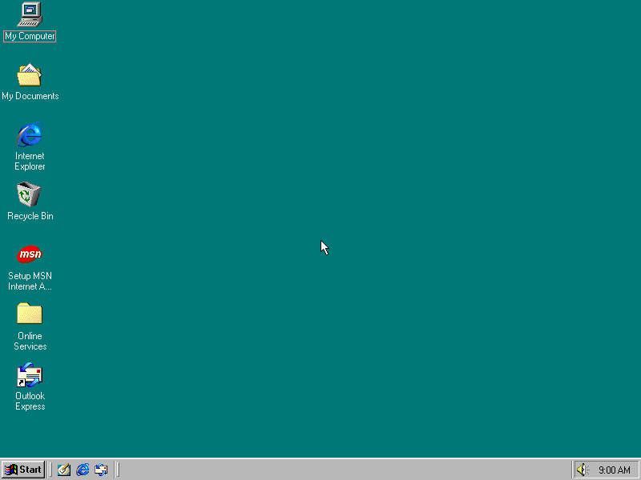
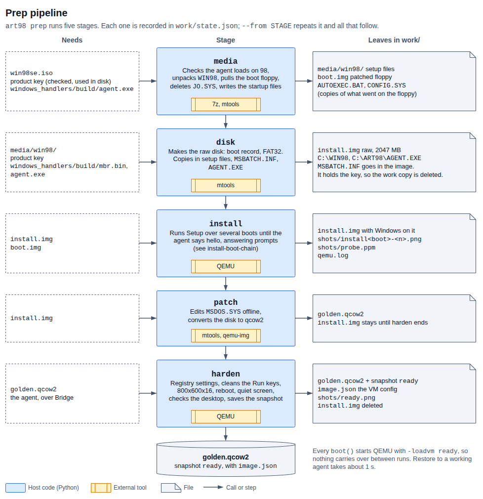
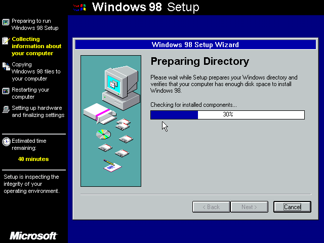

# Part 1: preparing the VM

`art98 setup` turns your Windows 98 SE disc image into a desktop that restores to
the same state every time. It runs Windows Setup with no input, cleans up the result, and
saves a QEMU snapshot called `ready`: a saved moment of the running machine, with Windows
booted, settings applied and art98's agent running. Everything else in art98 starts from that
snapshot, and restoring it takes about a second.

Most people run setup through `art98 up`, which does it inside a container and also builds the
container image the renders need. Then `art98 vm start` starts the **VM service**: the VM kept
running in that container, paused between renders. Unfamiliar words are in the
[glossary](../glossary.md).

This part covers the setup tool, `setup/`. To drive the finished desktop, see
[Part 2](../scenes/README.md).


## What it produces

| File | What it is |
|------|------------|
| `work/golden.qcow2` | The installed disk, with the snapshot `ready` inside it. About 415 MB on disk, 2 GB virtual |
| `work/image.json` | The `VMConfig` that created the snapshot. The VM service and `boot_local()` read it, and the snapshot only loads on the same hardware |
| `work/state.json` | The steps that have finished |
| `work/shots/ready.png` | What the desktop looked like when the snapshot was saved |



The desktop is Windows 98 SE at 800x600 in 16-bit colour, with screensavers,
system sounds and power saving off, and `C:\ART98\AGENT.EXE` already running.
[image.md](image.md) lists what is on it.

## What you need

- **A Windows 98 SE disc image and product key of your own.** The disc must boot
  from an emulated floppy and hold a `WIN98` folder. The tool was run on one OEM
  disc only, see [what a different disc needs](troubleshooting.md#a-different-disc).
- **Docker and ffmpeg**, for the [container path](#quick-path-in-a-container).
  The container holds QEMU 10.2.2, mtools, 7-Zip and the guest programs, so the host needs
  nothing else. art98 calls only `docker`. On a Podman host, install `podman-docker`, which
  provides that command.
- **Or, for [setup on the host](#quick-path-on-the-host), Linux with these tools.** Rendering
  still runs the VM in the container, so the host path also needs the image from `art98 up`.
  `art98 doctor` checks them.

  | Tool | Fedora package | Debian and Ubuntu package | Used for |
  |------|----------------|---------------------------|----------|
  | `qemu-system-i386` | `qemu-system-x86` | `qemu-system-x86` | Running the VM |
  | `qemu-img` | `qemu-img` | `qemu-utils` | Converting the disk to qcow2 |
  | `mcopy` and the rest of mtools | `mtools` | `mtools` | Editing the FAT floppy and disk from the host |
  | `7z` | `7zip` | `7zip` (`p7zip-full` on Debian 12 and older) | Unpacking the disc |
  | `ffmpeg` | `ffmpeg` | `ffmpeg` | Not used by `setup`. Scenes need it to encode video |
  | `make`, `as` | `make`, `binutils` | `make`, `binutils` | Building `mbr.bin` |
  | `i686-w64-mingw32-gcc` | `mingw32-gcc` | `gcc-mingw-w64-i686` | Building `agent.exe` |

  The `ready` snapshot only loads on the QEMU machine type that saved it, so an image made
  with one QEMU version may not restore on another. The container pins the version.
- **Python 3.11 or newer and [uv](https://docs.astral.sh/uv/).** art98 has no
  runtime Python dependencies.
- **About 3 GB of free disk space during the build**, and 25 to 40 minutes. The raw
  install disk is 2 GB, and it exists next to the qcow2 until the `ready` step deletes it.

KVM is not used. See [why TCG](image.md#hardware).

## Licence

Nothing from Microsoft is in this repository. You supply the disc and the key.

**Running `art98 setup` accepts the Windows 98 licence agreement on your behalf.** The
answer file sets `ShowEula=0`, and on OEM discs that show the agreement anyway,
setup selects "I accept the Agreement" by keystroke. Only run it with a disc and
key you are licensed to use.

Do not share `golden.qcow2`: it is an installed copy of Windows 98. It also holds your key
in clear text, see [the key on the image](image.md#your-product-key-is-on-the-image).

## Quick path in a container

One command builds the image, runs setup in the container and checks the result:

```bash
uv run art98 up --iso /path/to/win98se.iso
```

Give it your product key at the prompt, or set `ART98_PRODUCT_KEY` first. Setup takes
25 to 40 minutes, depending on host load: about 25 on a quiet one. Add `--watch` and point a VNC viewer at `127.0.0.1:5998` to see the screen.
If setup stops, read the error, then run the same command again: it resumes, and asks for the key again, since
nothing keeps it between runs. If the error is `Windows rejected the product key`, delete
`work/state.json` first and type the right key. Running `up` again once setup is done skips setup and prints
`art98 vm start`.

Then start the VM and render. The VM stays up, paused between renders, until you stop it:

```bash
uv run art98 vm start
uv run art98 render examples/mvp/mvp.py
uv run art98 vm stop
```

The VM runs in the container. See [the VM service](../design/container.md#the-vm-service) for
how it works, and [configuration](config.md) for the ports and the work folder.

### By hand

`art98 up` runs these. Build the image from the repository root:

```bash
docker build -t localhost/art98:latest -f setup/Dockerfile .
```

Put the key in a file. The container reads it from `/run/secrets/art98_key`, so the file is
mounted read-only there:

```bash
printf %s "XXXXX-XXXXX-XXXXX-XXXXX-XXXXX" > "$XDG_RUNTIME_DIR/art98_key"
```

Run setup, with `work/`, the disc and the key mounted. `ART98_HOST_UID` and `ART98_HOST_GID`
make the files setup writes in `work/` yours on rootful Docker. Rootless engines ignore them,
since their root is you already:

```bash
docker run --rm --init --security-opt label=disable -v "$PWD/work:/work" -e ART98_HOST_UID=$(id -u) -e ART98_HOST_GID=$(id -g) -v /path/to/win98se.iso:/media/win98.iso:ro -v "$XDG_RUNTIME_DIR/art98_key:/run/secrets/art98_key:ro" localhost/art98:latest setup --work /work --iso /media/win98.iso
```

Then delete the file; it is only a copy of the key:

```bash
rm "$XDG_RUNTIME_DIR/art98_key"
```

The VM's container runs `art98 serve`, which reads the token from `work/vm.token` (or the
file `[vm] token_file` names) and waits for a client to connect. A client can also be another
container: see [attach from another container](config.md#attach-from-another-container). `art98 vm start` starts it for you. Which file does what is in
[the container design](../design/container.md#the-image).

## Quick path on the host

Install the tools:

```bash
sudo dnf install qemu-system-x86 qemu-img mtools 7zip ffmpeg make binutils mingw32-gcc
```

On Debian or Ubuntu:

```bash
sudo apt install qemu-system-x86 qemu-utils mtools 7zip ffmpeg make binutils gcc-mingw-w64-i686
```

Build the three files that go on the Windows disk and into scenes, `guest/build/agent.exe`,
`guest/build/mbr.bin` and `guest/build/view.exe`:

```bash
make -C guest
```

Check the host:

```bash
uv run art98 doctor
```

Give setup your key in `ART98_PRODUCT_KEY`, or pass it with `--key`. `art98 setup` does not prompt for it:

```bash
export ART98_PRODUCT_KEY=XXXXX-XXXXX-XXXXX-XXXXX-XXXXX
```

Build the image. This takes 25 to 40 minutes and needs no input:

```bash
uv run art98 setup --iso /path/to/win98se.iso
```

Renders and `ping` run the VM in the container, so build the container image too. `art98 up`
does that and skips setup, since `work/image.json` now exists:

```bash
uv run art98 up
uv run art98 vm start
uv run art98 ping
```

`ping` prints what is running in the guest:

```
guest tick count: 54390
0xff0f5f99 C:\WINDOWS\SYSTEM\KERNEL32.DLL
0xffff8b21 C:\WINDOWS\SYSTEM\MSGSRV32.EXE
0xffff8319 C:\WINDOWS\SYSTEM\SPOOL32.EXE
0xffff91cd C:\WINDOWS\SYSTEM\MPREXE.EXE
0xfffff38d C:\WINDOWS\SYSTEM\mmtask.tsk
0xffffdc1d C:\WINDOWS\EXPLORER.EXE
0xfffe4865 C:\ART98\AGENT.EXE
0xfffe4025 C:\WINDOWS\SYSTEM\SYSTRAY.EXE
```

If a step fails, fix the cause and see
[recovering from a failed step](troubleshooting.md#recovering-from-a-failed-step).

## What happens

Setup runs four steps in order, named after the path from a blank machine to a
scriptable desktop: VM, setup, init api, ready. Each one is recorded in
`work/state.json`. Builds made with the old five stage names (`media`, `disk`,
`install`, `patch`, `harden`) still count as done, and `--from` accepts those names too.



| Step | Time on the two full runs logged | Result |
|------|---------------------------------|--------|
| `vm` | 1 s, then 0 to 9 s | Setup files unpacked, boot floppy patched, raw disk with Setup, the answer file and the agent on it |
| `setup` | 2083 s and 2268 s | Windows installed |
| `init_api` | 1 to 2 s, plus one extra boot | `MSDOS.SYS` edited, disk converted to qcow2, the agent seen answering |
| `ready` | 78 s and 106 s | Settings applied, snapshot saved |

The extra boot in `init_api` is new, so the logged times do not include it.

This is Setup running, from file copy to the first desktop, with one frame every
few minutes:



## The rest of this part

| Page | Covers |
|------|--------|
| [stages.md](stages.md) | Each step: inputs, outputs, what happens inside, how it fails, what `--from` redoes |
| [cli.md](cli.md) | `art98 doctor`, `setup`, `vm`, `render`, `ping`, `up` and `serve`, every flag, environment variables, the work directory |
| [config.md](config.md) | `art98.toml`: the container name, the image, the work folder and the ports |
| [image.md](image.md) | What is on the finished image, every setting and why, the snapshot, the VM hardware |
| [troubleshooting.md](troubleshooting.md) | Setup quirks, the stall rule, recovery, other discs |

Audio is deferred. art98 is video only for now, though the VM keeps its Sound
Blaster.
