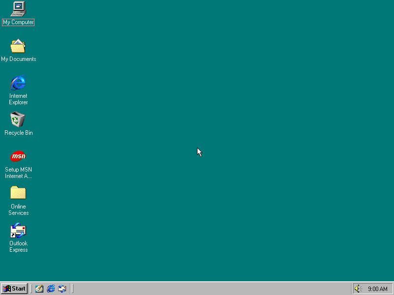

# What is on the finished image

The facts on this page were read from a running guest on 2026-11-06, using a private
copy of the image built from a Windows 98 SE OEM disc on QEMU 10.2.2. A different
disc may give a different inventory. Settings come from `ready.py` and `init_api.py` in `98artware_setup/art98_setup/`, and
each one was read back from the guest.

## At a glance

| What | Value |
|------|-------|
| Windows | Windows 98 SE, version 4.10.2222, `SubVersionNumber` ` A ` |
| `GetVersion` | `0xc0000a04` |
| Internet Explorer | 5.00.2614.3500 |
| Registered owner | `art98`, no organization |
| Computer name | `art98`, workgroup `WORKGROUP` |
| Drive `C:` | FAT32, label `ART98`, 2 GB, about 1.6 GB free |
| RAM seen by Windows | 127.5 MB |
| Display | 800x600, 16-bit, `Cirrus Logic` driver |
| Sound | `Sound Blaster 16 or AWE-32 or compatible`, 1 `waveOut` and 1 `midiOut` device |
| Guest clock at restore | 1998-06-25, 09:01 |
| Network | No adapter. Windows lists `Dial-Up Adapter` and `TCP/IP`, with nothing to connect to |
| CD drive | None |



### The desktop

The icons are My Computer, My Documents, Internet Explorer, Recycle Bin, Setup MSN
Internet Access, Online Services and Outlook Express. There is no Network
Neighborhood. Setup does not remove or arrange icons. The wallpaper is off, so the
background is the plain teal.

### Processes

Eight processes run in the snapshot, all listed in the
[`ping` output](README.md#quick-path). Only `AGENT.EXE` is added by art98.
`SYSTRAY.EXE` is kept on purpose.

### Your product key is on the image

Your key is stored in clear text in at least two places inside `golden.qcow2`:

- `C:\WIN98\MSBATCH.INF`, the answer file. Setup leaves `C:\WIN98` in place.
- The `ProductKey` value under `HKLM\Software\Microsoft\Windows\CurrentVersion`,
  written by Setup.

Both were confirmed present on the private copy. The values were not printed. An old
Windows 98 key is rarely worth guarding, but the disk is still an installed copy of Windows,
so don't publish `golden.qcow2`, a copy of it, or `install.img`.

## The answer file

`render_msbatch` writes `C:\WIN98\MSBATCH.INF`, which is what makes Setup run
without questions. Meanings are from Microsoft's
[Windows 98 Resource Kit, Appendix D](https://learn.microsoft.com/en-us/previous-versions/cc768165(v=technet.10)).

| Setting | Value | Effect |
|---------|-------|--------|
| `Express` | `1` | Use only the file and built-in defaults. No questions |
| `InstallDir` | `"C:\WINDOWS"` | Where Windows goes |
| `InstallType` | `1` | Typical |
| `ProductKey` | your key | |
| `EBD` | `0` | No startup disk |
| `ShowEula` | `0` | **Accepts the licence for you** and does not show it |
| `ChangeDir` | `0` | Keep the default directory |
| `OptionalComponents` | `1` | Pairs with the `[OptionalComponents]` section below |
| `CleanBoot` | `1` | Force a clean install, not an upgrade |
| `DevicePath` | `0` | Look for INF files only in the Windows INF folder |
| `NoDirWarn` | `1` | No warning about an existing Windows folder |
| `TimeZone` | `"GMT"` | The `timezone` argument of `render_msbatch`. The CLI has no flag for it |
| `Uninstall` | `0` | No uninstall backup |
| `PenWinWarning` | `0` | No Pen Windows warning |
| `NoPrompt2Boot` | `1` | No prompt before rebooting. Appendix D's parameter table says `1` means prompt, but its own sample script uses `1`, and setup follows the sample |
| `[System] Locale` | `L0409` | US English |
| `[System] SelectedKeyboard` | `KEYBOARD_00000409` | US keyboard |
| `[NameAndOrg]` | `Name="art98"`, `Org=""`, `Display=0` | Registered user. Do not show the page |
| `[Network]` | `ComputerName="art98"`, `Workgroup="WORKGROUP"`, `Description="art98"`, `Display=0` | Do not show the page. Windows refuses a workgroup with the same name as the computer |
| `[Install] AddReg` | `Art98.AddReg` | Adds `Art98Agent` to `HKLM\...\Run`, which is how the agent starts on the first desktop |

Appendix D says `OptionalComponents=1` shows the Select Components dialog and needs
`InstallType=3`. On this disc, with `Express=1` and `InstallType=1`, no dialog
appeared and the `[OptionalComponents]` section was honoured anyway.

## Installed components

`OPTIONAL_COMPONENTS` lists what setup asks for on top of a Typical install. Setup
ignores names it does not know, so asking does not prove it installed. The result:

| Requested | Installed |
|-----------|-----------|
| `Accessories` | Yes |
| `Games` | Yes |
| `Character Map` | Yes |
| `Screen Savers` | Yes |
| `Flying Windows` | Yes |
| `OpenGL Screen Savers` | Yes |
| `Additional Screen Savers` | Yes |
| `Desktop Wallpaper` | Yes |
| `Mouse Pointers` | Yes |
| `Multimedia Sound Schemes` | Yes |
| `Sample Sounds` | Yes |
| `Desktop Themes Support` | Yes (`ThemesEngine`) |
| `Desktop Themes` | **No themes.** All `Theme_*` components are off and `C:\Program Files\Plus!\Themes` is empty |

There are two ways to check a component on an image:

- `C:\SETUPLOG.TXT` has an `[OptionalComponents]` section with Setup's choices.
- `HKLM\Software\Microsoft\Windows\CurrentVersion\Setup\OptionalComponents` has one
  key per component, each with an `Installed` value. 37 of the 95 are `1`.

Not installed, because setup does not ask for them and Typical leaves them out:
Accessibility Tools (so no Magnifier), System Resource Meter, System Monitor, Net
Watcher, Clipboard Viewer, Quick View, HyperTerminal, Backup, Microsoft Chat, Web TV.
To add one, add its Setup name to `OPTIONAL_COMPONENTS` and rebuild from `disk`.

Also there from the Typical install: Outlook Express, Address Book, NetMeeting, Dial-Up
Networking, Phone Dialer, Imaging, CD Player, Windows Scripting Host, and the online
service folders.

## Inventory

### Screensavers: 12

Eleven are in `C:\WINDOWS\SYSTEM`, and one is in `C:\WINDOWS`. All have long names.

| File | 8.3 name | Bytes |
|------|----------|-------|
| `3D Flower Box.scr` | `3DFLOW~1.SCR` | 94,112 |
| `3D Flying Objects.scr` | `3DFLYI~1.SCR` | 203,104 |
| `3D Maze.scr` | `3DMAZE~1.SCR` | 478,128 |
| `3D Pipes.scr` | `3DPIPE~1.SCR` | 161,040 |
| `3D Text.scr` | `3DTEXT~1.SCR` | 121,456 |
| `Blank Screen.scr` | `BLANKS~1.SCR` | 9,728 |
| `Curves and Colors.scr` | `CURVES~1.SCR` | 16,896 |
| `Flying Through Space.scr` | `FLYING~2.SCR` | 16,384 |
| `Flying Windows.scr` | `FLYING~1.SCR` | 14,848 |
| `Mystify Your Mind.scr` | `MYSTIF~1.SCR` | 21,504 |
| `Scrolling Marquee.scr` | `SCROLL~1.SCR` | 18,944 |
| `Channel Screen Saver.SCR`, in `C:\WINDOWS` | `CHANNE~1.SCR` | 91,888 |

### Games: 4

| Game | File |
|------|------|
| FreeCell | `C:\WINDOWS\FREECELL.EXE` |
| Hearts | `C:\WINDOWS\MSHEARTS.EXE` |
| Minesweeper | `C:\WINDOWS\WINMINE.EXE` |
| Solitaire | `C:\WINDOWS\SOL.EXE` |

### Accessories and tools

| Program | File |
|---------|------|
| Notepad | `C:\WINDOWS\NOTEPAD.EXE` |
| Paint | `C:\Program Files\Accessories\MSPAINT.EXE` |
| WordPad | `C:\Program Files\Accessories\WORDPAD.EXE` |
| Calculator | `C:\WINDOWS\CALC.EXE` |
| Character Map | `C:\WINDOWS\CHARMAP.EXE` |
| Imaging | `C:\WINDOWS\KODAKIMG.EXE` |
| Sound Recorder | `C:\WINDOWS\SNDREC32.EXE` |
| Volume Control | `C:\WINDOWS\SNDVOL32.EXE` |
| CD Player | `C:\WINDOWS\CDPLAYER.EXE` |
| Media Player | `C:\WINDOWS\MPLAYER.EXE` |
| Windows Media Player | `C:\Program Files\Windows Media Player\MPLAYER2.EXE` |
| Phone Dialer | `C:\WINDOWS\DIALER.EXE` |
| Internet Explorer | `C:\Program Files\Internet Explorer\IEXPLORE.EXE` |
| Registry Editor | `C:\WINDOWS\REGEDIT.EXE` |
| System Configuration | `C:\WINDOWS\SYSTEM\MSCONFIG.EXE` |
| Disk Defragmenter, ScanDisk, Disk Cleanup | `DEFRAG.EXE`, `SCANDSKW.EXE`, `CLEANMGR.EXE` in `C:\WINDOWS` |
| Older shells and tools | `PROGMAN.EXE`, `WINFILE.EXE`, `TASKMAN.EXE`, `WRITE.EXE` in `C:\WINDOWS` |
| Welcome, Discover tour | `WELCOME.EXE`, `TOUR98.EXE` in `C:\WINDOWS` |

### Media files

| Kind | Where | Count |
|------|-------|-------|
| Sounds | `C:\WINDOWS\Media\*.wav` | 77: nine default sounds such as `The Microsoft Sound.wav`, plus the Jungle, Musica, Robotz and Utopia schemes |
| Music | `C:\WINDOWS\Media\*.mid`, `*.rmi` | 9, such as `CANYON.MID` and `PASSPORT.MID` |
| Pointers | `C:\WINDOWS\Cursors` | 42 `.CUR`, 3 `.ANI`: `GLOBE.ANI`, `APPSTART.ANI`, `HOURGLAS.ANI` |
| Wallpapers | `C:\WINDOWS\*.bmp` | 20, including `Clouds.bmp`, `Forest.bmp` and `Setup.bmp` |

### Drive C:

| Path | What |
|------|------|
| `C:\ART98\AGENT.EXE` | The agent, 10,240 bytes |
| `C:\WIN98\` | Setup files, 103 from the disc plus `MSBATCH.INF`. Windows can add components from here without a disc. Holds your key |
| `C:\WINDOWS\`, `C:\Program Files\`, `C:\My Documents\` | As Setup left them |
| `C:\SETUPLOG.TXT`, `DETLOG.TXT`, `NETLOG.TXT`, `BOOTLOG.TXT` | Setup's logs |
| `C:\AUTOEXEC.BAT` | Empty |
| `C:\CONFIG.SYS` | One remark left by Setup |

### How to repeat the listing

`FindFirstFileA` fills a `WIN32_FIND_DATA`, which holds the file name at offset 44:

```python
from art98 import Out, boot

def listing(guest, pattern):
    found = guest.kernel32.FindFirstFileA(pattern, Out(320))
    if found.value == 0xFFFFFFFF:
        return []
    handle, names = found.value, []
    data = found.buffers[0]
    while True:
        names.append(data[44:304].split(b"\0", 1)[0].decode("cp1252"))
        more = guest.kernel32.FindNextFileA(handle, Out(320))
        if not more.value:
            guest.kernel32.FindClose(handle)
            return names
        data = more.buffers[0]

with boot("work") as stage:
    print(listing(stage.bridge, r"C:\WINDOWS\SYSTEM\*.SCR"))
```

## Registry settings

`ready` writes all of `HARDEN_SETTINGS`. "Took effect" says what Windows itself
reports through `SystemParametersInfoA` or the screen, not just that the value is in
the registry. All values were read back and match.

The reasons here come from `docs/archive/PLAN.md` section 3 and the names of the settings. The code
gives none, apart from what is noted.

All keys are under `HKCU`. Setup writes data as `REG_SZ`, or `REG_BINARY` where
shown.

### `Control Panel\Desktop`

| Value | Data | Why | Took effect |
|-------|------|-----|-------------|
| `ScreenSaveActive` | `0` | No screensaver starting mid-scene | Yes |
| `ScreenSaveLowPowerActive` | `0` | No low power screen | Yes |
| `ScreenSavePowerOffActive` | `0` | No monitor power off | Yes |
| `DragFullWindows` | `1` | Show window contents while dragging, not an outline | Yes |
| `FontSmoothing` | `0` | Plain unsmoothed text | Yes |
| `MenuShowDelay` | `0` | Menus open at once | Yes |
| `SmoothScroll` | binary `00 00 00 00` | No list box animation | **No**, see below |
| `UserPreferencesMask` | binary `00 00 00 00` | Turn off UI animation | **No**, see below |
| `Wallpaper` | empty | Plain background | Yes |

`ScreenSaveTimeOut` stays at 840 seconds, which is harmless with the saver off.

### Other keys

| Key | Value | Data | Why | Took effect |
|-----|-------|------|-----|-------------|
| `Control Panel\Desktop\WindowMetrics` | `MinAnimate` | `0` | No minimize and restore animation | Yes |
| `Control Panel\PowerCfg` | `CurrentPowerPolicy` | `3` | Scheme 3 on this image is "Always On" | Yes, the scheme exists |
| `AppEvents\Schemes` | default | `.None` | Selects the "No Sounds" scheme | Value set |
| `AppEvents\Schemes\Apps\.Default\<event>\.Current` | default | empty | Silences each of the 17 `SILENCED_EVENTS` | Value set. Playback untested, audio is deferred |
| `Software\Microsoft\Windows\CurrentVersion\Explorer\Tips` | `Show` | binary `00 00 00 00` | No Welcome or tips window at logon | No such window appears |
| `Software\Microsoft\Windows\CurrentVersion\Policies\Explorer` | `NoDriveTypeAutoRun` | binary `FF 00 00 00` | AutoRun off for every drive type | Value set. The VM has no CD drive anyway |

`SILENCED_EVENTS` is `.Default`, `AppGPFault`, `Close`, `EmptyRecycleBin`, `Maximize`,
`MenuCommand`, `MenuPopup`, `Minimize`, `Open`, `RestoreDown`, `RestoreUp`,
`SystemAsterisk`, `SystemExclamation`, `SystemExit`, `SystemHand`, `SystemQuestion`
and `SystemStart`.

### UI animation is still on

`HARDEN_SETTINGS` writes `UserPreferencesMask`, but Windows 98 reads a value spelled
`UserPreferencemask`, with no second `s`. On the image both exist, and Windows's own
one still holds its default, `BE 00 00 00`. So these effects are on, and the title bars
are gradients rather than solid colour:

| Effect | `SystemParametersInfoA` query | Reports |
|--------|-------------------------------|---------|
| Menu animation | `SPI_GETMENUANIMATION` | On |
| Combo box animation | `SPI_GETCOMBOBOXANIMATION` | On |
| List box smooth scrolling | `SPI_GETLISTBOXSMOOTHSCROLLING` | On |
| Gradient captions | `SPI_GETGRADIENTCAPTIONS` | On |
| Hot tracking | `SPI_GETHOTTRACKING` | On |

Calling `SystemParametersInfoA` to turn off menu animation changes
`UserPreferencemask` from `BE` to `BC`, which shows it is the value Windows uses. On a
private copy, writing `00 00 00 00` to `UserPreferencemask` and cold booting turned off
all five. The prepared image does not have that change.

## Startup entries

`clear_run_key` empties these keys, keeping only the names in `KEPT_RUN_VALUES`:

| Key | On the finished image |
|-----|-----------------------|
| `HKLM\Software\Microsoft\Windows\CurrentVersion\Run` | `Art98Agent` = `C:\ART98\AGENT.EXE`, `SystemTray` = `SysTray.Exe` |
| `HKLM\Software\Microsoft\Windows\CurrentVersion\RunServices` | Empty |
| `HKCU\Software\Microsoft\Windows\CurrentVersion\Run` | Empty |

Setup does not touch `RunOnce`, `RunServicesOnce`, `RunOnceEx`, the StartUp folder or
`WIN.INI`. All of them are empty on this image: `load=` and `run=` have no value in
`WIN.INI`.

## MSDOS.SYS

`init_api` sets `MSDOS_SYS_OPTIONS` offline. Only `AutoScan` has a reason in the code. The
others are standard `MSDOS.SYS` options.

| Option | Value | Effect | In the file |
|--------|-------|--------|-------------|
| `AutoScan` | `0` | No ScanDisk prompt if a run is cut short | Replaced |
| `BootDelay` | `0` | No pause at startup | Added |
| `BootGUI` | `1` | Boot to Windows, not DOS | Replaced |
| `BootMenu` | `0` | No boot menu | Added |
| `DisableLog` | `1` | No boot log | Added |
| `Logo` | `0` | No startup logo | Added |

Setup's `BootMulti=1`, `DoubleBuffer=1` and `WinVer=4.10.2222` are kept.

## Display

`DISPLAY_MODE` is `(800, 600, 16)`. `docs/archive/PLAN.md` calls it period-correct and reliable.
`bridge.set_display_mode` picks a mode the driver reports and saves it with
`CDS_UPDATEREGISTRY`, so it survives the reboot. Windows reports 800, 600 and 16 from
`GetDeviceCaps`.

Setup itself runs at 640x480, which is why the screen checks for the wizard and logon
prompt expect that size.

The Cirrus driver offers these modes:

| Size | Bits per pixel |
|------|----------------|
| 640x480 | 4, 8, 16, 24 |
| 800x600 | 8, 16 |
| 1024x768 | 8, 16 |
| 1280x1024 | 8 |

Setup only sets 800x600x16.

## The snapshot

| What | Value |
|------|-------|
| Name | `ready`, the constant `SNAPSHOT` in `session.py` |
| Stored in | `golden.qcow2`, as an internal qcow2 snapshot |
| Size of VM state | 26.5 MB |
| Guest uptime when saved | 1:01.7 |
| Tick count at restore | About 54,400 ms |
| Restore to a working agent | About 1 second |

The snapshot holds memory, device state and the disk as they were, with the agent
running and connected to COM1. `boot()` starts QEMU with `-loadvm ready`, so nothing a
run does carries over. The agent does not send `HELLO` after a restore, so `boot()`
uses `wait_ready`, which sends `PING`.

A snapshot only loads on the same machine version and devices. That is why `image.json`
exists, and why a change to `VMConfig` means a new image.

There is no setup option for adding files to the image. Only `AGENT.EXE` is copied in.

## Hardware

`VMConfig` in `98artware_core/art98/qemu.py` holds the VM's hardware, and `argv` turns it into
the QEMU command line. The docstring gives the reasons for TCG and `-no-reboot`.

| Field | Value | QEMU | Why |
|-------|-------|------|-----|
| `accel` | `tcg` | `-machine ...,accel=tcg` | KVM on a recent CPU exposes the Windows 9x TLB bug and needs a patched VMM. `art98 doctor` says so too |
| `cpu` | `pentium3` | `-cpu pentium3` | Keeps Windows away from its timing bugs on fast processors. Windows sees family 6 model 7 |
| `machine` | `pc-i440fx-10.2` here | `-machine ...` | Pinned. `_machine` reads what the `pc` alias means on this QEMU, because snapshots load only on the version they came from. The default `"pc"` in `VMConfig` is not used for the image |
| | | `acpi=off,hpet=off` | Not explained in the code. Both are always off |
| `memory_mb` | 128 | `-m 128` | Not explained in the code. A size from the period |
| `vga` | `cirrus` | `-vga cirrus` | Windows 98 has its own driver for it, confirmed in the guest |
| `sound` | `True` | `-device sb16` | Windows 98 has its own driver for it, confirmed in the guest. The audio backend is `none` unless `audio_wav` is set |
| `rtc_base` | `1998-06-25T09:00:00` | `-rtc base=...,clock=vm` | The guest's date does not depend on the host's. `clock=vm` makes it follow the VM's own time |
| `disk`, `disk_format` | `golden.qcow2`, `qcow2` | `-drive ...,if=ide,index=0` | Raw during `install`, qcow2 after, because snapshots need qcow2 |
| | | `-boot order=c` | Boots the disk. `boot_once="a"` adds `once=a` for the first install boot |
| | | `-no-reboot` | See below |
| | | `-nic none` | No network adapter, so nothing to configure or wait for. The bridge uses COM1 |
| `display` | `none` | `-display none` | `gtk` with `--watch`, or if `boot()` is asked for it |
| | | `-serial chardev:guest` | COM1 is a Unix socket on the host. It carries the bridge |
| | | `-mon chardev=qmp,mode=control` | QMP is a second Unix socket. It handles screenshots, keys and snapshots |
| `icount_shift` | `None` | `-icount shift=N,sleep=off,align=off` when set | Off. Setup and `boot()` do not set it |
| `floppy` | `None` | `-drive ...,if=floppy` when set | Only the first install boot |
| `loadvm` | `None` in `image.json` | `-loadvm ready` | `boot()` sets it |
| `audio_wav` | `None` | `-audiodev wav,...` when set | Deferred |
| `extra_args` | `[]` | Appended | For extra QEMU options |

**TCG, not KVM.** This costs speed, which is why Setup takes 40 minutes, but the guest
behaves the same on any host CPU.

**`-no-reboot`.** After a warm reset, `IO.SYS` spins on the BIOS tick counter at
`0040:046C`, because the timer interrupt stays pending and is never taken, so Windows
freezes on its logo. QMP `system_reset` does not clear it, but a new QEMU process does.
With `-no-reboot`, a guest reboot ends QEMU instead, and art98 starts a new one. Anything
that reboots the guest must do the same. See
[reboots](troubleshooting.md#reboots-end-the-vm).

**The clock.** The RTC restarts at `rtc_base` in every new process, so after each reboot
during setup the date goes back to 1998-06-25 09:00. In the snapshot it reads 09:01. A
restored run continues from that moment, and it keeps real time from there: `GetTickCount`
moved 5,005 ms over 5,010 ms of host time.
