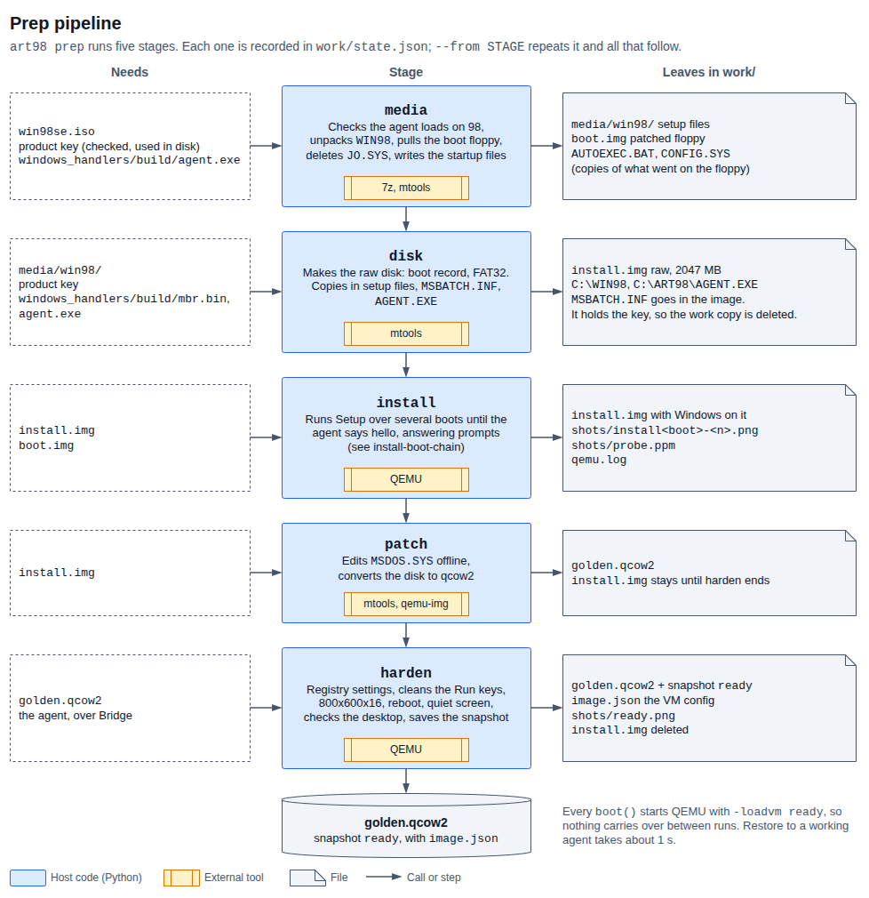
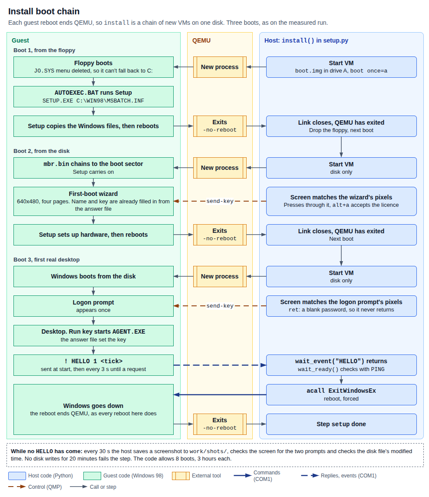

# The setup steps

`Setup.STAGES` is `vm`, `setup`, `init_api`, `ready`, in that order, named after the
path from a blank machine to a desktop you can script: a VM to install onto, Windows
Setup, the agent's first call, and the `ready` snapshot. Each step is a module in
`setup/art98_setup/` with a `run` function, and `Setup` in `builder.py`
runs them.

| Step | Module | What it holds |
|------|--------|---------------|
| `vm` | `vm.py` | Boot floppy, Setup files from the disc, blank disk with the MBR, `AGENT.EXE` copied in |
| `setup` | `setup.py` | Unattended Windows Setup through its reboots |
| `init_api` | `init_api.py` | `MSDOS.SYS` options, convert to qcow2, then boot once and wait for the agent |
| `ready` | `ready.py` | Registry settings, display mode, clean desktop check, the `ready` snapshot |



The command is `art98 setup`.

## How steps are tracked

`Setup.run` reads `work/state.json`, a JSON list of finished steps, and skips what
is in it. A step is added only after it returns, so a failed step is not marked
done. Running `art98 setup` again resumes at that step from its start. A step has no
checkpoints of its own.

`--from STEP` cuts the list down to the steps before `STEP`, writes that to
`state.json`, and then runs as usual. The file is rewritten before any work
starts, so if the redo fails, the later steps stay forgotten. `STEP` must be one of the four step names.

The list is cut by position, so `--from` never skips a step that has not run. On
a `state.json` holding `["vm"]`, `--from ready` runs `setup` next.

### What `--from` needs

The `ready` step deletes `work/install.img` when it finishes. Two steps read that
file, so what you can redo depends on how far setup got.

| `--from` | Needs | Before `ready` has finished | After `ready` has finished |
|----------|-------|-----------------------------|----------------------------|
| `vm` (or `media`, `disk`) | `--iso`, a key | New disk, then a new install | New disk, then a new install. Use this one to rebuild |
| `setup` (or `install`) | `work/install.img`, `work/boot.img` | Runs Setup again over whatever is on the disk, see the warning under [setup](#setup) | **Fails.** QEMU can't find `install.img`, which ends in a `QemuError` and an `error:` line |
| `init_api` (or `patch`) | `work/install.img` | Redoes `init_api` and `ready` | **Fails** with `mtype failed: ...` |
| `ready` (or `harden`) | `work/golden.qcow2` | Redoes `ready` | Works, with a catch, see [ready](#ready) |

`disk` used to skip the disc and need only a key. It now means `vm`, which runs both
of its parts, so `--from disk` needs `--iso` too.

A failed `--from setup` or `--from init_api` has already shortened `state.json`.
Run `--from vm` afterwards, not a plain `art98 setup`, because a plain run would
retry the failed step.

## vm

Step 1. Checks the agent, unpacks Setup, makes a boot floppy that starts it, then
builds a blank hard disk and copies in what Setup needs. It was two stages, `media`
and `disk`, and runs them one after the other in `vm.py`.

### media

Checks the agent, unpacks Setup, and makes a boot floppy that starts it.

**Inputs:** `--iso`, a product key, `guest/build/agent.exe`.

**Outputs:**

- `work/media/win98/`: the disc's `WIN98` folder. 103 files, 175 MB on the disc used
- `work/boot.img`: the patched boot floppy
- `work/AUTOEXEC.BAT` and `work/CONFIG.SYS`: scratch copies of what went on the
  floppy. Nothing reads them afterwards

**Inside:**

1. **Checks the agent loads on Windows 98.** `pecheck.check_agent` reads the PE
   headers of `agent.exe`. The subsystem version must be at most
   `MAX_SUBSYSTEM_VERSION`, 4.10, and every import must be in `ALLOWED_IMPORTS`, a
   list of functions confirmed present on Windows 98. A modern toolchain can
   quietly build a file that fails on 98 with a vague error, and this catches that
   on the host instead of 40 minutes later.
2. **Unpacks `WIN98`.** `extract_setup_files` runs `7z x -y -ssc-`, where `-ssc-`
   makes the folder match case insensitive. The folder must contain `SETUP.EXE` and
   `PRECOPY1.CAB`. An existing `work/media` is deleted first.
3. **Pulls the boot floppy out of the disc.** `boot_floppy_image` follows El Torito
   by hand: the boot record is at sector 17, it points to the catalog, and the
   catalog's default entry at offset 32 gives the load sector. The entry must be
   bootable (`0x88`) and use a floppy media type. The sizes are in
   `EL_TORITO_FLOPPY_SIZES`: 1.2, 1.44 or 2.88 MB.
4. **Points the floppy at Setup.** `patch_floppy` requires `HIMEM.SYS`, deletes
   `JO.SYS` if present, and overwrites two files.

   `CONFIG.SYS` from `render_config_sys`:

   ```
   DEVICE=A:\HIMEM.SYS
   DOS=HIGH
   FILES=40
   BUFFERS=30
   ```

   `AUTOEXEC.BAT` from `render_autoexec`:

   ```
   @ECHO OFF
   C:
   CD \WIN98
   SETUP.EXE C:\WIN98\MSBATCH.INF /IS /IE /IM /IQ /IV /NF
   ```

   The floppy loads no CD driver, because Setup runs from a copy on `C:`. The VM has
   no CD drive at all.

   | Switch | Effect |
   |--------|--------|
   | `/IS` | Skip the system check (ScanDisk) |
   | `/IE` | Skip the startup disk screens |
   | `/IM` | Skip the conventional memory check |
   | `/IQ` | Skip the cross-linked file check |
   | `/IV` | Skip the billboard screens |
   | `/NF` | Do not ask to remove the floppy from drive A |

**Finished when:** every check passes and the floppy is written.

**How it fails:**

| Message | Cause |
|---------|-------|
| `the media stage needs --iso` | No `--iso` |
| `the media stage needs --key` | No `--key` and no `ART98_PRODUCT_KEY` |
| `.../agent.exe missing; run make in guest/` | The guest was not built |
| `... needs Windows x.y` | `PEError`: the agent's subsystem version is too new. Shows as a traceback |
| `... imports unreviewed functions from ...` | `PEError`: the agent imports something not in `ALLOWED_IMPORTS`. Shows as a traceback |
| `... is not a bootable disc` | No El Torito boot record |
| `... does not boot from an emulated floppy` | A no-emulation boot image, or an entry that is not bootable |
| `... has no WIN98 folder; is it a Windows 98 disc?` | Wrong disc, or a different layout |
| `... WIN98 folder lacks [...]` | `SETUP.EXE` or `PRECOPY1.CAB` missing |
| `the disc's boot floppy has no HIMEM.SYS` | Unexpected floppy |
| `7z failed: ...` | `7z` could not read the file |

**`--from media`** means `--from vm`, which redoes everything.

### disk

Builds a blank hard disk and copies in what Setup needs.

**Inputs:** a product key, `work/media/win98/`, `guest/build/mbr.bin`,
`guest/build/agent.exe`, `--disk-mb`.

**Outputs:** `work/install.img`, a raw disk with this layout:

| Where | What |
|-------|------|
| Sector 0 | `mbr.bin` plus one partition entry, from `build_mbr` |
| From sector 63 | A FAT32 partition labelled `ART98` |
| `C:\WIN98\` | The Setup files and `MSBATCH.INF` |
| `C:\ART98\AGENT.EXE` | The agent |

**Inside:**

1. **Computes the geometry.** `create_disk` rounds the size down to whole cylinders
   of `HEADS` (16) by `SECTORS_PER_TRACK` (63). The default 2047 MB gives 4158
   cylinders, 4,191,264 sectors and 2,145,927,168 bytes.
2. **Writes the MBR.** `build_mbr` appends one active partition entry of type
   `FAT32_LBA` (`0x0C`) starting at `PARTITION_START` (63), and the `55 AA`
   signature. The boot code must fit in 440 bytes.

   A blank MBR will not boot, and Setup writes only the partition's boot sector, so
   setup has to supply this. `guest/boot_record/mbr.S` moves itself to `0x600`, finds the active
   partition, reads its first sector to `0x7C00` with INT 13h extensions, checks the
   `AA55` signature and jumps to it. If anything fails it prints
   `art98: no bootable partition` and halts.
3. **Formats the partition.** `mformat -F -c 8`: FAT32 with 8 sectors per cluster.
   `_mtools_env` sets `MTOOLS_SKIP_CHECK=1`, because mtools rejects images whose
   geometry is not a textbook floppy or disk.
4. **Copies the files.** `disk_spec` addresses the partition as `path@@32256`,
   where 32256 is `PARTITION_OFFSET`.
5. **Writes the answer file.** `render_msbatch` builds `MSBATCH.INF` with CRLF line
   ends. Its local copy holds your key and is deleted right after the copy. The
   copy inside the disk stays, see
   [the key on the image](image.md#your-product-key-is-on-the-image).

[image.md](image.md#the-answer-file) explains each answer file setting.

**Finished when:** every mtools call succeeds.

**How it fails:**

- `the disk stage needs --key`
- `mformat failed: ...` or `mcopy failed: ...`, for example if the host disk is
  full. If it fails on the `MSBATCH.INF` copy, `work/MSBATCH.INF` is left behind
  with your key in it. Delete it.
- `boot code is N bytes, over the 440 byte limit`
- A `FileNotFoundError` traceback if `guest/build/mbr.bin` is missing. `media`
  checks only `agent.exe`.
- A `FileNotFoundError` or `StopIteration` traceback if `work/media` is missing or
  has no `WIN98` folder.

**`--from disk`** now means `--from vm`: it runs `media` again, then makes a new
`install.img`, replacing any old one, then runs `setup`, `init_api` and `ready`. It
needs `--iso` and a key. Before the regroup `disk` could be redone alone, without
`--iso`.

## setup

Step 2. This was the `install` stage, in `setup.py`.

Runs Windows 98 Setup to the end, across several boots.

**Inputs:** `work/install.img`, `work/boot.img`.

**Outputs:** `work/install.img` with Windows installed and the machine shut down
cleanly. Screenshots in `work/shots/`. QEMU's output in `work/qemu.log`.

**Inside:** every guest reboot ends QEMU, because the VM runs with `-no-reboot`, so
the step is a loop of new VMs on one disk.
[Why](image.md#hardware) is covered with the hardware. The first boot uses the
floppy, through `boot_once="a"`. Later ones use the disk.



Both full runs logged took three boots:

| Boot | What runs | Screenshots | About |
|------|-----------|-------------|-------|
| 1 | Floppy, then Setup checks the machine and copies files | `install1-*` | 10 min |
| 2 | Disk. First-boot wizard, hardware detection, Control Panel and Start menu setup | `install2-*` | 25 min |
| 3 | Disk. Logon prompt, last settings, first desktop, agent starts | `install3-*` | 3 min |

`SETUP_BOOTS`, 8, caps the loop. The comment on it says Setup restarts the machine
a few times on its own.

During each boot, `_wait_for_agent` loops until one of three things happens: the
agent says `HELLO`, the guest reboots, or a limit is hit. Every `SHOT_INTERVAL`, 30
seconds, it:

1. Saves `shots/install<boot>-<count>.png`.
2. Takes `shots/probe.ppm` and calls `_answer_setup_prompts`, which checks two
   screens by exact pixel colours:
   - `setup_wizard_showing`: the OEM first-boot wizard. `_answer_setup_wizard` sends
     the keys in `WIZARD_PAGES`. On each page it waits for the heading area
     `WIZARD_HEADING` to change, up to `WIZARD_PAGE_TIMEOUT`, 2 minutes.
   - `logon_prompt_showing`: the logon dialog. Setup presses Enter, which sets a
     blank password.
3. Checks whether the disk file has been written, see
   [the stall rule](troubleshooting.md#the-stall-rule).

The guest reboot shows up as the link to the guest closing. Setup then starts the
next VM, and `Setup restarted the machine (boot N)` appears in the log.

The agent starts by itself on the first real desktop. The answer file adds it to
the `Run` key in `HKLM`, and it sends `HELLO` every 3 seconds until the host
speaks.

**Finished when:** `HELLO` arrives, `bridge.wait_ready()` gets a `PING` reply with
the right protocol version, and Windows shuts down. `_reboot` calls
`ExitWindowsEx(EWX_REBOOT | EWX_FORCE)` with `acall`, because that call never
replies, and then waits up to `SHUTDOWN_TIMEOUT`, 5 minutes, for QEMU to exit.

**How it fails:**

| Message | Limit | Cause |
|---------|-------|-------|
| `no disk writes for 20 minutes during installN; see ...` | `STALL_LIMIT` | Setup is waiting on a dialog, or the guest has hung |
| `installN did not finish; last screen: ...` | `INSTALL_TIMEOUT`, 3 hours, per boot | Setup kept writing but never finished |
| `Windows did not come up after 8 boots` | `SETUP_BOOTS` | Reboot loop |
| `the first-boot wizard did not advance; see .../wizard.png` | `WIZARD_PAGE_TIMEOUT` | A key had no effect, or the disc's wizard has different pages |
| `Windows did not shut down; see .../shutdown.png` | `SHUTDOWN_TIMEOUT` | Windows hung while closing |

**Warning: `setup` does not reset the disk.** It always starts by booting the
floppy, which runs Setup again. If you rerun after a failure, plain or with
`--from setup`, Setup runs over the partly installed disk it left behind. The
answer file sets `NoDirWarn=1`, so it will not stop to warn you. Nothing in the code
or tests covers this case. Use `--from vm` to start from a clean disk.

**`--from setup`** is only useful straight after `vm`. See
[what `--from` needs](#what---from-needs).

## init_api

Step 3. Gets the installed system ready to be called, and proves the agent answers.
It was the `patch` stage, followed by a boot that did not exist before: the first
call to the agent now happens here instead of at the start of `ready`. The module
is `init_api.py`.

### patch

Edits one file offline and converts the disk.

**Inputs:** `work/install.img`, shut down.

**Outputs:** `work/golden.qcow2`. `install.img` stays until `ready` finishes.

**Inside:**

1. Reads `C:\MSDOS.SYS` with `mtype`, decoded as cp437.
2. `patch_msdos_sys` applies `MSDOS_SYS_OPTIONS` to the `[Options]` section. A value
   already there is replaced in place, and a missing one is added at the end of the
   section. Everything else is kept, including the padding lines that keep the file
   over 1024 bytes.
3. Clears the read-only, hidden and system attributes, writes the file back, and
   restores them.
4. Runs `qemu-img convert -f raw -O qcow2`. Snapshots need qcow2, because raw has
   nowhere to hold them.

[image.md](image.md#msdossys) explains each option.

**Finished when:** `qemu-img` exits cleanly.

**How it fails:** `mtype failed: ...` if `install.img` is missing or was not
installed. `qemu-img failed: ...` if the host disk is full.


### boot and ping

Boots `golden.qcow2` once, as `ready` will, and checks the agent comes up on its own.

**Inputs:** `work/golden.qcow2`, from the patch part.

**Outputs:** `golden.qcow2` with Windows shut down cleanly. Shots are `init_api-*`.

**Inside:** `_require_agent` waits for `HELLO` from `AGENT.EXE`, up to 15 minutes,
still answering prompts, then `bridge.wait_ready()` gets a `PING` reply with the
right protocol version. `_reboot` then shuts Windows down with `ExitWindowsEx`.

**Finished when:** the agent has answered and QEMU has exited.

**How it fails:** as in `ready`, `init_api did not finish; last screen: ...`, or `the guest
rebooted during init_api before the agent started`, or `Windows did not shut down`.
This is the first boot of the converted disk, so a bad `MSDOS.SYS` shows up here and
not after the hardening.

**`--from init_api`** works only while `install.img` exists, so only if `ready` has not
finished. It overwrites `golden.qcow2`.

## ready

Step 4. This was the `harden` stage, in `ready.py`. The registry settings that make the
desktop quiet and deterministic live here, so this is where any future blank-start
settings go.

Applies the settings, proves the desktop is clean, and saves the snapshot.

**Inputs:** `work/golden.qcow2`.

**Outputs:** `golden.qcow2` with the snapshot `ready`, `work/image.json`,
`work/shots/ready.png`. `work/install.img` is deleted.

**Inside**, across two VMs:

First VM:

1. `_require_agent` waits for `HELLO`, up to 15 minutes, still answering prompts.
   Shots are `harden-*`.
2. `apply_settings` writes every entry in `HARDEN_SETTINGS` over the bridge, then
   empties the `RUN_KEYS` except for the names in `KEPT_RUN_VALUES`.
3. `bridge.set_display_mode(*DISPLAY_MODE)` sets 800x600x16 and saves it to the
   registry. It uses a mode the video driver itself reports.
4. `_reboot` shuts Windows down, so the settings apply on the next boot.

Second VM:

5. `_require_agent` again. Shots are `reboot-*`.
6. `wait_for_quiet_screen` waits until `shots/ready.png` has not changed for
   `SETTLE_SECONDS`, 30 seconds, so startup has finished. It compares a hash of
   the screenshot.
7. `verify_desktop` refuses anything but a clean desktop.
8. `vm.pause()`, then `savevm ready`, then a last screenshot.
9. Writes `image.json` from the `VMConfig` in use, and deletes `install.img`.

**Finished when:** `verify_desktop` passes, the snapshot is saved and `image.json`
exists.

**How it fails:**

| Message | Cause |
|---------|-------|
| `harden did not finish; last screen: ...`, `reboot did not finish; ...` | No agent within 15 minutes. The 20 minute stall rule can't fire here, because this limit comes first |
| `the guest rebooted during ... before the agent started` | Windows restarted before the agent came up |
| `unexpected windows on the desktop: [...]` | A window other than `Program Manager` is visible and has a title. Setup will not snapshot it. See `shots/ready.png` |
| `the taskbar is missing` | No `Shell_TrayWnd` window |
| `Windows did not shut down; see ...` | As in `setup` |
| `cannot open ...` or `cannot set ...` | `BridgeError` from a registry call. Shows as an `error:` line |
| `guest has no 800x600x16 display mode` | `BridgeError`: the driver lists no such mode. Shows as an `error:` line |
| `guest speaks protocol N, host M` | `BridgeError`: `agent.exe` and the Python code are from different versions. Shows as an `error:` line |

**`_wait_for_quiet_screen` has no time limit.** If something on screen keeps moving,
such as a blinking caret, `ready` waits forever. A taskbar clock is not a problem,
since it changes once a minute. Run with `--watch` to see what is moving.

**`--from ready`** cold-boots whatever is on `golden.qcow2` now, and `savevm`
replaces the old `ready`. The catch: `boot_local("work")` writes to that
file. It restores the snapshot at the start of each run, but what the last run
left on disk stays there until the next restore, and a cold boot skips the restore. So
`--from ready` can bake those leftovers into the new snapshot. `art98 ping` and
`art98 render` are not a problem, because the VM service runs on a copy. `--from ready` is safe right after a failed
`ready`. For a clean result on an image you have used directly, use `--from vm`.
